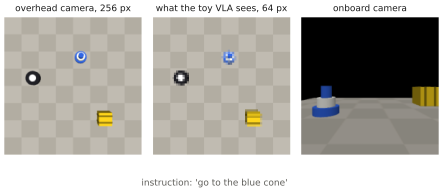

# Appendix A — A Practical Guide to MuJoCo

MuJoCo (*Multi-Joint dynamics with Contact*) is the physics simulator used throughout robot learning: in benchmarks (LIBERO, the DeepMind Control Suite, MuJoCo Menagerie robot models), for collecting demonstrations, for RL fine-tuning, and in this course's Lab 12. This appendix is a working guide. It covers the model format, the simulation loop, actuators and contacts, cameras and rendering, control timing, and the pitfalls that make simulated policies fail on real robots. Every snippet runs with the course environment (`mujoco` is installed by `uv sync`).

## What is it?

!!! definition "MuJoCo in one paragraph"
    MuJoCo simulates articulated rigid bodies with joints, actuators, tendons and contacts, using generalised coordinates and a convex, soft contact model solved at every step. A model is written in **MJCF** (an XML format), compiled into an immutable **`mjModel`** (geometry, masses, joint limits, actuator gains, solver options), and simulated by advancing a mutable **`mjData`** (positions, velocities, controls, contacts, sensor readings) with `mj_step`. Rendering is offscreen OpenGL (EGL or OSMesa on headless machines).

| Object | Holds | Changes during simulation? |
|---|---|---|
| `mjModel` (`m`) | everything that is *defined*: bodies, joints, geoms, actuators, sensors, cameras, `m.opt.timestep` | no (but you may edit numeric fields, e.g. for domain randomisation) |
| `mjData` (`d`) | everything that is *simulated*: `d.qpos`, `d.qvel`, `d.ctrl`, `d.time`, `d.contact`, `d.sensordata`, body poses `d.xpos`, `d.xquat` | yes, every step |

## Why does it exist (for this course)?

Real robot data is the scarcest resource in VLA research ([Chapter 9](../chapters/09-training/index.md)). A simulator gives unlimited, resettable, labelled episodes and exact rewards. That makes it the natural place to collect demonstrations with scripted experts, to run DAgger and RL ([Chapter 7](../chapters/07-decision-making/index.md)), and to evaluate policies in closed loop before touching hardware. MuJoCo is fast (thousands of steps per second per core), accurate enough for manipulation and locomotion research, open-source, and has a clean Python API.

## How does it work?

### 1. The model: MJCF essentials

```xml
<mujoco model="depot">
  <option timestep="0.005" integrator="implicitfast"/>   <!-- physics step and integrator -->
  <worldbody>
    <light pos="0 0 6" dir="0 0 -1" directional="true"/>
    <geom name="floor" type="plane" size="2 2 .1"/>
    <camera name="top" pos="0 0 4.83" xyaxes="1 0 0 0 1 0" fovy="45"/>
    <body name="crate" pos="1 0 .18">
      <freejoint/>                                         <!-- 6-DoF: it can be pushed -->
      <geom type="box" size=".18 .18 .18" mass="5" rgba=".2 .4 .9 1"/>
    </body>
    <body name="robot" pos="0 0 .08">
      <joint name="x" type="slide" axis="1 0 0" damping="2"/>
      <joint name="y" type="slide" axis="0 1 0" damping="2"/>
      <geom type="cylinder" size=".2 .08" mass="6"/>
      <camera name="onboard" pos="0 0 .3" xyaxes="0 -1 0 0 0 1" fovy="70"/>
    </body>
  </worldbody>
  <actuator>
    <velocity name="vx" joint="x" kv="60" ctrlrange="-1.6 1.6"/>
    <velocity name="vy" joint="y" kv="60" ctrlrange="-1.6 1.6"/>
  </actuator>
</mujoco>
```

| Element | Meaning |
|---|---|
| `<body>` | a rigid body in a kinematic tree; its `pos`/`quat` are relative to the parent |
| `<joint>` | a degree of freedom connecting a body to its parent: `hinge`, `slide`, `ball`, or `<freejoint/>` (6-DoF, for floating objects) |
| `<geom>` | collision and visual geometry (`plane`, `box`, `sphere`, `capsule`, `cylinder`, `ellipsoid`, `mesh`); mass is inferred from size and density unless `mass` is given |
| `<site>` | a massless marker (end-effector point, sensor location) |
| `<camera>` | a camera; `xyaxes` gives the image x and y axes in the parent frame (the camera looks along $-z$) |
| `<actuator>` | how `d.ctrl` becomes forces: `motor` (torque = gear·ctrl), `position` (PD to a target), `velocity` (damping to a target velocity), `general` |
| `<sensor>` | readings in `d.sensordata`: joint positions, IMU-like `accelerometer`/`gyro`, force/torque, touch |
| `<option>` | timestep, integrator (`Euler`, `implicitfast`, `RK4`), gravity, solver settings |

Robot models need not be written by hand. **MuJoCo Menagerie** provides curated MJCF models of common arms (Franka, UR5e, xArm), hands, quadrupeds, humanoids and drones (Crazyflie, Skydio X2).

### 2. The simulation loop

```python
import os
os.environ.setdefault("MUJOCO_GL", "egl")      # headless GPU rendering; "osmesa" for CPU-only
import mujoco

m = mujoco.MjModel.from_xml_string(xml)          # or from_xml_path("robot.xml")
d = mujoco.MjData(m)
mujoco.mj_forward(m, d)                          # compute derived quantities (poses, contacts) without stepping

for _ in range(1000):
    d.ctrl[:] = [0.5, 0.0]                       # set actuator commands (units of each actuator's ctrl)
    mujoco.mj_step(m, d)                         # advance by m.opt.timestep
print(d.time, d.qpos, d.body("robot").xpos)      # named access to any element
```

`mj_step` integrates one timestep: it computes forward kinematics, contacts, actuator forces and constraint forces, then integrates the state. `mj_forward` computes everything except the integration — call it after setting `qpos` by hand. Named access (`d.body("robot")`, `d.joint("x").qpos`, `m.actuator("vx").id`) avoids hard-coded indices.

### 3. Actuators and the control rate

A policy rarely runs at the physics rate. The standard pattern is a **frame skip**: hold the control for $n$ physics steps.

$$
\Delta t_\text{control}=n\cdot\Delta t_\text{physics},\qquad\text{e.g. }0.1\text{ s}=20\times0.005\text{ s}.
$$

The actuator type decides what the policy's output *means*. A `velocity` actuator applies force $-k_v(\dot q-u)$, so the joint *tracks* the commanded velocity $u$ with a time constant set by $k_v$ and the mass — a first-order lag that a kinematic simulation ignores. A `position` actuator is a PD loop to a target ($k_p$, plus `dampratio` or joint damping). A `motor` applies raw torque. Choosing position or velocity actuators with sensible gains is MuJoCo's version of putting a stable controller under the policy ([7.3](../chapters/07-decision-making/covariate-shift.md#how-does-it-work-mitigations), [8.3](../chapters/08-vla/action-spaces.md)).

### 4. Contacts

MuJoCo contacts are **soft**: penetration produces a constraint force whose stiffness and damping are set by `solref` (time constant and damping ratio, default `0.02 1`) and `solimp`; friction by `friction` (sliding, torsional, rolling; default `1 0.005 0.0001`). Which geoms collide is decided by bitmasks: two geoms can collide if `contype` of one and `conaffinity` of the other share a bit. Practical rules:

- the timestep must resolve the contact time constant (keep `timestep` ≤ `solref[0]/2`); stiff contacts with a large timestep explode;
- use primitive geoms (boxes, capsules) for collision and meshes for visuals where possible;
- inspect `d.ncon` and `d.contact[i]` (positions, normals, geom ids) when grasps behave oddly;
- in the course's depot, objects have `contype="0" conaffinity="0"`: the task is to *reach* them, so the robot drives over their footprints instead of pushing them.

### 5. Cameras, rendering and intrinsics

```python
r = mujoco.Renderer(m, height=64, width=64)
r.update_scene(d, camera="top")        # or "onboard", or a free mujoco.MjvCamera
rgb = r.render()                        # (64, 64, 3) uint8
r.enable_depth_rendering(); depth = r.render(); r.disable_depth_rendering()   # metres
r.close()                               # free the GL context explicitly
```

A MuJoCo camera with vertical field of view `fovy` (degrees) and an image of height $H$ has focal length, in pixels,

$$
f=\frac{H/2}{\tan(\text{fovy}/2)},\qquad K=\begin{pmatrix}f&0&W/2\\0&f&H/2\\0&0&1\end{pmatrix},
$$

which lets you deproject a pixel and its depth into a 3-D point, the bridge from grounding ([4.4](../chapters/04-alignment/grounding.md)) to manipulation. The depot's top camera sits at height $h=2/\tan(22.5^\circ)=4.83$ m so that the 4 m floor exactly fills the image.

<figure markdown="span">
  
  <figcaption markdown="span">The course's depot in MuJoCo (`vlacourse.mujoco_depot`). Left: the overhead camera used as the policy's observation, at 256 px and at the 64 px the toy VLA sees. Right: the robot's onboard camera. The scene, instruction and expert are identical to the 2-D `DepotNav`, but the robot has mass, the velocity actuators lag behind the commands, and the images are rendered with perspective and lighting.</figcaption>
</figure>

### 6. Randomisation and reproducibility

**Domain randomisation** varies what the policy should be robust to: light directions and intensities (`m.light_*`), colours (`m.geom_rgba`), camera poses (`m.cam_pos`), masses (`m.body_mass`), friction (`m.geom_friction`), actuator gains. Edit these numeric fields in `mjModel` between episodes; no recompilation is needed. Structural changes (adding bodies) require building a new model.

MuJoCo is deterministic for a given model, initial state and control sequence on the same machine and build. Keep the seed of every random choice (scene, start, noise) with the logged episode, and log the MuJoCo version: contact solver changes between releases can change trajectories.

### 7. Speed

For one environment, the cost is usually rendering, not physics. Render at the policy's resolution, reuse the `Renderer`, and render only on control steps. For massive parallelism, **MJX** (MuJoCo in JAX) runs thousands of environments on a GPU, without rendering. That suits RL with state observations, and MuJoCo Playground builds on it.

## Implementation: the course's MuJoCo depot

`vlacourse.mujoco_depot.MujocoDepotNav` subclasses the 2-D `DepotNav`, so `collect` and the toy VLA of Lab 11 work unchanged:

```python
from vlacourse.mujoco_depot import MujocoDepotNav
from vlacourse.depot_env import collect

env = MujocoDepotNav(res=64)
obs = env.reset(seed=10)            # same scene and instruction as DepotNav(seed=10)
obs, done, success = env.step(env.expert_action())   # 10 Hz control, 20 physics steps of 5 ms
demos = collect(2000, seed=1, env=MujocoDepotNav(), tasks_per_scene=3)
```

| | 2-D `DepotNav` | `MujocoDepotNav` |
|---|---|---|
| dynamics | kinematic: $p\leftarrow p+v\,a$ | 6 kg body, joint damping, velocity actuators ($k_v=60$): commands are tracked with lag |
| observation | flat top-down drawing | perspective rendering with lighting; objects have height |
| time per step | ≈ 1.5 ms | ≈ 9 ms (20 physics steps + rendering) |

!!! lab "Lab 12 — The depot in MuJoCo"
    Build and inspect the MJCF, step the physics, render both cameras, deproject a pixel with the intrinsics, collect demonstrations, train the toy VLA on them, and measure the *sim-to-sim gap*. A policy trained in the 2-D world is evaluated in MuJoCo, and the other way round.

## Pitfalls

| Symptom | Likely cause |
|---|---|
| `mujoco.FatalError: gladLoadGL error` or a black image | no display and no `MUJOCO_GL=egl`/`osmesa` set before `import mujoco` |
| objects jitter or fly apart | timestep too large for contact stiffness; interpenetrating initial poses |
| robot ignores commands | `ctrlrange` clipping, wrong actuator type, gains too low for the mass |
| image upside down or mirrored | camera `xyaxes` convention: the camera looks along its local $-z$ |
| policy works in sim, fails on the robot | unmodelled latency, actuator dynamics, lighting, camera pose — randomise them, and see [Chapter 15](../chapters/15-research/index.md) on sim-to-real |
| non-reproducible runs | unseeded randomness, multithreaded rendering order, different MuJoCo versions |
