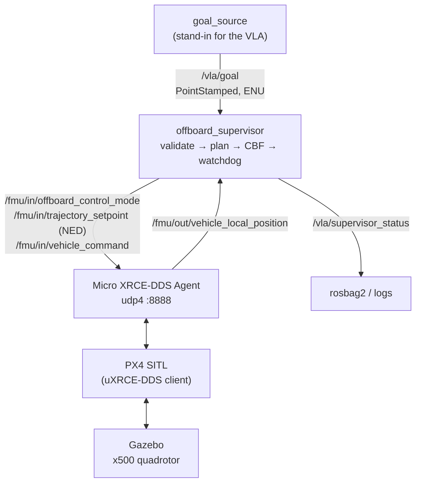

# Appendix B — ROS 2 and PX4 SITL

This appendix sets up the software-in-the-loop stack of [Chapter 13](../chapters/13-uavs/index.md): PX4 running in simulation with Gazebo, the uXRCE-DDS bridge to ROS 2, and the course's ROS 2 package `vla_px4_bridge`, which places a safety supervisor between goal proposals (from a VLA, or a scripted stand-in) and PX4's offboard mode. It then runs the failure-injection scenarios of [13.6](../chapters/13-uavs/testing.md).

!!! warning "Status of this code"
    ROS 2 and PX4 are not part of the course's Python environment and were not installed on the machine that built this book. The package in `ros2/vla_px4_bridge/` has been syntax-checked and its safety logic is the tested `vlacourse.safety`, but the ROS 2/PX4 integration has **not** been executed by the author. Treat it as a reference implementation to debug in SITL, never as flight-ready code. Versions of PX4, `px4_msgs` and ROS 2 change; the [PX4 ROS 2 user guide](https://docs.px4.io/main/en/ros2/user_guide.html) is the authority.

## What you will build



## 1. Platform

PX4's development environment targets **Ubuntu 24.04 with ROS 2 Jazzy** (or Ubuntu 22.04 with ROS 2 Humble). On a newer host (this course was developed on Ubuntu 26.04), run the stack in an Ubuntu 24.04 container that shares your display and network, for example with [distrobox](https://distrobox.it/):

```bash
distrobox create --name px4 --image ubuntu:24.04
distrobox enter px4            # every following step runs inside this shell
```

A virtual machine or a dual boot works too. A GPU is not required for SITL.

## 2. ROS 2 Jazzy

Follow the [official installation for Ubuntu (deb packages)](https://docs.ros.org/en/jazzy/Installation/Ubuntu-Install-Debs.html). In short, after enabling the ROS 2 apt repository as described there:

```bash
sudo apt update && sudo apt install -y ros-jazzy-desktop ros-dev-tools
source /opt/ros/jazzy/setup.bash
```

## 3. PX4 and Gazebo

```bash
cd ~
git clone https://github.com/PX4/PX4-Autopilot.git --recursive
bash ./PX4-Autopilot/Tools/setup/ubuntu.sh      # toolchain and Gazebo; log out and in afterwards
cd PX4-Autopilot
make px4_sitl gz_x500                            # builds PX4 and starts a quadrotor in Gazebo
```

The last command opens Gazebo and a PX4 shell (`pxh>`). Check that the vehicle takes off and lands from the shell (`commander takeoff`, `commander land`) before going further. For a release instead of `main`, check out its tag (e.g. `git checkout v1.16.0 && git submodule update --init --recursive`) and use the matching `px4_msgs` branch below.

## 4. ROS 2 workspace: px4_msgs, the Agent and vla_px4_bridge

```bash
mkdir -p ~/ros2_px4_ws/src && cd ~/ros2_px4_ws/src
git clone https://github.com/PX4/px4_msgs.git                    # main = PX4 main; use the branch of your PX4 release
git clone -b v2.4.3 https://github.com/eProsima/Micro-XRCE-DDS-Agent.git
ln -s /path/to/this/course/ros2/vla_px4_bridge .                   # the course package
cd ~/ros2_px4_ws
source /opt/ros/jazzy/setup.bash
colcon build
source install/local_setup.bash
```

From PX4 v1.16, messages are versioned. If your `px4_msgs` and PX4 build differ in message versions, PX4's documentation describes a message translation node that must run alongside. Topic names may then carry version suffixes; check with `ros2 topic list` and set the supervisor's `local_position_topic` parameter accordingly.

## 5. Configure PX4's own protections

In the `pxh>` shell (or QGroundControl), set the flight controller's independent layers ([13.5](../chapters/13-uavs/safety.md)). Values are examples:

```text
param set COM_OF_LOSS_T 1.0      # offboard stream lost for 1 s -> failsafe
param set GF_MAX_HOR_DIST 60     # PX4 geofence: 60 m horizontal from home
param set GF_MAX_VER_DIST 25     # and 25 m vertical
param set GF_ACTION 2            # action on breach (see the PX4 parameter reference for the codes)
```

Look up each parameter and its allowed values in the [parameter reference](https://docs.px4.io/main/en/advanced_config/parameter_reference.html) for your PX4 version; codes and defaults change between releases.

## 6. Run

Four terminals, each inside the container with ROS 2 and the workspace sourced:

```bash
# 1: the bridge between PX4 and ROS 2
MicroXRCEAgent udp4 -p 8888

# 2: PX4 SITL + Gazebo
cd ~/PX4-Autopilot && make px4_sitl gz_x500

# 3: the safety supervisor (takes off to 5 m and holds until goals arrive)
ros2 run vla_px4_bridge offboard_supervisor

# 4: goals (the VLA stand-in)
ros2 run vla_px4_bridge goal_source --ros-args -p scenario:=nominal
```

Record everything for later analysis ([11.5](../chapters/11-deployment/monitoring.md)):

```bash
ros2 bag record -s mcap /vla/goal /vla/supervisor_status /fmu/in/trajectory_setpoint /fmu/out/vehicle_local_position
```

The supervisor's parameters (fence, no-fly zones as a flat `[x, y, radius, ...]` list, speed and acceleration limits, CBF margin and rate, goal timeout) are ROS 2 parameters: `ros2 param list /offboard_supervisor`.

## 7. Failure-injection scenarios

Each scenario of `goal_source` exercises one protection layer. Write down the expected outcome before running it, then compare with the log.

| Scenario | What it does | Layer that should act | Expected behaviour |
|---|---|---|---|
| `nominal` | four goals away from the no-fly zone | — | flies to each goal in turn, then holds |
| `no_fly_goal` | second goal inside the zone at (10, 0) | goal validation | goal rejected (status message), vehicle holds after the timeout |
| `outside_fence` | second goal 60 m away | goal validation | goal rejected |
| `silence` | one goal, then no more proposals | companion watchdog | holds position 3 s after the last proposal |
| `through_zone` | straight path crosses the zone | CBF filter | slides around the zone boundary; status reports the filter active |
| kill the supervisor (Ctrl-C in terminal 3) | offboard stream stops | PX4 offboard-loss failsafe | PX4 leaves offboard mode after `COM_OF_LOSS_T` and executes its configured action |

## 8. From the stand-in to a VLA

Replace `goal_source` with a node that:

1. subscribes to the simulated camera (bridged from Gazebo with `ros_gz_bridge`; install `ros-jazzy-ros-gzharmonic`);
2. runs a VLM or goal-level VLA on the image and an instruction ("go to the red container") at its own rate, with stage timing ([11.1](../chapters/11-deployment/latency.md));
3. grounds the chosen pixel to a 3-D point using depth or the ground plane and the camera intrinsics ([Appendix A](mujoco.md#5-cameras-rendering-and-intrinsics)), transformed to the local ENU frame with the vehicle's pose;
4. publishes it on `/vla/goal`.

The supervisor does not change: that is the point of the architecture ([13.3](../chapters/13-uavs/architectures.md)).

## Troubleshooting

- **No `/fmu/...` topics**: the Agent is not running, PX4 did not start its uXRCE-DDS client, or ROS 2 cannot discover across the container boundary (check `ROS_DOMAIN_ID` and that the container shares the host network).
- **Subscriber receives nothing**: QoS mismatch; PX4 publishes best-effort ([11.4](../chapters/11-deployment/ros2.md)).
- **Vehicle does not switch to offboard**: the setpoint stream must run before the mode switch; check the arming checks in the PX4 shell (`commander check`).
- **Vehicle flies mirrored or climbs instead of descending**: ENU/NED conversion ([13.2](../chapters/13-uavs/px4-offboard.md)).
