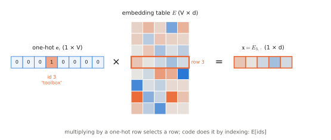
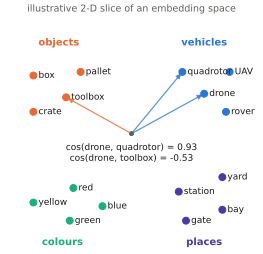

# 0.6 Embeddings

## What is it?

!!! definition "Embedding"
    An **embedding** is a learned map from discrete symbols to vectors in $\mathbb{R}^{d}$. For a vocabulary of size $V$, it is a matrix $E\in\mathbb{R}^{V\times d}$ (the **embedding table**) whose $i$-th row $E_{i,:}$ is the vector of token $i$. Embedding a sequence of ids $(i_1,\dots,i_T)$ gives the matrix $X\in\mathbb{R}^{T\times d}$ with rows $X_{t,:}=E_{i_t,:}$.

More broadly, "embedding" names *any* vector representation produced by a network — an *image embedding*, a *sentence embedding*, a *state embedding*. What unites them is that geometry (distances, angles, directions) in the embedding space carries meaning.

## Why does it exist?

Token ids are labels, not quantities: id 1012 is not "bigger" than id 87, and nothing about the integers says that "drone" and "quadrotor" are related. A network fed raw ids would have to undo an arbitrary numbering. Two naive alternatives both fail:

- **One-hot vectors** $\mathbf{e}_i\in\{0,1\}^{V}$ are honest (all tokens equidistant) but huge ($V\sim10^5$) and carry no similarity.
- **Hand-designed features** do not scale to $10^5$ tokens, let alone to image patches.

An embedding lets the network *learn* a dense, low-dimensional ($d\sim10^2$–$10^4$) representation in which similar symbols are close — because placing them close helps reduce the training loss.

## How does it work?

### An embedding is a linear layer on one-hot vectors

$$
X_{t,:} = \mathbf{e}_{i_t}E, \qquad \mathbf{e}_{i_t}\in\{0,1\}^{1\times V}.
$$

Multiplying a one-hot row vector by $E$ selects row $i_t$. So an embedding layer is mathematically an `nn.Linear(V, d, bias=False)` applied to one-hot inputs, implemented as an *indexing* operation (`E[ids]`) because multiplying by mostly-zero vectors is wasteful. Its gradient follows from the [affine-map rule](training.md#how-does-it-work): $\bar E=\sum_t \mathbf{e}_{i_t}^\top\bar X_{t,:}$, i.e. each occurrence of token $i$ adds its upstream gradient to row $i$; rows of tokens absent from the batch receive zero gradient.

```python
import torch
import torch.nn as nn

V, d = 1000, 64
emb = nn.Embedding(V, d)                    # E: (V, d), initialised N(0, 1)
ids = torch.tensor([[12, 7, 431], [5, 5, 0]])   # (B, T) = (2, 3)
X = emb(ids)                                # (B, T, d) = (2, 3, 64)
assert torch.equal(X[0, 0], emb.weight[12])

onehot = nn.functional.one_hot(ids, V).float()  # (2, 3, 1000)
assert torch.allclose(onehot @ emb.weight, X)   # same thing, 1000x more work
```

<figure markdown="span">
  
  <figcaption markdown="span">An embedding is a linear layer applied to one-hot vectors. Multiplying $\mathbf{e}_3$ by $E$ selects row 3, so implementations simply index the table.</figcaption>
</figure>

### Why geometry becomes meaningful: the distributional hypothesis

> "You shall know a word by the company it keeps." — J. R. Firth, 1957

Embeddings are trained as part of a model whose loss rewards predicting context. Two tokens that appear in similar contexts receive similar gradients and drift toward similar vectors. **word2vec** (Mikolov et al., 2013) made this explicit with a tiny model: the **skip-gram** objective predicts context words $c$ from a centre word $w$,

$$
p(c\mid w)=\operatorname{softmax}\!\big(\mathbf{u}_w C^\top\big)_c=\frac{\exp(\mathbf{u}_w\mathbf{c}_c^\top)}{\sum_{c'=1}^{V}\exp(\mathbf{u}_w\mathbf{c}_{c'}^\top)},
$$

with $U\in\mathbb{R}^{V\times d}$ (centre-word embeddings, row $\mathbf{u}_w$) and $C\in\mathbb{R}^{V\times d}$ (context embeddings, row $\mathbf{c}_c$). Minimising the cross-entropy pushes $\mathbf{u}_w\mathbf{c}_c^\top$ up for observed pairs. The famous consequence is linear structure: $\mathbf{u}_\text{king}-\mathbf{u}_\text{man}+\mathbf{u}_\text{woman}\approx\mathbf{u}_\text{queen}$ — relations become directions.

<figure markdown="span">
  
  <figcaption markdown="span">What a trained embedding space looks like (illustrative 2-D sketch; real spaces have hundreds of dimensions). Words used in similar contexts end up in the same direction, so cosine similarity is high within a group and low across groups.</figcaption>
</figure>

In modern models there is no separate word2vec stage: the embedding table is the first layer of a transformer and is learned jointly with everything else by the next-token loss. The principle is the same.

### Measuring similarity

!!! definition "Cosine similarity"
    $$
    \cos(\mathbf{a},\mathbf{b}) = \frac{\mathbf{a}\mathbf{b}^\top}{\lVert\mathbf{a}\rVert_2\lVert\mathbf{b}\rVert_2}\in[-1,1].
    $$

    It compares directions and ignores norms. It is the standard similarity for embeddings, and the dot product of $\ell_2$-normalised vectors is exactly the cosine — which is how CLIP compares images and text ([Chapter 4](../04-alignment/index.md)).

The dot product without normalisation, $\mathbf{a}\mathbf{b}^\top$, is what [attention](first-look.md#attention-in-one-paragraph) uses; there the norms *do* matter (they act as confidence/temperature).

### Positions need embeddings too

A set of token embeddings carries no order: `"drone follows rover"` and `"rover follows drone"` contain the same three vectors. Sequence models that process tokens in parallel (transformers) must add order information — a **positional embedding** $\mathbf{p}_t\in\mathbb{R}^{d}$ for each position $t$, either learned (a second table of shape `(T_max, d)`) or fixed (sinusoids), or applied as a rotation inside attention (RoPE). This is introduced in [0.8](first-look.md#transformers) and treated rigorously in [2.3](../02-transformers/positions.md).

## Embeddings for everything

The embedding idea generalises to every input of a VLA:

| Input | "Vocabulary" | Embedding |
|---|---|---|
| text token | $V$ subwords | table lookup $E_{i,:}$ |
| image patch | continuous $P\times P\times 3$ pixels | linear projection of the flattened patch ([Chapter 3](../03-vision/index.md)) |
| proprioception | continuous joint vector $\mathbf{q}\in\mathbb{R}^{d_q}$ | linear layer or MLP to $\mathbb{R}^{d}$ |
| discrete action bin | 256 bins per dimension | table lookup (RT-2, OpenVLA) |
| continuous noisy action | $\mathbb{R}^{d_a}$ | linear layer + time embedding (π0) |
| robot identity / embodiment | number of robot types | table lookup (Octo, multi-embodiment models) |
| diffusion time $\tau$ | continuous scalar | sinusoidal features + MLP ([Chapter 6](../06-generative/index.md)) |

Once everything is a sequence of $d$-dimensional vectors, a single transformer can process them all. The last two rows also show a pattern that becomes important for multi-robot systems ([Chapter 14](../14-multi-robot/index.md)): **conditioning information** (which robot, which task, which timestep) can be injected simply by embedding it and adding or appending it to the token sequence.

## Limitations

- **Static per token.** An input embedding table gives "bank" one vector regardless of context; context-dependent meaning is computed by later layers (that is what attention is for).
- **Rare tokens** receive few gradient updates and have poor embeddings.
- **Anisotropy.** Learned embedding spaces are often far from isotropic (vectors crowd in a narrow cone), which distorts cosine similarities.
- **Size.** $V\times d$ parameters: for $V=128{,}000$, $d=4096$ that is $5.2\times10^8$ parameters — a non-trivial fraction of a small model, and often shared with the output layer (*weight tying*, [2.5](../02-transformers/training.md)).

## Why it matters for VLAs and robots

The first operation in every VLA is to embed each input modality into the shared width $d$ of its transformer, and the last is to map vectors back to an action. Whether "red toolbox" in text and the red toolbox in the image end up near each other in that space ([alignment](../04-alignment/index.md)) decides whether the policy can follow the instruction.

!!! lab "Lab 02 — Embeddings and positions"
    Verify the one-hot equivalence, train a skip-gram model on the depot instruction corpus and find the nearest neighbours of "drone", "red" and "toolbox", visualise the space with PCA, and implement sinusoidal and rotary position encodings.
