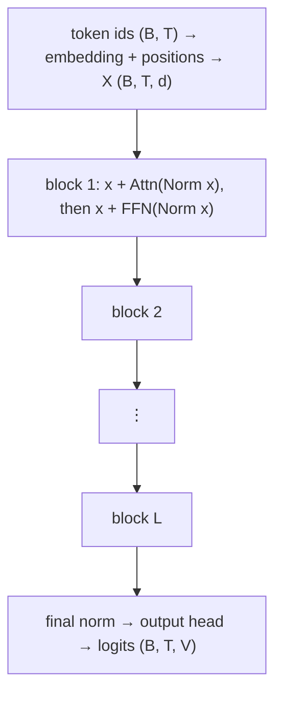
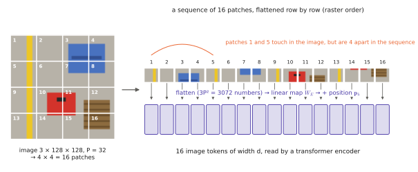
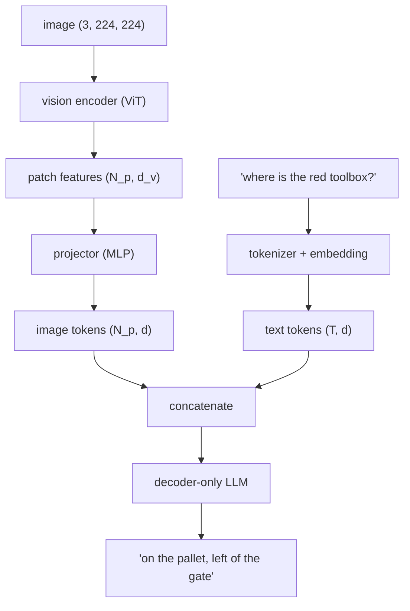
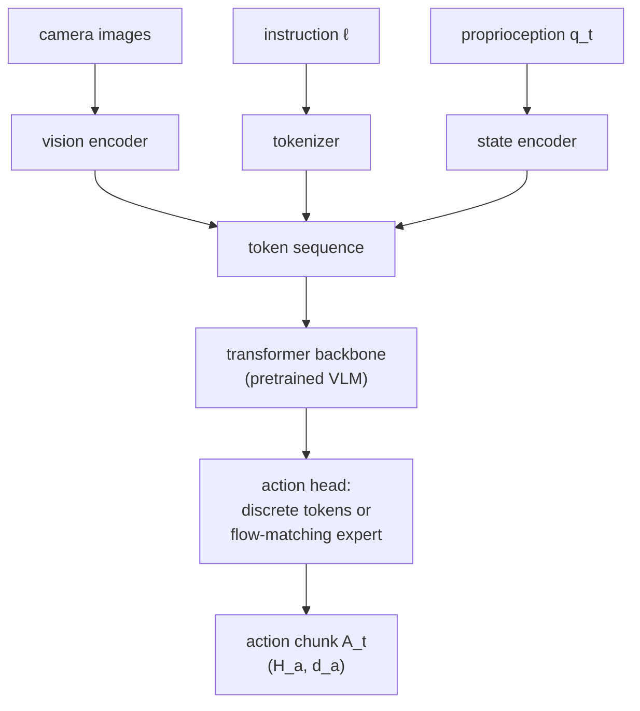

# 0.8 A First Look: Attention, Transformers, LLMs, Vision and Multimodal Models

This section is a map, not the territory. It sketches the five ideas that the rest of Parts I–II develop in depth, so that you know where each piece fits before taking it apart. Every paragraph links to its deep-dive.

## Attention in one paragraph

Given $T$ token vectors stacked as rows of $X\in\mathbb{R}^{T\times d}$, **self-attention** lets every token gather information from every other token, with weights computed from the tokens' own content. Each token emits three vectors by linear maps: a **query** $\mathbf{q}_i=\mathbf{x}_iW_Q$ ("what am I looking for?"), a **key** $\mathbf{k}_j=\mathbf{x}_jW_K$ ("what do I contain?") and a **value** $\mathbf{v}_j=\mathbf{x}_jW_V$ ("what do I give if selected?"). Token $i$'s output is the average of all values, weighted by how well its query matches each key:

$$
\mathbf{y}_i=\sum_{j=1}^{T}\alpha_{ij}\,\mathbf{v}_j,\qquad \alpha_{ij}=\operatorname{softmax}_j\!\left(\frac{\mathbf{q}_i\mathbf{k}_j^\top}{\sqrt{d_k}}\right).
$$

It is a **soft, differentiable dictionary lookup**: a hard lookup returns the value whose key equals the query; attention returns a blend of values, weighted by similarity. Everything — what to look for, what to advertise, what to return — is learned. The full derivation, with every dimension, the reason for the $\sqrt{d_k}$, masking, and the implementation, is [2.1](../02-transformers/attention.md).

!!! robot "Attention in the depot"
    In *"find the red toolbox"*, the token "toolbox" can attend to "red" and absorb its colour; in a VLA, an action-predicting token can attend to the image patches that contain the toolbox. Attention is how a VLA decides *which* part of its input matters for the current action.

## Transformers

!!! definition "Transformer (first pass)"
    A **transformer** is a stack of $L$ identical **blocks** acting on a sequence of $T$ token vectors of width $d$. Each block applies (i) multi-head self-attention, which mixes information *across* tokens, and (ii) a position-wise MLP (the **feed-forward network**), which transforms each token *independently*; each sub-layer is wrapped in a residual connection and normalisation. Input: `(B, T, d)`. Output: `(B, T, d)`.

Three facts to carry forward:

1. **Shape-preserving.** Each block maps `(B, T, d)` to `(B, T, d)`, so blocks stack and the sequence can contain any mixture of token types (text, image, action).
2. **Permutation-equivariant without positions.** Attention treats its input as a *set*; order enters only through **positional encodings** ([2.3](../02-transformers/positions.md)).
3. **Masks define the model.** An **encoder** lets every token see every token (good for understanding); a **decoder** uses a **causal mask** so token $t$ sees only tokens $\le t$ (required for [autoregressive](sequence-models.md#the-autoregressive-factorisation) generation). Many VLAs mix both in one sequence: bidirectional attention among image and text tokens, causal or block-wise masks for action tokens ([Chapter 8](../08-vla/index.md)).

The full block — residual stream, LayerNorm/RMSNorm, SwiGLU, multi-head attention — is built in [Chapter 2](../02-transformers/index.md).

## Large language models

!!! definition "Large language model (LLM)"
    An **LLM** is a decoder-only transformer with $10^8$–$10^{12}$ parameters trained by [next-token prediction](sequence-models.md#the-autoregressive-factorisation) on $10^{12}$–$10^{13}$ tokens of text, usually followed by instruction tuning and preference optimisation so that it follows instructions.

The surprising empirical fact behind the field: predicting the next token of internet-scale text, at sufficient scale, forces a model to learn grammar, facts, some arithmetic, code, and a usable — though unreliable — capacity for multi-step reasoning, because all of these help predict text. Loss improves smoothly and predictably with parameters, data and compute (**scaling laws**, [2.7](../02-transformers/scaling.md)).

For robotics the important consequence is **semantic knowledge for free**: an LLM already "knows" that toolboxes have handles, that drones should not fly into people, and that "bring X to Y" implies picking X up first. A VLA is, to a large degree, an attempt to transfer that knowledge into motor behaviour. [Chapter 1](../01-multimodal-intro/language.md) covers how an LLM generates text.

## Vision transformers

!!! definition "Vision Transformer (ViT, first pass)"
    A **ViT** (Dosovitskiy et al., 2021) cuts an image of $H\times W$ pixels into a grid of $N_p=HW/P^2$ non-overlapping $P\times P$ patches, flattens each patch to a vector of $3P^2$ numbers, maps it linearly to width $d$ (a **patch embedding**), adds a positional embedding, and processes the resulting $N_p$ tokens with a standard transformer encoder.

<figure markdown="span">
  
  <figcaption markdown="span">How a ViT turns an image into tokens. The image is cut into $P\times P$ patches, read in raster order. Each patch is flattened, mapped linearly to width $d$, and given a position embedding. Raster order puts vertically adjacent patches far apart in the sequence, which matters for [positions](../02-transformers/positions.md#limitations).</figcaption>
</figure>

A $224\times224$ image with $P=16$ becomes $14\times14=196$ tokens. The image is now "a sentence of patches", and the attention between patches can learn which regions relate. ViTs have weaker built-in assumptions than convolutional networks ([inductive bias](neural-networks.md#universal-approximation-and-what-it-does-not-say)) and therefore need more data, but they scale better and — crucially — speak the same token language as LLMs. The vision encoders inside VLAs (SigLIP, DINOv2) are ViTs; [Chapter 3](../03-vision/index.md) builds them.

## Multimodal models

Once images and text are both token sequences of width $d$, combining them is conceptually simple. Two families dominate:

1. **Dual encoders with a shared embedding space** (CLIP, SigLIP): an image encoder and a text encoder trained so that matching image–caption pairs have high cosine similarity ([embeddings](embeddings.md#measuring-similarity)) and non-matching pairs low. Useful for retrieval, zero-shot recognition, and as pretrained vision encoders. ([Chapter 4](../04-alignment/index.md))
2. **Vision-language models (VLMs)** (Flamingo, LLaVA, PaliGemma): a vision encoder produces image tokens; a small **projector** maps them into the LLM's embedding space; the LLM reads `[image tokens] [text tokens]` as one sequence and generates text. ([Chapter 5](../05-vlms/index.md))

## From here to a VLA

A **Vision-Language-Action model** takes the VLM above and changes what comes out of it: instead of (or in addition to) text, it emits **actions**. The simplest version — RT-2, OpenVLA — keeps the VLM entirely and teaches it to output action *tokens*: each action dimension is discretised into 256 bins, the bins are mapped to token ids, and the model is fine-tuned on robot demonstrations by ordinary next-token prediction. More recent versions (π0, GR00T, SmolVLA) attach a separate **action expert** that produces continuous action chunks with [flow matching](../06-generative/index.md).

Every arrow in this diagram is a chapter of this book. The remainder of Part I goes deeper into the language half ([Chapter 1](../01-multimodal-intro/index.md), [Chapter 2](../02-transformers/index.md)); Part II into the vision half; Part III into the action half.

!!! lab "Preview: Lab 03"
    If you want to see attention working before reading Chapter 2, run the first cells of `labs/03_attention/`: they compute attention weights between the tokens of the running-example instruction with random projections, then with projections trained on a small associative-recall task.
