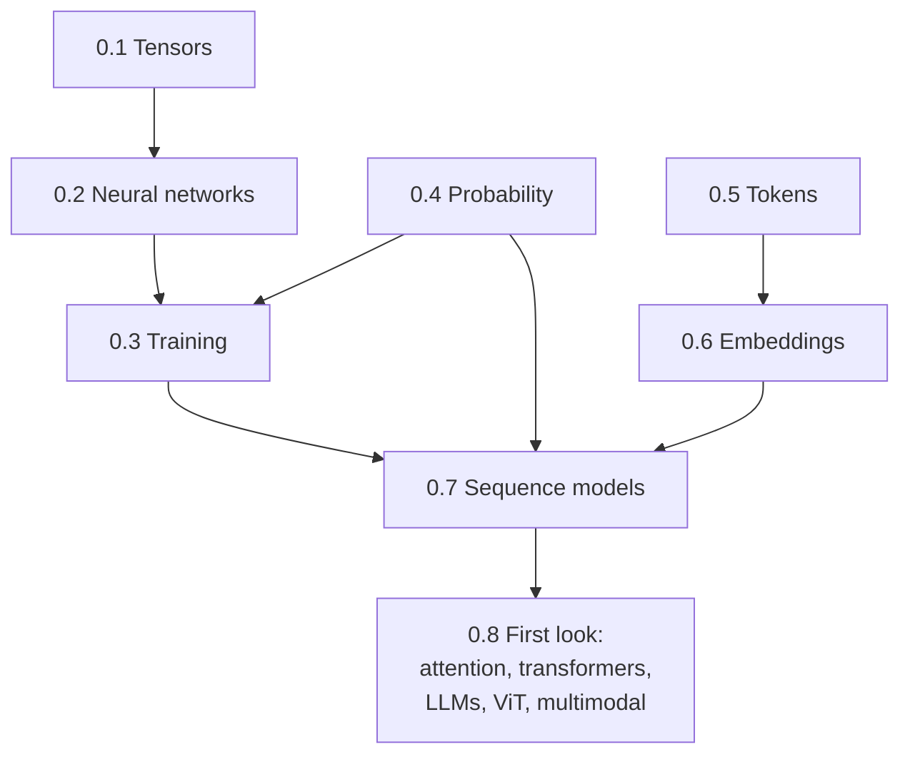

# 0. Foundations

This chapter builds, from nothing, the vocabulary needed for the rest of the book: what a tensor is, what a neural network computes, how it is trained, what probability has to do with it, how text becomes numbers, and — as a first pass — what attention, transformers, language models, vision models and multimodal models are.

It assumes mathematics (linear algebra, calculus, probability, optimisation), programming (Python, PyTorch basics), and robotics/control maturity. It assumes **no** prior knowledge of modern deep learning. Where an idea from your background maps onto a deep-learning idea (e.g. backpropagation is reverse-mode automatic differentiation; a softmax policy is a Boltzmann distribution; a transformer layer is a learned, input-dependent graph filter), the connection is made explicit.

## Learning objectives

After this chapter you should be able to:

1. Manipulate tensors fluently: shapes, broadcasting, batching, memory layout. ([0.1](tensors.md))
2. Write down a multilayer perceptron as a composition of affine maps and non-linearities, and count its parameters. ([0.2](neural-networks.md))
3. Derive backpropagation as reverse-mode differentiation on a computational graph and explain why optimisers like Adam exist. ([0.3](training.md))
4. Interpret mean-squared error and cross-entropy as maximum-likelihood estimation under specific probabilistic models. ([0.4](probability.md))
5. Explain how text is turned into a sequence of integers and implement byte-pair encoding. ([0.5](tokens.md))
6. Explain what an embedding is, why it is a lookup table, and why geometry in embedding space carries meaning. ([0.6](embeddings.md))
7. Factorise a sequence distribution autoregressively and explain why recurrent networks gave way to attention. ([0.7](sequence-models.md))
8. Describe, at a high level, attention, transformers, LLMs, vision transformers and multimodal models — enough to read the next chapters. ([0.8](first-look.md))

## Sections

| Section | Topic | Lab |
|---|---|---|
| [0.1](tensors.md) | Tensors | [Lab 00](#labs) |
| [0.2](neural-networks.md) | Neural networks | Lab 00 |
| [0.3](training.md) | Training: losses, gradient descent, backpropagation | Lab 00 |
| [0.4](probability.md) | Probability for machine learning | Lab 00 |
| [0.5](tokens.md) | Tokens and tokenization | Lab 01 |
| [0.6](embeddings.md) | Embeddings | Lab 02 |
| [0.7](sequence-models.md) | Sequence modelling | Lab 02 |
| [0.8](first-look.md) | A first look at attention, transformers, LLMs, vision and multimodal models | Lab 03 (preview) |
| [Review](review.md) | Quiz and reading assignments | |

## Labs

- **Lab 00 — Neural networks from scratch** (`labs/00_nn_from_scratch/`): tensors and broadcasting, a two-layer network for the inverse kinematics of a planar arm written in NumPy with hand-derived backpropagation, gradient checking, and the same model in PyTorch with autograd.
- **Lab 01 — Tokenization** (`labs/01_tokenization/`): character, word and byte-pair-encoding tokenizers built from scratch on the depot instruction corpus; comparison with a production tokenizer.
- **Lab 02 — Embeddings and positions** (`labs/02_embeddings/`): embedding tables as one-hot matrix products, a skip-gram model trained on instructions, sinusoidal positional encodings and rotary embeddings.
