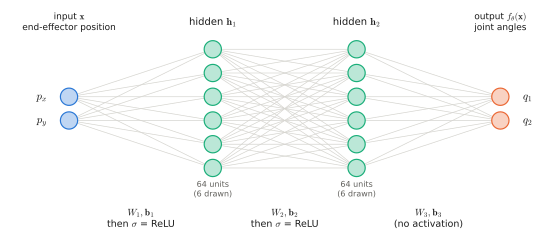
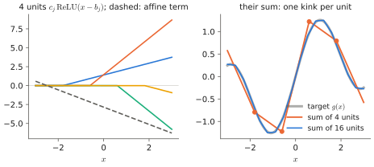
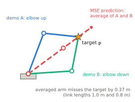

# 0.2 Neural Networks

## What is it?

!!! definition "Neural network (feed-forward)"
    A **neural network** is a parameterised function $f_\theta:\mathbb{R}^{d_\text{in}}\to\mathbb{R}^{d_\text{out}}$ built by composing simple differentiable maps called **layers**. The parameters $\theta$ (also called *weights*) are learned from data. A **multilayer perceptron (MLP)** alternates affine maps and element-wise non-linear functions:

    $$
    \mathbf{h}_0 = \mathbf{x},\qquad
    \mathbf{h}_{\ell} = \sigma\!\left(\mathbf{h}_{\ell-1} W_\ell + \mathbf{b}_\ell\right)\ \ (\ell = 1,\dots,L-1),\qquad
    f_\theta(\mathbf{x}) = \mathbf{h}_{L-1} W_L + \mathbf{b}_L .
    $$

| Symbol | Shape | Meaning |
|---|---|---|
| $\mathbf{x}$ | $1\times d_\text{in}$ | input (a row vector, see [notation](../../appendix/notation.md)) |
| $W_\ell$ | $d_{\ell-1}\times d_\ell$ | weight matrix of layer $\ell$; $d_0=d_\text{in}$, $d_L=d_\text{out}$ |
| $\mathbf{b}_\ell$ | $1\times d_\ell$ | bias vector |
| $\sigma$ | — | **activation function**, applied element-wise |
| $\mathbf{h}_\ell$ | $1\times d_\ell$ | **hidden representation** after layer $\ell$; $d_\ell$ is the layer's *width* |
| $\theta$ | — | the collection $\{W_\ell,\mathbf{b}_\ell\}_{\ell=1}^{L}$ |

<figure markdown="span">
  
  <figcaption markdown="span">The MLP of the inverse-kinematics example: the input $\mathbf{x}$ (end-effector position) goes through two hidden layers of 64 ReLU units to the output, two joint angles. Every line is one weight; every hidden circle computes one entry of $\sigma(\mathbf{h}W+\mathbf{b})$.</figcaption>
</figure>

With a batch, $\mathbf{x}$ becomes $X\in\mathbb{R}^{B\times d_\text{in}}$ and every formula is unchanged: $XW_\ell + \mathbf{b}_\ell$ broadcasts the bias over the batch ([broadcasting](tensors.md#element-wise-operations-and-broadcasting)).

## Why does it exist?

Many problems require a function we cannot write down but can sample: *image → "is there a toolbox?"*, *joint angles + camera image → next motor command*. A neural network is a flexible function family whose parameters can be fitted to examples by gradient descent ([0.3](training.md)). Three properties make MLPs the basic building block of everything that follows:

1. **Expressiveness.** With non-linear $\sigma$, they can approximate any continuous function on a compact set (below).
2. **Differentiability.** Every layer is differentiable (almost everywhere), so gradients w.r.t. $\theta$ exist and are cheap to compute.
3. **Hardware fit.** The cost is dominated by matrix multiplications, the operation GPUs are built for.

## How does it work?

### Why the non-linearity is essential

Without $\sigma$, the network collapses:

$$
(\mathbf{x}W_1 + \mathbf{b}_1)W_2 + \mathbf{b}_2 = \mathbf{x}\,\underbrace{W_1W_2}_{W'} + \underbrace{\mathbf{b}_1W_2+\mathbf{b}_2}_{\mathbf{b}'},
$$

a single affine map, no matter how many layers. The activation bends the space between layers. Geometrically, a ReLU layer partitions input space into convex polytopes and is affine on each; a ReLU MLP is therefore a **continuous piecewise-affine function** whose number of linear regions can grow exponentially with depth.

<figure markdown="span">
  
  <figcaption markdown="span">Why the non-linearity matters. Left: each ReLU unit is zero, then a straight line, with one kink. Right: adding them gives a continuous piecewise-affine function with one kink per unit. More units give more pieces and a closer fit, which is the idea behind universal approximation.</figcaption>
</figure>

!!! definition "Common activation functions"
    | Name | $\sigma(z)$ | Notes |
    |---|---|---|
    | ReLU | $\max(0,z)$ | cheap; zero gradient for $z<0$ ("dead units") |
    | GELU | $z\,\Phi(z)$, $\Phi$ = standard normal CDF | smooth ReLU; default in BERT/GPT-2/ViT |
    | SiLU / Swish | $z\,\operatorname{sigmoid}(z)$ | smooth; used in SwiGLU ([2.4](../02-transformers/block.md#the-feed-forward-network)) |
    | sigmoid | $1/(1+e^{-z})$ | squashes to $(0,1)$; used for gates and probabilities |
    | tanh | $(e^z-e^{-z})/(e^z+e^{-z})$ | squashes to $(-1,1)$; used to bound actions |

    Sigmoid and tanh **saturate**: for large $|z|$ their derivative is near 0, which starves earlier layers of gradient ([vanishing gradients](sequence-models.md#recurrent-neural-networks)). Modern hidden layers use ReLU-like functions; bounded functions survive where their range is the point (gates, bounded action outputs).

### Universal approximation — and what it does not say

!!! definition "Universal approximation theorem (Cybenko 1989; Hornik 1991)"
    Let $\sigma$ be any continuous non-polynomial function. For every continuous $g:K\to\mathbb{R}$ on a compact $K\subset\mathbb{R}^{d}$ and every $\varepsilon>0$, there is a one-hidden-layer network $f(\mathbf{x})=\sum_{j=1}^{m} c_j\,\sigma(\mathbf{x}\mathbf{w}_j^\top + b_j)$ with $\sup_{\mathbf{x}\in K}|f(\mathbf{x})-g(\mathbf{x})|<\varepsilon$.

The theorem guarantees *existence*. It says nothing about (i) how large $m$ must be (it can be exponential in $d$), (ii) whether gradient descent will find the weights, or (iii) whether a network fitted on finite data will generalise. Deep learning works in practice for reasons the theorem does not cover: depth gives compositional, hierarchical representations far more efficiently than width, and architectures encode *assumptions* about the problem.

!!! definition "Inductive bias"
    The **inductive bias** of a learning system is the set of assumptions that make it prefer some functions over others consistent with the same data. Examples: a convolutional network assumes translation equivariance and locality ([Chapter 3](../03-vision/index.md)); a transformer assumes that relations between tokens are pairwise and content-dependent ([0.8](first-look.md)); an MLP on a flattened image assumes almost nothing, which is why it needs far more data.

The history of architectures in this book is largely a history of choosing inductive biases — and then, as data grows, removing them.

### Counting parameters

Layer $\ell$ has $d_{\ell-1}d_\ell$ weights and $d_\ell$ biases. An MLP $2\to64\to64\to2$ has $(2\cdot64+64)+(64\cdot64+64)+(64\cdot2+2)=4{,}482$ parameters. A transformer layer of width $d$ has $\approx12d^2$ ([2.7](../02-transformers/scaling.md#counting-parameters)); with $d=4096$ and $L=32$ layers that is $\approx 6.4\times10^9$ — most of a 7B language model.

## A robotics example: learning inverse kinematics

!!! robot "Two-link planar arm"
    A planar arm with link lengths $l_1,l_2$ and joint angles $\mathbf{q}=(q_1,q_2)$ has **forward kinematics**

    $$
    \mathbf{p}(\mathbf{q}) = \big(l_1\cos q_1 + l_2\cos(q_1+q_2),\; l_1\sin q_1 + l_2\sin(q_1+q_2)\big).
    $$

    We want the **inverse**: a network $f_\theta(\mathbf{p})\approx\mathbf{q}$. Data is free: sample $\mathbf{q}$, compute $\mathbf{p}(\mathbf{q})$, and train on the pairs $(\mathbf{p},\mathbf{q})$.

    The catch: almost every reachable point has **two** solutions (elbow-up and elbow-down). If the dataset contains both, a network trained with squared error learns their *average* — a configuration that reaches neither and may not reach the target at all. Lab 00 shows this failure explicitly. It is the simplest instance of the central problem of [Chapter 6](../06-generative/index.md): when demonstrations contain several valid actions for the same observation, a regression policy predicts an invalid "mean" action. Every diffusion and flow-matching VLA head exists to solve this problem.

<figure markdown="span">
  
  <figcaption markdown="span">Regression to the mean, on a robot. Both demonstrations reach the target $\mathbf{p}$, one with the elbow up and one with the elbow down. A network trained with squared error predicts the average of their joint angles. Here that is a straight arm, which overshoots the target. Chapter 6 introduces the generative action heads that fix this.</figcaption>
</figure>

## Implementation

```python
import torch
import torch.nn as nn

class MLP(nn.Module):
    def __init__(self, d_in=2, d_hidden=64, d_out=2):
        super().__init__()
        self.net = nn.Sequential(
            nn.Linear(d_in, d_hidden), nn.ReLU(),       # W1: (2, 64), b1: (64,)
            nn.Linear(d_hidden, d_hidden), nn.ReLU(),   # W2: (64, 64)
            nn.Linear(d_hidden, d_out),                 # W3: (64, 2)
        )

    def forward(self, x):          # x: (B, 2) end-effector positions
        return self.net(x)         #    (B, 2) joint angles

model = MLP()
print(sum(p.numel() for p in model.parameters()))   # 4482
```

`nn.Linear(d_in, d_out)` stores its weight as `(d_out, d_in)` and computes `x @ weight.T + bias` — the transpose of our convention, a historical artefact. The mathematics is identical.

!!! lab "Lab 00, part 2"
    Implement this MLP in NumPy with your own forward and backward pass, then in PyTorch; train it on single-branch and on mixed-branch IK data and visualise the averaging failure.

## Limitations

- An MLP treats its input as an unstructured vector: it has no notion that pixel $(i,j)$ neighbours pixel $(i,j+1)$, or that a sentence is a sequence. Flattening a $224\times224\times3$ image into an MLP needs $150{,}528\times d_1$ first-layer weights and learns translation invariance only from data.
- Fixed input size: an MLP cannot natively take a variable-length instruction.

These two limitations motivate convolution ([Chapter 3](../03-vision/index.md)) and attention ([0.8](first-look.md), [Chapter 2](../02-transformers/index.md)). But the MLP never disappears: every transformer layer contains one ([feed-forward network](../02-transformers/block.md#the-feed-forward-network)), and VLA action heads, projectors and value functions are MLPs.

## Why it matters for VLAs and robots

Inside a VLA, MLPs appear as the **projector** that maps visual features into the language model's space ([Chapter 4](../04-alignment/index.md)), as the **feed-forward half of every transformer layer**, as the **proprioception encoder**, and as **action heads**. The IK example will also come back: it is a miniature of the multimodal-action problem.
