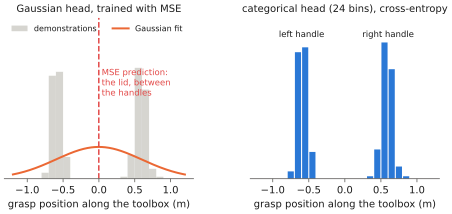
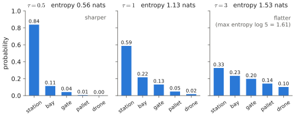
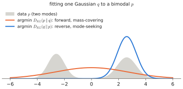

# 0.4 Probability for Machine Learning

You know probability; this section isolates the five ideas that the rest of the book uses constantly and shows how they turn into code: **conditional distributions as model outputs**, **maximum likelihood**, **the softmax/categorical pair**, **entropy, cross-entropy and KL divergence**, and **sampling**.

## Models output distributions, not answers

!!! definition "Probabilistic model"
    A **conditional probabilistic model** $p_\theta(\mathbf{y}\mid\mathbf{x})$ is a neural network whose output parameterises a probability distribution over targets $\mathbf{y}$ given inputs $\mathbf{x}$. The network does not output $\mathbf{y}$; it outputs the *parameters* of a distribution over $\mathbf{y}$ — for example a mean and variance (Gaussian), or a vector of $V$ probabilities (categorical).

This is the right way to think about every model in the book:

| Model | $\mathbf{x}$ | $\mathbf{y}$ | Distribution family |
|---|---|---|---|
| language model | previous tokens | next token | categorical over $V$ tokens |
| image classifier | image | label | categorical |
| regression policy | observation | action | Gaussian (fixed variance) |
| VLA with discrete action tokens (RT-2, OpenVLA) | image, instruction, previous action tokens | next action token | categorical over 256 bins |
| VLA with diffusion/flow head (π0) | image, instruction, proprioception | action chunk | implicit, arbitrarily multimodal ([Chapter 6](../06-generative/index.md)) |

Seeing a policy as a distribution $\pi_\theta(\mathbf{a}\mid\mathbf{o},\ell)$ rather than a function $\mathbf{a}=f(\mathbf{o},\ell)$ is not pedantry: demonstrations of the same situation genuinely contain different actions (go left or right around the obstacle), and only a distribution can represent that.

## Maximum likelihood

!!! definition "Maximum likelihood estimation (MLE)"
    Given i.i.d. data $\{(\mathbf{x}_i,\mathbf{y}_i)\}_{i=1}^{n}$, MLE chooses

    $$
    \theta^\star=\arg\max_\theta\ \prod_{i=1}^{n}p_\theta(\mathbf{y}_i\mid\mathbf{x}_i)
    =\arg\min_\theta\ \underbrace{-\frac{1}{n}\sum_{i=1}^{n}\log p_\theta(\mathbf{y}_i\mid\mathbf{x}_i)}_{\text{negative log-likelihood (NLL)}} .
    $$

    Products become sums under the log (numerically essential: a product of $10^6$ probabilities underflows to 0).

The two standard losses of [0.3](training.md#loss-functions) are both NLLs:

**Gaussian → mean squared error.** If $p_\theta(\mathbf{y}\mid\mathbf{x})=\mathcal{N}(\mathbf{y};f_\theta(\mathbf{x}),\sigma^2 I)$ in $\mathbb{R}^{m}$,

$$
-\log p_\theta(\mathbf{y}\mid\mathbf{x}) = \frac{1}{2\sigma^2}\lVert\mathbf{y}-f_\theta(\mathbf{x})\rVert^2 + \frac{m}{2}\log(2\pi\sigma^2),
$$

so minimising MSE is MLE under a **unimodal** Gaussian with fixed variance. The minimiser of expected MSE is the conditional mean $\mathbb{E}[\mathbf{y}\mid\mathbf{x}]$. When $p(\mathbf{y}\mid\mathbf{x})$ has two modes (elbow-up and elbow-down, [0.2](neural-networks.md#a-robotics-example-learning-inverse-kinematics)), the mean lies between them — the **regression-to-the-mean** failure, now explained: MSE silently assumes the data is unimodal.

<figure markdown="span">
  
  <figcaption markdown="span">The same bimodal demonstrations (grasp the left or the right handle) fitted two ways. A Gaussian trained with MSE puts its mean on the lid, where no demonstration grasped. A categorical distribution over bins keeps both modes; sampling it commits to one handle.</figcaption>
</figure>

**Categorical → cross-entropy.** For $y\in\{1,\dots,V\}$, the network outputs **logits** $\mathbf{z}\in\mathbb{R}^{V}$, turned into probabilities by the softmax (below). Then

$$
-\log p_\theta(y\mid\mathbf{x}) = -\log\operatorname{softmax}(\mathbf{z})_y = -z_y + \log\sum_{j=1}^{V}e^{z_j}.
$$

A categorical distribution can represent *any* distribution over $V$ outcomes, including multimodal ones. This is a major reason why early VLAs discretised actions into bins and predicted them like words ([Chapter 8](../08-vla/index.md)).

## Softmax

!!! definition "Softmax"
    $$
    \operatorname{softmax}(\mathbf{z})_i=\frac{e^{z_i}}{\sum_{j=1}^{V}e^{z_j}},\qquad \mathbf{z}\in\mathbb{R}^{V}.
    $$

    Output: a vector of positive numbers summing to 1. **Temperature** $\tau>0$ rescales logits, $\operatorname{softmax}(\mathbf{z}/\tau)$: $\tau\to0$ approaches a one-hot on the argmax; $\tau\to\infty$ approaches uniform.

<figure markdown="span">
  
  <figcaption markdown="span">Softmax of the same five logits at three temperatures. A low $\tau$ concentrates the mass on the argmax; a high $\tau$ approaches uniform. Entropy measures how spread out the result is.</figcaption>
</figure>

Properties used repeatedly:

1. **Shift invariance**: $\operatorname{softmax}(\mathbf{z}+c\mathbf{1})=\operatorname{softmax}(\mathbf{z})$. Implementations subtract $\max_j z_j$ before exponentiating, so the largest exponent is $e^0=1$ and nothing overflows.
2. **Gradient of the cross-entropy**: $\partial\big(-\log\operatorname{softmax}(\mathbf{z})_y\big)/\partial\mathbf{z}=\operatorname{softmax}(\mathbf{z})-\mathbf{e}_y$ — predicted probabilities minus the one-hot target. Clean, bounded, and the reason softmax + cross-entropy train so well.
3. **Saturation**: if one logit dominates, the softmax is nearly one-hot and its Jacobian $\operatorname{diag}(\mathbf{p})-\mathbf{p}^\top\mathbf{p}$ is nearly zero — gradients vanish. This is precisely why attention divides by $\sqrt{d_k}$ ([2.1](../02-transformers/attention.md#why-scale)).
4. **Boltzmann form**: $\operatorname{softmax}(\mathbf{z}/\tau)$ is the Boltzmann/Gibbs distribution with energies $-z_i$. The maximum-entropy RL policies and energy-based models you may know use exactly this form.

```python
import torch
z = torch.tensor([2.0, 1.0, -1.0])
print(z.softmax(-1))                 # tensor([0.7054, 0.2595, 0.0351])
print((z / 0.5).softmax(-1))         # sharper: tensor([0.8789, 0.1189, 0.0022])
y = torch.tensor(0)
print(torch.nn.functional.cross_entropy(z[None], y[None]))  # -log 0.7054 = 0.3490
```

Always pass **logits** to `cross_entropy`; it applies `log_softmax` internally in a numerically stable way. Applying `softmax` yourself first is a classic bug (the loss still decreases, slowly and wrongly).

## Entropy, cross-entropy and KL divergence

For distributions $p,q$ over the same discrete set:

!!! definition "Information-theoretic quantities"
    - **Entropy** $\ H(p)=-\sum_y p(y)\log p(y)$: the expected surprise, or the average number of nats (bits, with $\log_2$) needed to encode samples of $p$ with an optimal code. Maximal ($\log V$) for uniform $p$, zero for a deterministic one.
    - **Cross-entropy** $\ H(p,q)=-\sum_y p(y)\log q(y)$: the average code length when data comes from $p$ but the code is optimised for $q$.
    - **Kullback–Leibler divergence** $\ D_\text{KL}(p\,\Vert\,q)=\sum_y p(y)\log\frac{p(y)}{q(y)}=H(p,q)-H(p)\ \ge 0$, with equality iff $p=q$. Not symmetric.

With $p=p_\text{data}$ and $q=p_\theta$: since $H(p_\text{data})$ does not depend on $\theta$,

$$
\arg\min_\theta D_\text{KL}(p_\text{data}\Vert p_\theta)=\arg\min_\theta H(p_\text{data},p_\theta)=\arg\min_\theta\ \mathbb{E}_{y\sim p_\text{data}}[-\log p_\theta(y)],
$$

i.e. **maximum likelihood = minimising cross-entropy = minimising forward KL** to the data distribution. Forward KL is *mass-covering*: $p_\theta$ is heavily penalised wherever $p_\text{data}>0$ but $p_\theta\approx0$, so it spreads probability over all modes of the data. (Reverse KL $D_\text{KL}(p_\theta\Vert p_\text{data})$, used in variational inference and some RL objectives, is *mode-seeking*.)

<figure markdown="span">
  
  <figcaption markdown="span">Fitting a single Gaussian to a bimodal distribution. Minimising the forward KL (maximum likelihood) covers both modes and puts mass between them. Minimising the reverse KL picks one mode and ignores the other.</figcaption>
</figure>

**Perplexity** $=\exp(\text{average NLL per token})$ is the standard language-model metric: a perplexity of 20 means the model is, on average, as uncertain as a uniform choice among 20 tokens.

## Sampling

A model that outputs a distribution must be **sampled** to act. For a categorical: draw $u\sim\mathcal{U}(0,1)$ and invert the CDF (`torch.multinomial`), or use the **Gumbel-max trick**, $\arg\max_i(z_i+g_i)$ with $g_i$ i.i.d. Gumbel. Decoding strategies for language — greedy, temperature, top-$k$, nucleus (top-$p$) — are covered in [1.1](../01-multimodal-intro/language.md#decoding). For continuous multimodal distributions, sampling *is* the hard part, and is the subject of diffusion and flow matching ([Chapter 6](../06-generative/index.md)).

!!! robot "Why a robot cares about the distribution"
    Picking the red toolbox, the demonstrations show grasps from the left handle and from the right handle. A categorical action head can put 50% on each and then *commit* to one when sampled. A Gaussian head with MSE puts its mean in the middle — a grasp on the lid. Sampling, though, also introduces randomness into control: two consecutive control steps may sample different modes and the arm dithers between them. [Action chunking](../08-vla/index.md) (committing to a sequence of actions from one sample) is the common fix. Distributional modelling and temporal consistency pull in different directions; much VLA engineering is about reconciling them.

## Bayes' rule and latent variables (preview)

Two more tools appear later and are only stated here:

- **Bayes' rule** $p(\mathbf{z}\mid\mathbf{x})=p(\mathbf{x}\mid\mathbf{z})p(\mathbf{z})/p(\mathbf{x})$ — the basis of state estimation (Kalman filters, in [Chapter 13](../13-uavs/index.md)) and of latent-variable models.
- **Latent variables**: $p_\theta(\mathbf{y}\mid\mathbf{x})=\int p_\theta(\mathbf{y}\mid\mathbf{x},\mathbf{z})p(\mathbf{z})\,d\mathbf{z}$. Simple conditionals mixed over a hidden $\mathbf{z}$ give complex, multimodal marginals. VAEs (used by ACT), diffusion and flow models are all built this way ([Chapter 6](../06-generative/index.md)).

## Why it matters for VLAs and robots

Every VLA objective in [Chapter 9](../09-training/index.md) is either a cross-entropy (token-based VLAs) or a denoising/flow-matching loss that bounds or approximates a likelihood (diffusion VLAs). Choosing between them is choosing how to represent $\pi_\theta(\mathbf{a}\mid\mathbf{o},\ell)$ — and that is the single most consequential architectural choice in a VLA.
