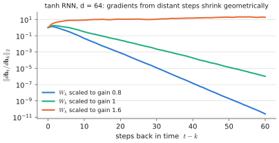
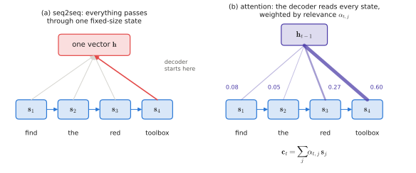

# 0.7 Sequence Modelling

## What is it?

!!! definition "Sequence model"
    A **sequence model** maps a variable-length sequence $x_{1:T}=(x_1,\dots,x_T)$ to an output — a label, another sequence, or a probability distribution over sequences. A **generative sequence model** defines $p_\theta(x_{1:T})$.

Language, speech, robot trajectories $(\mathbf{o}_1,\mathbf{a}_1,\mathbf{o}_2,\mathbf{a}_2,\dots)$ and action chunks are all sequences. The architecture that processes them determines what dependencies a model can capture, how fast it trains, and how fast it runs.

## The autoregressive factorisation

By the chain rule of probability, *any* distribution over sequences factorises exactly as

$$
p(x_{1:T}) = \prod_{t=1}^{T} p\big(x_t \mid x_{<t}\big),\qquad x_{<t}=(x_1,\dots,x_{t-1}).
$$

!!! definition "Autoregressive model"
    An **autoregressive (AR) model** parameterises each conditional $p_\theta(x_t\mid x_{<t})$ with a network and generates by sampling $x_1$, then $x_2$ given $x_1$, and so on. Trained by maximum likelihood, its loss is the sum of per-step cross-entropies:

    $$
    \mathcal{L}(\theta) = -\sum_{t=1}^{T}\log p_\theta(x_t\mid x_{<t}).
    $$

This is **next-token prediction**, the objective of every GPT-style language model and of every token-based VLA. Note what it requires of the architecture: a way to summarise a *variable-length* prefix $x_{<t}$ into something that predicts $x_t$. The history of sequence models is the history of answers to that question.

During training, the true prefix is fed at every step (**teacher forcing**), so all $T$ conditionals can be computed in parallel *if the architecture allows it*. At generation time, the model consumes its own samples, one at a time. The mismatch between training on true prefixes and generating from its own (possibly wrong) prefixes is called **exposure bias** — the language-model version of the compounding-error problem of [behavioural cloning](../07-decision-making/index.md).

## n-gram models: a fixed window

The simplest answer: assume $p(x_t\mid x_{<t})\approx p(x_t\mid x_{t-n+1:t-1})$ (a Markov assumption of order $n-1$) and estimate it by counting. Cheap and transparent, but the table has $V^{n}$ entries — with $V=50{,}000$ even $n=3$ gives $10^{14}$ — so long dependencies are impossible and unseen contexts get zero probability. A *neural* n-gram model (Bengio et al., 2003) replaced the table by embeddings + an MLP over the window: the first neural language model, and the origin of learned word embeddings. The window remained fixed.

## Recurrent neural networks

!!! definition "Recurrent neural network (RNN)"
    An RNN maintains a **hidden state** $\mathbf{h}_t\in\mathbb{R}^{d}$ updated once per input:

    $$
    \mathbf{h}_t = \tanh\!\big(\mathbf{x}_tW_x + \mathbf{h}_{t-1}W_h + \mathbf{b}\big),\qquad p_\theta(x_{t+1}\mid x_{\le t})=\operatorname{softmax}(\mathbf{h}_tW_o).
    $$

    $\mathbf{x}_t\in\mathbb{R}^{1\times d_x}$ is the embedded input, $W_x\in\mathbb{R}^{d_x\times d}$, $W_h\in\mathbb{R}^{d\times d}$, $W_o\in\mathbb{R}^{d\times V}$. The same weights are used at every step.

If you come from control, this is a **discrete-time nonlinear state-space model** $\mathbf{h}_t=f(\mathbf{h}_{t-1},\mathbf{x}_t)$ with a learned $f$ — an observer that compresses the whole past into $\mathbf{h}_t$. That compression is both its strength (constant memory and constant cost per step, unbounded context in principle) and its weakness.

### Vanishing and exploding gradients

Training uses backpropagation through time: unroll the recurrence $T$ steps and backpropagate. The gradient of the loss at step $t$ w.r.t. the state at step $k<t$ contains the product of Jacobians

$$
\frac{\partial\mathbf{h}_t}{\partial\mathbf{h}_k}=\prod_{j=k+1}^{t}\frac{\partial\mathbf{h}_j}{\partial\mathbf{h}_{j-1}}=\prod_{j=k+1}^{t} W_h^\top\operatorname{diag}\!\big(1-\mathbf{h}_j^{\odot 2}\big)
$$

(in column-vector convention). Like the state-transition matrix of a linear system, this product shrinks or grows geometrically with $t-k$ depending on whether its singular values are below or above 1. Gradients from distant steps either vanish (the network cannot learn long-range dependencies) or explode (training diverges; *gradient clipping* rescales $\mathbf{g}$ when $\lVert\mathbf{g}\rVert$ exceeds a threshold — a trick still used in every VLA training run).

<figure markdown="span">
  
  <figcaption markdown="span">The norm of $\partial\mathbf{h}_t/\partial\mathbf{h}_k$, measured on a random tanh RNN, against how far back $k$ lies. With small recurrent gain it decays geometrically, so distant steps get almost no gradient. With large gain the tanh saturates instead of exploding. Either way, long-range credit assignment fails.</figcaption>
</figure>

**LSTMs** (Hochreiter & Schmidhuber, 1997) and **GRUs** add multiplicative **gates** — sigmoid-valued vectors that decide what to write to, keep in, and read from an additive memory cell. The additive path lets gradients flow over long spans, much like the residual connections of [2.4](../02-transformers/block.md#the-residual-stream). LSTMs dominated sequence modelling until 2017.

### Two problems that remained

1. **Sequential computation.** $\mathbf{h}_t$ depends on $\mathbf{h}_{t-1}$, so the $T$ steps cannot be parallelised during training. GPUs, which want huge matrix multiplications, sit mostly idle. This capped how much data RNNs could be trained on.
2. **The bottleneck.** Everything about the past must fit in one fixed-size $\mathbf{h}_t$. In **sequence-to-sequence** translation (Sutskever et al., 2014), an encoder RNN read the source sentence and passed only its final state to a decoder RNN; quality degraded sharply with sentence length.

## Attention: let the decoder look back

**Bahdanau, Cho & Bengio (2015)** removed the bottleneck: instead of one summary vector, keep all encoder states $\mathbf{s}_1,\dots,\mathbf{s}_S$, and at each decoder step compute a weighted average of them, with weights determined by how relevant each one is to the current decoder state:

$$
\alpha_{t,j}=\operatorname{softmax}_j\big(\operatorname{score}(\mathbf{h}_{t-1},\mathbf{s}_j)\big),\qquad \mathbf{c}_t=\sum_{j=1}^{S}\alpha_{t,j}\,\mathbf{s}_j .
$$

<figure markdown="span">
  
  <figcaption markdown="span">(a) A classic encoder–decoder squeezes the whole input into one vector. (b) With attention, every decoder step reads all encoder states, weighted by $\alpha_{t,j}$ (line width).</figcaption>
</figure>

The decoder learns *where to look*. The weights $\alpha_{t,j}$ are a soft, differentiable alignment between output and input positions — a learned, input-dependent routing of information. This is the seed of everything in [Chapter 2](../02-transformers/index.md).

**Vaswani et al. (2017)**, *Attention Is All You Need*, asked: if attention gives every position direct access to every other position, do we still need the recurrence at all? Removing it solved both problems at once: all positions are processed in parallel (problem 1), and no information has to pass through a fixed-size state (problem 2). The cost moved elsewhere — every position attends to every other, so compute grows as $T^2$ — and that trade-off defines modern AI. The [first look](first-look.md) gives the idea in a page; [Chapter 2](../02-transformers/index.md) builds it completely.

!!! info "State-space models (aside)"
    Recurrence has made a comeback in *linear* form. Structured state-space models (S4) and Mamba use a linear (input-dependent, in Mamba's case) recurrence $\mathbf{h}_t=\bar A\mathbf{h}_{t-1}+\bar B\mathbf{x}_t$ that — being linear — can be computed in parallel by a scan during training and runs at constant cost per step at inference. They are attractive for long robot histories and fast control loops and appear in some recent policies; transformers remain dominant in VLAs.

## Why it matters for VLAs and robots

!!! robot "Trajectories are sequences"
    A demonstration of the depot task is a sequence $(\mathbf{o}_1,\mathbf{a}_1,\dots,\mathbf{o}_T,\mathbf{a}_T)$. Three design questions of every VLA are sequence-modelling questions:

    1. **How much history?** Most VLAs condition only on the current observation (Markov assumption) because history is expensive in tokens. Tasks with occlusion or memory ("go back to where you saw the toolbox") break this.
    2. **How are action dimensions generated?** Token-based VLAs generate the $d_a$ dimensions of an action *autoregressively*, one token at a time, inheriting the AR factorisation — and its sequential latency ([Chapter 8](../08-vla/index.md)).
    3. **How many future actions?** Predicting a chunk of $H_a$ actions is a sequence-*output* problem. Generating them autoregressively costs $H_a d_a$ sequential steps; generating them jointly with diffusion/flow costs a fixed number of denoising steps.

!!! lab "Lab 02, part 3"
    A tiny RNN on the instruction corpus, with a measurement of $\lVert\partial\mathbf{h}_t/\partial\mathbf{h}_0\rVert$ versus $t$ that shows vanishing gradients directly. Lab 04 later trains a transformer on the same data for comparison.
