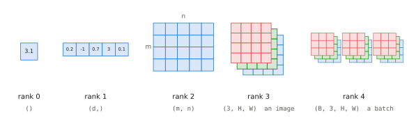
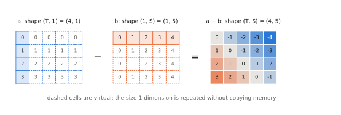

# 0.1 Tensors

## What is it?

!!! definition "Tensor (deep-learning sense)"
    A **tensor** is a multi-dimensional array of numbers of a single data type, together with a **shape** — the tuple of its sizes along each dimension (also called *axis*). A tensor with $k$ dimensions is a *rank-$k$* or *$k$-D* tensor.

    - rank 0: a scalar, shape `()`
    - rank 1: a vector, shape `(d,)`
    - rank 2: a matrix, shape `(m, n)`
    - rank 3+: e.g. a batch of images, shape `(B, C, H, W)`

<figure markdown="span">
  
  <figcaption markdown="span">Tensors of increasing rank. A colour image is a rank-3 tensor (one $H\times W$ plane per colour channel); a batch of images adds a leading batch dimension.</figcaption>
</figure>

This is *not* the multilinear-algebra tensor of continuum mechanics or differential geometry. There are no covariant/contravariant indices and no transformation law: a deep-learning tensor is an array. The word stuck because the arrays generalise vectors and matrices.

## Why does it exist?

Neural networks are built almost entirely from a handful of operations — matrix multiplications, element-wise functions, reductions — applied to *many* numbers at once. Expressing computation on whole arrays instead of loops has three consequences that shape everything in this book:

1. **Hardware efficiency.** GPUs execute the same instruction on thousands of numbers in parallel. A matrix multiplication of two $4096\times4096$ matrices is $\approx 1.4\times10^{11}$ floating-point operations, done in milliseconds on a GPU. The same computation as Python loops would take hours.
2. **Batching.** Processing $B$ independent examples is the same code as processing one, with an extra leading dimension.
3. **Automatic differentiation.** Libraries such as PyTorch know the derivative of each tensor operation, so gradients of arbitrary compositions come for free ([0.3](training.md#backpropagation)).

## How does it work? Shapes as a type system

The most useful habit in deep learning is to **track the shape of every tensor**. Shape errors are the most common bug, and the shape of an intermediate tensor usually tells you what it means. The conventions used in this book ([notation appendix](../../appendix/notation.md)) are:

- the **first** dimension is the **batch** $B$ — independent examples processed together;
- the **last** dimension is the **feature** dimension $d$ — the numbers that describe one item;
- dimensions in between index *positions* inside one example (time steps, tokens, pixels).

The tensors you will meet most often:

| Tensor | Shape | Meaning |
|---|---|---|
| batch of RGB images | `(B, 3, H, W)` | channel-first images, as PyTorch vision code expects |
| batch of token ids | `(B, T)` | integers in $\{0,\dots,V-1\}$ |
| embedded tokens | `(B, T, d)` | one $d$-dimensional vector per token |
| attention weights | `(B, h, T, S)` | for each head, how much each of $T$ queries looks at each of $S$ keys |
| proprioception | `(B, d_q)` | joint angles, end-effector pose, gripper state |
| action chunk | `(B, H_a, d_a)` | $H_a$ future actions of dimension $d_a$ |

!!! robot "The depot, as tensors"
    One control step of the mobile manipulator receives two camera images (wrist and head) of $224\times224$ pixels, a 7-joint arm state plus gripper opening, and the instruction. With a batch of $B=32$ training examples:

    - images: `(32, 2, 3, 224, 224)` — 9.6 M numbers, 38.5 MB in 32-bit floats;
    - proprioception: `(32, 8)`;
    - instruction: `(32, T)` integer ids, with $T$ the (padded) number of tokens;
    - target actions: `(32, 50, 7)` — a chunk of 50 future 7-D actions.

    The images dominate memory by four orders of magnitude. This imbalance — vision is expensive, language and proprioception are cheap — returns in [Chapter 3](../03-vision/index.md) and [Chapter 11](../11-deployment/index.md).

## The operations

### Element-wise operations and broadcasting

Element-wise operations ($+$, $\odot$, $\exp$, $\max(0,\cdot)$, …) act independently on each entry. When the two operands have different shapes, **broadcasting** aligns them:

!!! definition "Broadcasting"
    Compare shapes from the **last** dimension backwards. Two sizes are compatible if they are equal or one of them is 1 (a missing leading dimension counts as 1). A size-1 dimension is (virtually) repeated to match the other. No data is copied.

Examples (`→` gives the result shape):

```
(B, T, d) + (d,)        → (B, T, d)     add a bias vector to every token
(B, T, d) * (B, T, 1)   → (B, T, d)     scale each token by its own scalar
(T, 1)    - (1, S)      → (T, S)        all pairwise differences
(B, T, d) + (T, d)      → (B, T, d)     add the same positional vectors to every example
(B, T, d) + (B, d)      → ERROR         d vs T mismatch at dimension -2
```

<figure markdown="span">
  
  <figcaption markdown="span">Broadcasting `(T, 1) - (1, S) -> (T, S)`. Each size-1 dimension is stretched (dashed cells) to match the other operand, without copying memory. Entry $(i,j)$ of the result is $i-j$: the matrix of relative positions that reappears in [2.3](../02-transformers/positions.md).</figcaption>
</figure>

The last line is the dangerous case when it *doesn't* error: if $T$ happened to equal $B$, `(B, d)` would silently broadcast as `(1, B, d)` and you would add example $i$'s vector to token $i$ of *every* example. Broadcasting bugs are silent; the cure is to write shapes in comments and to use explicit `unsqueeze` (or `x[:, None, :]`).

### Matrix multiplication

For $X\in\mathbb{R}^{m\times k}$ and $W\in\mathbb{R}^{k\times n}$,

$$
(XW)_{ij} = \sum_{p=1}^{k} X_{ip}\,W_{pj}, \qquad XW\in\mathbb{R}^{m\times n}.
$$

It costs $mkn$ multiply-adds, conventionally counted as $2mkn$ **FLOPs** (floating-point operations). In PyTorch, `X @ W` with more than two dimensions treats all leading dimensions as batch dimensions (broadcast like above) and multiplies the last two:

```python
X = torch.randn(32, 10, 64)   # (B, T, d)
W = torch.randn(64, 128)      # (d, d_out)
Y = X @ W                     # (B, T, d_out) = (32, 10, 128)
```

Every token of every example is multiplied by the same $W$. This is the single most important operation in the book: a *linear layer applied to each token independently* is just `X @ W + b`.

### Reductions

`sum`, `mean`, `max`, `softmax`, `logsumexp` act along a chosen dimension `dim`. Reducing removes that dimension (or keeps it with size 1 if `keepdim=True`, which is usually what you want for subsequent broadcasting):

```python
x = torch.randn(32, 10, 64)       # (B, T, d)
x.mean(dim=-1).shape              # (32, 10): one number per token
x.mean(dim=-1, keepdim=True).shape  # (32, 10, 1): broadcasts back against x
```

### Reshaping and permuting

`view`/`reshape` reinterpret the same numbers with a new shape (total size preserved); `transpose`/`permute` reorder dimensions. A key example, used in [multi-head attention](../02-transformers/multi-head.md), splits the feature dimension into heads:

```python
B, T, d, h = 2, 5, 12, 3
x = torch.randn(B, T, d)                 # (B, T, d)
x = x.view(B, T, h, d // h)              # (B, T, h, d_h): split features into h groups
x = x.transpose(1, 2)                    # (B, h, T, d_h): heads become a batch-like dim
```

!!! definition "Memory layout and contiguity"
    A tensor is stored as one flat block of memory plus **strides**: how many elements to skip to move by one along each dimension. A `(T, d)` tensor stored row-major has strides `(d, 1)`. `transpose` does not move data; it swaps strides, so the result is **non-contiguous**. `view` requires a compatible layout; `reshape` copies when it must. `.contiguous()` forces a copy into row-major order.

This matters for performance (GPU kernels prefer contiguous memory) and explains the `.contiguous()` / `.reshape()` calls you will see in attention code.

### Einstein summation

`torch.einsum` names dimensions with letters; repeated letters that do not appear in the output are summed. It is the most readable way to write many tensor contractions:

```python
# attention scores: for each batch b, head h, query i, key j: sum over feature k
scores = torch.einsum("bhik,bhjk->bhij", Q, K)   # (B, h, T, S)
```

## Data types and memory

!!! definition "Floating-point formats"
    | dtype | bits | exponent / mantissa | range ≈ | use |
    |---|---|---|---|---|
    | `float32` | 32 | 8 / 23 | $10^{\pm38}$ | default; optimiser states |
    | `float16` | 16 | 5 / 10 | $6.5\times10^{4}$ | inference; training needs loss scaling |
    | `bfloat16` | 16 | 8 / 7 | $10^{\pm38}$ | training and inference of large models |
    | `int8`, `int4` | 8, 4 | — | — | quantised weights ([Chapter 11](../11-deployment/index.md)) |

`bfloat16` keeps float32's range but with only 2–3 significant decimal digits; this is enough for neural networks, which are robust to small relative errors but not to overflow.

A model with $N$ parameters occupies $N\times(\text{bytes per parameter})$. A 7-billion-parameter VLA such as OpenVLA needs $7\times10^9\times2 \approx 14$ GB in bfloat16 just for its weights — more than many robot computers have. In 4-bit form it needs $\approx 3.5$ GB. This arithmetic is the beginning of [deployment engineering](../11-deployment/index.md).

## Implementation

```python
import torch

x = torch.randn(32, 10, 64)             # (B, T, d), float32 on CPU
print(x.shape, x.dtype, x.device, x.stride())   # strides (640, 64, 1)
x = x.to("cuda", dtype=torch.bfloat16)  # move + cast (if a GPU is present)
print(x.element_size() * x.numel() / 1e6, "MB")
```

!!! lab "Lab 00, part 1"
    `labs/00_nn_from_scratch/` begins with broadcasting puzzles, a silent-broadcasting bug to find, a stride/contiguity experiment, and an `einsum` exercise.

## Limitations and pitfalls

- **Silent broadcasting** and **wrong-axis reductions** produce numbers, not errors. Assert shapes.
- **Precision**: summing many `float16`/`bfloat16` numbers loses accuracy; reductions such as softmax and normalisation are usually computed in `float32` internally.
- **Memory** is the binding constraint long before compute is, both in training (activations) and on robots (weights).

## Why it matters for VLAs and robots

A VLA is a function from a dictionary of tensors (images, joint states, token ids) to a tensor of actions. Reading a VLA paper well means being able to write down the shape of every arrow in its architecture figure — this book will make you do that for every architecture in [Chapter 10](../10-case-studies/index.md).
