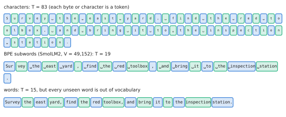
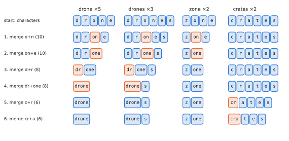

# 0.5 Tokens and Tokenization

## What is it?

!!! definition "Token, vocabulary, tokenizer"
    A **token** is the atomic unit a sequence model reads and writes. A **vocabulary** $\mathcal{V}$ is a finite set of $V=|\mathcal{V}|$ tokens, each identified by an integer **token id** in $\{0,\dots,V-1\}$. A **tokenizer** is a pair of functions

    $$
    \operatorname{encode}:\ \text{string}\to(\text{id}_1,\dots,\text{id}_T),\qquad \operatorname{decode}:\ (\text{id}_1,\dots,\text{id}_T)\to\text{string},
    $$

    with $\operatorname{decode}(\operatorname{encode}(s))=s$ for a lossless tokenizer.

Neural networks operate on tensors of numbers; text is a string of characters. Tokenization is the (non-learned, fixed before training) bridge. After it, a sentence is a tensor of shape `(T,)` of integers, a batch is `(B, T)`, and everything downstream is the tensor machinery of [0.1](tensors.md).

## Why does it exist? The granularity trade-off

The choice of unit trades vocabulary size against sequence length:

| Unit | $V$ | Tokens for the running example | Problem |
|---|---|---|---|
| bytes (UTF-8) | 256 | 83 | sequences long; attention cost grows as $T^2$ ([2.1](../02-transformers/attention.md#computational-cost)) |
| characters | ~100 (ASCII) to ~150 000 (Unicode) | 83 | same; Unicode vocabulary huge and sparse |
| words | $10^5$–$10^6$ | 15 | huge embedding table; any unseen word ("quadrotor-7") is *out of vocabulary* |
| **subwords (BPE etc.)** | $3\times10^4$–$2.6\times10^5$ | ~15–20 | the compromise used by every modern model |

<figure markdown="span">
  
  <figcaption markdown="span">The running example at three granularities. Colours alternate only to show where tokens begin and end. Characters give long sequences, and words give an open vocabulary. Subwords sit between them: 19 tokens, and no word is ever out of vocabulary.</figcaption>
</figure>

Subword tokenizers keep frequent words as single tokens ("drone", "the") and split rare ones into pieces ("quad", "rot", "or"), so nothing is ever out of vocabulary while common text stays short. Since compute and latency grow with $T$ (linearly for most layers, quadratically in attention), **tokens are the unit of cost**: LLM prices, context-window limits and VLA inference latency are all measured in tokens.

## How does it work? Byte-pair encoding

!!! definition "Byte-pair encoding (BPE) — Sennrich et al., 2016"
    **Training.** Start with a vocabulary of single symbols (characters or bytes) and represent every word in the training corpus as a sequence of them. Repeat until the vocabulary has the target size:

    1. count every adjacent pair of symbols across the corpus (weighted by word frequency);
    2. add the most frequent pair, concatenated, to the vocabulary as a new symbol, and record the **merge rule**;
    3. replace every occurrence of that pair in the corpus by the new symbol.

    **Encoding** a new string applies the learned merges *in the order they were learned*.

### Worked example

Corpus word counts: `drone` ×5, `drones` ×3, `zone` ×2, `crate` ×4, `crates` ×2. Initial symbols are characters. Ties are broken by first occurrence.

| Step | Most frequent pair (count) | Corpus after the merge |
|---|---|---|
| 0 | — | `d r o n e`, `d r o n e s`, `z o n e`, `c r a t e`, `c r a t e s` |
| 1 | `o`+`n` (10) | `d r on e`, `d r on e s`, `z on e`, … |
| 2 | `on`+`e` (10) | `d r one`, `d r one s`, `z one`, … |
| 3 | `d`+`r` (8) | `dr one`, `dr one s`, `z one`, … |
| 4 | `dr`+`one` (8) | `drone`, `drone s`, `z one`, `c r a t e`, `c r a t e s` |
| 5 | `c`+`r` (6) | …, `cr a t e`, `cr a t e s` |
| 6 | `cr`+`a` (6) | …, `cra t e`, `cra t e s` |

<figure markdown="span">
  
  <figcaption markdown="span">The worked example as merges. The pair merged at each step is highlighted. The subword `one` emerges because `drone` and `zone` share it.</figcaption>
</figure>

After 6 merges, `drone` is one token and `drones` is `drone`+`s`; words never seen in training remain encodable from pieces: `zones` → `z one s`, `crater` → `cra t e r`. Notice that the subword `one` was discovered because it is shared by `drone` and `zone`: BPE is a greedy compression algorithm, and its units reflect corpus statistics, not linguistics.

### Byte-level BPE and pre-tokenization

Production tokenizers (GPT-2 onward, Llama 3, Qwen, …) run BPE over **UTF-8 bytes** rather than characters, so the base vocabulary is exactly 256 and *any* string, in any language or containing emoji, is encodable. Text is first **pre-tokenized** by a regular expression that splits on whitespace and punctuation (merges never cross these boundaries), and a leading space is usually part of the token: `" toolbox"` and `"toolbox"` are different tokens.

Alternatives you will see in model cards: **WordPiece** (BERT; merges chosen by likelihood gain rather than raw frequency), **Unigram LM** (SentencePiece/T5/PaliGemma; starts from a large vocabulary and prunes tokens that least reduce corpus likelihood). The engineering consequences are the same.

### Special tokens, padding and masks

Tokenizers reserve ids for **special tokens**: beginning/end of sequence (`<bos>`, `<eos>`), padding (`<pad>`), and model-specific markers such as `<image>` placeholders in VLMs or chat-role markers. To batch sentences of different lengths into one `(B, T)` tensor, short ones are **padded** and an **attention mask** of shape `(B, T)` (1 = real token, 0 = padding) tells the model to ignore the padding ([masking](../02-transformers/attention.md#masking)).

## Implementation

A minimal BPE trainer (Lab 01 builds the full encoder/decoder):

```python
from collections import Counter

def train_bpe(word_counts: dict[str, int], n_merges: int):
    seqs = {w: list(w) for w in word_counts}          # word -> list of symbols
    merges = []
    for _ in range(n_merges):
        pairs = Counter()
        for w, f in word_counts.items():
            s = seqs[w]
            for a, b in zip(s, s[1:]):
                pairs[(a, b)] += f
        if not pairs:
            break
        (a, b), _ = max(pairs.items(), key=lambda kv: kv[1])  # first occurrence wins ties
        merges.append((a, b))
        for w, s in seqs.items():                     # apply the merge everywhere
            out, i = [], 0
            while i < len(s):
                if i + 1 < len(s) and s[i] == a and s[i + 1] == b:
                    out.append(a + b); i += 2
                else:
                    out.append(s[i]); i += 1
            seqs[w] = out
    return merges
```

Using a production tokenizer:

```python
from transformers import AutoTokenizer
tok = AutoTokenizer.from_pretrained("HuggingFaceTB/SmolLM2-135M")
ids = tok("Survey the east yard, find the red toolbox.")["input_ids"]
print(ids, [tok.decode([i]) for i in ids])
```

!!! lab "Lab 01 — Tokenization"
    Build character-, word- and BPE tokenizers on the procedurally generated depot instruction corpus (`vlacourse.data.instructions`), measure sequence lengths and out-of-vocabulary rates on held-out instructions, and compare your BPE's splits of the running example with SmolLM2's tokenizer.

## Limitations

- **Tokenization artefacts.** Models see token ids, not characters. They struggle with spelling, counting letters, and arithmetic on numbers split into arbitrary pieces (GPT-2 may split `"1234"` as `"123"`+`"4"`; SmolLM2 and Llama 3-era tokenizers split digits individually or in groups of three). For robotics this matters when **numbers are in the prompt** (coordinates, altitudes): a language model does not see `5.25` as a number.
- **Fixed and non-differentiable.** The tokenizer is frozen before training; changing it requires re-training (or at least re-learning) the embedding table.
- **Language and domain bias.** A tokenizer trained mostly on English web text spends more tokens per word on other languages and on technical jargon — so those inputs are slower and use more of the context window.

## Why it matters for VLAs and robots

"Token" generalises beyond text, and this generalisation is the key conceptual move of the whole field:

- an image is cut into patches, each projected to a vector — **image tokens** ([0.8](first-look.md#vision-transformers), [Chapter 3](../03-vision/index.md));
- a continuous action is discretised into bins, each bin given an id — **action tokens** ([Chapter 8](../08-vla/index.md)). RT-2 and OpenVLA literally overwrite 256 rarely used entries of a language model's vocabulary with action bins.

Once everything is a token, one sequence model can read images and instructions and write actions. The price is that every token costs compute and latency: a VLA reading two 256-token images plus a 20-token instruction processes ~530 tokens per control step, and that number sets its control rate ([Chapter 11](../11-deployment/index.md)).

!!! robot "The running example, tokenized"
    *"Survey the east yard, find the red toolbox, and bring it to the inspection station."* is 83 characters and 15 words. SmolLM2's byte-level BPE tokenizer (vocabulary 49,152) splits it into **19 tokens**:

    `Sur` `vey` `␣the` `␣east` `␣yard` `,` `␣find` `␣the` `␣red` `␣toolbox` `,` `␣and` `␣bring` `␣it` `␣to` `␣the` `␣inspection` `␣station` `.`

    (`␣` marks a leading space, which is part of the token.) Every word with a leading space is a single token — they are common English. The exception is the sentence-initial `Survey`: capitalised and without a leading space it is rarer, so it costs two tokens. An instruction full of site-specific names ("inspect bay C7-north, pallet 0x3F") would cost several tokens per word. Lab 01 reproduces this split.
