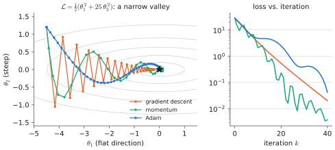
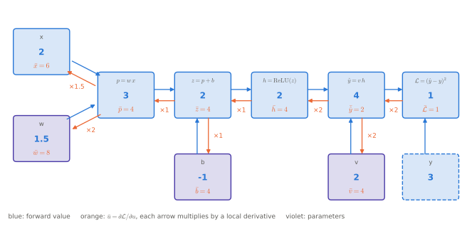
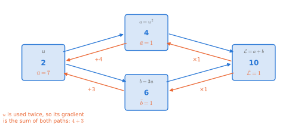
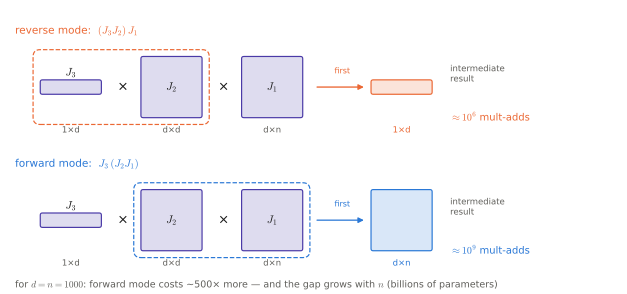
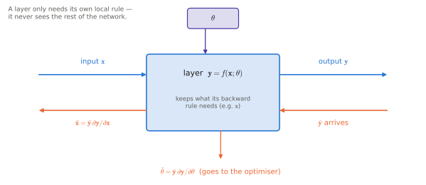
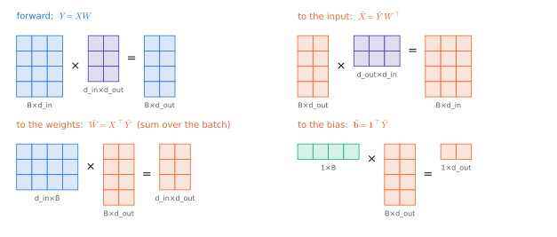
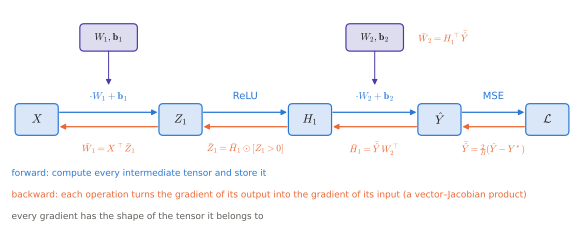
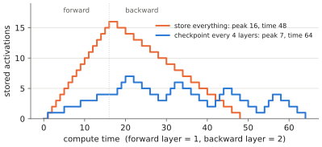

# 0.3 Training: Losses, Gradient Descent and Backpropagation

## What is it?

!!! definition "Empirical risk minimisation"
    Given a dataset $\mathcal{D}=\{(\mathbf{x}_i,\mathbf{y}_i)\}_{i=1}^{n}$, a model $f_\theta$ and a per-example **loss** $\ell(\hat{\mathbf{y}},\mathbf{y})\ge 0$ measuring how wrong prediction $\hat{\mathbf{y}}$ is, **training** means approximately solving

    $$
    \theta^\star \in \arg\min_\theta\ \mathcal{L}(\theta),\qquad \mathcal{L}(\theta)=\frac{1}{n}\sum_{i=1}^{n}\ell\big(f_\theta(\mathbf{x}_i),\mathbf{y}_i\big).
    $$

    $\mathcal{L}$ is the **empirical risk**: an average over the data we have, standing in for the expected loss on the data we will see.

Training a neural network is an unconstrained, non-convex, very high-dimensional (millions to billions of variables) optimisation problem solved with first-order methods. Second-order methods are out: the Hessian of a 7B-parameter model has $5\times10^{19}$ entries.

## Loss functions

The two losses that cover almost all of this book — and their probabilistic justification, which is the important part — are derived in [0.4](probability.md#maximum-likelihood). Briefly:

| Task | Loss | Formula |
|---|---|---|
| regression (continuous actions, joint angles) | mean squared error | $\ell = \lVert\hat{\mathbf{y}}-\mathbf{y}\rVert_2^2$ |
| classification over $V$ classes (next token, discretised action) | cross-entropy | $\ell = -\log \operatorname{softmax}(\mathbf{z})_{y}$, with logits $\mathbf{z}\in\mathbb{R}^{V}$ and true class $y$ |

## Gradient descent

### The update

$$
\theta_{k+1} = \theta_k - \eta\,\nabla_\theta\mathcal{L}(\theta_k).
$$

$\eta>0$ is the **learning rate** (step size), $k$ the iteration. For an $L$-smooth convex function, $\eta<2/L_\text{smooth}$ guarantees descent; for neural networks no such constant is known in advance and $\eta$ is tuned empirically. Too large: divergence (the loss becomes `nan`). Too small: no progress.

### Stochastic gradient descent

Computing $\nabla\mathcal{L}$ over all $n$ examples per step is wasteful. **Stochastic gradient descent (SGD)** draws a **minibatch** $\mathcal{B}$ of $B$ examples uniformly at random and uses

$$
\mathbf{g}_k = \frac{1}{B}\sum_{i\in\mathcal{B}}\nabla_\theta\,\ell\big(f_\theta(\mathbf{x}_i),\mathbf{y}_i\big),\qquad \mathbb{E}[\mathbf{g}_k]=\nabla\mathcal{L}(\theta_k).
$$

The estimate is unbiased; its variance scales as $1/B$. One pass over the dataset is an **epoch**. The noise is not purely a nuisance: it helps escape saddle points and is associated with solutions that generalise better.

### Momentum and Adam

Plain SGD struggles in ill-conditioned valleys (steep in some directions, flat in others) — the same problem you know from optimisation and from tuning gradient-based controllers. Two fixes:

**Momentum** keeps a running average of gradients, $\mathbf{m}_k = \beta\mathbf{m}_{k-1} + \mathbf{g}_k$, $\theta_{k+1}=\theta_k-\eta\mathbf{m}_k$: a heavy-ball, low-pass-filtered descent direction.

!!! definition "Adam (Kingma & Ba, 2015)"
    Adam keeps per-parameter exponential moving averages of the gradient and of its element-wise square:

    $$
    \begin{aligned}
    \mathbf{m}_k &= \beta_1\mathbf{m}_{k-1} + (1-\beta_1)\,\mathbf{g}_k, &
    \mathbf{v}_k &= \beta_2\mathbf{v}_{k-1} + (1-\beta_2)\,\mathbf{g}_k\odot\mathbf{g}_k,\\
    \hat{\mathbf{m}}_k &= \mathbf{m}_k/(1-\beta_1^k), &
    \hat{\mathbf{v}}_k &= \mathbf{v}_k/(1-\beta_2^k),\\
    \theta_{k+1} &= \theta_k - \eta\,\hat{\mathbf{m}}_k \oslash \big(\sqrt{\hat{\mathbf{v}}_k}+\epsilon\big).
    \end{aligned}
    $$

    - $\mathbf{m}_k,\mathbf{v}_k$: first- and second-moment estimates, same shape as $\theta$; $\oslash$, $\sqrt{\cdot}$ element-wise.
    - $\beta_1\approx0.9$, $\beta_2\approx0.95$–$0.999$: decay rates; $\epsilon\approx10^{-8}$ avoids division by zero.
    - The division by $1-\beta^k$ corrects the bias from initialising $\mathbf{m}_0=\mathbf{v}_0=\mathbf{0}$.

    Each parameter gets its own effective step size $\eta/\sqrt{\hat v}$: parameters with consistently large gradients take smaller steps. This is a diagonal preconditioner — a cheap approximation to second-order scaling.

<figure markdown="span">
  
  <figcaption markdown="span">Three optimisers on an ill-conditioned quadratic, 40 steps each from the same start. Plain gradient descent must keep its step small enough for the steep direction $\theta_2$; it zig-zags across the valley and crawls along it. Momentum averages out the zig-zag. Adam rescales each coordinate by its gradient history, so both directions move at a similar rate.</figcaption>
</figure>

**AdamW** (Loshchilov & Hutter, 2019) adds *decoupled* weight decay, $\theta\leftarrow\theta-\eta\lambda\theta$, applied outside the adaptive scaling. It is the default optimiser for transformers and VLAs.

!!! warning "Memory cost of Adam"
    Adam stores two extra tensors per parameter. Training a model with $N$ parameters in mixed precision typically needs ~16 bytes/parameter (bf16 weights and gradients, fp32 master weights, $\mathbf{m}$, $\mathbf{v}$) *before* activations. Full fine-tuning of a 7B VLA therefore needs ~112 GB — the reason [parameter-efficient fine-tuning](../09-training/index.md) exists.

### Learning-rate schedules

Large models are trained with a **warm-up** (linearly increase $\eta$ from ~0 over the first few hundred to thousand steps, while Adam's $\mathbf{v}$ estimates are unreliable) followed by **cosine decay** to a small value. Details in [2.5](../02-transformers/training.md).

## Backpropagation

### What is it?

!!! definition "Backpropagation"
    **Backpropagation** is reverse-mode automatic differentiation applied to a neural network: it computes the gradient of a scalar loss with respect to *all* parameters at a cost of a small constant multiple (≈ 2×) of one forward evaluation, by applying the chain rule from the output back to the inputs on the **computational graph**.

Gradient descent needs $\nabla_\theta\mathcal{L}$, and a network has up to billions of parameters. Backpropagation is how we get all of those partial derivatives for roughly the price of running the network twice. It is not a new kind of mathematics — it is the chain rule from calculus, organised so that no work is repeated.

### The idea: local derivatives on a graph

A network is a long composition of simple operations (multiply by a matrix, add a bias, apply ReLU, …). Draw each intermediate value as a node and each operation as an arrow: that is the **computational graph**. Two passes visit it:

1. **Forward pass.** Evaluate the graph left to right and *remember* every intermediate value.
2. **Backward pass.** Walk the graph right to left. At every node, store its **adjoint** $\bar u=\partial\mathcal{L}/\partial u$: how much the final loss changes per unit change of $u$. Each arrow passes the adjoint backwards after multiplying it by the **local derivative** of that one operation.

That is the whole algorithm: *the gradient of the loss with respect to a node = the gradient at the node after it × the local derivative of the step between them.* The local derivatives are trivial (the derivative of $a+b$ is 1, of $ab$ is the *other* factor, of ReLU is 0 or 1); the chain rule glues them together.

### A worked example

Take one "neuron" followed by a squared error, $\mathcal{L}=\big(v\cdot\mathrm{ReLU}(wx+b)-y\big)^2$, with $x=2,\ w=1.5,\ b=-1,\ v=2,\ y=3$.

<figure markdown="span">
  
  <figcaption markdown="span">A scalar network with real numbers. Blue: values computed on the forward pass. Orange: the adjoint $\bar u$ of every node, computed on the backward pass; the label on each orange arrow is the local derivative that was multiplied in. Violet nodes are parameters — those are the gradients the optimiser uses. All numbers are checked against finite differences when the figure is generated.</figcaption>
</figure>

Reading the figure from the right:

| Step | Local derivative | Adjoint |
|---|---|---|
| start at the loss | — | $\bar{\mathcal{L}}=1$ |
| $\mathcal{L}=(\hat y-y)^2$ | $2(\hat y-y)=2$ | $\bar{\hat y}=1\cdot2=2$ |
| $\hat y=v\,h$ | w.r.t. $h$: $v=2$; w.r.t. $v$: $h=2$ | $\bar h=2\cdot2=4,\quad \bar v=2\cdot2=4$ |
| $h=\mathrm{ReLU}(z)$ | $\mathbb{1}[z>0]=1$ | $\bar z=4$ |
| $z=p+b$ | $1$ and $1$ | $\bar p=4,\quad\bar b=4$ |
| $p=w\,x$ | w.r.t. $w$: $x=2$; w.r.t. $x$: $w=1.5$ | $\bar w=8,\quad\bar x=6$ |

Sanity check by hand: nudge $w$ from $1.5$ to $1.51$. Then $z=2.02$, $\hat y=4.04$, $\mathcal{L}=1.0816$: the loss rose by $\approx0.08=\bar w\times0.01$. ✓.

!!! note "Notice"
    - The *same* adjoint $\bar z=4$ was reused for both $\bar b$ and (through $\bar p$) $\bar w$ and $\bar x$. Computing a separate derivative for every parameter from scratch would redo the shared right-hand part each time.
    - If $z$ had been negative, ReLU's local derivative would be 0 and *nothing* would flow to $w$, $b$, $x$: a "dead" unit receives no gradient.

### When a value is used twice, gradients add

If a node feeds several operations — a weight reused for every example in a batch, a skip connection, the same embedding used at many positions — the backward pass receives one contribution per use, and the adjoint is their **sum** (the multivariable chain rule).

<figure markdown="span">
  
  <figcaption markdown="span">$u$ feeds two branches. Each branch sends back its own contribution ($2u=4$ and $3$); the adjoint of $u$ is the sum, $7=\mathrm{d}(u^2+3u)/\mathrm{d}u$ at $u=2$. Every shared parameter in a network is a larger version of this picture.</figcaption>
</figure>

### Why backward and not forward?

For $f:\mathbb{R}^{n}\to\mathbb{R}^{m}$, the chain rule is a product of Jacobians, and matrix multiplication is associative — so the only question is the *order*. **Forward mode** multiplies from the input side and carries a full matrix; **reverse mode** multiplies from the output side and carries a single row (a vector–Jacobian product). A loss has $m=1$ output and $n\sim10^9$ inputs, so reverse mode gets the full gradient in one backward pass; forward mode would need $10^9$ passes.

<figure markdown="span">
  
  <figcaption markdown="span">The same three Jacobians multiplied in two orders. Starting from the scalar loss, the running product stays a thin $1\times d$ row vector; starting from the input it becomes a full $d\times n$ matrix. The cost ratio is about $n$.</figcaption>
</figure>

If you know adjoint methods from optimal control (the costate in Pontryagin's principle), backpropagation is exactly the discrete adjoint method.

### The rule for one layer

Write the network as a chain $\mathbf{x}\to\mathbf{u}_1\to\mathbf{u}_2\to\dots\to\mathcal{L}$. If $\mathbf{v}=g(\mathbf{u})$, the chain rule for the adjoints is the **vector–Jacobian product** (VJP)

$$
\bar{\mathbf{u}} = \bar{\mathbf{v}}\,\frac{\partial\mathbf{v}}{\partial\mathbf{u}} .
$$

Each layer therefore only has to know two things: how to compute its output, and how to turn the adjoint of its output into the adjoints of its input and of its own parameters. The Jacobian itself is never formed. This is what makes backpropagation *modular* — new layer types plug in without touching the rest.

<figure markdown="span">
  
  <figcaption markdown="span">The contract of a layer. Forward (blue): $\mathbf{x}\mapsto\mathbf{y}$. Backward (orange): receives $\bar{\mathbf{y}}$, returns $\bar{\mathbf{x}}$ for the layer before it and $\bar\theta$ for the optimiser. To do so it must have saved whatever its local derivative depends on.</figcaption>
</figure>

### The three layers of an MLP

For a batch $X\in\mathbb{R}^{B\times d_\text{in}}$ we need the VJP of three operations.

**Affine map** $Y = XW + \mathbf{b}$, with $W\in\mathbb{R}^{d_\text{in}\times d_\text{out}}$, $Y\in\mathbb{R}^{B\times d_\text{out}}$:

$$
\bar{X} = \bar{Y}\,W^\top\ \ (B\times d_\text{in}),\qquad
\bar{W} = X^\top\bar{Y}\ \ (d_\text{in}\times d_\text{out}),\qquad
\bar{\mathbf{b}} = \textstyle\sum_{i=1}^{B}\bar{Y}_{i,:}\ \ (1\times d_\text{out}).
$$

<figure markdown="span">
  
  <figcaption markdown="span">The affine layer backward, with matrix shapes. Every adjoint has the shape of the tensor it belongs to, and the only way to multiply the available factors into that shape is the formula on the left of each panel. $\bar W$ and $\bar{\mathbf b}$ contract over the batch index $B$: each example contributes one term and they are added (the fan-out rule again).</figcaption>
</figure>

**Shape check.** Each gradient has the shape of the thing it is the gradient of — a cheap, reliable way to remember (or debug) these formulas. The same rule gives the gradient of an embedding table ([0.6](embeddings.md)) and of attention projections shared across tokens.

**Element-wise activation** $H=\sigma(Y)$: $\bar{Y}=\bar{H}\odot\sigma'(Y)$. For ReLU, $\sigma'(Y)=\mathbb{1}[Y>0]$.

**Loss** $\mathcal{L}=\frac{1}{B}\sum_i\lVert\hat{Y}_{i,:}-Y^\ast_{i,:}\rVert^2$: $\bar{\hat Y}=\frac{2}{B}(\hat Y - Y^\ast)$.

### Putting it together: a two-layer MLP

<figure markdown="span">
  
  <figcaption markdown="span">Backpropagation on the two-layer MLP. The forward pass (blue) computes and stores every intermediate tensor. The backward pass (orange) runs the chain in reverse: each operation turns the gradient of its output into the gradient of its input, and the gradients of the shared weights come out along the way.</figcaption>
</figure>

Backpropagation for $\hat Y = \operatorname{ReLU}(XW_1+\mathbf{b}_1)W_2+\mathbf{b}_2$ — the code is the figure, line by line:

```python
# forward (store what the backward pass needs)
Z1 = X @ W1 + b1          # (B, d_h)
H1 = np.maximum(Z1, 0)    # (B, d_h)
Yh = H1 @ W2 + b2         # (B, d_out)
loss = ((Yh - Y) ** 2).sum(1).mean()

# backward
dYh = 2 * (Yh - Y) / B    # (B, d_out)
dW2 = H1.T @ dYh          # (d_h, d_out)
db2 = dYh.sum(0)          # (d_out,)
dH1 = dYh @ W2.T          # (B, d_h)
dZ1 = dH1 * (Z1 > 0)      # (B, d_h)
dW1 = X.T @ dZ1           # (d_in, d_h)
db1 = dZ1.sum(0)          # (d_h,)
```

### What happens internally in PyTorch

PyTorch builds the graph dynamically during the forward pass: every tensor produced by an operation on a tensor with `requires_grad=True` records the operation (`.grad_fn`) and saves the inputs its VJP needs. `loss.backward()` traverses this graph in reverse topological order, accumulating into each leaf's `.grad`.

```python
W = torch.randn(3, 2, requires_grad=True)
x = torch.randn(4, 3)
loss = (x @ W).relu().pow(2).sum()
print(loss.grad_fn, loss.grad_fn.next_functions)  # SumBackward0 -> PowBackward0 -> ...
loss.backward()
print(W.grad.shape)   # torch.Size([3, 2]) -- same shape as W
```

Two consequences you will meet constantly:

1. **Activation memory.** The saved intermediates (`Z1`, `H1` above) must live until the backward pass. For a transformer, they scale with $B\times T\times d\times L$ and usually dominate training memory. *Gradient checkpointing* keeps only every $k$-th activation and recomputes the rest during backward, trading ~30% compute for memory.
2. **Gradients accumulate.** `.grad` is added to, not overwritten (the fan-out rule, across calls); call `optimizer.zero_grad()` each step. Accumulating over several minibatches on purpose (*gradient accumulation*) simulates a larger batch.

<figure markdown="span">
  
  <figcaption markdown="span">Stored activations during one training step of a 16-layer network. Without checkpointing the memory grows to 16 during the forward pass and is released as the backward pass proceeds. Checkpointing every 4 layers halves the peak (and the gap widens with depth, ~$2\sqrt{L}$ vs. $L$), at the price of recomputing each segment once: 64 instead of 48 time units, i.e. +33%.</figcaption>
</figure>

### Gradient checking

The finite-difference approximation $\partial\mathcal{L}/\partial\theta_j\approx[\mathcal{L}(\theta+\epsilon\mathbf{e}_j)-\mathcal{L}(\theta-\epsilon\mathbf{e}_j)]/2\epsilon$ (error $O(\epsilon^2)$) verifies hand-written gradients — it is what we just did by hand for $w$ in the worked example. Use float64 and $\epsilon\approx10^{-6}$; a relative error below $10^{-6}$ means the gradient is right. It costs two forward passes *per parameter*, so it is a test tool, never a training method. Lab 00 does this for the code above.

## Initialisation

If weights are too large, activations explode through the layers; too small, they vanish. For a layer $\mathbf{y}=\mathbf{x}W$ with independent zero-mean entries, $\operatorname{Var}(y_j)=d_\text{in}\operatorname{Var}(W_{ij})\operatorname{Var}(x_i)$. Choosing $\operatorname{Var}(W_{ij})=1/d_\text{in}$ (LeCun/Xavier) preserves variance; $2/d_\text{in}$ (He/Kaiming) compensates for ReLU zeroing half the inputs. The same variance argument justifies the $1/\sqrt{d_k}$ in [attention](../02-transformers/attention.md#why-scale).

## Generalisation, overfitting and regularisation

The goal is low loss on *unseen* data, estimated on a held-out **validation set** (for model selection) and a **test set** (touched once). A model that drives training loss down while validation loss rises is **overfitting**. Standard remedies: more data, data augmentation, weight decay, dropout (randomly zeroing activations during training), early stopping, and — the dominant one in modern practice — *pretraining* on much more data and fine-tuning ([Chapter 9](../09-training/index.md)).

!!! robot "Offline loss is not task success"
    For a robot policy, the training loss measures how well it imitates demonstrations *on states the demonstrator visited*. When deployed, the policy's own small errors take it to states no demonstration covers, and errors compound. Validation loss on held-out demonstrations is therefore a weak predictor of closed-loop success — one of the central difficulties of [imitation learning](../07-decision-making/index.md) and of evaluating VLAs.

## Limitations

- Non-convexity: no guarantee of a global minimum; in practice wide networks have many good minima and the optimiser finds one of them.
- Hyperparameters (learning rate, batch size, schedule, weight decay) matter enormously and interact; they are found by experiment.
- Gradient-based training needs a differentiable loss: discrete decisions, simulators and real-world task success are not directly differentiable. This is one place where [reinforcement learning](../07-decision-making/index.md) enters.

## Why it matters for VLAs and robots

Everything in the training of a VLA — pretraining a vision encoder, a language model, then fine-tuning on robot demonstrations — is this loop: minibatch, forward pass, loss, backward pass, AdamW step. Its memory cost (weights + gradients + optimiser state + activations) determines whether you can fine-tune a VLA on your hardware, and its offline nature is why good training loss does not imply a good robot.

!!! lab "Lab 00, parts 3–4"
    Hand-written backpropagation for the IK network, gradient checking against finite differences, comparison with PyTorch autograd, and SGD vs Adam on the same problem.
