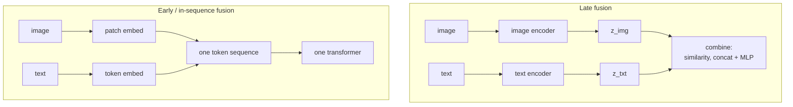
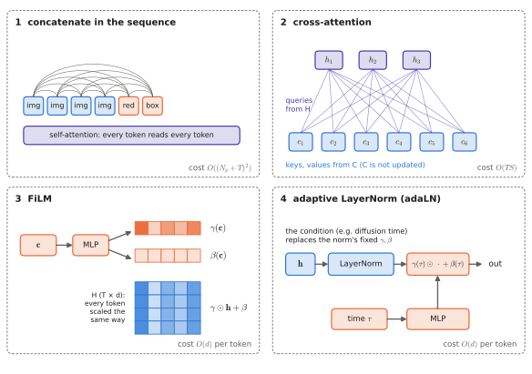

# 1.3 Combining Modalities

## What is it?

!!! definition "Modality, multimodal model, fusion"
    A **modality** is a type of input or output signal with its own structure: text, RGB images, depth, audio, proprioception, actions. A **multimodal model** processes more than one modality. **Fusion** is the mechanism by which information from different modalities is combined inside the model.

A VLA is a multimodal model with at least three input modalities (images, language, proprioception) and one output modality (actions). Its fusion design decides which information can influence which, at what depth, and at what computational cost.

## Why is it hard?

1. **Different structures.** Text is a 1-D sequence of discrete tokens; images are 2-D grids of continuous values; proprioception is a small fixed-size vector; actions are continuous trajectories.
2. **Different scales.** A 20-token instruction versus 500 image tokens per step.
3. **Different statistics.** Representations learned separately live in unrelated spaces: the vector a text encoder assigns to "red" has no a-priori relation to what a vision encoder produces for red pixels.
4. **Different rates.** Instructions arrive once per task, images at 30 Hz, joint states at 1 kHz.

## How does it work? The fusion design space

### Where to fuse: early, late, intermediate



- **Late fusion:** encode each modality separately into a vector, combine at the end (dot product, concatenation + MLP). Cheap and modular, but the modalities never interact while being encoded: the image encoder cannot "look for" what the text asks about. CLIP-style dual encoders are late fusion.
- **Early / in-sequence fusion:** turn every modality into tokens of the same width $d$ and let one transformer process the concatenated sequence. Every token can attend to every other in every layer. Maximum interaction; cost grows with total sequence length. This is the dominant VLM/VLA design (LLaVA, PaliGemma, RT-2, OpenVLA, π0's backbone).
- **Intermediate fusion:** separate streams that exchange information at several depths, e.g. by cross-attention (Flamingo) or by conditioning layers (FiLM in RT-1).

### How to fuse: four mechanisms

Let $H\in\mathbb{R}^{T\times d}$ be the representation being processed (e.g. image features) and $C$ the conditioning information (e.g. the instruction).

**1. Concatenation in the sequence.** $[H_\text{img};H_\text{txt}]\in\mathbb{R}^{(N_p+T)\times d}$, processed by self-attention. Symmetric: both modalities influence each other. Cost: attention is quadratic in $N_p+T$.

**2. Cross-attention.** The tokens of one stream form **queries**, the tokens of the other provide **keys and values** ([2.2](../02-transformers/multi-head.md#cross-attention)):

$$
\operatorname{CrossAttn}(H, C)=\operatorname{softmax}\!\left(\frac{(HW_Q)(CW_K)^\top}{\sqrt{d_k}}\right)CW_V,\qquad H\in\mathbb{R}^{T\times d},\ C\in\mathbb{R}^{S\times d_c}.
$$

Asymmetric: $H$ reads from $C$; $C$ is unchanged. Cost $O(TS)$ rather than $O((T+S)^2)$. Used in Flamingo (text reads image), in encoder–decoder transformers, and in many VLA action heads (action queries read the backbone's features: Octo, GR00T).

**3. FiLM — feature-wise linear modulation** (Perez et al., 2018).

!!! definition "FiLM"
    A conditioning vector $\mathbf{c}$ predicts a per-channel scale and shift that modulate features:

    $$
    \operatorname{FiLM}(\mathbf{h};\mathbf{c}) = \boldsymbol{\gamma}(\mathbf{c})\odot\mathbf{h}+\boldsymbol{\beta}(\mathbf{c}),\qquad \boldsymbol\gamma,\boldsymbol\beta:\mathbb{R}^{d_c}\to\mathbb{R}^{d}\ \text{(small MLPs or linear maps)}.
    $$

    It is applied to every spatial position (every token) of $H$ identically — broadcasting a `(1, d)` scale and shift over `(T, d)`.

FiLM is cheap (no attention) and lets the condition change *what the features mean* — e.g. amplify channels that respond to red when the instruction says "red". **RT-1** uses FiLM layers to condition an EfficientNet image encoder on the instruction embedding, so the image is encoded *already knowing the task*.

**4. Adaptive normalisation (adaLN).** A variant of FiLM applied inside a normalisation layer: $\operatorname{adaLN}(\mathbf{h};\mathbf{c})=\boldsymbol\gamma(\mathbf{c})\odot\operatorname{LayerNorm}(\mathbf{h})+\boldsymbol\beta(\mathbf{c})$. It is the standard way to inject the **diffusion/flow time** $\tau$ into a denoising network (DiT, and several VLA action experts; [Chapter 6](../06-generative/index.md)).

<figure markdown="span">
  
  <figcaption markdown="span">The four fusion mechanisms. (1) Concatenation lets every token attend to every other. (2) In cross-attention, one stream reads the other. (3) FiLM scales and shifts every feature channel, the same way for every token. (4) adaLN is FiLM inside a normalisation layer, the standard way to inject diffusion time.</figcaption>
</figure>

| Mechanism | Interaction | Cost | Typical use in VLAs |
|---|---|---|---|
| in-sequence concatenation | full, symmetric, every layer | $O((N_p+T)^2)$ | VLM backbone over image + text tokens |
| cross-attention | one stream reads another | $O(TS)$ | action heads reading backbone features |
| FiLM | global, per-channel modulation | $O(d)$ per token | instruction → vision encoder (RT-1) |
| adaLN | modulation of normalisation | $O(d)$ per token | diffusion time → action expert |

### Implementation sketch: FiLM

```python
import torch.nn as nn

class FiLM(nn.Module):
    def __init__(self, d_cond: int, d_feat: int):
        super().__init__()
        self.to_gamma_beta = nn.Linear(d_cond, 2 * d_feat)
        nn.init.zeros_(self.to_gamma_beta.weight)   # start as the identity map:
        nn.init.zeros_(self.to_gamma_beta.bias)     # gamma = 1 + 0, beta = 0

    def forward(self, h, c):             # h: (B, T, d_feat), c: (B, d_cond)
        gamma, beta = self.to_gamma_beta(c).chunk(2, dim=-1)   # each (B, d_feat)
        return (1 + gamma)[:, None, :] * h + beta[:, None, :]  # broadcast over T
```

The zero initialisation makes the layer an identity at the start of training, so inserting it into a *pretrained* network does not destroy what that network already knows. The same trick appears in adaLN-Zero (DiT), in LoRA ([Chapter 9](../09-training/index.md)), and in ControlNet: **when you add a new pathway to a pretrained model, initialise it to do nothing.**

## Tokens as a universal interface

The design that won — for VLMs and most VLAs — is in-sequence fusion: embed everything as tokens of width $d$ and let a pretrained LLM's transformer process them. The reasons:

1. **Reuse.** The largest, most knowledgeable pretrained component is the LLM. In-sequence fusion lets it be used unmodified; other modalities only need an *adapter* into its embedding space.
2. **Generality.** Any number of images, any order of text and images, any extra modality (state, action, robot identity) is just more tokens.
3. **Simplicity.** One architecture, one loss.

Its cost is sequence length, and therefore compute and latency — the trade-off of every VLA.

### Actions and proprioception as modalities

- **Proprioception** $\mathbf{q}_t$ is low-dimensional and highly informative (where is my gripper?). It is usually embedded by a linear layer or MLP into one or a few tokens. Some VLAs (RT-2, OpenVLA) omit it entirely and infer the robot state from images.
- **Actions** become a modality in two ways: as discrete **action tokens** in the LLM vocabulary, or as continuous vectors embedded by a linear layer and processed by a separate **action expert** that attends to the backbone ([Chapter 8](../08-vla/index.md)).

## The grounding problem

!!! definition "Symbol grounding problem (Harnad, 1990)"
    How do symbols (words, tokens) acquire meaning connected to the physical world, rather than only to other symbols?

An LLM's representation of "red toolbox" is defined by its relations to other tokens. A contrastive image–text model (CLIP) connects it to *appearance*. Neither connects it to *action*: what grasping it requires, how heavy it is, what happens when it is pushed. **Embodied grounding** — linking language and perception to the consequences of actions — requires data in which actions and their effects appear: robot demonstrations, teleoperation, simulation, or interaction. That is why a VLA needs robot data at all, why such data is the scarcest resource in the field ([Chapter 9](../09-training/index.md)), and why the alignment of vision and language ([Chapter 4](../04-alignment/index.md)) is necessary but not sufficient.

!!! robot "Fusion choices for the depot team"
    - The **arm's VLA** needs fine, early interaction between instruction and image ("the *red* toolbox *behind* the crate"): in-sequence fusion in a VLM backbone.
    - A **drone** surveying the yard at 30 m needs only a coarse semantic check of each frame ("does this contain a red toolbox?"): late fusion — a CLIP image embedding compared with the text embedding — is cheap enough to run on every frame of the companion computer.
    - The **team coordinator** fuses *other robots' reports*, not raw images: a new kind of modality (messages) that [Chapter 14](../14-multi-robot/index.md) treats as tokens.

## Limitations

- In-sequence fusion is expensive: compute and memory grow superlinearly with the number of image tokens.
- Late fusion loses fine-grained cross-modal interaction.
- Alignment is not grounding: matching images to words says nothing about physics or affordances.

## Why it matters for VLAs and robots

Every VLA architecture in [Chapter 10](../10-case-studies/index.md) can be described by its answers to three questions from this section: *what are the tokens*, *where is fusion* (in-sequence, cross-attention, FiLM), and *where does the action come out*. You will be asked to answer these for each one.
