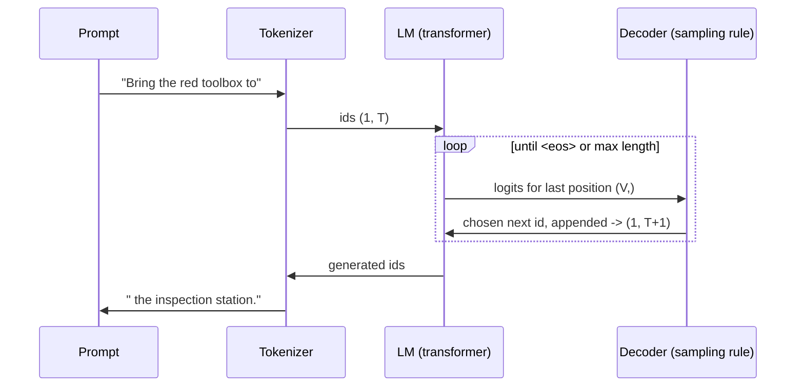
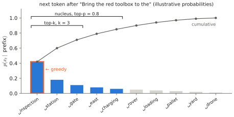

# 1.1 Language Models in Operation

## What is it?

!!! definition "Language model"
    A **language model (LM)** is a probability distribution over token sequences, $p_\theta(x_{1:T})$, almost always represented [autoregressively](../00-foundations/sequence-models.md#the-autoregressive-factorisation) as a network that maps a prefix $x_{<t}$ to a distribution over the next token, $p_\theta(x_t\mid x_{<t})$, given by a vector of $V$ **logits**.

Using an LM means repeatedly (1) running the network on the current sequence, (2) turning the last position's logits into a choice of next token, (3) appending it. This section describes that loop from the outside; [2.6](../02-transformers/inference.md) describes what happens inside it computationally.

## How does it work? The generation loop



The network produces logits for *every* position in one forward pass — shape `(B, T, V)` — but at generation time only the last row matters: it is the distribution over what comes after the whole prefix. (The other rows are what training uses: each position predicts its successor, so one sequence provides $T$ training examples at once — see [2.5](../02-transformers/training.md).)

## Decoding

The decoding rule converts logits $\mathbf{z}\in\mathbb{R}^{V}$ into a token. Each rule is a different trade-off between **fidelity** (pick what the model thinks is likely) and **diversity** (avoid repetitive, degenerate text).

!!! definition "Decoding strategies"
    - **Greedy:** $x_t=\arg\max_i z_i$. Deterministic; prone to repetition loops; not the most likely *sequence*.
    - **Beam search:** keep the $k$ most likely partial sequences, extend each, keep the best $k$. Approximates the most likely sequence; used for translation, rarely for open-ended text.
    - **Temperature sampling:** sample from $\operatorname{softmax}(\mathbf{z}/\tau)$ ([temperature](../00-foundations/probability.md#softmax)). $\tau<1$ sharpens, $\tau>1$ flattens.
    - **Top-$k$:** keep only the $k$ largest logits, renormalise, sample.
    - **Nucleus / top-$p$** (Holtzman et al., 2020): keep the smallest set of tokens whose cumulative probability exceeds $p$ (e.g. 0.9), renormalise, sample. Adapts the candidate set to the model's confidence.

<figure markdown="span">
  
  <figcaption markdown="span">The decoding rules on one next-token distribution (illustrative). Greedy takes the tallest bar. Top-$k$ samples among the $k$ tallest. Nucleus sampling keeps the smallest set whose cumulative probability reaches $p$, so the candidate set grows when the model is unsure and shrinks when it is confident.</figcaption>
</figure>

```python
def sample_next(logits, temperature=1.0, top_p=1.0, generator=None):
    """logits: (V,) for the last position. Returns one token id."""
    if temperature == 0:
        return int(logits.argmax())
    probs = (logits / temperature).softmax(-1)                  # (V,)
    sorted_p, idx = probs.sort(descending=True)
    keep = sorted_p.cumsum(-1) - sorted_p < top_p               # tokens before the nucleus edge
    sorted_p = sorted_p * keep
    choice = torch.multinomial(sorted_p / sorted_p.sum(), 1, generator=generator)
    return int(idx[choice])
```

!!! robot "Decoding actions"
    When a VLA emits **action tokens** ([Chapter 8](../08-vla/index.md)), the decoding rule becomes part of the controller. OpenVLA decodes actions **greedily**: stochastic sampling of action bins at 5–10 Hz would inject noise directly into the robot's motion. Greedy decoding has its own costs. Because each action dimension is decoded conditioned on the previous ones, the result is usually coherent with *one* mode of a multimodal distribution — but it is not guaranteed to be the most probable *joint* action, and when two modes are nearly tied (pass the obstacle left or right), tiny changes in the image between control steps can flip the argmax, so the robot **dithers** between modes. [Chapter 8](../08-vla/index.md) analyses this and why action chunking helps.

## Context window

!!! definition "Context window"
    The **context window** (or *context length*) $T_\text{max}$ is the maximum number of tokens the model can condition on. It is fixed by the positional encoding range used in training and limited in practice by memory: the [KV cache](../02-transformers/inference.md#the-kv-cache) grows linearly with $T$, attention compute quadratically.

Everything the model "knows" about the current situation must be in the context: the system prompt, the instruction, previous turns, and — in a VLM/VLA — image tokens. A VLA has no memory beyond its context; anything outside it is forgotten. A robot running for an hour cannot keep its whole history in context, which is a core obstacle to [long-horizon autonomy](../15-research/index.md).

## From pretrained LM to instruction follower

A model pretrained on web text continues text; it does not obey. Two additional stages turn it into an assistant:

1. **Supervised instruction tuning:** fine-tune on (instruction, good response) pairs, formatted with a **chat template** — special tokens marking roles, e.g. `<|user|> ... <|assistant|> ...`. The loss is applied only to the response tokens.
2. **Preference optimisation** (RLHF, DPO): further fine-tune so that responses humans prefer become more likely. This is [reinforcement learning](../07-decision-making/index.md) with a learned reward.

VLAs inherit this structure: the instruction $\ell$ is formatted with a prompt template (e.g. OpenVLA's *"In: What action should the robot take to {instruction}? Out:"*), and the loss is applied only to the action tokens.

## Limitations

- **Hallucination.** The model produces fluent text whether or not it is true. It is trained to be likely, not correct.
- **No grounding.** An LM's notion of "red toolbox" comes from text co-occurrence. It has never seen one. (This is the [grounding problem](combining.md#the-grounding-problem).)
- **Weak numerics and spatial reasoning**, partly due to [tokenization](../00-foundations/tokens.md#limitations), partly to training data.
- **Latency.** Generation is sequential: one forward pass per output token. A 7B model on an embedded GPU generates perhaps 10–30 tokens/s; an action needing 7 tokens then costs 0.2–0.7 s ([2.6](../02-transformers/inference.md)).

## Why it matters for VLAs and robots

An LLM can serve a robot at two very different levels, and distinguishing them is one of the most important architectural judgements in this book:

| Level | Output | Rate | Example | Safety exposure |
|---|---|---|---|---|
| **Task planner** | text/structured plan ("1. fly to east yard; 2. search for red toolbox; …") | seconds–minutes | SayCan, LLM-based mission planners | low: a classical planner/controller executes |
| **Policy (VLA)** | actions | 3–50 Hz | RT-2, OpenVLA, π0 | high: outputs reach actuators |

[Chapter 12](../12-embodied/index.md) and [Chapter 13](../13-uavs/index.md) argue that for UAVs, the first level is usually where a foundation model belongs.

!!! lab "Lab 05 (preview)"
    Load SmolLM2-135M, print the logits for the running example's prefix, and compare greedy, temperature and nucleus decoding.
