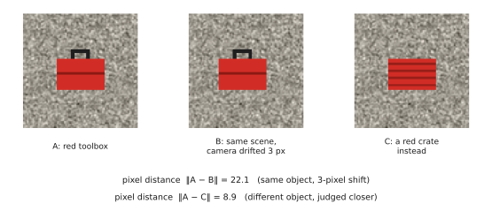

# 1.2 Images as Data

## What is it?

A digital colour image is a tensor $I\in\mathbb{R}^{C\times H\times W}$ — $C=3$ channels (red, green, blue), $H$ rows, $W$ columns — typically stored as 8-bit integers in $[0,255]$ and converted to floats for a network. A video is a sequence of such tensors; a depth image has $C=1$ with metric values; a stereo or multi-camera rig gives several images per time step.

Before entering a network, images are **preprocessed**: resized (or cropped) to the encoder's training resolution (224, 384, 448 pixels are common), scaled to $[0,1]$, and normalised per channel, $\tilde I_c=(I_c-\mu_c)/\sigma_c$, with the mean and standard deviation of the encoder's training data. Using the wrong normalisation for a pretrained encoder is a classic, silent bug: the model still produces features, just worse ones.

## Why are pixels a poor representation?

Consider two photos of the red toolbox, taken one second apart by a hovering drone. The drone drifted 3 pixels to the right. As vectors in $\mathbb{R}^{3\cdot224\cdot224}=\mathbb{R}^{150{,}528}$ they are far apart — every pixel changed — while a photo of a red *crate* at the same position may be closer. Pixel distance does not track semantic similarity. It is also extremely high-dimensional and dominated by nuisance factors: lighting, viewpoint, motion blur, background.

<figure markdown="span">
  
  <figcaption markdown="span">Pixel distance does not track meaning. Shifting the camera by 3 pixels changes every pixel of the textured floor, so B is far from A. Replacing the toolbox with a crate changes only the object, so C is closer to A. These numbers are computed on the images shown.</figcaption>
</figure>

What we want is a **visual representation** (a feature vector or a set of feature vectors) that is:

- **invariant** to nuisances that do not matter for the task (small shifts, lighting),
- **equivariant** to things that do (if the toolbox moves left in the image, its feature should move correspondingly — essential for manipulation),
- **semantic** (toolbox vs crate), and
- **compact** (few numbers, few tokens).

These goals conflict: global invariance throws away *where* things are, which a robot needs. Classifiers trained on ImageNet are highly invariant and poor at localisation; this is one reason VLA vision encoders are chosen carefully ([Chapter 3](../03-vision/index.md)).

## How does it work? Pretrained visual features

!!! definition "Visual encoder / backbone"
    A **visual encoder** is a network $g_\phi$ that maps an image to features. Two output forms matter:

    - a **global embedding** $\mathbf{z}\in\mathbb{R}^{d_v}$ summarising the whole image (used for classification, retrieval, CLIP similarity);
    - a **feature map / patch features** $Z\in\mathbb{R}^{N_p\times d_v}$, one vector per spatial location (patch), which preserves *where* things are (used by VLMs and VLAs).

Encoders are almost never trained from scratch for robotics. They are **pretrained** on large image datasets with one of three supervision signals, which determine what their features capture:

| Pretraining signal | Example | Features good at | Weak at |
|---|---|---|---|
| class labels | ImageNet-trained ResNet/ViT | object categories | localisation, open vocabulary |
| image–text contrast | CLIP, SigLIP | semantics aligned with language | fine spatial detail, counting |
| self-supervision | DINOv2, MAE | geometry, part correspondences, dense features | direct link to words |

Several VLAs (OpenVLA, Prismatic) concatenate SigLIP and DINOv2 features precisely to get both semantics and spatial detail. [Chapter 3](../03-vision/index.md) and [Chapter 4](../04-alignment/index.md) explain why each signal produces the features it does.

## Robot images are not internet images

!!! robot "What the depot cameras see"
    - **Viewpoints.** A wrist camera looks down at a gripper from 20 cm; a drone looks down from 30 m. Internet photos are mostly eye-level, object-centred.
    - **Motion.** Blur, rolling-shutter distortion, and exposure changes during flight.
    - **Geometry matters.** The robot must act in 3-D; images are 2-D projections through a camera with intrinsics $K$ and extrinsics $(R,\mathbf{t})$, $\tilde{\mathbf{u}}\sim K[R\,|\,\mathbf{t}]\tilde{\mathbf{X}}$. Most VLAs never receive $K$ or the extrinsics explicitly: they must infer 3-D relations from pixels and learn the camera placement from data — one reason a policy trained with one camera mounting fails when the camera is moved.
    - **Multiple cameras.** Each extra camera multiplies image tokens; a third camera can increase VLA compute by ~50% ([0.5](../00-foundations/tokens.md#why-it-matters-for-vlas-and-robots)).
    - **Rate.** Cameras give 30–60 frames per second; a 7B VLA consumes perhaps 5 of them. The rest are dropped.

## Limitations

- Pretrained encoders are trained on internet distributions; robot viewpoints and embodiment (a gripper in every frame) are out of distribution.
- Fixed input resolution: small objects (a toolbox seen from 30 m) may occupy a fraction of one patch.
- Single frames are blind to velocity; temporal information requires stacking frames (more tokens) or memory.

## Why it matters for VLAs and robots

Image tokens dominate a VLA's input length and therefore its compute and latency. The choice of encoder, resolution, number of cameras, and how many tokens each image becomes is one of the main levers for making a VLA run in real time — and for what it can perceive at all.
