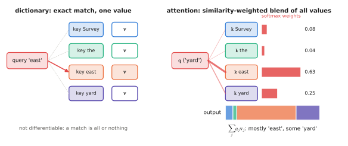
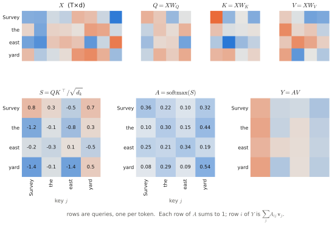
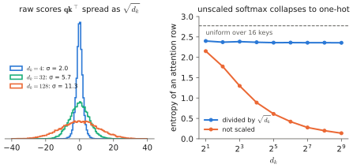
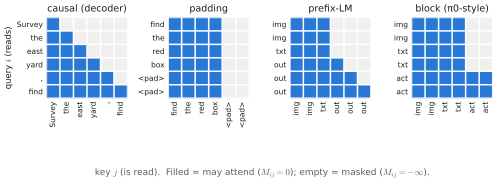

# 2.1 Attention

[0.8](../00-foundations/first-look.md#attention-in-one-paragraph) gave attention in one paragraph. This section derives it completely: every tensor, every dimension, the scaling factor, masking, cost, implementation, and its structural properties.

## What is it?

!!! definition "Scaled dot-product attention"
    Given **queries** $Q\in\mathbb{R}^{T\times d_k}$, **keys** $K\in\mathbb{R}^{S\times d_k}$ and **values** $V\in\mathbb{R}^{S\times d_v}$,

    $$
    \operatorname{Attention}(Q,K,V)=\underbrace{\operatorname{softmax}\!\left(\frac{QK^\top}{\sqrt{d_k}}+M\right)}_{A\ \in\ \mathbb{R}^{T\times S}}\,V\ \in\ \mathbb{R}^{T\times d_v},
    $$

    where the softmax is applied to each **row** independently (over the $S$ keys), and $M\in\{0,-\infty\}^{T\times S}$ is an optional **mask**.

| Symbol | Shape | Meaning |
|---|---|---|
| $T$ | — | number of queries: the positions that *receive* information |
| $S$ | — | number of keys/values: the positions that *provide* information ($S=T$ in self-attention) |
| $d_k$ | — | width of queries and keys (they must match: they are dot-producted) |
| $d_v$ | — | width of values, and therefore of the output |
| $Q_{i,:}=\mathbf{q}_i$ | $1\times d_k$ | query of position $i$: what position $i$ is looking for |
| $K_{j,:}=\mathbf{k}_j$ | $1\times d_k$ | key of position $j$: what position $j$ offers to be matched against |
| $V_{j,:}=\mathbf{v}_j$ | $1\times d_v$ | value of position $j$: what position $j$ contributes if attended to |
| $QK^\top$ | $T\times S$ | raw **scores**: entry $(i,j)=\mathbf{q}_i\mathbf{k}_j^\top$ |
| $A$ | $T\times S$ | **attention weights**; each row is a probability distribution over the $S$ keys |
| output row $i$ | $1\times d_v$ | $\sum_j A_{ij}\mathbf{v}_j$: a convex combination of the values |

In **self-attention**, all three come from the same sequence $X\in\mathbb{R}^{T\times d}$ by learned linear maps:

$$
Q = XW_Q,\quad K = XW_K,\quad V = XW_V,\qquad W_Q,W_K\in\mathbb{R}^{d\times d_k},\ W_V\in\mathbb{R}^{d\times d_v}.
$$

In **cross-attention**, $Q$ comes from one sequence and $K,V$ from another ([2.2](multi-head.md#cross-attention)).

## Why does it exist? Three derivations of the same formula

### 1. A differentiable dictionary

A Python dictionary maps a query to the value whose key *equals* it. Replace equality by a similarity score, and the single selected value by a similarity-weighted average:

$$
\text{lookup}(\mathbf{q})=\sum_j \frac{\exp(\operatorname{sim}(\mathbf{q},\mathbf{k}_j))}{\sum_{j'}\exp(\operatorname{sim}(\mathbf{q},\mathbf{k}_{j'}))}\,\mathbf{v}_j .
$$

<figure markdown="span">
  
  <figcaption markdown="span">Attention as a soft dictionary. A hard lookup returns the single value whose key matches. Attention scores the query against every key, turns the scores into softmax weights, and returns the weighted blend of all values. Every step is differentiable.</figcaption>
</figure>

With $\operatorname{sim}(\mathbf{q},\mathbf{k})=\mathbf{q}\mathbf{k}^\top/\sqrt{d_k}$ this is attention. The lookup is differentiable in the query, the keys and the values — so a network can *learn* what to look for, what to advertise, and what to return.

### 2. Kernel regression

Given samples $(\mathbf{k}_j,\mathbf{v}_j)$ of an unknown function, the **Nadaraya–Watson** estimator predicts its value at $\mathbf{q}$ as $\sum_j\kappa(\mathbf{q},\mathbf{k}_j)\mathbf{v}_j/\sum_{j'}\kappa(\mathbf{q},\mathbf{k}_{j'})$. With the exponential kernel $\kappa(\mathbf{q},\mathbf{k})=\exp(\mathbf{q}\mathbf{k}^\top/\sqrt{d_k})$, this is attention. Each token performs a non-parametric regression over the other tokens, in a feature space the network learns.

### 3. Message passing on a complete graph

Treat the $S$ positions as nodes of a fully connected directed graph. Node $j$ sends message $\mathbf{v}_j$; node $i$ aggregates incoming messages with weights $A_{ij}$ that depend on both endpoints' content. Attention is a **graph neural network layer on a complete graph with learned, input-dependent edge weights**, and a mask removes edges.

!!! robot "Attention and consensus"
    If you have worked with distributed consensus, the update $Y = AV$ with $A$ row-stochastic ($A_{ij}\ge0$, $\sum_jA_{ij}=1$) is exactly the form of a consensus iteration $\mathbf{x}\leftarrow W\mathbf{x}$, with one difference: the weight matrix is recomputed from the agents' states at every step. Two consequences follow, both studied in the literature: repeated pure attention (no residual connection, no MLP) drives all token representations toward each other — **rank collapse**, the transformer analogue of reaching consensus — which is one reason residual connections are indispensable ([2.4](block.md#the-residual-stream)). And attention is a natural language for **multi-robot communication**: each robot's message is a value, relevance is computed from content, and a communication-graph mask restricts who hears whom ([Chapter 14](../14-multi-robot/index.md)).

## How does it work? Step by step

Take the running example's first clause, tokenised to $T=4$ tokens — `Survey`, `the`, `east`, `yard` — embedded with $d=8$, and a single head with $d_k=d_v=4$.

1. **Project.** $Q=XW_Q$, $K=XW_K$, $V=XW_V$, each $4\times4$. Every token gets a query, a key and a value.
2. **Score.** $QK^\top$ is $4\times4$: entry $(i,j)$ is how well token $i$'s query matches token $j$'s key.
3. **Scale.** Divide by $\sqrt{d_k}=2$ (next subsection).
4. **Mask** (optional). Add $-\infty$ where attention is forbidden.
5. **Normalise.** Softmax along each row: row $i$ becomes a distribution over which tokens $i$ reads.
6. **Aggregate.** Multiply by $V$: row $i$ of the output is the weighted mixture of the value vectors.

```python
import math
import torch

torch.manual_seed(0)
T, d, d_k = 4, 8, 4
X = torch.randn(T, d)                         # (T, d): embedded "Survey the east yard"
W_Q, W_K, W_V = (torch.randn(d, d_k) / math.sqrt(d) for _ in range(3))

Q, K, V = X @ W_Q, X @ W_K, X @ W_V           # each (T, d_k)
scores = Q @ K.T / math.sqrt(d_k)             # (T, T)
A = scores.softmax(dim=-1)                    # (T, T); rows sum to 1
Y = A @ V                                     # (T, d_k)

print(A.sum(-1))                              # tensor([1., 1., 1., 1.])
```

<figure markdown="span">
  
  <figcaption markdown="span">Every tensor of the code above, computed with the same seed. The projections are random, so the pattern itself means nothing yet: Lab 03 trains them. The shapes and the row-wise softmax are exactly what a trained model computes.</figcaption>
</figure>

With a batch and several heads the same code runs unchanged on `(B, h, T, d_k)` tensors, because `@` batches over leading dimensions ([0.1](../00-foundations/tensors.md#matrix-multiplication)); `K.T` becomes `K.transpose(-2, -1)`.

### Why divide by $\sqrt{d_k}$? {#why-scale}

Assume (as at initialisation) that the entries of $\mathbf{q}$ and $\mathbf{k}$ are independent with mean 0 and variance 1. Then

$$
\mathbf{q}\mathbf{k}^\top=\sum_{m=1}^{d_k}q_mk_m,\qquad \mathbb{E}[q_mk_m]=0,\quad \operatorname{Var}(q_mk_m)=\mathbb{E}[q_m^2]\,\mathbb{E}[k_m^2]=1,
$$

so $\operatorname{Var}(\mathbf{q}\mathbf{k}^\top)=d_k$: the scores have standard deviation $\sqrt{d_k}$. For $d_k=128$ that is $\approx11$. Softmax of logits spread over $\pm 20$ or more is essentially one-hot, and the softmax Jacobian $\operatorname{diag}(\mathbf{a})-\mathbf{a}^\top\mathbf{a}$ ([0.4](../00-foundations/probability.md#softmax)) is then nearly zero: **gradients vanish and attention cannot learn**. Dividing by $\sqrt{d_k}$ restores unit variance regardless of $d_k$ — the same variance-preservation argument as weight [initialisation](../00-foundations/training.md#initialisation).

<figure markdown="span">
  
  <figcaption markdown="span">Left: with unit-variance entries, raw scores have standard deviation $\sqrt{d_k}$. Right: without the $1/\sqrt{d_k}$ factor, attention rows become nearly one-hot as $d_k$ grows (entropy → 0), and the softmax gradient vanishes with them. Measured on random vectors.</figcaption>
</figure>

The factor is a temperature. Some models replace it by a learned temperature, or by normalising $\mathbf{q}$ and $\mathbf{k}$ (*QK-norm*) to keep scores bounded during training — a stabilisation used in several recent large models.

### Masking

A mask adds $-\infty$ to forbidden scores before the softmax, so $e^{-\infty}=0$ and those keys receive zero weight while the remaining weights still sum to 1.

!!! definition "Masks"
    - **Padding mask:** $M_{ij}=-\infty$ if key $j$ is padding ([0.5](../00-foundations/tokens.md#special-tokens-padding-and-masks)). Shape `(B, 1, 1, S)`, broadcast over heads and queries.
    - **Causal mask:** $M_{ij}=-\infty$ if $j>i$. Position $i$ sees only positions $\le i$, which makes the model [autoregressive](../00-foundations/sequence-models.md#the-autoregressive-factorisation): the prediction at $i$ cannot cheat by looking at the token it must predict.
    - **Block / prefix masks:** arbitrary patterns, e.g. bidirectional attention among image and instruction tokens (the *prefix*) and causal attention among generated tokens. VLAs use such masks to control exactly which tokens may read which: in π0, the action tokens read the image–text prefix but the prefix never reads the actions ([Chapter 10](../10-case-studies/index.md)).

<figure markdown="span">
  
  <figcaption markdown="span">Four masks over six tokens; row $i$ shows which keys query $i$ may read. **Causal**: only the past. **Padding**: nobody reads `<pad>` keys. **Prefix-LM**: the prefix (image, text) is bidirectional, generated tokens are causal. **Block**, as in π0: image and text tokens never read the action tokens, while action tokens read everything.</figcaption>
</figure>

!!! warning "The all-masked row"
    If every key of some query is masked (e.g. a query at a padding position with a padding mask), the softmax computes $0/0$ = `NaN`, which then propagates through the whole network. Implementations either guarantee each row has a visible key or replace $-\infty$ with a large finite negative number.

In code, masks are usually boolean (`True` = may attend) and applied with `masked_fill`:

```python
mask = torch.ones(T, T, dtype=torch.bool).tril()          # causal, (T, T)
scores = scores.masked_fill(~mask, float("-inf"))
```

## Structural properties

**Convex combinations.** Each output row lies in the convex hull of the value vectors. Attention can select and mix, but it cannot by itself produce something outside what the values span; new features come from the projections and the MLP.

**Permutation equivariance.** Let $P$ be a $T\times T$ permutation matrix. Without a mask, $\operatorname{Attention}(PXW_Q,PXW_K,PXW_V)=P\operatorname{Attention}(XW_Q,XW_K,XW_V)$, because $PQK^\top P^\top$ permutes rows and columns of the scores consistently, softmax acts row-wise, and $P^\top P=I$. Permuting the input permutes the output identically: **attention does not know token order**. Order must be supplied by [positional encodings](positions.md).

**Content-dependent weights.** Unlike a convolution (fixed weights over a fixed neighbourhood) or an MLP (fixed weights over fixed input positions), the mixing weights $A$ are functions of the input. This is what makes attention expressive — and what makes it hard to analyse.

## Computational cost

For one head, with $T$ queries and $S$ keys:

| Step | FLOPs | Memory for intermediates |
|---|---|---|
| $QK^\top$ | $2TSd_k$ | $T\times S$ scores |
| softmax | $O(TS)$ | $T\times S$ |
| $AV$ | $2TSd_v$ | $T\times d_v$ |

For self-attention ($S=T$) both compute and memory are **quadratic in sequence length**. The projections cost $O(Td^2)$, linear in $T$. For short sequences the projections and MLP dominate; past $T\approx d$ (a few thousand tokens for typical widths) the quadratic term takes over.

| $T$ | score entries per head per layer | notes |
|---|---|---|
| 256 (one image) | 65 536 | trivial |
| 600 (two images + instruction: a typical VLA step) | 360 000 | |
| 8 192 | $6.7\times10^7$ | long-context LLM; score matrix no longer fits in fast memory |
| 196 × 30 (30-frame history at one image each) | $3.5\times10^7$ | why VLAs rarely use long visual history |

FlashAttention ([2.6](inference.md#memory-bandwidth-and-flashattention)) removes the $T\times S$ *memory* term by never materialising the score matrix; the FLOPs remain quadratic.

## Limitations

- **Quadratic cost** in sequence length, which limits image resolution, number of cameras and history length.
- **No inherent notion of order or geometry**; it must be added.
- **Soft, dense weights**: every token attends a little to everything; attention weights are *not* reliable explanations of model decisions (they show where information was read from in one layer, not why an output was produced).

## Why it matters for VLAs and robots

Attention is the mechanism by which a VLA relates "the red toolbox" in the instruction to the pixels where it appears, the gripper's state to the object, and the current action to the scene. Its quadratic cost is why VLA designers fight over token counts, and its mask is how they encode *which information may influence which output* — a structural design choice with safety relevance (e.g. ensuring that action tokens cannot change how the scene is perceived).

!!! lab "Lab 03 — Attention from scratch"
    Implement attention step by step on the running example, inspect every intermediate tensor, verify the $\sqrt{d_k}$ variance argument empirically and watch softmax saturate without it, build padding/causal/prefix masks, demonstrate permutation equivariance, compare with `torch.nn.functional.scaled_dot_product_attention`, and train a single attention layer on an associative-recall task to see learned attention patterns.
