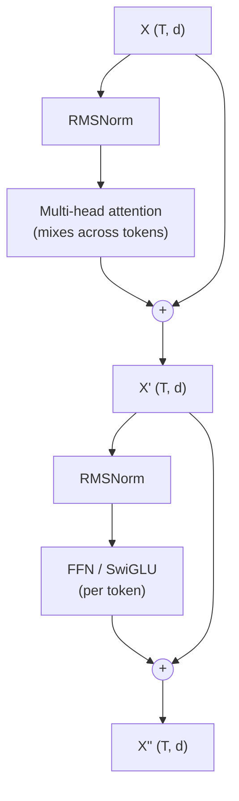
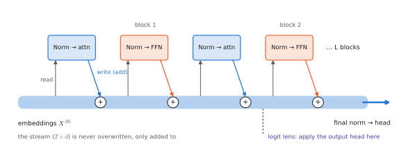

# 2.4 The Transformer Block

## What is it?

!!! definition "Pre-norm transformer block"
    For a sequence $X\in\mathbb{R}^{T\times d}$, a (pre-norm) transformer block computes

    $$
    \begin{aligned}
    X' &= X + \operatorname{MHA}\big(\operatorname{Norm}_1(X)\big),\\
    X'' &= X' + \operatorname{FFN}\big(\operatorname{Norm}_2(X')\big),
    \end{aligned}
    $$

    where $\operatorname{MHA}$ is [multi-head attention](multi-head.md) (with a mask), $\operatorname{FFN}$ is a position-wise MLP, and $\operatorname{Norm}$ is LayerNorm or RMSNorm. Input and output are both $T\times d$. A transformer is $L$ such blocks, an input embedding, and an output head.

Every LLM, ViT, VLM and VLA backbone in this book is this block repeated; differences between models are mostly in the norm type, the FFN variant, the positional encoding, the mask, and the sizes $(d,L,h,d_\text{ff})$.



## The residual stream

!!! definition "Residual stream"
    Because every sub-layer *adds* its output to its input, the sequence of vectors $X^{(0)},X^{(1)},\dots,X^{(2L)}$ can be read as one **residual stream**: a $T\times d$ working memory that each sub-layer *reads* (through its normalisation and input projections) and *writes* to (by adding its output). Unrolled,

    $$
    X^{(2L)}=X^{(0)}+\sum_{\text{sub-layers } s}f_s\big(\text{its input}\big).
    $$

<figure markdown="span">
  
  <figcaption markdown="span">The residual stream. Each sub-layer reads a normalised copy of the stream and adds its output back. Nothing is ever overwritten, which is why gradients flow through depth, and why the logit lens can read intermediate predictions.</figcaption>
</figure>

Three reasons this structure is essential:

1. **Gradient flow.** $\partial X^{(\ell+1)}/\partial X^{(\ell)}=I+\partial f/\partial X$. The identity term gives every layer a direct gradient path to the loss, regardless of depth — the transformer's answer to the [vanishing-gradient problem](../00-foundations/sequence-models.md#vanishing-and-exploding-gradients), and the reason 100-layer networks train (He et al., 2016, introduced residual connections for CNNs).
2. **Incremental computation.** Each sub-layer only needs to compute a *correction*. If a layer has nothing useful to add, it can output ≈ 0 and the stream passes through.
3. **Communication bus.** Attention heads and MLPs communicate only through the stream; a feature written by an early head in some subspace can be read by a later layer. This is the basis of mechanistic interpretability (Elhage et al., 2021) and of techniques like the **logit lens** (apply the output head to intermediate stream states to see what the model "currently predicts"), which you use in Lab 05.

It also explains the rank-collapse remark of [2.1](attention.md#why-does-it-exist-three-derivations-of-the-same-formula): pure attention averages token representations together; the residual path keeps each token's own information.

## Normalisation

Activations in the stream grow and drift during training; normalisation keeps each sub-layer's *input* at a controlled scale.

!!! definition "LayerNorm and RMSNorm"
    For one token vector $\mathbf{x}\in\mathbb{R}^{d}$ (normalisation is per token, over the feature dimension — never across the batch or sequence):

    $$
    \operatorname{LayerNorm}(\mathbf{x})=\boldsymbol{\gamma}\odot\frac{\mathbf{x}-\mu}{\sqrt{\sigma^2+\epsilon}}+\boldsymbol\beta,\qquad \mu=\tfrac1d\textstyle\sum_ix_i,\ \ \sigma^2=\tfrac1d\sum_i(x_i-\mu)^2;
    $$

    $$
    \operatorname{RMSNorm}(\mathbf{x})=\boldsymbol\gamma\odot\frac{\mathbf{x}}{\sqrt{\tfrac1d\sum_ix_i^2+\epsilon}}.
    $$

    $\boldsymbol\gamma,\boldsymbol\beta\in\mathbb{R}^{d}$ are learned; $\epsilon\approx10^{-6}$ avoids division by zero.

RMSNorm drops the mean subtraction and the bias: cheaper, and empirically as good. It is used by Llama, Gemma, Qwen, SmolLM and most VLA backbones; ViTs and older models use LayerNorm.

**Pre-norm vs post-norm.** The original transformer normalised *after* the residual addition, $X'=\operatorname{Norm}(X+\operatorname{MHA}(X))$. That puts a normalisation on the residual path itself, which interferes with gradient flow: post-norm models need careful learning-rate warm-up and are unstable at depth. Pre-norm (normalise only the branch input) leaves the residual path an exact identity and is the modern default. Pre-norm models need one final norm before the output head.

## The feed-forward network

The FFN is applied to each token independently — it does not mix positions — and holds about two-thirds of a transformer's parameters.

**Classic FFN:** $\operatorname{FFN}(\mathbf{x})=\sigma(\mathbf{x}W_1+\mathbf{b}_1)W_2+\mathbf{b}_2$, with $W_1\in\mathbb{R}^{d\times d_\text{ff}}$, $W_2\in\mathbb{R}^{d_\text{ff}\times d}$, $d_\text{ff}=4d$, $\sigma$ = ReLU or GELU. Parameters $\approx 8d^2$.

**SwiGLU** (Shazeer, 2020): a gated variant,

$$
\operatorname{SwiGLU}(\mathbf{x})=\big(\operatorname{SiLU}(\mathbf{x}W_1)\odot\mathbf{x}W_3\big)W_2,\qquad W_1,W_3\in\mathbb{R}^{d\times d_\text{ff}},\ W_2\in\mathbb{R}^{d_\text{ff}\times d}.
$$

The second projection $\mathbf{x}W_3$ acts as a data-dependent gate on the activated features. With three matrices, $d_\text{ff}\approx\tfrac83d$ keeps the parameter count at $\approx8d^2$. SwiGLU consistently improves quality at equal parameter count and is standard in modern LLMs.

**What the FFN does.** If attention *moves* information between tokens, the FFN *processes* it within a token. One useful (approximate) view: the rows of $W_1$ are "keys" matched against the token, the rows of $W_2$ are "values" written back to the stream — a large associative memory. Factual knowledge in LLMs is largely stored in FFN weights.

## Putting it together

```python
class Block(nn.Module):
    def __init__(self, d, n_heads, d_ff):
        super().__init__()
        self.norm1, self.attn = RMSNorm(d), MultiHeadAttention(d, n_heads)
        self.norm2, self.ffn = RMSNorm(d), SwiGLU(d, d_ff)

    def forward(self, x, mask=None):                  # x: (B, T, d)
        x = x + self.attn(self.norm1(x), mask=mask)   # mix across tokens
        x = x + self.ffn(self.norm2(x))               # transform each token
        return x                                      # (B, T, d)
```

This is (abridged) `vlacourse.transformer.Block`, which you build yourself in Lab 04. **Dropout** (randomly zeroing a fraction of activations during training) is often inserted after attention weights and sub-layer outputs in small models; large-scale pretraining usually disables it.

### Parameters per block

| Component | Parameters |
|---|---|
| MHA ($W_Q,W_K,W_V,W_O$) | $4d^2$ (less with GQA) |
| FFN (classic, $d_\text{ff}=4d$) or SwiGLU ($d_\text{ff}=\tfrac83 d$) | $8d^2$ |
| two norms | $2d$ (RMSNorm) |
| **total** | $\approx 12d^2$ |

## Encoder, decoder, encoder–decoder

The same block yields three architectures, distinguished by masks and by what is attended to:

| Architecture | Mask | Example | Typical use |
|---|---|---|---|
| **encoder-only** | none (bidirectional) | BERT, ViT, SigLIP image tower | representations / understanding |
| **decoder-only** | causal | GPT, Llama, Gemma, SmolLM | generation; the backbone of VLMs and VLAs |
| **encoder–decoder** | bidirectional encoder; causal decoder with cross-attention to the encoder | original transformer, T5 | sequence-to-sequence |
| **prefix-LM** (hybrid) | bidirectional over a prefix, causal after it | PaliGemma; π0's prefix + action blocks | conditioned generation |

Decoder-only won for LLMs because one model, one objective, and one KV-cached inference path handle everything. VLAs inherit decoder-only or prefix-LM backbones from their VLMs.

## Limitations

- Every block costs the same compute, whether the token is easy or hard (adaptive-computation and mixture-of-experts variants address this).
- Depth is sequential: a VLA backbone with $L=32$ layers has 32 dependent steps per forward pass, which bounds latency regardless of parallel hardware.

## Why it matters for VLAs and robots

When a VLA paper says "we use a 2B Gemma backbone with an action expert of width 1024", you can now reconstruct the computation: $L$ blocks of RMSNorm → GQA attention with RoPE → residual → RMSNorm → GeGLU/SwiGLU FFN → residual, plus a second, narrower stack for the actions. The residual stream is also where you look when debugging or interpreting a VLA: you can probe it, patch it, or read it out with the logit lens.

!!! lab "Lab 04 — Transformer block and tiny GPT"
    Build RMSNorm, SwiGLU, and the block; assemble a decoder-only TinyGPT; count its parameters against the formula; train it on the depot instruction corpus on a CPU in a few minutes; and generate new instructions.
