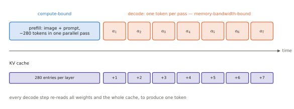
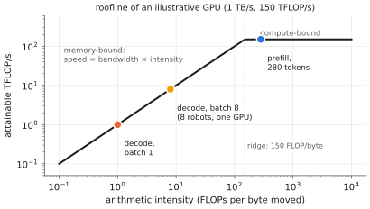

# 2.6 Inference: KV Cache, Memory Bandwidth and Latency

Training processes many sequences in parallel and cares about throughput. A robot runs **one** sequence, now, and cares about **latency**. This section explains what determines the time from "new camera frame" to "action available" in a transformer — the foundation of [Chapter 11](../11-deployment/index.md).

## Prefill and decode

Autoregressive generation has two phases:

1. **Prefill:** process the whole prompt (image tokens, instruction) in one forward pass. All $T$ positions are computed in parallel: large matrix multiplications, high GPU utilisation, **compute-bound**.
2. **Decode:** generate output tokens one at a time. Each step processes a *single* new token but must read the model's entire weights and the cached keys/values: tiny matrix–vector products, **memory-bandwidth-bound**.

<figure markdown="span">
  
  <figcaption markdown="span">One control step of a token-based VLA. One parallel prefill pass, then one decode pass per action token. Each decode pass appends one entry per layer to the KV cache, and must read all weights and the whole cache to produce a single token.</figcaption>
</figure>

A token-based VLA that emits 7 action tokens runs one prefill and 7 decode steps per control cycle. A flow-matching VLA runs one prefill plus $K$ (e.g. 10) passes of a small action expert.

## The KV cache

Without care, generating token $T+1$ would re-run the whole sequence: cost $O(T)$ per layer for the projections and $O(T^2)$ for attention, every step. But with a causal mask, the keys and values of past positions **never change** once computed — position $j$'s representation depends only on tokens $\le j$. So they can be cached.

!!! definition "KV cache"
    During generation, each attention layer stores the keys and values of all past positions, $K_{\le t},V_{\le t}$ (shape `(B, h_kv, t, d_h)` each). To process a new token, compute only its query, key and value, append the key and value to the cache, and attend from the new query to the whole cache. Per-step cost becomes $O(d^2)$ for projections and $O(td)$ for attention, instead of recomputing the full sequence.

```python
# inside an attention layer, for new tokens x_new: (B, T_new, d)
q, k, v = proj_q(x_new), proj_k(x_new), proj_v(x_new)      # (B, h, T_new, d_h)
if "k" in cache:
    k = torch.cat([cache["k"], k], dim=2)                   # (B, h, T_past + T_new, d_h)
    v = torch.cat([cache["v"], v], dim=2)
cache["k"], cache["v"] = k, v
out = attention(q, k, v, mask)                              # queries only for the new tokens
```

The mask must account for the offset: new query $i$ sits at absolute position $T_\text{past}+i$ and may see keys $0,\dots,T_\text{past}+i$. `vlacourse.transformer.TinyGPT` implements exactly this, and a unit test checks that cached and uncached greedy generation produce identical tokens.

**Memory.** For $L$ layers, $h_\text{kv}$ key/value heads of width $d_h$, $b$ bytes per number:

$$
\text{KV bytes per token} = 2\,L\,h_\text{kv}\,d_h\,b .
$$

Llama-2-7B ($L=32$, $h_\text{kv}=32$, $d_h=128$, bf16): $2\cdot32\cdot32\cdot128\cdot2=524{,}288$ bytes ≈ **0.5 MB per token**. A 600-token VLA context needs 315 MB of cache; an 8k context, 4.3 GB. GQA with $h_\text{kv}=8$ cuts this by 4×. This is why [GQA](multi-head.md#multi-query-and-grouped-query-attention) exists.

## FLOPs per token

A forward pass multiplies every weight matrix by every token vector once, and each multiply–add counts as 2 FLOPs. For a model with $N$ parameters (excluding embeddings, which are lookups),

$$
\text{FLOPs per token (forward)}\approx 2N,
$$

plus the attention term $\approx 4Ltd$ for a token attending to $t$ previous positions — small relative to $2N$ unless the context is very long. A 7B model needs ≈ 14 GFLOPs per token. Prefilling 600 tokens: ≈ 8.4 TFLOPs.

## Memory bandwidth and FlashAttention

### Arithmetic intensity

A GPU has two speeds: how fast it computes (FLOP/s) and how fast it moves data from its main memory (bytes/s). The ratio of work to data movement of an operation, its **arithmetic intensity** (FLOPs per byte), decides which limit binds (the *roofline model*).

- **Prefill:** each weight, read once, is used for all $T$ tokens: intensity $\propto T$. Compute-bound.
- **Decode at batch 1:** each weight is read once and used for one token: $2$ FLOPs per 2 bytes (bf16) ≈ 1 FLOP/byte. Modern GPUs can do 100–300 FLOPs in the time they read one byte. Decode is **memory-bandwidth-bound**: the GPU waits on memory almost all the time.

<figure markdown="span">
  
  <figcaption markdown="span">The roofline model (illustrative GPU numbers). Decode at batch 1 performs ≈1 FLOP per byte read and sits far down the bandwidth slope. Prefill reuses each weight for every token and reaches the compute roof. Batching requests, for example from several robots, moves decode up the slope.</figcaption>
</figure>

So the decode latency lower bound is simply

$$
t_\text{token}\gtrsim\frac{\text{bytes of weights (+ KV cache) read per step}}{\text{memory bandwidth}} .
$$

| Hardware | Bandwidth | 7B model in bf16 (14 GB) | 7B in 4-bit (≈3.5 GB) |
|---|---|---|---|
| desktop GPU (RTX 4090) | ≈1 TB/s | ≥ 14 ms/token | ≥ 3.5 ms/token |
| embedded (Jetson AGX Orin) | ≈205 GB/s | ≥ 68 ms/token | ≥ 17 ms/token |

!!! robot "Latency arithmetic for a token-based VLA"
    OpenVLA (7B) emits 7 action tokens per step. On the Orin, decode alone needs ≥ 7 × 68 ms ≈ 0.5 s in bf16, plus prefill of ~280 tokens (one image + prompt) — an upper bound of ~2 Hz before any overhead. On a desktop GPU the OpenVLA authors report ~6 Hz. A quadrotor's attitude loop runs at ~250 Hz–1 kHz, its position loop at ~50 Hz. The numbers alone tell you a 7B token-based VLA cannot be in the inner loop of a drone, and that quantisation (bytes per weight) translates *directly* into speed. This is the arithmetic behind the architectural recommendations of [Chapter 13](../13-uavs/index.md).

### FlashAttention

Standard attention writes the $T\times S$ score matrix to GPU main memory, reads it back for the softmax, writes the weights, reads them again for $AV$ — dominated by memory traffic, not FLOPs. **FlashAttention** (Dao et al., 2022) splits $Q$, $K$, $V$ into tiles that fit in fast on-chip memory and computes the output tile by tile, never materialising the full matrix. The obstacle is the softmax, whose normaliser needs the whole row; it is solved by an **online softmax**: keep a running maximum $m$ and running sum $\ell$, and rescale partial results when a new tile raises the maximum:

$$
m^\text{new}=\max(m,\ \max_j s_j),\qquad \ell^\text{new}=e^{m-m^\text{new}}\ell+\sum_je^{s_j-m^\text{new}},\qquad \mathbf{o}^\text{new}=e^{m-m^\text{new}}\mathbf{o}+\sum_je^{s_j-m^\text{new}}\mathbf{v}_j,
$$

with the final output $\mathbf{o}/\ell$. The result is *exact*, uses $O(T)$ instead of $O(T^2)$ memory, and is several times faster. In PyTorch, `F.scaled_dot_product_attention` dispatches to FlashAttention-style kernels automatically when it can.

## Other latency techniques (preview)

- **Quantisation** (8/4-bit weights) reduces bytes read per step — the most effective lever when bandwidth-bound ([Chapter 11](../11-deployment/index.md)).
- **Speculative decoding:** a small draft model proposes several tokens; the large model verifies them in one parallel pass.
- **Parallel decoding of actions:** predict all action dimensions (or a whole chunk) in one pass instead of autoregressively — OpenVLA-OFT's main speed-up ([Chapter 10](../10-case-studies/index.md)).
- **Batching** improves throughput but not single-request latency; a robot rarely has a batch to fill, but a multi-robot team served by one GPU does ([Chapter 14](../14-multi-robot/index.md)).

## Limitations

The KV cache trades compute for memory and grows without bound with context length. Memory bandwidth, not FLOPs, limits single-stream generation, which is why model size in *bytes* is the first number to check when deploying.

## Why it matters for VLAs and robots

Control rate is a function of bytes, bandwidth and the number of sequential passes. Every VLA design decision with a latency consequence — action tokens vs. flow head, chunk length, number of image tokens, model size, quantisation — can be evaluated with the formulas on this page before training anything.

!!! lab "Lab 04, part 4 and Lab 05"
    Implement the KV cache in TinyGPT and verify identical outputs and the speed-up; in Lab 05, time prefill vs. decode for SmolLM2 on CPU and GPU and compare with the bandwidth bound.
