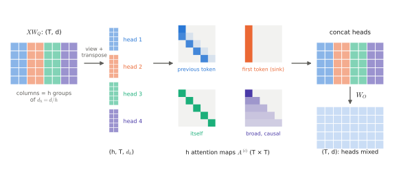
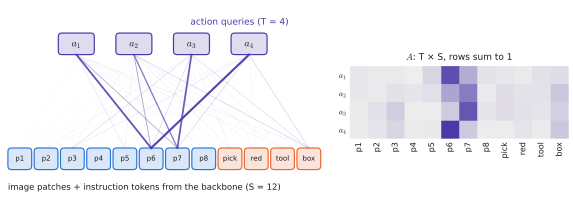
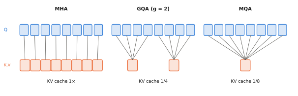

# 2.2 Multi-Head Attention and Cross-Attention

## What is it?

!!! definition "Multi-head attention (MHA)"
    Run $h$ attention operations ("heads") in parallel, each with its own projections into a $d_h=d/h$-dimensional subspace, concatenate their outputs and mix them with an output projection:

    $$
    \begin{aligned}
    \operatorname{head}_i &= \operatorname{Attention}\big(XW_Q^{(i)},\ XW_K^{(i)},\ XW_V^{(i)}\big)\in\mathbb{R}^{T\times d_h}, \qquad i=1,\dots,h,\\
    \operatorname{MHA}(X) &= \big[\operatorname{head}_1;\ \dots;\ \operatorname{head}_h\big]\,W_O\in\mathbb{R}^{T\times d},
    \end{aligned}
    $$

    with $W_Q^{(i)},W_K^{(i)},W_V^{(i)}\in\mathbb{R}^{d\times d_h}$ and $W_O\in\mathbb{R}^{d\times d}$ ($[\cdot;\cdot]$ concatenates along features, giving $T\times hd_h=T\times d$).

## Why does it exist?

A single head computes one attention distribution per query: one notion of "relevant". But a token typically needs several kinds of information at once. In *"bring the red toolbox to the inspection station"*, the token `toolbox` benefits from reading its adjective (`red`), its verb (`bring`), and the destination (`station`) — three different relations. One softmax row can only put its mass in one place; averaging the three into one distribution blurs them.

Multiple heads let the model attend to **different positions for different reasons**, in **different representation subspaces**, at the same cost as one full-width head: $h$ heads of width $d/h$ cost the same FLOPs as one head of width $d$.

## How does it work? The reshape trick

In practice the $h$ separate projections are stored as one $d\times d$ matrix per Q, K, V, and the heads are created by *reshaping* the result ([0.1](../00-foundations/tensors.md#reshaping-and-permuting)):

```python
B, T, d, h = 2, 5, 64, 8
d_h = d // h
X = torch.randn(B, T, d)

W_Q, W_K, W_V, W_O = (nn.Linear(d, d, bias=False) for _ in range(4))

def split(t):                                    # (B, T, d) -> (B, h, T, d_h)
    return t.view(B, T, h, d_h).transpose(1, 2)

Q, K, V = split(W_Q(X)), split(W_K(X)), split(W_V(X))      # each (B, h, T, d_h)
scores = Q @ K.transpose(-2, -1) / d_h ** 0.5              # (B, h, T, T)
A = scores.softmax(-1)                                     # (B, h, T, T)
heads = A @ V                                              # (B, h, T, d_h)
out = W_O(heads.transpose(1, 2).reshape(B, T, d))          # (B, T, d)
```

<figure markdown="span">
  
  <figcaption markdown="span">The reshape trick. The $d$ columns of $XW_Q$ (and of $K$, $V$) are split into $h$ groups. Each group becomes a head with its own $T\times T$ attention pattern; the four patterns shown are typical of trained heads. The head outputs are concatenated and mixed by $W_O$.</figcaption>
</figure>

The columns of the $d\times d$ matrix `W_Q.weight.T` split into $h$ blocks of $d_h$ columns; block $i$ is $W_Q^{(i)}$. The head dimension then behaves like a batch dimension: one batched matrix multiplication computes all heads at once.

The output projection $W_O$ is where heads interact. It can be written as a sum over heads, $\operatorname{MHA}(X)=\sum_{i=1}^{h}\operatorname{head}_i\,W_O^{(i)}$ with $W_O^{(i)}$ the $i$-th block of $d_h$ rows of $W_O$: **each head independently reads from the sequence and writes an additive contribution** — the view taken by the [residual-stream picture](block.md#the-residual-stream).

**Parameters:** four $d\times d$ matrices, $4d^2$ (plus biases if used). **FLOPs per token:** $8d^2$ for the projections, plus $4Td$ for the scores and weighted sum (summed over heads).

### What heads learn

Trained heads specialise, though rarely cleanly. Documented patterns in language models include heads attending to the previous token, to syntactic dependents, to the first token (an "attention sink" used as a no-op), and **induction heads** that implement copying ("if `A B` appeared before and the current token is `A`, attend to the token after the earlier `A`") — a mechanism behind in-context learning. In VLMs and VLAs, some heads attend from text tokens to the image patches of the referred object; Lab 05 lets you look for such patterns.

## Cross-attention

!!! definition "Cross-attention"
    **Cross-attention** is multi-head attention in which queries come from one sequence $X\in\mathbb{R}^{T\times d}$ and keys and values from another, $C\in\mathbb{R}^{S\times d_c}$:

    $$
    \operatorname{head}_i = \operatorname{Attention}\big(XW_Q^{(i)},\ CW_K^{(i)},\ CW_V^{(i)}\big),\qquad W_K^{(i)},W_V^{(i)}\in\mathbb{R}^{d_c\times d_h}.
    $$

    Output shape $T\times d$: one updated vector per *query* position. The attention matrix is $T\times S$ (rectangular). $C$ is not updated.

<figure markdown="span">
  
  <figcaption markdown="span">Cross-attention as used in VLA action heads (illustrative weights). Four action queries read twelve backbone tokens (image patches and instruction words). The attention matrix is rectangular, $T\times S$, and the backbone tokens are not changed.</figcaption>
</figure>

Cross-attention is how one stream *reads* another without merging them. It appears:

- in the original **encoder–decoder** transformer: the decoder reads the encoded source sentence;
- in **Flamingo**-style VLMs: text tokens read image features;
- in **Perceiver/Q-Former resamplers**: a small, fixed set of $T$ learned query vectors reads $S\gg T$ image patches, compressing them to $T$ tokens ([Chapter 4](../04-alignment/index.md));
- in **VLA action heads**: $H_a$ action queries (one per future time step) read the backbone's image–language features and are turned into an action chunk (GR00T N1, the transformer variant of Diffusion Policy; Octo's *readout tokens* do the same inside a single self-attention stack with a block mask).

!!! robot "Cross-attention as a compression knob"
    Two depot cameras at $448\times448$ with $P=14$ give $2\times1024=2048$ patch tokens. Feeding them all into a 7B backbone costs a lot per control step. A resampler with 64 learned queries cross-attending to the 2048 patches reduces the backbone's input to 64 tokens at a cost of $64\times2048$ scores. Whether the 64 tokens retain the information needed to grasp a small handle is an empirical — and research-relevant — question: compression trades latency for spatial precision.

## Multi-query and grouped-query attention

At inference time, the keys and values of past tokens are cached ([KV cache](inference.md#the-kv-cache)), and its size is proportional to the number of K/V heads. Two variants share K/V across query heads:

- **Multi-query attention (MQA):** all $h$ query heads share *one* K head and one V head. KV cache shrinks $h$-fold; quality drops somewhat.
- **Grouped-query attention (GQA):** the $h$ query heads are split into $g$ groups; each group shares one K/V head. $g=h$ is MHA, $g=1$ is MQA. Llama 2/3 (70B), Mistral, Gemma, and the SmolLM2 models in Lab 05 use GQA.

<figure markdown="span">
  
  <figcaption markdown="span">Eight query heads sharing key/value heads. The KV cache scales with the number of K/V heads, which is the whole point of GQA and MQA.</figcaption>
</figure>

```python
# GQA: h query heads, g key/value heads (h % g == 0)
Q = split_heads(W_Q(X), h)          # (B, h, T, d_h)
K = split_heads(W_K(X), g)          # (B, g, T, d_h)   W_K: d -> g * d_h
V = split_heads(W_V(X), g)
K = K.repeat_interleave(h // g, dim=1)   # (B, h, T, d_h): each K/V head serves h/g query heads
V = V.repeat_interleave(h // g, dim=1)
```

The motivation is purely systems-level: on a robot, inference is usually memory-bandwidth bound, and the KV cache is part of what must be read every step ([2.6](inference.md)).

## Limitations

- Heads are not guaranteed to specialise or be interpretable; many can be pruned with little loss.
- The low per-head width $d_h$ limits the rank of each head's attention-score matrix $QK^\top$ (at most $d_h$).

## Why it matters for VLAs and robots

Multi-head self-attention is the computation inside the VLA backbone; cross-attention is the most common way to connect an action head to that backbone; GQA is a deployment optimisation already baked into the LLMs that VLAs are built on. When you read a VLA architecture figure, the arrows between "backbone" and "action expert" are almost always cross-attention or a shared self-attention with a block mask — and the difference matters for latency and for what can influence what.
