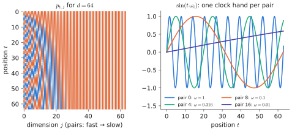
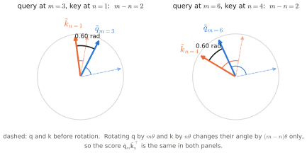

# 2.3 Positional Encodings

## What is it?

!!! definition "Positional encoding"
    A **positional encoding** injects the position $t$ of each token into a transformer, which is otherwise [permutation-equivariant](attention.md#structural-properties). Three families:

    1. **Absolute, additive:** add a vector $\mathbf{p}_t\in\mathbb{R}^{d}$ to the token embedding, $\mathbf{x}_t\leftarrow\mathbf{x}_t+\mathbf{p}_t$, once at the input. $\mathbf{p}_t$ is learned (GPT-2, ViT) or fixed sinusoids (original transformer).
    2. **Relative, in the scores:** add a bias depending on $i-j$ to the attention score of query $i$ and key $j$ (T5, ALiBi).
    3. **Rotary (RoPE):** rotate queries and keys by position-dependent angles inside every attention layer, so that their dot product depends only on the offset $i-j$ (Llama, Qwen, Gemma, SmolLM, PaliGemma's Gemma backbone).

## Why does it exist?

Without positions, *"the drone follows the rover"* and *"the rover follows the drone"* produce the same multiset of output vectors. Proof: an unmasked attention layer satisfies $\operatorname{Attn}(PX)=P\operatorname{Attn}(X)$ for any permutation $P$, and the position-wise MLP trivially commutes with $P$, so the whole stack does. Any order information must therefore enter through the inputs or the scores. (A causal mask does break the symmetry — the first token sees only itself — and decoder-only models can learn some position information from it, but explicit encodings work far better.)

## How does it work?

### Learned absolute embeddings

A second table $P\in\mathbb{R}^{T_\text{max}\times d}$; $\mathbf{x}_t\leftarrow E_{i_t,:}+P_{t,:}$. Simple, used by GPT-2, BERT, ViT, and the TinyGPT of Lab 04. Cannot extrapolate beyond $T_\text{max}$ (position $T_\text{max}+1$ has no row) and treats position 7 and position 8 as unrelated symbols until training teaches otherwise.

### Sinusoidal encodings

Vaswani et al. used fixed features:

$$
p_{t,2i}=\sin\!\big(t\,\omega_i\big),\qquad p_{t,2i+1}=\cos\!\big(t\,\omega_i\big),\qquad \omega_i=10000^{-2i/d},\quad i=0,\dots,\tfrac d2-1 .
$$

Each pair of dimensions is a sinusoid with frequency $\omega_i$, ranging geometrically from 1 rad/token to $10^{-4}$ rad/token — like the hands of a clock, from seconds to days. The key property: shifting the position by $k$ is a **fixed linear map** of the encoding. For each pair,

$$
\begin{pmatrix}\sin((t+k)\omega)\\ \cos((t+k)\omega)\end{pmatrix}=\begin{pmatrix}\cos k\omega & \sin k\omega\\ -\sin k\omega & \cos k\omega\end{pmatrix}\begin{pmatrix}\sin t\omega\\ \cos t\omega\end{pmatrix},
$$

a rotation by $k\omega$ that does not depend on $t$. So relative offsets are linearly accessible to the network. The same sinusoidal features are used to embed the continuous **diffusion time** $\tau$ in [Chapter 6](../06-generative/index.md) — a position on a continuous axis.

<figure markdown="span">
  
  <figcaption markdown="span">Sinusoidal encodings for $d=64$. Left: each row is the vector $\mathbf{p}_t$ added to the token at position $t$. Right: individual pairs oscillate at geometrically spaced frequencies, like the hands of a clock.</figcaption>
</figure>

### Rotary position embedding (RoPE)

RoPE (Su et al., 2021) takes the rotation idea and applies it *to queries and keys directly*, in every layer, instead of adding anything to the input.

**Two dimensions first.** View a 2-D query $\mathbf{q}=(q_1,q_2)$ as the complex number $q=q_1+\mathrm{i}q_2$, likewise $k$. Encode position $m$ of the query and $n$ of the key by rotating:

$$
\tilde q_m = q\,e^{\mathrm{i}m\theta},\qquad \tilde k_n = k\,e^{\mathrm{i}n\theta}.
$$

The real dot product of two 2-D vectors equals $\operatorname{Re}(a\bar b)$ in complex notation, so the attention score is

$$
\langle\tilde{\mathbf{q}}_m,\tilde{\mathbf{k}}_n\rangle=\operatorname{Re}\!\big(q\,e^{\mathrm{i}m\theta}\,\bar k\,e^{-\mathrm{i}n\theta}\big)=\operatorname{Re}\!\big(q\bar k\,e^{\mathrm{i}(m-n)\theta}\big),
$$

which depends on the positions **only through $m-n$**. The content ($q\bar k$) and the relative position interact multiplicatively.

<figure markdown="span">
  
  <figcaption markdown="span">RoPE in two dimensions. The query is rotated by $m\theta$ and the key by $n\theta$. Shifting both positions by the same amount (left: $m=3,n=1$; right: $m=6,n=4$) leaves the angle between them, and therefore their dot product, unchanged.</figcaption>
</figure>

**$d_h$ dimensions.** Split $\mathbf{q}\in\mathbb{R}^{d_h}$ into $d_h/2$ pairs and rotate pair $i$ by angle $m\theta_i$ with $\theta_i=b^{-2i/d_h}$ (base $b=10^4$ originally; $5\times10^5$ in Llama 3, to slow the rotations for longer contexts). In matrix form, with $R_m=\operatorname{blockdiag}(R(m\theta_0),\dots,R(m\theta_{d_h/2-1}))$ and row vectors,

$$
\tilde{\mathbf{q}}_m=\mathbf{q}_mR_m,\quad\tilde{\mathbf{k}}_n=\mathbf{k}_nR_n,\qquad \tilde{\mathbf{q}}_m\tilde{\mathbf{k}}_n^\top=\mathbf{q}_mR_mR_n^\top\mathbf{k}_n^\top=\mathbf{q}_mR_{m-n}\mathbf{k}_n^\top ,
$$

since 2-D rotations commute and $R_n^\top=R_{-n}$. Values are not rotated.

Properties: no learned parameters; relative by construction; applied per layer, so position information does not fade with depth; and the high-frequency pairs make nearby offsets distinguishable while low-frequency pairs vary slowly over long ranges. RoPE does not extrapolate gracefully far beyond the trained context, which is addressed by rescaling the frequencies (position interpolation, NTK/YaRN scaling) and fine-tuning briefly on longer sequences.

```python
def rope(x, base=10000.0):
    """x: (B, h, T, d_h) queries or keys. Rotates pairs (2i, 2i+1) by angle t * theta_i."""
    B, h, T, d_h = x.shape
    theta = base ** (-torch.arange(0, d_h, 2, dtype=torch.float32) / d_h)   # (d_h/2,)
    angles = torch.arange(T, dtype=torch.float32)[:, None] * theta           # (T, d_h/2)
    cos, sin = angles.cos(), angles.sin()
    x1, x2 = x[..., 0::2], x[..., 1::2]                                      # (B, h, T, d_h/2) each
    out = torch.empty_like(x)
    out[..., 0::2] = x1 * cos - x2 * sin
    out[..., 1::2] = x1 * sin + x2 * cos
    return out
```

!!! warning "Two RoPE layouts"
    The code above rotates *interleaved* pairs $(0,1),(2,3),\dots$ as in the paper. Hugging Face's Llama implementation instead rotates pairs $(i, i+d_h/2)$ (the "rotate-half" layout). Both are valid encodings, but weights trained with one are wrong under the other. Porting a checkpoint between codebases with mismatched layouts produces a model that runs without error and outputs garbage — a bug class worth knowing when you modify VLA backbones.

### Relative biases and ALiBi

T5 adds a learned scalar bias $b_{\text{bucket}(i-j)}$ to each score; ALiBi adds a fixed linear penalty $-\lambda_h|i-j|$ per head, which biases toward recent tokens and extrapolates to longer sequences. Both act directly on the $T\times S$ score matrix.

## Positions beyond text

Position is a modelling decision for every modality in a VLA:

| Tokens | What "position" means | Common choice |
|---|---|---|
| text | order in the sentence | RoPE (inherited from the LLM) |
| image patches | 2-D location $(r,c)$ in the grid | learned 2-D table in the ViT; the LLM then also applies its 1-D RoPE to the flattened sequence |
| multiple cameras | which camera + location | camera-specific learned embeddings added to patch tokens |
| action chunk | future time step $k=0,\dots,H_a-1$ | learned per-step embeddings, or sinusoids |
| diffusion/flow time $\tau$ | position on a continuous axis | sinusoidal features + MLP |
| robots in a team | *no natural order* | omit positions (permutation equivariance), or robot-ID / embodiment embeddings |

!!! robot "Order is a choice in multi-robot systems"
    If the depot coordinator encodes the drones' reports as a token sequence `[drone 1, drone 2, rover]` with positional encodings, its output depends on the arbitrary order in which the robots were listed — and a team of 4 robots is a sequence length it may never have seen. Dropping positional encodings makes the coordinator **permutation-equivariant**: renaming robots renames the outputs and changes nothing else, and the same network applies to any team size. Encoding *spatial* position (each robot's pose) instead of list position is a third option. This choice — which symmetries a multi-robot policy should respect — is a recurring theme of [Chapter 14](../14-multi-robot/index.md).

## Limitations

- Absolute learned embeddings do not extrapolate beyond the trained length.
- RoPE extrapolates poorly without rescaling; long-context behaviour depends on training data length.
- 1-D RoPE applied to flattened image patches encodes a raster order that does not respect 2-D geometry (vertically adjacent patches are $W/P$ apart), which may contribute to VLMs' weak spatial reasoning.

## Why it matters for VLAs and robots

Positional encodings decide what structure a VLA can perceive in its inputs: spatial layout in images, temporal order in action chunks and history, identity among multiple cameras or robots. Changing them (more cameras, longer chunks, more robots) is one of the most common modifications when adapting a VLA — and one of the easiest to get subtly wrong.

!!! lab "Lab 02, part 4"
    Plot sinusoidal encodings, verify the shift-is-a-rotation property numerically, implement RoPE and check that $\tilde{\mathbf{q}}_m\tilde{\mathbf{k}}_n^\top$ is unchanged when both $m$ and $n$ are shifted by the same amount.
