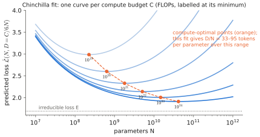

# 2.7 Scale: Parameters, Compute and Scaling Laws

## Counting parameters

With the components of [2.4](block.md#parameters-per-block), a decoder-only transformer of width $d$, depth $L$, vocabulary $V$ has

$$
N\approx\underbrace{12\,L\,d^2}_{\text{blocks}}+\underbrace{V d}_{\text{embedding}}\ (+\ Vd\ \text{if the output head is untied}).
$$

**Check: Llama-2-7B** ($d=4096$, $L=32$, $V=32{,}000$, SwiGLU with $d_\text{ff}=11{,}008$, untied head). Per block: attention $4d^2=67.1$ M; FFN $3\,d\,d_\text{ff}=135.3$ M; total 202.4 M. Times 32: 6.48 B. Embedding and head: $2\times131$ M. Total ≈ **6.74 B**, the published size. (The FFN is wider than $\tfrac83d=10{,}923$, so the block is slightly above $12d^2$.)

This tells you where a model's parameters — and therefore its memory and per-token FLOPs — live: in the blocks, roughly one-third attention, two-thirds FFN, with embeddings significant only for small models with large vocabularies.

## Compute

Training FLOPs for a model with $N$ parameters on $D$ tokens:

$$
C\approx 6ND .
$$

**Derivation.** The forward pass costs $\approx2N$ FLOPs per token ([2.6](inference.md#flops-per-token)). The backward pass computes, for every weight matrix, two products of the same size as the forward one — the gradient with respect to the input ($\bar X=\bar YW^\top$) and with respect to the weight ($\bar W=X^\top\bar Y$) ([0.3](../00-foundations/training.md#how-does-it-work)) — so $\approx4N$. Total $6N$ per token.

Example: training a 7B model on 2 T tokens costs $6\cdot7\times10^9\cdot2\times10^{12}\approx8.4\times10^{22}$ FLOPs. At 40% utilisation of GPUs delivering $10^{15}$ bf16 FLOP/s each, that is $2.1\times10^8$ GPU-seconds ≈ 2,400 GPU-days. Fine-tuning OpenVLA on robot data is reported at ~21,500 A100-hours for the pretraining run; a LoRA fine-tune on a single task fits on one GPU in hours ([Chapter 9](../09-training/index.md)).

## Scaling laws

Kaplan et al. (2020) found that language-model loss falls as a **power law** in parameters, data and compute over many orders of magnitude, with architecture details (depth vs. width, heads) mattering much less. Hoffmann et al. (2022, "Chinchilla") fitted

$$
\hat{\mathcal{L}}(N,D)=E+\frac{A}{N^{\alpha}}+\frac{B}{D^{\beta}},\qquad E\approx1.69,\ A\approx406.4,\ B\approx410.7,\ \alpha\approx0.34,\ \beta\approx0.28,
$$

where $E$ is the irreducible loss (the entropy of text), and the two power-law terms are the penalties for finite model size and finite data. Minimising $\hat{\mathcal L}$ subject to $C=6ND$ gives $N^\star\propto C^{a}$, $D^\star\propto C^{b}$ with $a\approx b\approx0.5$: **scale parameters and tokens together**, about **20 tokens per parameter** at the compute-optimal point. Earlier models (GPT-3: 175 B parameters, 300 B tokens) were heavily undertrained by this criterion. Modern small models deliberately train far *beyond* compute-optimal (SmolLM2-135M saw ~2 T tokens, ~15,000 per parameter) because inference cost depends on $N$ only: a smaller model trained longer is cheaper to deploy.

<figure markdown="span">
  
  <figcaption markdown="span">The fitted Chinchilla loss along fixed compute budgets. Each curve trades parameters $N$ against tokens $D=C/6N$; its minimum (orange) is the compute-optimal model for that budget. With these published coefficients the optimum is 33–95 tokens per parameter. The paper's other two estimation methods give the often-quoted ≈20.</figcaption>
</figure>

!!! robot "Is there a scaling law for robots?"
    The ingredients of language scaling — a single objective, effectively unlimited data, a loss that tracks capability — are each problematic for robot policies:

    - **Data** is scarce: the largest open robot datasets contain on the order of $10^6$ trajectories, vastly fewer "tokens" than text corpora, collected at great human cost.
    - **Loss ≠ success**: action-prediction loss is a weak proxy for task success ([2.5](training.md#what-to-monitor)).
    - **Diversity vs. volume**: empirical studies of imitation learning suggest that generalisation scales with the *diversity* of environments and objects more than with the number of demonstrations per setting.
    - **Embodiment**: data from different robots is not interchangeable; a drone's data may not help an arm at all.

    Whether VLAs obey predictable scaling laws, and in which variable, is an open research question ([Chapter 15](../15-research/index.md)). For multi-robot systems there is an additional, intriguing axis: a team of $N$ robots collects $N$ times the data per hour, but correlated data from one site.

## Emergence and its caveats

Some capabilities appear to switch on abruptly at scale ("emergent abilities"). Part of this is an artefact of discontinuous metrics (exact-match accuracy jumps even when per-token loss improves smoothly). The practical lesson for VLAs: small-scale experiments (like this book's labs) reliably reveal *mechanisms* and *failure modes*; they do not reliably predict which capabilities will appear at 100× scale.

## Why it matters for VLAs and robots

Parameter counts determine memory and latency on the robot; compute determines what you can afford to train or fine-tune; and scaling laws — or their absence for robot data — determine where research effort pays off. The deployed VLAs that matter for UAVs and teams of small robots are not the largest ones, but the smallest that are good enough, trained as long as possible: the SmolLM2 lesson applied to action.

!!! lab "Lab 04 and Lab 05"
    Lab 04 counts TinyGPT's parameters against the formula; Lab 05 does the same for SmolLM2-135M from its configuration and checks the result against `sum(p.numel() for p in model.parameters())`.
