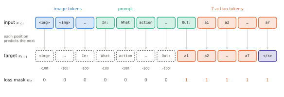

# 2.5 Training Transformer Language Models

## What is it?

Training a decoder-only transformer as a language model means minimising the [autoregressive negative log-likelihood](../00-foundations/sequence-models.md#the-autoregressive-factorisation) of token sequences:

$$
\mathcal{L}(\theta)=-\frac{1}{\sum_{b,t}m_{b,t}}\sum_{b=1}^{B}\sum_{t=1}^{T-1}m_{b,t}\,\log p_\theta\big(x_{b,t+1}\mid x_{b,\le t}\big),
$$

| Symbol | Meaning |
|---|---|
| $x_{b,t}$ | token id at position $t$ of sequence $b$ in the batch |
| $p_\theta(\cdot\mid x_{b,\le t})$ | softmax of the logits at position $t$ — the model's prediction for position $t+1$ |
| $m_{b,t}\in\{0,1\}$ | **loss mask**: 1 if the prediction of token $t+1$ counts toward the loss |

The causal mask makes position $t$'s output depend only on $x_{\le t}$, so a single forward pass produces all $T-1$ predictions of a sequence at once (**teacher forcing**) — the parallelism that RNNs lacked.

## How does it work? The shift

The logits at position $t$ are compared with the token at position $t+1$. In code this is a one-position shift between inputs and targets:

```python
ids = batch["input_ids"]                       # (B, T)
logits = model(ids[:, :-1])                    # (B, T-1, V): predictions for positions 1..T-1
targets = ids[:, 1:]                           # (B, T-1)
loss = F.cross_entropy(
    logits.reshape(-1, logits.shape[-1]),      # (B*(T-1), V)
    targets.reshape(-1),                       # (B*(T-1),)
    ignore_index=-100,                         # targets set to -100 are excluded (loss mask)
)
```

`cross_entropy` expects classes in the second dimension, hence the flattening. Getting the shift wrong (no shift, or shifting both) gives a model that learns to copy its input: training loss collapses to near zero and generation is garbage — a classic bug to recognise.

## Loss masking: what the model is trained to say

The loss mask $m$ decides *which tokens the model learns to produce*, while all tokens are still *read*:

| Training stage | Loss on |
|---|---|
| pretraining | all tokens (except padding) |
| instruction tuning / chat | only the assistant's response tokens |
| VLM training | only text after the image (never the image placeholder tokens) |
| **VLA training (token-based)** | **only the action tokens**; the prompt and image tokens are context |

Implementation: set targets to `-100` (`ignore_index`) wherever $m=0$. For a token-based VLA such as OpenVLA, a training example is `[image tokens][prompt tokens][7 action tokens][eos]`, and only the 7 action tokens (and end-of-sequence) contribute to the loss.

<figure markdown="span">
  
  <figcaption markdown="span">One training sequence of a token-based VLA (OpenVLA-style). Targets are the inputs shifted by one. Targets of image and prompt positions are set to $-100$ and ignored, so only the action tokens and end-of-sequence are learned, while everything is read.</figcaption>
</figure>

## Weight tying

The input embedding $E\in\mathbb{R}^{V\times d}$ maps token ids to vectors; the output head $W_\text{out}\in\mathbb{R}^{d\times V}$ maps vectors to logits. **Weight tying** sets $W_\text{out}=E^\top$: the logit for token $i$ is the dot product of the final hidden state with token $i$'s embedding. It saves $Vd$ parameters (significant for small models — 28 M of SmolLM2-135M's parameters are the tied embedding) and couples input and output representations. Large models often untie them.

!!! robot "Tying and action tokens"
    When RT-2/OpenVLA repurpose 256 vocabulary entries as action bins, both the input embedding rows and the output-head columns of those tokens are retrained. With weight tying they are the same parameters, so the action tokens' meaning as *inputs* (when previous action dimensions are read during autoregressive decoding) and as *outputs* are learned jointly.

## The optimisation recipe

The near-universal recipe, which VLA training inherits ([Chapter 9](../09-training/index.md)):

| Ingredient | Typical setting | Why |
|---|---|---|
| optimiser | [AdamW](../00-foundations/training.md#momentum-and-adam), $\beta=(0.9,0.95)$, weight decay 0.1 | adaptive steps; decoupled decay |
| learning rate | peak $10^{-4}$–$6\times10^{-4}$ (smaller for bigger models); $10^{-5}$–$5\times10^{-5}$ for fine-tuning | |
| schedule | linear warm-up (~1–5% of steps), then cosine decay to ~10% of peak | Adam's second-moment estimates are poor early on; large early steps destabilise |
| gradient clipping | clip global norm to 1.0 | rare large gradients (loss spikes) |
| precision | bf16 activations/weights, fp32 master weights and optimiser state | 2× memory/speed; bf16 keeps fp32's range ([0.1](../00-foundations/tensors.md#data-types-and-memory)) |
| batch | sequences packed end-to-end to avoid padding; $10^5$–$10^7$ tokens per step | |

```python
opt = torch.optim.AdamW(model.parameters(), lr=3e-4, betas=(0.9, 0.95), weight_decay=0.1)
sched = torch.optim.lr_scheduler.OneCycleLR(opt, max_lr=3e-4, total_steps=n_steps,
                                            pct_start=0.05, anneal_strategy="cos")
for step in range(n_steps):
    with torch.autocast(device_type="cuda", dtype=torch.bfloat16):
        loss = lm_loss(model, next(batches))
    loss.backward()
    torch.nn.utils.clip_grad_norm_(model.parameters(), 1.0)
    opt.step(); sched.step(); opt.zero_grad(set_to_none=True)
```

## What to monitor

- **Training loss** in nats/token, and its exponential, **perplexity** ([0.4](../00-foundations/probability.md#entropy-cross-entropy-and-kl-divergence)). A uniform model has loss $\log V$ (10.8 for $V=50{,}000$); that is where an untrained model starts — if your initial loss is far from $\log V$, initialisation is wrong.
- **Validation loss** on held-out text; divergence from training loss means overfitting (small datasets such as Lab 04's corpus overfit quickly).
- **Gradient norm**; spikes precede loss spikes.
- **Samples**: generate periodically. Loss can improve while samples stay bad, and vice versa.

!!! robot "For VLAs, loss is not the metric"
    For token-based VLAs, the action-token cross-entropy and the accuracy of predicted bins are logged during training, but they correlate only loosely with task success ([0.3](../00-foundations/training.md#generalisation-overfitting-and-regularisation)). VLA papers therefore report closed-loop success rates from robot or simulator rollouts — expensive evaluations that must be planned from the start of a project.

## Limitations

- Teacher forcing trains on true prefixes but generation uses the model's own outputs (exposure bias, [0.7](../00-foundations/sequence-models.md#the-autoregressive-factorisation)).
- The objective rewards likelihood, not truth, safety, or task success; later stages (instruction tuning, preference optimisation, RL fine-tuning) adjust behaviour.

## Why it matters for VLAs and robots

Token-based VLA training *is* this procedure: same shift, same cross-entropy, same AdamW recipe, with a loss mask that selects action tokens. Continuous-action VLAs replace the cross-entropy on actions with a flow-matching loss ([Chapter 6](../06-generative/index.md)) but keep everything else.

!!! lab "Lab 04, part 3"
    Train TinyGPT on the depot corpus: check that the initial loss is $\approx\log V$, watch training and validation loss, introduce the "no shift" bug deliberately and observe the collapse, then sample instructions at several temperatures.
