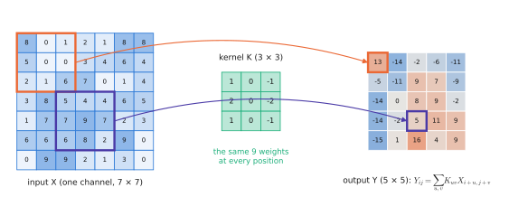
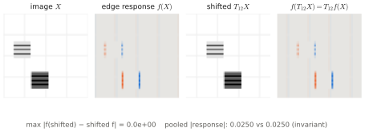
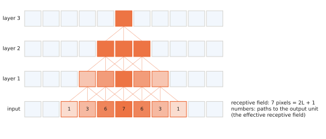

# 3.1 Convolutional Networks

[1.2](../01-multimodal-intro/vision.md) argued that raw pixels are a poor representation and that robots use pretrained visual encoders. This section builds the first family of such encoders, the **convolutional neural network (CNN)**, from the operation up. CNNs are no longer the backbone of VLAs, but you need them for three reasons: they are still the image encoders of many robot policies (ACT, Diffusion Policy, RT-1); they are the clearest example of an architecture built from [inductive biases](../00-foundations/neural-networks.md#universal-approximation-and-what-it-does-not-say); and the Vision Transformer of [3.2](vit.md) is best understood as the CNN with most of those biases removed.

## What is it?

!!! definition "2-D convolution layer"
    A convolution layer maps an input feature map $X\in\mathbb{R}^{C_\text{in}\times H\times W}$ to an output $Y\in\mathbb{R}^{C_\text{out}\times H'\times W'}$ by sliding $C_\text{out}$ small kernels over the input:

    $$
    Y_{c,i,j}=b_c+\sum_{c'=1}^{C_\text{in}}\ \sum_{u=0}^{k-1}\sum_{v=0}^{k-1} K_{c,c',u,v}\;X_{c',\,s i+u-p,\ s j+v-p},
    \qquad
    H'=\Big\lfloor\frac{H+2p-k}{s}\Big\rfloor+1 .
    $$

| Symbol | Shape | Meaning |
|---|---|---|
| $X$ | $C_\text{in}\times H\times W$ | input: an image ($C_\text{in}=3$) or the feature map of a previous layer |
| $K$ | $C_\text{out}\times C_\text{in}\times k\times k$ | the learned **kernels** (filters); one $C_\text{in}\times k\times k$ kernel per output channel |
| $b$ | $C_\text{out}$ | bias, one per output channel |
| $k$ | — | kernel size (typically 3; 7 in the first layer of a ResNet) |
| $s$, $p$ | — | **stride** (step between windows) and **padding** (zeros added at the border) |
| $Y_{c,i,j}$ | scalar | response of filter $c$ at output location $(i,j)$ |

(Strictly this is a cross-correlation — the kernel is not flipped — but deep learning calls it convolution.) A **CNN** stacks convolutions with non-linearities, normalisation and occasional downsampling, and ends with a pooling step that turns the final feature map into a vector.

<figure markdown="span">
  
  <figcaption markdown="span">One output channel of a $3\times3$ convolution. The same nine weights are applied at every window position (weight sharing); each output depends only on a small neighbourhood (locality). Stacking layers grows the region of the input that one output can see, its receptive field.</figcaption>
</figure>

## Why does it exist? Three assumptions about images

An [MLP](../00-foundations/neural-networks.md) on a flattened $224\times224\times3$ image needs $150{,}528$ weights *per hidden unit* and must learn separately, at every position, what an edge looks like. A convolution layer with $k=3$, $C_\text{in}=3$, $C_\text{out}=64$ has $3\cdot3\cdot3\cdot64+64=1{,}792$ parameters, whatever the image size. The reduction comes from three assumptions that are true of natural images:

1. **Locality.** Pixels are strongly correlated with their neighbours, weakly with distant pixels. Each output looks at a $k\times k$ window.
2. **Stationarity (weight sharing).** A useful local pattern — an edge, a corner, the rim of a barrel — is useful everywhere in the image. The same kernel is applied at every position.
3. **Compositionality.** Objects are made of parts, parts of motifs, motifs of edges. Stacking layers builds features of growing size and abstraction.

!!! definition "Equivariance and invariance"
    Let $T_\mathbf{s}$ shift an image by $\mathbf{s}$ pixels. A map $f$ is **translation-equivariant** if $f(T_\mathbf{s}X)=T_\mathbf{s}f(X)$ — shifting the input shifts the output by the same amount — and **translation-invariant** if $f(T_\mathbf{s}X)=f(X)$.

A stride-1 convolution is exactly equivariant: the formula above depends on $i,j$ only through the window position. **Global average pooling** at the end, $\mathbf{z}_c=\frac{1}{H'W'}\sum_{i,j}Y_{c,i,j}$, is invariant. A CNN classifier is therefore (approximately — strides and borders break exactness) invariant to where the object is. Lab 06 measures this: a CNN trained only on objects in the left half of the image classifies objects in the right half perfectly.

<figure markdown="span">
  
  <figcaption markdown="span">Translation equivariance, computed. A vertical-edge filter applied to the depot image and to the same image shifted 12 pixels to the right: the response map shifts by exactly 12 pixels and is otherwise identical. Global pooling of either map gives the same number, which is invariance.</figcaption>
</figure>

For a robot this is a double-edged property. Invariance is what you want for *recognition* ("is there a toolbox?"). It is the opposite of what you want for *manipulation* ("where exactly is the handle?"): a policy needs features that are equivariant — they must move when the object moves — up to the point where the action is computed. Diffusion Policy, for example, replaces global average pooling by a *spatial softmax* that outputs the expected image coordinates of each feature, precisely to keep position information.

## How does it work?

### Convolution is a matrix multiplication

Gather every $C_\text{in}\times k\times k$ window into a column (the **im2col** or `unfold` operation): a matrix $U\in\mathbb{R}^{C_\text{in}k^2\times H'W'}$. Reshape the kernels into $K_\text{mat}\in\mathbb{R}^{C_\text{out}\times C_\text{in}k^2}$. Then

$$
Y_\text{mat}=K_\text{mat}\,U+\mathbf{b}\ \in\mathbb{R}^{C_\text{out}\times H'W'},
$$

one [matrix multiplication](../00-foundations/tensors.md#matrix-multiplication), which is how GPUs compute convolutions (with more sophisticated tiling). Its cost is $2\,C_\text{out}C_\text{in}k^2H'W'$ FLOPs: unlike the parameter count, it grows with the image area. Lab 06 implements `conv2d_by_hand` this way and matches `nn.Conv2d` to $10^{-7}$.

### Receptive fields

The **receptive field** of a unit is the set of input pixels that can influence it. For a stack of layers with kernel sizes $k_\ell$ and strides $s_\ell$,

$$
r_L = 1+\sum_{\ell=1}^{L}(k_\ell-1)\prod_{m=1}^{\ell-1}s_m .
$$

Without strides, $L$ layers of $3\times3$ give $r_L=2L+1$: growth is linear and slow. Strides and pooling multiply it, which is why CNNs downsample: a ResNet-50 reaches a receptive field larger than the image within its 50 layers. In practice the **effective** receptive field — where the gradient is actually large — is much smaller than $r_L$ and roughly Gaussian (a repeated box filter is approximately a Gaussian); Lab 06 measures both.

<figure markdown="span">
  
  <figcaption markdown="span">Receptive-field growth. One unit after three $3\times3$ layers depends on a $7\times7$ input region (the formula's $2L+1$). A stride-2 layer doubles the growth rate of every later layer. The colour inside the region shows the effective receptive field: the gradient concentrates in the centre.</figcaption>
</figure>

### The canonical architecture

A typical CNN for images alternates *stages*: several $3\times3$ convolutions at one resolution, then a downsampling step (stride 2 or max pooling) that halves $H,W$ and usually doubles $C$. Spatial resolution is traded for channels: $224\times224\times3\to112\times112\times64\to\dots\to7\times7\times2048$ in a ResNet-50. Two ingredients made deep CNNs trainable:

- **Batch normalisation** (Ioffe & Szegedy, 2015): normalise each channel over the batch and spatial positions, then rescale. Unlike [LayerNorm](../02-transformers/block.md#normalisation), it uses batch statistics — a source of train/test discrepancies when a robot runs with batch size 1, and the reason Diffusion Policy switched to GroupNorm.
- **Residual connections** (He et al., 2016): $\mathbf{x}\leftarrow\mathbf{x}+F(\mathbf{x})$, the same idea — and the same gradient argument — as the [residual stream](../02-transformers/block.md#the-residual-stream) of transformers, which borrowed it from ResNets.

### A short history

| Year | Model | What changed |
|---|---|---|
| 1998 | LeNet-5 | convolution + pooling + gradient training, for handwritten digits |
| 2012 | AlexNet | the same idea, scaled on GPUs with ReLU and dropout; ImageNet top-5 error 15.3% vs 26.2% for the best non-neural method — the start of the deep-learning era |
| 2014 | VGG | only $3\times3$ kernels, much deeper (16–19 layers) |
| 2016 | ResNet | residual connections; 152 layers trainable; ResNet-50 (25.6 M parameters, ≈4 GFLOP multiply-adds at 224 px) becomes the default backbone for years |
| 2019 | EfficientNet | width, depth and resolution scaled jointly; used by RT-1 |

## Implementation

```python
import torch.nn as nn

def stage(c_in, c_out):                      # two 3x3 convs at one resolution, then halve H and W
    return nn.Sequential(
        nn.Conv2d(c_in, c_out, 3, padding=1), nn.BatchNorm2d(c_out), nn.ReLU(),
        nn.Conv2d(c_out, c_out, 3, padding=1), nn.BatchNorm2d(c_out), nn.ReLU(),
        nn.MaxPool2d(2))

class SmallCNN(nn.Module):
    def __init__(self, n_classes=16, w=32):
        super().__init__()
        self.features = nn.Sequential(stage(3, w), stage(w, 2 * w), stage(2 * w, 4 * w))
        self.head = nn.Linear(4 * w, n_classes)

    def forward(self, x):                    # x: (B, 3, 64, 64)
        f = self.features(x)                 # (B, 128, 8, 8): a feature map, still spatial
        return self.head(f.mean((2, 3)))     # global average pooling -> (B, 128) -> (B, n_classes)
```

The feature map before pooling, `(B, 128, 8, 8)`, is 64 feature vectors, one per spatial location. Reading it as a *sequence* of 64 tokens of width 128 is all it takes to feed a CNN into a transformer — RT-1 and many early multimodal models did exactly that.

!!! lab "Lab 06, parts 1–3 and 5"
    Convolution by im2col, matched against `nn.Conv2d`; translation equivariance measured for a convolution and for a ViT patch embedding; receptive fields measured by back-propagation; and a CNN against a ViT on depot scenes with 100 vs 4000 training images, and with train/test objects in different halves of the image.

## Limitations

- **Local by construction.** Relating two distant regions ("the toolbox *left of* the crate") requires many layers before their receptive fields overlap; attention relates them in one layer.
- **Invariance throws away position.** Pooling, which makes classification robust, discards the *where* that manipulation needs.
- **Only translation.** Convolutions are not equivariant to rotation or scale — a drone camera that yaws produces rotated images that a CNN must learn to handle from data.
- **Not a token interface.** A CNN outputs a feature map, not tokens aligned with a language model; using it in a VLM needs an adapter, and CNNs did not ride the scaling of web image–text pretraining as well as ViTs did.

## Why it matters for VLAs and robots

CNNs remain the encoder of choice where latency and data are tight. ACT and Diffusion Policy use ResNet-18s; RT-1 used a FiLM-conditioned EfficientNet ([1.3](../01-multimodal-intro/combining.md#how-to-fuse-four-mechanisms)) followed by TokenLearner to compress each image to 8 tokens. Their inductive biases are a form of free data, valuable in robotics where data is the scarcest resource. The large VLAs moved to ViTs because ViTs scale better with web data and speak the token language of LLMs ([3.2](vit.md)). Where an encoder must run at hundreds of hertz on a drone's companion computer, a small CNN is still often the right answer ([Chapter 13](../13-uavs/index.md)).
