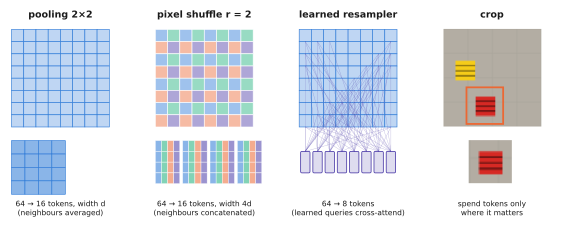

# 3.4 What a VLA Needs from Its Vision Encoder

The previous sections built encoders. This one asks the engineering question: given a robot, its cameras and a latency budget, which encoder, at which resolution, producing how many tokens? These choices are made once and then constrain everything downstream. A VLA's image tokens typically outnumber its instruction tokens by more than ten to one, and they are processed every control step.

## What is it?

A VLA's vision pipeline is the chain

$$
\text{cameras}\ \xrightarrow{\ \text{resize, crop, normalise}\ }\ I^{(c)}\in\mathbb{R}^{3\times H\times W}\ \xrightarrow{\ g_\phi\ }\ Z^{(c)}\in\mathbb{R}^{N_p\times d_v}\ \xrightarrow{\ \text{reduce}\ }\ \mathbb{R}^{N_v\times d_v}\ \xrightarrow{\ \text{project}\ }\ \mathbb{R}^{N_v\times d}
$$

for each camera $c$, where $g_\phi$ is the encoder, $N_p$ its number of patch tokens, $N_v\le N_p$ the number of tokens after an optional reduction step, and the final projection maps into the backbone width $d$ ([4.3](../04-alignment/connectors.md)). The decisions are the encoder $g_\phi$ (and its pretraining), the resolution $H\times W$, the reduction, the number of cameras, and whether $\phi$ is frozen or fine-tuned.

## Why does it matter? Five requirements that conflict

1. **Semantics aligned with language** — "the *red toolbox*" must select the right pixels. Favours language-supervised encoders (SigLIP, [4.2](../04-alignment/clip-siglip.md)).
2. **Spatial precision** — a grasp needs the handle's position to a centimetre. Favours self-supervised dense features (DINOv2, [3.3](self-supervised.md)), high resolution, and patch tokens rather than a pooled vector.
3. **Few tokens** — every token costs backbone compute and latency at every step ([2.6](../02-transformers/inference.md)).
4. **Robustness to robot imagery** — wrist cameras, top-down drone views, motion blur, the robot's own gripper in every frame ([1.2](../01-multimodal-intro/vision.md#robot-images-are-not-internet-images)).
5. **Low latency on the robot's computer** — the encoder runs once per camera per step.

No single encoder satisfies all five, and the VLAs of [Chapter 10](../10-case-studies/index.md) make visibly different trade-offs:

| System | Encoder | Pretraining | Resolution → tokens per image | Notes |
|---|---|---|---|---|
| ACT, Diffusion Policy | ResNet-18 | ImageNet (ACT) / none (DP) | feature map → $15\times20$ (ACT) or spatial-softmax keypoints (DP) | small, fast, task-specific |
| RT-1 | EfficientNet-B3 + FiLM | ImageNet | 300 px → 81 → **8** via TokenLearner | instruction modulates the encoder |
| Octo | shallow conv stem + patches | none (trained on robot data) | 256 px → 256 (primary camera) | trained from scratch on ~800 k episodes |
| OpenVLA | SigLIP-So400m **and** DINOv2-L, concatenated | language + self-supervised | 224 px → 256 | encoder fine-tuned with the policy |
| π0 | SigLIP-So400m (from PaliGemma) | language | 224 px → 256, up to 3 cameras | |
| SmolVLA | SigLIP (from SmolVLM2) + pixel shuffle | language | 512 px → **64** | built for small GPUs |

## How does it work? The levers

### Fusing two encoders

OpenVLA (via the Prismatic VLM) runs SigLIP and DINOv2 on the same image at the same patch grid and **concatenates their patch features along the channel dimension**: $Z=[Z_\text{SigLIP};Z_\text{DINOv2}]\in\mathbb{R}^{256\times(1152+1024)}$, then projects. The token count is unchanged; the encoder cost roughly doubles. The Prismatic authors found the fusion improved spatial reasoning tasks over SigLIP alone. That is precisely the semantics-plus-geometry argument of [3.3](self-supervised.md#why-does-it-exist).

### Choosing the resolution: the drone example

!!! robot "Can the drone see the toolbox?"
    A quadrotor surveys the east yard from 30 m with a downward camera of 90° horizontal field of view. The ground footprint is $2\cdot30\cdot\tan45^\circ=60$ m wide.

    - At 224 px, one pixel covers $60/224\approx0.27$ m. A 40 cm toolbox is **1.5 pixels** wide — a fraction of one 14-pixel patch. No encoder can recognise it.
    - For the toolbox to span one full patch (14 px), one pixel must cover $0.4/14\approx2.9$ cm: an image about **2100 px** wide, $150^2=22{,}500$ patch tokens. Far beyond any VLA's budget.

    The realistic options are architectural, not encoder choices: fly lower; **tile** the high-resolution image and run a cheap detector or a CLIP similarity on each tile ([4.4](../04-alignment/grounding.md)), then send only the tile with a candidate to the VLA; or **foveate**, with a wide low-resolution view to decide where to look and a high-resolution crop of that region. [Chapter 13](../13-uavs/index.md) builds this pipeline.

For a wrist camera the opposite holds: the object fills the image, and 224 px is ample.

### Reducing tokens

<figure markdown="span">
  
  <figcaption markdown="span">Four ways to cut the number of image tokens a backbone must read. Pooling averages neighbours (cheap, loses detail). Pixel shuffle concatenates neighbours into one wider token (keeps all values, the projector must untangle them). A learned resampler or TokenLearner computes a fixed number of tokens as weighted combinations of all patches. Cropping spends tokens only where they matter.</figcaption>
</figure>

| Method | Tokens | What is lost | Used by |
|---|---|---|---|
| larger patch $P$ | $\div(P'/P)^2$ | fine detail, at the encoder input | ViT-B/32 |
| average pooling $r\times r$ | $\div r^2$ | detail, averaged away | several VLMs |
| **pixel shuffle** (space-to-depth) $r$ | $\div r^2$, width $\times r^2$ | nothing yet — the projector must learn to use it | SmolVLM, SmolVLA |
| learned resampler / TokenLearner | fixed $N_v$ | whatever the learned queries ignore | Flamingo, BLIP-2, RT-1 |
| crop / foveate | — | context outside the crop | wrist cameras, tiling |

Pixel shuffle deserves a note because Lab 08 dissects it: SmolVLM-256M's SigLIP produces a $32\times32$ grid of 768-d tokens for a 512-px image; every $4\times4$ block is concatenated into one 12 288-d token, giving 64 tokens, which a single linear layer maps to the LM width of 576. The information is not discarded; it is moved from the sequence dimension (expensive: attention is quadratic in it) to the feature dimension (cheap: linear).

### Frozen or fine-tuned?

VLM practice usually freezes the vision encoder during instruction tuning ([5.2](../05-vlms/training.md)). VLA practice usually does not. The OpenVLA authors report that fine-tuning the vision encoder during robot training was crucial: web-pretrained features are not precise enough for control, and the robot's viewpoints differ from web photos. The cost: more memory, a risk of forgetting the encoder's general knowledge, and a need for more robot data. A common compromise is a lower learning rate for the encoder than for the rest (Lab 08, exercise 4).

### Several cameras and time

Each extra camera adds $N_v$ tokens: π0 with three cameras at 256 tokens each reads 768 image tokens per step. Each extra frame of history does the same, which is why most VLAs see only the current frame ([0.7](../00-foundations/sequence-models.md#why-it-matters-for-vlas-and-robots)). Camera identity must be encoded too — usually by a learned per-camera embedding added to that camera's tokens ([2.3](../02-transformers/positions.md#positions-beyond-text)) — otherwise a policy cannot tell the wrist view from the head view.

## Implementation

```python
import torch
import torch.nn as nn

class FusedEncoder(nn.Module):
    """OpenVLA-style: two encoders on the same image, patch features concatenated per token."""

    def __init__(self, enc_a, enc_b, d_a, d_b, d_model, n_cameras):
        super().__init__()
        self.enc_a, self.enc_b = enc_a, enc_b                 # e.g. SigLIP and DINOv2, same patch grid
        self.proj = nn.Sequential(nn.Linear(d_a + d_b, d_model), nn.GELU(), nn.Linear(d_model, d_model))
        self.camera_emb = nn.Embedding(n_cameras, d_model)    # which camera these tokens came from

    def forward(self, images, camera_id):                     # images: (B, 3, H, W)
        za, zb = self.enc_a(images), self.enc_b(images)       # (B, N_p, d_a), (B, N_p, d_b)
        z = self.proj(torch.cat([za, zb], dim=-1))            # (B, N_p, d_model)
        return z + self.camera_emb(camera_id)[:, None, :]     # broadcast over the N_p tokens


def pixel_shuffle(x, r):
    """(B, N, d) on a square grid -> (B, N / r^2, d * r^2): each output token is an r x r block."""
    B, N, d = x.shape
    g = int(N ** 0.5)
    x = x.reshape(B, g // r, r, g // r, r, d).permute(0, 1, 3, 2, 4, 5)
    return x.reshape(B, (g // r) ** 2, r * r * d)
```

!!! lab "Lab 06, part 7, and Lab 08, part 10"
    Time DINOv2-S from 224 to 518 px; reproduce SmolVLM's pixel shuffle and match the library exactly; and watch SmolVLM's image splitting turn one 512-px image into 1088 tokens, and a worse answer.

## Limitations

- **Every choice is a trade-off you cannot fully evaluate offline.** Token budgets and encoder choices are validated by closed-loop success rates, which are expensive to measure ([2.5](../02-transformers/training.md#what-to-monitor)).
- **2-D only.** None of these encoders knows the camera intrinsics or depth; 3-D reasoning is learned implicitly, if at all. Some recent policies add depth images or point clouds as extra modalities.
- **Static.** The encoder processes each frame independently; motion must be inferred from several frames (tokens) or from proprioception.

## Why it matters for VLAs and robots

Choosing an encoder is choosing what the robot can perceive and how fast it can react. This chapter's tools let you estimate both before training anything. Tokens per camera, from resolution, patch size and reduction, give you latency ([2.6](../02-transformers/inference.md)). Pixels per object, from camera geometry, tell you whether perception is possible at all. Chapter 4 now addresses the remaining requirement: features that line up with words.
