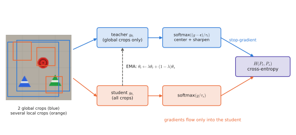
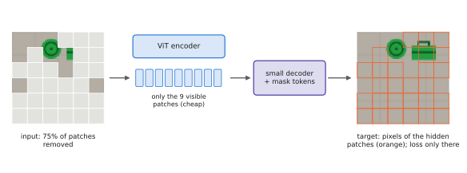

# 3.3 Self-Supervised Encoders: DINO, DINOv2 and MAE

A ViT needs hundreds of millions of training images ([3.2](vit.md#why-does-it-exist)), and labelled images do not exist in that quantity. Worse, labels teach the wrong thing for robots: an ImageNet classifier is rewarded for *discarding* where the object is and what shape its handle has, as long as it outputs "toolbox". **Self-supervised learning** trains an encoder with a signal manufactured from the images themselves. Its two dominant forms, self-distillation (DINO, DINOv2) and masked image modelling (MAE), produce the features that VLAs use when they need geometry rather than names.

## What is it?

!!! definition "Self-supervised representation learning"
    A **pretext task** is a training objective whose targets are computed from unlabelled data — for example "two crops of the same image should have the same representation" or "predict the pixels hidden behind a mask". The network trained on it, used without its task-specific head, is the **encoder**; its outputs are evaluated by how well a cheap model on top of them (a **linear probe**, or a frozen encoder plus small head) solves downstream tasks.

The danger of every such objective is a trivial solution. If the target is "two views have the same representation", a network that outputs a constant vector achieves zero loss: **representation collapse**. Each method below is mainly a different way of preventing collapse.

## Why does it exist?

| Signal | What it rewards | What it discards |
|---|---|---|
| class labels | features that separate ~1000 categories | position, shape detail, anything not needed to name the class |
| image–text pairs ([Chapter 4](../04-alignment/index.md)) | features that match captions | everything captions do not mention: exact position, geometry, counting |
| self-supervision | features that are stable across views / predictive of hidden regions | dependent on the pretext; typically keeps geometry and parts, lacks names |

Robots need the middle ground: objects, parts and their spatial layout, robust to viewpoint and lighting. Self-supervised features are the best available off-the-shelf approximation, which is why OpenVLA concatenates DINOv2 features with SigLIP features ([3.4](encoders-for-vlas.md)).

## How does it work?

### DINO: self-distillation with no labels

DINO (Caron et al., 2021) trains a **student** network to match the output of a **teacher** network with the same architecture, on different crops of the same image.

<figure markdown="span">
  
  <figcaption markdown="span">DINO. The teacher sees only the two large (global) crops, the student sees all crops, including small local ones. The student is trained to predict the teacher's output distribution, and the teacher is an exponential moving average of the student; no gradient flows into it. Centering and a low teacher temperature prevent collapse.</figcaption>
</figure>

!!! definition "The DINO objective"
    Both networks map an image crop to $K$ scores ($K=65{,}536$ "prototypes"), turned into distributions with different temperatures:

    $$
    P_s(x)=\operatorname{softmax}\!\Big(\frac{g_{\theta_s}(x)}{\tau_s}\Big),\qquad
    P_t(x)=\operatorname{softmax}\!\Big(\frac{g_{\theta_t}(x)-\mathbf{c}}{\tau_t}\Big),
    $$

    $$
    \mathcal{L}=\sum_{x\in\{x_1^g,x_2^g\}}\ \sum_{\substack{x'\in V\\ x'\neq x}} H\big(P_t(x),P_s(x')\big),\qquad
    \theta_t\leftarrow\lambda\,\theta_t+(1-\lambda)\,\theta_s,\qquad
    \mathbf{c}\leftarrow m\,\mathbf{c}+(1-m)\,\overline{g_{\theta_t}(x)} .
    $$

| Symbol | Meaning |
|---|---|
| $V$ | the set of crops of one image: 2 **global** crops ($224^2$, covering a large part of the image) and several **local** crops ($96^2$, small parts) |
| $g_{\theta_s},g_{\theta_t}$ | student and teacher: a ViT plus a small projection head to $K$ outputs |
| $H(p,q)=-\sum_kp_k\log q_k$ | [cross-entropy](../00-foundations/probability.md#entropy-cross-entropy-and-kl-divergence): the student predicts the teacher's distribution |
| $\tau_s=0.1$, $\tau_t\approx0.04$ | temperatures; the teacher's lower temperature **sharpens** its targets |
| $\mathbf{c}$ | **centre**: running mean of teacher outputs, subtracted before the softmax |
| $\lambda$ | EMA rate, from 0.996 to 1 during training; the teacher is a slow average of past students |

Read the three ingredients as a control problem. **Centering** subtracts the mean output, so no single prototype can win for every image — it prevents collapse to one dominant dimension, but on its own pushes towards a uniform output. **Sharpening** (low $\tau_t$) pushes the teacher's distributions toward one-hot, preventing the uniform collapse. The two balance each other. The **EMA teacher** is a slowly moving target, an ensemble of recent students, so its outputs are slightly better than the student's and the student has something to learn from — the same idea as the target networks of deep reinforcement learning ([Chapter 7](../07-decision-making/index.md)).

**Multi-crop** is what makes the features spatial. The student must produce, from a small local crop showing only a toolbox's handle, the same distribution the teacher produces from a global crop of the whole scene. Matching local to global forces the representation to encode *which object and which part* a region belongs to. The well-known consequence: the [CLS] attention maps of a DINO ViT segment objects without ever having seen a segmentation mask. Lab 06 shows the same in DINOv2-S on depot scenes.

### DINOv2: the same idea, engineered at scale

DINOv2 (Oquab et al., 2024) turned DINO into a general-purpose frozen backbone:

- **Data curation.** LVD-142M: 142 M images retrieved from 1.2 B uncurated web images by similarity to curated datasets, with deduplication. Curation, not raw size, was the main lever.
- **A patch-level loss.** Alongside the image-level DINO loss, an iBOT loss masks some patches in the student's input and asks it to predict the teacher's prototypes *for the masked patches*, which directly trains the dense features.
- **Stabilisers** — Sinkhorn–Knopp centering, a KoLeo regulariser that spreads features uniformly — and a short final phase at 518 px for high-resolution features.
- **Distillation.** A ViT-g (1.1 B parameters) is trained, then distilled into ViT-S/B/L students. DINOv2-S (Lab 06) is a distilled 22 M-parameter model.

Frozen DINOv2 patch features with only a linear head are competitive on semantic segmentation and monocular depth estimation — evidence that they encode geometry, which is exactly why they appear in robot policies.

### MAE: masked autoencoders

MAE (He et al., 2022) takes the BERT idea — hide part of the input and predict it — to pixels:

$$
\mathcal{L}_\text{MAE}=\frac{1}{|\mathcal{M}|}\sum_{n\in\mathcal{M}}\big\lVert\hat{\mathbf{x}}_p^{(n)}-\operatorname{norm}\big(\mathbf{x}_p^{(n)}\big)\big\rVert_2^2 ,
$$

where $\mathcal{M}$ is a random set of **75%** of the patches, $\hat{\mathbf{x}}_p^{(n)}$ the reconstruction of patch $n$ and $\operatorname{norm}$ normalises each target patch by its own mean and variance. Two design choices make it work:

1. **Very high masking ratio.** Images are spatially redundant; with 15% masking (BERT's ratio) a patch can be filled in by interpolating its neighbours, which teaches nothing. At 75% the network must infer object shape and layout.
2. **Asymmetric encoder–decoder.** The ViT encoder processes only the visible 25% of patches (no mask tokens), so pretraining is ~3–4× cheaper; a small decoder receives the encoded visible tokens plus learned mask tokens and reconstructs the pixels. The decoder is thrown away.

<figure markdown="span">
  
  <figcaption markdown="span">MAE. Three quarters of the patches are removed, the encoder sees only the remaining quarter, and a light decoder must reconstruct the hidden patches. The loss is computed only on the hidden patches.</figcaption>
</figure>

MAE features are weaker than DINO's under a frozen linear probe but excellent after fine-tuning; for robot learning, MAE pretraining on egocentric and manipulation video (MVP; Xiao et al., 2022) was one of the first demonstrations that in-domain self-supervised pretraining helps control.

## Implementation

The core of DINO fits in a few lines; everything difficult is in the augmentations, schedules and scale.

```python
import torch
import torch.nn.functional as F

def dino_loss(student_out, teacher_out, center, tau_s=0.1, tau_t=0.04):
    """student_out: list of (B, K) for all crops; teacher_out: list of (B, K) for the 2 global crops."""
    t_probs = [F.softmax((t - center) / tau_t, dim=-1).detach() for t in teacher_out]   # no gradient to teacher
    loss, n = 0.0, 0
    for i, p_t in enumerate(t_probs):
        for j, s in enumerate(student_out):
            if j == i:                                   # same view: skip
                continue
            loss = loss - (p_t * F.log_softmax(s / tau_s, dim=-1)).sum(-1).mean()
            n += 1
    return loss / n

@torch.no_grad()
def ema_update(teacher, student, lam=0.996):
    for pt, ps in zip(teacher.parameters(), student.parameters()):
        pt.mul_(lam).add_(ps.detach(), alpha=1 - lam)

@torch.no_grad()
def update_center(center, teacher_out, m=0.9):
    return m * center + (1 - m) * torch.cat(teacher_out).mean(0)
```

!!! lab "Lab 06, part 6"
    Open DINOv2-S: project its patch features of depot scenes on three principal components (objects and floor separate without any label), plot last-layer [CLS] attention, and find its artifact token.

## Limitations

- **No link to language.** A DINOv2 feature knows that two patches belong to the same object, not that the object is called "toolbox"; an instruction cannot select it without an aligned model ([Chapter 4](../04-alignment/index.md)).
- **Web-photo bias.** Even curated data is mostly human-eye-level photographs; wrist cameras, top-down drone views and motion blur are out of distribution.
- **Expensive pretraining.** DINOv2-g needed tens of thousands of GPU-hours; in practice one uses the released checkpoints.
- **Which pretext suits control is unclear.** Several studies of pretrained representations for robot learning found that the best ImageNet-style benchmark scores do not predict the best policy performance.

## Why it matters for VLAs and robots

Self-supervised encoders provide the spatial half of a VLA's vision: where objects and parts are, robust across viewpoints. The language-supervised encoders of [Chapter 4](../04-alignment/index.md) provide the semantic half. [3.4](encoders-for-vlas.md) shows how VLAs combine them. Lab 08 shows that spatial information present in patch features is the last thing a VLM learns to use.
