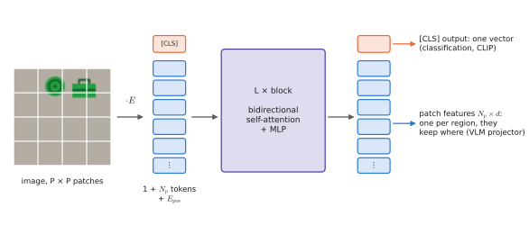
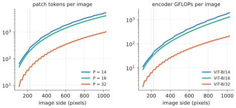

# 3.2 The Vision Transformer

[0.8](../00-foundations/first-look.md#vision-transformers) introduced the ViT in one paragraph: cut the image into patches, embed each patch as a token, run a transformer encoder. This section builds it completely — every tensor, the cost model, the position table and what happens when the resolution changes, the [CLS] token and its alternatives, and the evidence on when ViTs beat CNNs. Every VLA backbone in [Chapter 10](../10-case-studies/index.md) starts with one.

## What is it?

!!! definition "Vision Transformer (Dosovitskiy et al., 2021)"
    Split an image $I\in\mathbb{R}^{C\times H\times W}$ into $N_p=HW/P^2$ non-overlapping patches and flatten each to a vector $\mathbf{x}_p^{(n)}\in\mathbb{R}^{1\times CP^2}$, in raster order. Then

    $$
    \begin{aligned}
    Z^{(0)}&=\big[\,\mathbf{x}_\text{cls};\ \mathbf{x}_p^{(1)}E;\ \dots;\ \mathbf{x}_p^{(N_p)}E\,\big]+E_\text{pos}, &&E\in\mathbb{R}^{CP^2\times d},\ E_\text{pos}\in\mathbb{R}^{(1+N_p)\times d},\\
    Z^{(\ell)}&=\operatorname{Block}\big(Z^{(\ell-1)}\big),\qquad \ell=1,\dots,L, &&\text{(pre-norm, no mask)}\\
    \mathbf{y}&=\operatorname{Norm}\big(Z^{(L)}_{0,:}\big) &&\text{(image embedding)}
    \end{aligned}
    $$

    where $[\cdot;\cdot]$ stacks rows and $\operatorname{Block}$ is the [transformer block](../02-transformers/block.md) of Chapter 2.

| Symbol | Shape | Meaning |
|---|---|---|
| $P$ | — | patch side in pixels (14, 16 or 32) |
| $N_p$ | — | number of patch tokens, $(H/P)(W/P)$; 196 for $224^2$ and $P=16$ |
| $E$ | $CP^2\times d$ | **patch embedding**: a linear map shared by all patches ($768\times768$ for ViT-B/16) |
| $\mathbf{x}_\text{cls}$ | $1\times d$ | a learned **[CLS] token** prepended to the sequence, whose output summarises the image |
| $E_\text{pos}$ | $(1+N_p)\times d$ | learned **position embeddings**, one per token slot |
| $Z^{(\ell)}$ | $(1+N_p)\times d$ | the token sequence after layer $\ell$ |
| $Z^{(L)}_{1:,:}$ | $N_p\times d$ | **patch features**: one vector per image region, what VLMs and VLAs consume |

The blocks use **no mask**: every patch attends to every patch (an *encoder*, [2.4](../02-transformers/block.md#encoder-decoder-encoderdecoder)). ViTs use LayerNorm and a GELU MLP rather than RMSNorm and SwiGLU, but otherwise this is exactly the block you built in Lab 04.

<figure markdown="span">
  
  <figcaption markdown="span">The ViT as a VLA uses it. Patches are embedded by one shared linear map, the [CLS] token and position embeddings are added, and $L$ bidirectional blocks follow. The [CLS] output summarises the image (used by CLIP-style retrieval). The patch outputs keep one vector per region; they are what a VLM's projector reads.</figcaption>
</figure>

**The patch embedding is a convolution.** Multiplying each flattened patch by $E$ equals a convolution with kernel size $=$ stride $=P$ and $d$ output channels whose kernel is $E$ reshaped to $d\times C\times P\times P$ — which is how every implementation writes it (`nn.Conv2d(3, d, P, stride=P)`). Lab 06 checks the equality numerically.

## Why does it exist?

By 2020 transformers dominated language, and there were two reasons to want one for images. **Uniformity:** one architecture, one set of optimisation tricks and one hardware path for every modality — and, once images are tokens, they can be fed to the same model as text ([1.3](../01-multimodal-intro/combining.md#tokens-as-a-universal-interface)). **Scaling:** transformers kept improving with more data and compute where CNNs saturated.

The ViT paper's central experiment is about inductive bias. Trained on ImageNet-1k alone (1.3 M images), ViTs were *worse* than ResNets of similar size; pretrained on ImageNet-21k (14 M) they matched them; pretrained on JFT-300M (300 M) they surpassed them. A ViT has much weaker built-in assumptions than a CNN:

| Property | CNN | ViT |
|---|---|---|
| locality | built in (small kernels) | none: attention is global from layer 1; only the patch is local |
| weight sharing across positions | built in | only in $E$ and in the per-token blocks; the position table is position-specific |
| translation equivariance | built in (stride 1) | only for shifts by multiples of $P$, and broken by $E_\text{pos}$ |
| 2-D structure | built in | learned from data through $E_\text{pos}$ |

Weaker assumptions mean more data is needed to learn what the CNN gets for free — but no wrong assumption can cap performance at scale. Lab 06 reproduces the effect in miniature: with 100 training images a small CNN reaches 92% and a ViT of similar training budget 64%; with 4000 images both exceed 98%. **DeiT** (Touvron et al., 2021) later showed that strong augmentation and regularisation (and distillation from a CNN) make ViTs trainable on ImageNet-1k alone. In VLAs the question is moot: the encoder is always pretrained on hundreds of millions of images ([3.3](self-supervised.md), [4.2](../04-alignment/clip-siglip.md)).

## How does it work?

### Sizes and cost

| Model | $d$ | $L$ | $h$ | $P$ | parameters | used in |
|---|---|---|---|---|---|---|
| ViT-S/14 (DINOv2-S) | 384 | 12 | 6 | 14 | 22 M | Lab 06 |
| ViT-B/16, ViT-B/32 | 768 | 12 | 12 | 16, 32 | 86–88 M | CLIP B/32 (Lab 07), SmolVLM's SigLIP-B/16 (Lab 08) |
| ViT-L/14 | 1024 | 24 | 16 | 14 | 304 M | CLIP L/14 (LLaVA), DINOv2-L (OpenVLA) |
| SigLIP So400m/14 | 1152 | 27 | 16 | 14 | 400 M | PaliGemma, π0, OpenVLA |

The notation ViT-B/16 means "Base" size with $P=16$. Using the per-block count of [2.7](../02-transformers/scaling.md#counting-parameters), $12Ld^2=12\cdot12\cdot768^2=85$ M for ViT-B — the whole model except the small patch embedding and position table.

FLOPs per image follow the same accounting as a language model processing $N_p+1$ tokens in parallel ([2.6](../02-transformers/inference.md#flops-per-token)):

$$
\text{FLOPs}\approx \underbrace{2\,(N_p+1)\cdot12Ld^2}_{\text{projections and MLPs}}+\underbrace{4\,L\,(N_p+1)^2\,d}_{\text{scores and weighted sums}} .
$$

For ViT-B/16 at 224 px: $2\cdot197\cdot85\text{M}\approx33.5$ GFLOPs plus $4\cdot12\cdot197^2\cdot768\approx1.4$ GFLOPs, ≈35 GFLOPs (17.5 G multiply-adds, the figure usually quoted). Note the first term is linear in $N_p$ and dominates at this size; the quadratic term takes over only at high resolution.

### Resolution is a token budget

Halving $P$ or doubling $H$ and $W$ quadruples $N_p$:

<figure markdown="span">
  
  <figcaption markdown="span">Token count and encoder compute for ViT-B at patch sizes 14, 16 and 32. Tokens grow with image area; compute grows slightly faster because of the quadratic attention term. In a VLA every image token is also processed by the language backbone, so the right-hand curve understates the true cost.</figcaption>
</figure>

For a VLA, resolution is the single most consequential encoder parameter: it sets what the robot can see (a small handle, a toolbox from 30 m altitude) and how many tokens the backbone must process every control step. Lab 06 times DINOv2-S: 7.7 ms at 224 px (256 patches) versus 47 ms at 518 px (1369 patches) on a laptop GPU.

### Position embeddings, and changing resolution

The ViT learns one position vector per slot of a fixed $g\times g$ grid ($g=H/P$). Nothing tells it that slot 5 is *below* slot 1; it learns 2-D structure from data (trained ViT position embeddings visibly show row and column similarity). Two consequences:

- **Changing resolution requires resizing the table.** A model trained at 518 px has a $37\times37$ grid. To run it at 224 px ($16\times16$), implementations reshape the table to an image of $d$ channels and **bicubically interpolate** it to the new grid (`vlacourse.vision.resize_pos_embed`; DINOv2 does it automatically). This works reasonably for moderate changes; large changes usually need brief fine-tuning at the new resolution.
- **Raster order meets the language model.** When patch tokens enter an LLM, the LLM's 1-D positional encoding sees them in raster order: vertically adjacent patches are $g$ positions apart ([2.3](../02-transformers/positions.md#limitations), and the figure in [0.8](../00-foundations/first-look.md#vision-transformers)). Some recent models use 2-D RoPE in the encoder or explicit row-separator tokens to restore the grid.

Fixed 2-D sinusoidal position embeddings (used by MAE) are an alternative that extends naturally to new resolutions.

### The [CLS] token, mean pooling and registers

The [CLS] token is a learned query-like slot with no image content; through attention it aggregates whatever the training objective needs, and its final state is the image embedding. Two alternatives are common: **mean pooling** of the patch outputs (SigLIP uses an attention-pooling head instead of [CLS]), and simply **not pooling** — VLMs and VLAs keep all patch tokens, because a single vector cannot say where things are. Lab 08 makes this concrete: a linear probe recovers an object's position from the patch tokens with 96% accuracy, but from the [CLS] token of the same encoder with only 28%.

!!! definition "Register tokens (Darcet et al., 2024)"
    Large ViTs trained long enough develop a few **high-norm artifact tokens**: patch tokens in uninformative background regions whose outputs no longer describe their patch but are used by the network as global scratch space. They show up as isolated bright spots in attention maps. Appending a few extra learned tokens — **registers**, discarded at the output — gives the network dedicated scratch space and removes the artifacts, which noticeably cleans the dense patch features that detection, segmentation and robot policies rely on.

Lab 06 finds such a token in DINOv2-S: one background patch receives strong [CLS] attention in every depot image and has a norm far above the others.

## Implementation

```python
class PatchEmbed(nn.Module):
    def __init__(self, patch, d, channels=3):
        super().__init__()
        self.proj = nn.Conv2d(channels, d, kernel_size=patch, stride=patch)   # = flatten + linear map E

    def forward(self, x):                                   # (B, C, H, W)
        return self.proj(x).flatten(2).transpose(1, 2)     # (B, N_p, d), raster order


class ViT(nn.Module):
    def __init__(self, img_size=64, patch=8, d=128, n_layers=4, n_heads=4):
        super().__init__()
        self.patch_embed = PatchEmbed(patch, d)
        self.cls = nn.Parameter(torch.zeros(1, 1, d))
        self.pos = nn.Parameter(torch.randn(1, 1 + (img_size // patch) ** 2, d) * 0.02)
        self.blocks = nn.ModuleList(Block(d, n_heads, 4 * d) for _ in range(n_layers))
        self.norm = RMSNorm(d)

    def forward(self, images):                                          # (B, 3, H, W)
        x = self.patch_embed(images)                                    # (B, N_p, d)
        x = torch.cat([self.cls.expand(len(x), -1, -1), x], 1) + self.pos   # (B, 1 + N_p, d)
        for blk in self.blocks:
            x = blk(x)                                                  # no mask: bidirectional
        return self.norm(x)                                             # [CLS] output = x[:, 0]
```

This is `vlacourse.vision.ViT`, used as the image tower of the tiny CLIP (Lab 07) and the tiny VLM (Lab 08).

!!! lab "Lab 06, parts 4–7"
    Patch embedding as a strided convolution; CNN vs ViT under scarce data and unseen positions; DINOv2-S opened up — PCA of its patch features, [CLS] attention maps, an artifact token, position-table interpolation, and the cost of resolution.

## Limitations

- **Quadratic in tokens.** High resolution or many cameras quickly dominates the compute of the whole VLA.
- **Fixed grid.** Objects smaller than a patch are blurred into it; the patch grid aliases thin structures; resolution changes need table interpolation.
- **Data-hungry.** Without large-scale pretraining, a ViT generalises worse than a CNN; robot datasets alone are far too small to train one from scratch.
- **No built-in geometry.** The ViT does not know about cameras, depth or 3-D; everything spatial is learned from 2-D image statistics.

## Why it matters for VLAs and robots

The ViT is the reason VLAs exist in their current form: it turns an image into a sequence of $d$-dimensional tokens that a language model can read alongside words. Every design choice above becomes a VLA design choice. Patch size and resolution set the token budget per camera. The position table sets which resolutions work without retraining. [CLS] versus patch features decides whether the policy can know *where* things are. And the pretraining objective of the ViT — self-supervised ([3.3](self-supervised.md)) or language-supervised ([4.2](../04-alignment/clip-siglip.md)) — decides what its features know.
