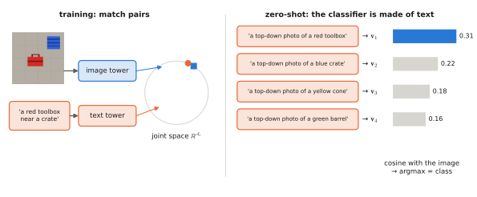

# 4.2 CLIP and SigLIP

[4.1](contrastive.md) gave the objective. This section describes the two models that put it into practice at web scale. **CLIP** made zero-shot image recognition from text work. **SigLIP** replaced its softmax with a sigmoid and became the vision encoder of choice for VLMs and VLAs. You will use both: CLIP ViT-B/32 in Lab 07, and SigLIP inside SmolVLM in Lab 08 and inside the VLAs of Part III.

## What is it?

!!! definition "CLIP (Radford et al., 2021)"
    **C**ontrastive **L**anguage–**I**mage **P**re-training: an image encoder (a ResNet or a [ViT](../03-vision/vit.md)) and a text encoder (a 12-layer causal transformer) trained from scratch with the symmetric [InfoNCE loss](contrastive.md#what-is-it) on 400 M image–text pairs collected from the web (the WIT dataset), batch size 32 768, learned temperature.

!!! definition "SigLIP (Zhai et al., 2023)"
    **Sig**moid loss for **L**anguage–**I**mage **P**re-training: the same two-tower architecture, trained with an independent **binary** loss on every image–text pair of the batch:

    $$
    \mathcal{L}_\text{sig}=-\frac{1}{B}\sum_{i=1}^{B}\sum_{j=1}^{B}\log\sigma\!\big(z_{ij}\,(t\,\mathbf{u}_i\mathbf{v}_j^\top+b)\big),\qquad z_{ij}=\begin{cases}+1 & i=j\\-1 & i\ne j\end{cases}
    $$

| Symbol | Meaning |
|---|---|
| $\sigma(x)=1/(1+e^{-x})$ | logistic sigmoid: $\sigma(t\,\mathbf{u}_i\mathbf{v}_j^\top+b)$ is the predicted probability that caption $j$ matches image $i$ |
| $z_{ij}$ | label: $+1$ for the $B$ matching pairs, $-1$ for the $B^2-B$ others |
| $t$ | learned scale ($=1/\tau$), parameterised as $t=e^{t'}$ with $t'$ initialised at $\log 10$ |
| $b$ | learned **bias**, initialised at $-10$ |
| $\mathbf{u}_i,\mathbf{v}_j$ | normalised image and text embeddings, as in [4.1](contrastive.md) |

## Why does it exist?

**CLIP** answered the question of whether natural-language supervision at scale could replace labels. It could: zero-shot, with no ImageNet training image, CLIP ViT-L/14 at 336 px matched the 76% top-1 of a supervised ResNet-50 on ImageNet. It was also far more robust when the image distribution shifted (sketches, renditions, adversarially selected photos), because it had not overfitted one dataset's quirks.

**SigLIP** answered a systems question. InfoNCE needs the full $B\times B$ similarity matrix *normalised over rows and columns*: every device must gather every other device's embeddings to compute each softmax denominator. With a sigmoid, each cell is an independent binary problem, so the loss is a plain sum over cells, and can be computed in chunks, with devices passing text embeddings around one block at a time. That made huge batches cheap and small batches work well, and SigLIP matched or beat CLIP at equal compute. The bias matters. With $B^2-B$ negatives against $B$ positives, a randomly initialised model would spend its first steps learning "almost everything is a mismatch"; starting at $b=-10$ already predicts that, so the early gradients go into the embeddings.

## How does it work?

### Architecture and the text tower

<figure markdown="span">
  
  <figcaption markdown="span">Two towers and a dot product. Training (left): matched image–caption pairs are pulled together in the joint space. Zero-shot classification (right): each class name is written into a prompt and embedded once. An image is assigned to the class whose prompt embedding has the highest cosine similarity with it. The classifier is made of text.</figcaption>
</figure>

| Component | CLIP ViT-B/32 (Lab 07) | SigLIP So400m/14 (PaliGemma, π0, OpenVLA) |
|---|---|---|
| image tower | ViT-B, $P=32$, 224 px → 49 patches; [CLS] pooled | ViT So400m, $P=14$, 224 px → 256 patches; attention-pooling head |
| text tower | 12 layers, width 512, causal mask, output at the end-of-text token | 27 layers, width 1152 (same shape as the image tower), output at the last token |
| joint width $d_e$ | 512 | 1152 |
| vocabulary | byte-level BPE, 49 408 tokens, 77-token context | SentencePiece, 32 000 tokens, 64-token context (16 in some checkpoints) |
| loss | InfoNCE, learned $\tau$ (ends at $1/\tau=100$) | sigmoid, learned $t$ and $b$ |

The CLIP text tower uses a **causal mask** and takes the output at the end-of-text position as the sentence embedding — Lab 07's `TextEncoder` does the same. Thanks to the mask, padding after that token cannot influence it.

### Zero-shot classification and prompts

To classify an image among $K$ classes without training: embed one prompt per class, e.g. "a photo of a {class}.", giving $\mathbf{v}_1,\dots,\mathbf{v}_K$; embed the image, $\mathbf{u}$; predict $\arg\max_k\mathbf{u}\mathbf{v}_k^\top$. The text embeddings *are* the weights of a linear classifier, written in language.

The wording matters, because the model learned from captions, not labels. Lab 07 measures this on depot scenes with CLIP ViT-B/32. The bare prompt "a {colour} {kind}" gets 69% on the 16 classes; "a photo of a …" 72%; "a top-down photo of a … on a concrete floor." **95%**. Colour is always right; the object kind is what improves when the prompt describes the viewpoint. CLIP's authors averaged the text embeddings of 80 prompt templates per class (**prompt ensembling**), gaining about 5 points on ImageNet. For robotics, describing the camera's viewpoint in the prompt is free accuracy.

### SigLIP's loss, step by step

For one pair $(i,j)$ with logit $x_{ij}=t\,\mathbf{u}_i\mathbf{v}_j^\top+b$, the term $-\log\sigma(z_{ij}x_{ij})$ is the [binary cross-entropy](../00-foundations/probability.md#maximum-likelihood) of label $z_{ij}$. Its gradient is $\partial/\partial x_{ij}=-z_{ij}\,\sigma(-z_{ij}x_{ij})$: a positive pair is pushed up by the probability it is currently *rejected*, a negative pair pushed down by the probability it is currently *accepted*. Unlike InfoNCE, the push on one negative does not depend on the others in its row. There is no competition among negatives, which is exactly what removes the batch-wide normaliser.

SigLIP 2 (Tschannen et al., 2025) keeps the sigmoid loss and adds captioning-based and self-distillation objectives to improve dense features and localisation — the properties [3.3](../03-vision/self-supervised.md) and [4.4](grounding.md) argue robots need.

## Implementation

```python
import torch
import torch.nn.functional as F

def siglip_loss(img_emb, txt_emb, logit_scale, logit_bias):
    """img_emb, txt_emb: (B, d_e) L2-normalised. logit_scale = log t, logit_bias = b."""
    logits = logit_scale.exp() * img_emb @ txt_emb.T + logit_bias          # (B, B)
    z = 2 * torch.eye(len(logits), device=logits.device) - 1               # +1 diagonal, -1 elsewhere
    return -F.logsigmoid(z * logits).sum() / len(logits)

@torch.no_grad()
def zero_shot(model, images, class_names, template="a top-down photo of a {} on a concrete floor."):
    v = model.encode_text([template.format(c) for c in class_names])       # (K, d_e), normalised
    u = model.encode_image(images)                                          # (N, d_e), normalised
    return (u @ v.T).argmax(-1)                                             # (N,) class indices
```

!!! lab "Lab 07, parts 3–7"
    Train the tiny CLIP with both losses and compare. Then load CLIP ViT-B/32 and measure prompt sensitivity and attribute and spatial binding on depot scenes.

## Limitations

- **Global embedding only.** The training signal reaches the [CLS]/pooled vector; the patch features are not trained to align with words ([4.4](grounding.md)).
- **Compositionality.** Attribute binding, word order, spatial relations and counting are weak ([4.5](failure-modes.md)) — Lab 07's CLIP is at chance on "which object is on the left".
- **Data.** Web pairs are noisy, biased toward photographs and toward what people caption; robot viewpoints and industrial objects are rare.
- **Prompt sensitivity.** Accuracy depends on phrasing; deployed systems must fix and validate their prompts.

## Why it matters for VLAs and robots

SigLIP is the most common vision encoder in today's VLAs: PaliGemma (and therefore π0), OpenVLA (with DINOv2), SmolVLM (and therefore SmolVLA). Its features organise the image around what language can name. That is why an instruction can steer a VLA's attention to "the red toolbox". It is also why the VLA struggles with "left of": the vision encoder never learned it. CLIP-style models are also directly useful as robot modules. A cheap image–text score can trigger a closer look, rank candidate frames, or check that a scene matches a mission description. Their prompt sensitivity and binding failures must then be designed around, never trusted blindly.
