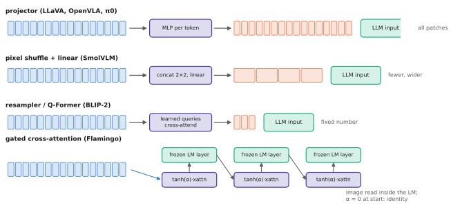

# 4.3 Connectors: Projectors, Resamplers and Gated Cross-Attention

A contrastive model ([4.1](contrastive.md)–[4.2](clip-siglip.md)) aligns one *vector* per image with one vector per caption. A vision-language model needs more: it must feed many visual tokens into a pretrained language model so that the LM can reason about them in words. The module that does this is the **connector** (also called adapter, projector or bridge). It is small, often the only part trained from scratch, and its design fixes how many image tokens the language model must process — the main cost of a VLM or VLA.

## What is it?

!!! definition "Connector"
    Given patch features $Z\in\mathbb{R}^{N_p\times d_v}$ from a vision encoder and a language model of width $d$, a **connector** is a learned map

    $$
    \operatorname{conn}:\ \mathbb{R}^{N_p\times d_v}\to\mathbb{R}^{N_v\times d}
    $$

    whose outputs are inserted into the language model as **image tokens**, either into its input sequence (in-sequence fusion) or as keys and values of extra cross-attention layers. $N_v$ is the number of image tokens the language model processes per image.

Four designs cover nearly every VLM and VLA in this book:

| Connector | Output tokens $N_v$ | Parameters | Where the LM reads them | Examples |
|---|---|---|---|---|
| linear / MLP projector | $N_p$ (one per patch) | $d_vd$ (linear), $\approx d_vd+d^2$ (2-layer MLP) | input sequence | LLaVA, PaliGemma, OpenVLA, π0 |
| pixel shuffle + linear | $N_p/r^2$ | $r^2d_vd$ | input sequence | Idefics3, SmolVLM, SmolVLA |
| learned-query resampler (Perceiver, Q-Former) | fixed $N_q$ (32–64) | a few transformer layers | input sequence (BLIP-2) or cross-attention (Flamingo) | BLIP-2, Flamingo, InstructBLIP |
| gated cross-attention layers | — (image tokens are only keys/values) | one cross-attention block every few LM layers | inside the LM | Flamingo |

<figure markdown="span">
  
  <figcaption markdown="span">Four ways to connect a vision encoder to a language model. A projector keeps one token per patch. Pixel shuffle merges neighbouring patches before projecting. A resampler compresses everything to a fixed number of learned queries. Flamingo leaves the language model's input untouched and lets its layers read the image through added, gated cross-attention.</figcaption>
</figure>

## Why does it exist?

The vision encoder and the language model were pretrained separately, with different widths ($d_v=1152$ for SigLIP-So400m, $d=2048$ for Gemma-2B) and, more importantly, unrelated representation spaces. Even a CLIP-aligned vision feature is aligned with CLIP's *text encoder*, not with the LLM's word embeddings. The connector translates. It also decides the token budget: every image token occupies a position in the LM's sequence at every layer, so $N_v$ multiplies the cost of every image ([2.6](../02-transformers/inference.md#flops-per-token)).

## How does it work?

### Projectors

The simplest connector applies the same map to every patch: $\operatorname{conn}(Z)=ZW$ (LLaVA-1.0), or a two-layer MLP, $\operatorname{GELU}(ZW_1)W_2$ (LLaVA-1.5 onward; OpenVLA). LLaVA-1.5 found the MLP clearly better than a single linear layer at almost no cost. With CLIP ViT-L/14 at 336 px that gives $24^2=576$ image tokens per image; PaliGemma at 224 px gives 256. A projector loses nothing — all spatial detail reaches the LM — and costs everything: the token count of the encoder.

### Pixel shuffle

Pixel shuffle ([3.4](../03-vision/encoders-for-vlas.md#reducing-tokens)) concatenates each $r\times r$ block of neighbouring patch tokens into one token of width $r^2d_v$, then projects:

$$
Z\in\mathbb{R}^{(g\times g)\times d_v}\ \longrightarrow\ Z'\in\mathbb{R}^{(g/r\times g/r)\times r^2d_v}\ \xrightarrow{\ W\in\mathbb{R}^{r^2d_v\times d}\ }\ \mathbb{R}^{(g/r)^2\times d}.
$$

SmolVLM-256M uses $r=4$: $32\times32$ SigLIP tokens of width 768 become 64 tokens of width 12 288, projected to 576. Lab 08 reproduces this rearrangement by hand and matches the library exactly. The projection $W$ sees all 16 neighbours at once and can learn what to keep. Compared with a resampler there is no attention and no learned query, so cost is minimal.

### Learned-query resamplers

A **resampler** uses $N_q$ learned query vectors $Q_0\in\mathbb{R}^{N_q\times d}$ that [cross-attend](../02-transformers/multi-head.md#cross-attention) to the patch features, layer after layer:

$$
Q_{\ell}=Q_{\ell-1}+\operatorname{CrossAttn}\big(Q_{\ell-1},\,[Z;Q_{\ell-1}]\big),\qquad Q_\ell\leftarrow Q_\ell+\operatorname{FFN}(Q_\ell),\qquad \ell=1,\dots,L_r .
$$

The output $Q_{L_r}\in\mathbb{R}^{N_q\times d}$ has a fixed size whatever the resolution or number of frames. Flamingo's **Perceiver Resampler** uses 64 queries (keys and values are the image features concatenated with the queries, as written). BLIP-2's **Q-Former** uses 32 queries and is first trained on its own with three objectives — image–text contrastive, image–text matching and image-grounded captioning — so that the 32 tokens extract what text needs before being connected to a frozen LLM through a linear layer.

Resamplers compress aggressively: 576 → 32 tokens is an 18× reduction in LM cost. The price is that the learned queries decide what survives, and fine spatial detail is the usual casualty. Recent VLMs have mostly moved back to projectors plus pixel shuffle. Resamplers return in VLA action heads, where a few action queries read the backbone ([Chapter 8](../08-vla/index.md)).

### Gated cross-attention: leaving the LM's input alone

Flamingo (Alayrac et al., 2022) kept the 70 B-parameter Chinchilla LM **frozen** and inserted new blocks between its layers:

$$
\mathbf{x}\leftarrow\mathbf{x}+\tanh(\alpha_\text{attn})\cdot\operatorname{CrossAttn}(\mathbf{x},\,Z_\text{img}),\qquad
\mathbf{x}\leftarrow\mathbf{x}+\tanh(\alpha_\text{ff})\cdot\operatorname{FFN}(\mathbf{x}),
$$

with scalar gates $\alpha$ initialised at **0**. At the start of training $\tanh(0)=0$: the new blocks do nothing and the frozen LM behaves exactly as before. As $\alpha$ grows, visual information is blended in gradually. This is the "initialise new pathways to do nothing" principle of [1.3](../01-multimodal-intro/combining.md#implementation-sketch-film), applied to a whole modality. Text tokens are queries and image tokens only keys and values, so the LM sequence stays text-only. That makes long interleaved image–text documents cheap. The price is a more invasive change to the LM.

### Costs compared

For an LM of width $d$ and depth $L$ processing $T$ text tokens, adding one image costs roughly:

| Connector | Extra LM FLOPs per image (prefill) | Spatial detail reaching the LM |
|---|---|---|
| projector | $\approx2N_p\cdot12Ld^2$ — every patch is a full token | all |
| pixel shuffle $r$ | $\approx2(N_p/r^2)\cdot12Ld^2$ | all, packed into width |
| resampler ($N_q$ queries) | $\approx2N_q\cdot12Ld^2$ + resampler | what the queries extract |
| gated cross-attention | $\approx(L/k)\cdot4TN_pd$ for one cross-attention block every $k$ layers | all, read only where text asks |

## Implementation

```python
import torch
import torch.nn as nn

class MLPProjector(nn.Module):                      # LLaVA-1.5 / OpenVLA / Lab 08
    def __init__(self, d_vision, d):
        super().__init__()
        self.net = nn.Sequential(nn.Linear(d_vision, d), nn.GELU(), nn.Linear(d, d))

    def forward(self, z):                           # (B, N_p, d_vision) -> (B, N_p, d)
        return self.net(z)


class Resampler(nn.Module):                         # Perceiver-style: N_p tokens -> n_queries tokens
    def __init__(self, d_vision, d, n_queries=32, n_layers=2, n_heads=8):
        super().__init__()
        self.queries = nn.Parameter(torch.randn(1, n_queries, d) * 0.02)
        self.inp = nn.Linear(d_vision, d)
        self.layers = nn.ModuleList(nn.MultiheadAttention(d, n_heads, batch_first=True) for _ in range(n_layers))
        self.ffns = nn.ModuleList(nn.Sequential(nn.LayerNorm(d), nn.Linear(d, 4 * d), nn.GELU(), nn.Linear(4 * d, d))
                                  for _ in range(n_layers))

    def forward(self, z):                           # z: (B, N_p, d_vision)
        z = self.inp(z)                             # (B, N_p, d)
        q = self.queries.expand(len(z), -1, -1)     # (B, N_q, d)
        for attn, ffn in zip(self.layers, self.ffns):
            kv = torch.cat([z, q], dim=1)           # keys/values: image features and the queries
            q = q + attn(q, kv, kv, need_weights=False)[0]
            q = q + ffn(q)
        return q                                    # (B, N_q, d): a fixed number of image tokens


class GatedCrossAttention(nn.Module):               # Flamingo: inserted between frozen LM layers
    def __init__(self, d, n_heads=8):
        super().__init__()
        self.attn = nn.MultiheadAttention(d, n_heads, batch_first=True)
        self.alpha = nn.Parameter(torch.zeros(1))   # tanh(0) = 0: starts as the identity

    def forward(self, x, img):                      # x: (B, T, d) text states; img: (B, N, d)
        return x + torch.tanh(self.alpha) * self.attn(x, img, img, need_weights=False)[0]
```

!!! lab "Lab 08, parts 3 and 10, and exercise 2"
    The tiny VLM uses an MLP projector (64 patch tokens → 64 image tokens). SmolVLM's pixel-shuffle connector is rebuilt by hand. Exercise 2 replaces the projector by a 16-query resampler and measures what is lost.

## Limitations

- **Projectors** make the LM pay for every patch; at high resolution or with several cameras this dominates latency.
- **Resamplers** lose spatial detail in ways that are hard to predict, and are slower to train.
- **Gated cross-attention** requires changing the LM's architecture, which complicates reusing new LLM releases.
- **All connectors** are trained on image–text data. Whatever robots need that captions never mention (precise positions, contact geometry) can be lost here as well as in the encoder.

## Why it matters for VLAs and robots

The connector decides the image-token budget of a VLA, and with it the backbone cost per control step. OpenVLA uses an MLP projector over 256 fused SigLIP+DINOv2 tokens per image. π0 inherits PaliGemma's projector over 256 SigLIP tokens per camera. SmolVLA uses pixel shuffle to reach 64 tokens per camera. These choices alone account for much of the latency differences between them ([Chapter 11](../11-deployment/index.md)). The resampler and the gated cross-attention block come back as the standard ways to attach an *action expert* to a VLM backbone ([Chapter 8](../08-vla/index.md)).
