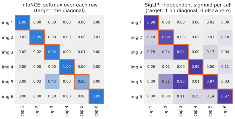
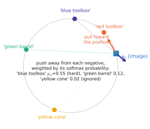

# 4.1 Contrastive Learning and Shared Embedding Spaces

[1.3](../01-multimodal-intro/combining.md#why-is-it-hard) listed the obstacle to combining modalities: representations learned separately live in unrelated spaces. The vector a text model produces for "red" has no relation to what a vision model produces for red pixels. This section introduces the tool that relates them, **contrastive learning**. It trains two encoders so that matching image–text pairs land close together in one **shared embedding space**, using nothing but a large collection of pairs.

## What is it?

!!! definition "Shared embedding space"
    An image encoder $f_\phi$ and a text encoder $g_\psi$ map their inputs to unit vectors in the same space $\mathbb{R}^{d_e}$:

    $$
    \mathbf{u}=\frac{f_\phi(I)W_I}{\lVert f_\phi(I)W_I\rVert_2},\qquad \mathbf{v}=\frac{g_\psi(\ell)W_T}{\lVert g_\psi(\ell)W_T\rVert_2},\qquad \operatorname{sim}(I,\ell)=\mathbf{u}\mathbf{v}^\top=\cos(\mathbf{u},\mathbf{v}),
    $$

    such that $\operatorname{sim}$ is high when the text describes the image and low otherwise. $W_I\in\mathbb{R}^{d_v\times d_e}$, $W_T\in\mathbb{R}^{d_t\times d_e}$ are linear projections from each encoder's width to the joint width $d_e$.

!!! definition "InfoNCE loss"
    For a batch of $B$ matched pairs $(\mathbf{u}_i,\mathbf{v}_i)$, define the logits $s_{ij}=\mathbf{u}_i\mathbf{v}_j^\top/\tau$. The image-to-text loss treats each row as a $B$-way classification whose correct class is the diagonal:

    $$
    \mathcal{L}_{I\to T}=-\frac1B\sum_{i=1}^{B}\log\frac{e^{s_{ii}}}{\sum_{j=1}^{B}e^{s_{ij}}},\qquad
    \mathcal{L}_{T\to I}=-\frac1B\sum_{j=1}^{B}\log\frac{e^{s_{jj}}}{\sum_{i=1}^{B}e^{s_{ij}}},\qquad
    \mathcal{L}=\tfrac12\big(\mathcal{L}_{I\to T}+\mathcal{L}_{T\to I}\big).
    $$

| Symbol | Shape | Meaning |
|---|---|---|
| $\mathbf{u}_i$, $\mathbf{v}_i$ | $1\times d_e$ | normalised embeddings of image $i$ and of its caption |
| $S=[s_{ij}]$ | $B\times B$ | all image–caption logits in the batch; the diagonal holds the **positives** |
| $s_{ij}$, $i\ne j$ | scalar | a **negative**: caption $j$ does not describe image $i$ (by assumption) |
| $\tau$ | scalar | **temperature**, usually learned (CLIP learns $\log(1/\tau)$, initialised at $\tau=0.07$) |
| $\mathcal{L}_{I\to T}$ | scalar | "for each image, pick its caption among the $B$ in the batch" |
| $\mathcal{L}_{T\to I}$ | scalar | "for each caption, pick its image" — the same matrix, normalised over the other axis |

<figure markdown="span">
  
  <figcaption markdown="span">One batch of the contrastive objective. Every image is compared with every caption. InfoNCE (left) turns each row into a softmax and asks for the diagonal entry; the same is done over columns. The sigmoid loss of SigLIP (right, [4.2](clip-siglip.md)) instead makes an independent yes/no decision for each of the $B^2$ cells.</figcaption>
</figure>

## Why does it exist?

Supervised classification needs a fixed label set and costly annotation. The web contains billions of images with nearby text — alt-text, captions, titles — that is noisy but free and describes an open-ended vocabulary. Contrastive learning turns that weak signal into a training objective without ever generating text: it only needs to tell which caption, among a few thousand, belongs to which image. CLIP's authors found it about 4× more compute-efficient than predicting the caption's bag of words, and about 12× more than generating the caption word by word, for the same zero-shot accuracy.

The result is an **open vocabulary**: any phrase the text encoder can read becomes a "class". "A red toolbox", "a drone landing pad" and "a spilled liquid" all get embeddings without retraining. This is what a robot that receives free-form instructions needs.

## How does it work?

### The gradient: pull the positive, push the negatives

Let $p_{ij}=\operatorname{softmax}_j(s_{ij})$ be the row-wise probabilities. By the [softmax–cross-entropy gradient](../00-foundations/probability.md#softmax), $\partial\mathcal{L}_{I\to T}/\partial s_{ij}=(p_{ij}-\delta_{ij})/B$. Through $s_{ij}=\mathbf{u}_i\mathbf{v}_j^\top/\tau$:

$$
\frac{\partial\mathcal{L}_{I\to T}}{\partial\mathbf{u}_i}=\frac{1}{B\tau}\Big(\underbrace{\sum_{j}p_{ij}\,\mathbf{v}_j}_{\text{weighted negatives}}-\ \mathbf{v}_i\Big).
$$

Gradient descent moves $\mathbf{u}_i$ *toward* its caption $\mathbf{v}_i$ and *away from* the other captions, weighted by how confusable they currently are ($p_{ij}$). Captions the model already rejects ($p_{ij}\approx0$) contribute nothing; **hard negatives** — similar captions — dominate. (The normalisation onto the sphere then projects this step onto the tangent plane.)

<figure markdown="span">
  
  <figcaption markdown="span">The contrastive gradient on the unit sphere (drawn as a circle). The image embedding $\mathbf{u}_i$ is pulled toward its caption and pushed away from the other captions, in proportion to their current softmax weight. The nearby "blue toolbox" caption is pushed hard, the distant "yellow cone" caption hardly at all.</figcaption>
</figure>

### The temperature

$\tau$ sets how peaked each row's softmax is. With $\tau=1$ and cosines in $[-1,1]$, logits span only $[-1,1]$: even a perfect embedding cannot make the softmax confident, and every negative gets a sizeable gradient. With small $\tau$ (CLIP ends near $\tau=0.01$, a logit scale of 100), the softmax concentrates on the hardest negatives. Too small, and training becomes unstable (CLIP clips $1/\tau$ at 100). Learning $\tau$ lets the model choose; Lab 07 watches it move from $1/0.07\approx14$ to ≈18 during training.

### Negatives, batch size and false negatives

The other $B-1$ captions of the batch are the negatives. More negatives make the classification harder and the estimate of the softmax denominator better. CLIP used $B=32{,}768$. Formally, InfoNCE is a lower bound on the **mutual information** between the two modalities:

$$
I(\text{image};\text{text})\ \ge\ \log B-\mathcal{L}_{I\to T},
$$

which can never exceed $\log B$ — one way to see why large batches help. Large batches also create **false negatives**: two images in the batch whose captions are equally correct for both. In Lab 07's closed world, 12 000 scenes share only 3063 distinct captions, so a batch of 256 often contains identical captions labelled as negatives of each other. On web data the problem is milder but real ("a photo of a dog" appears many times).

### Alignment and uniformity

A useful asymptotic reading (Wang & Isola, 2020): as $B\to\infty$, InfoNCE decomposes into an **alignment** term (positives close) and a **uniformity** term (embeddings spread evenly over the sphere). Uniformity is what prevents [collapse](../03-vision/self-supervised.md#what-is-it): a constant embedding perfectly aligns positives but maximally violates uniformity. Contrastive methods avoid collapse with negatives; DINO ([3.3](../03-vision/self-supervised.md)) avoids it without negatives, by centering and sharpening.

## Implementation

```python
import torch
import torch.nn.functional as F

def clip_loss(img_emb, txt_emb, logit_scale):
    """img_emb, txt_emb: (B, d_e), L2-normalised; pair i matches pair i. logit_scale = log(1 / tau)."""
    logits = logit_scale.exp().clamp(max=100) * img_emb @ txt_emb.T       # (B, B): s_ij
    labels = torch.arange(len(logits), device=logits.device)              # the diagonal
    return (F.cross_entropy(logits, labels)                               # rows: image -> caption
            + F.cross_entropy(logits.T, labels)) / 2                      # columns: caption -> image
```

`cross_entropy` applies the softmax over the last dimension, so `logits` gives the row-wise loss and `logits.T` the column-wise one. This is `vlacourse.clip.clip_loss`. Lab 07 also writes it with explicit `logsumexp` and checks the two agree.

!!! robot "Contrastive learning beyond images and captions"
    The objective only needs a definition of *which pairs belong together*. Time-contrastive networks and R3M treat frames close in time in the same video as positives; R3M also aligns video with language. Multi-robot systems offer natural positives too: two drones' images of the same location (place recognition for map merging), or a robot's camera image and the report another robot sent about it. Choosing positives is choosing what the embedding will be invariant to.

## Limitations

- **Needs many negatives**: large batches, hence large memory and multi-device training (SigLIP's loss eases this, [4.2](clip-siglip.md)).
- **Only discriminates what the batch contrasts.** If no batch contains two captions that differ only in word order, word order is never learned ([4.5](failure-modes.md)).
- **Global.** One vector per image and per caption; nothing in the loss asks the patch features to be aligned with words ([4.4](grounding.md)).
- **False negatives** penalise correct matches.

## Why it matters for VLAs and robots

Contrastive pretraining produced the vision encoders inside most VLAs (SigLIP in PaliGemma, π0, OpenVLA, SmolVLA): their features are organised around what language can describe, so an instruction can select them. It also produced cheap, open-vocabulary perception for robots: a drone can score every frame against "a red toolbox" with one dot product. And its blind spots — word order, spatial relations, counting — are the blind spots VLAs inherit. Lab 07 measures them.

!!! lab "Lab 07, parts 2–6"
    InfoNCE by hand, matched against the reference; a tiny CLIP trained on depot scenes and captions, with retrieval, zero-shot classification and binding probes; the same model with the sigmoid loss.
