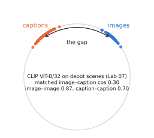
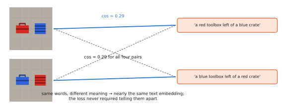

# 4.5 Failure Modes of Aligned Representations

Contrastive alignment works well enough that it is easy to over-trust. This section collects the systematic ways it fails, explains each failure from the training objective rather than as an anecdote, and measures the most robot-relevant ones in Lab 07. Every VLA built on a SigLIP or CLIP encoder inherits them, unless robot training removes them.

## What is it?

A **failure mode** here is a class of inputs on which the aligned representation is reliably wrong, in a way predictable from how it was trained. Five matter most for robots:

| Failure | What goes wrong | Root cause in the objective |
|---|---|---|
| **modality gap** | images and texts occupy different regions of the sphere | initialisation and temperature dynamics; the loss only constrains rankings |
| **bag-of-words behaviour** | "red toolbox left of blue crate" ≈ "blue toolbox left of red crate" | batches rarely contain negatives that differ only in word order or binding |
| **spatial and numerical blindness** | left/right, above/below, counting at or near chance | captions rarely state them; the pooled vector does not need them |
| **typographic and spurious cues** | text written in the image, or co-occurring context, overrides the object | text in web images is highly predictive of captions |
| **prompt and distribution sensitivity** | accuracy changes with wording and with camera viewpoint | captions describe eye-level photographs in particular styles |

## Why does it exist?

All five follow from one fact. The contrastive loss rewards whatever distinguishes a caption from **the other captions in the same batch**, and nothing else ([4.1](contrastive.md#the-gradient-pull-the-positive-push-the-negatives)). If two captions that differ only in word order essentially never meet in a batch, the gradient never asks the model to tell them apart. A model can reach low loss on web data while treating captions as bags of words, because for nearly all web negatives the bag of words *is* sufficient.

## How does it work? Each failure in turn

### The modality gap

Liang et al. (2022) observed that in CLIP-like models all image embeddings lie in one narrow cone and all text embeddings in another, with a clear gap between them. Lab 07 measures it on depot scenes with CLIP ViT-B/32. Matched image–caption pairs have mean cosine **0.30**, while two random images have cosine **0.87** and two random captions **0.70**. The first principal component of the joint embeddings separates images from texts.

<figure markdown="span">
  
  <figcaption markdown="span">The modality gap, with the numbers measured in Lab 07 for CLIP ViT-B/32. Image embeddings (blue) and text embeddings (orange) each crowd into a narrow cone. A matched pair is far apart in absolute terms (cosine 0.30), but still closer than the unmatched captions, so retrieval works.</figcaption>
</figure>

The authors trace it to the **cone effect** of randomly initialised deep networks (each tower's outputs start in a narrow cone) and to the low learned temperature, which makes it unnecessary to close the gap once the rankings are right. Retrieval does not care: only rankings within one modality matter. Anything that *mixes* the two — averaging an image and a text embedding, putting a fixed threshold on raw similarity, or feeding one modality's embedding where the other is expected — is affected. Our tiny CLIP, trained on a closed world to much lower loss, shows almost no gap (cosine 0.91 for matched pairs).

### Bag-of-words behaviour

Yuksekgonul et al. (2023) built the ARO benchmark from caption pairs that differ only in relation ("the horse is eating the grass" vs "the grass is eating the horse"), attribute binding, or word order, and found CLIP-like models close to chance on many of them. Winoground (Thrush et al., 2022) pairs two images and two captions with the same words in different orders; most models score at or below chance on matching both correctly. Lab 07 reproduces the effect with depot captions:

| Probe (300 two-object scenes) | tiny CLIP (Lab 07) | CLIP ViT-B/32 |
|---|---|---|
| true caption vs attribute swap ("blue toolbox … red crate") | 1.00 | **0.49** |
| true caption vs object swap (same words, other order) | 0.83 | **0.54** |

The real model recognises every colour (100% on single objects) and yet does not know *which* object has which colour, or which is on the left. The tiny model does better because its closed world forces the issue: with 42 words and ~3000 distinct captions, a batch often contains two captions that differ only in binding.

<figure markdown="span">
  
  <figcaption markdown="span">Bag-of-words behaviour. Two captions with the same words in different roles get nearly identical text embeddings, so both are equally similar to either image. Training on hard negatives — captions deliberately permuted, as in NegCLIP — is the main fix at the contrastive level.</figcaption>
</figure>

The direct fix is **hard negatives**: add permuted captions to each batch as explicit negatives. NegCLIP fine-tuned CLIP this way and largely closed the ARO gap — the cause was the absence of such negatives, not a limit of the architecture. Lab 07's exercise 2 tries it.

### Spatial and numerical blindness

Captions rarely say "the cup is to the left of the laptop", and almost never give counts precisely. Benchmarks built specifically for spatial prepositions find CLIP-like encoders, and VLMs built on them, near chance on left/right and above/below. For a manipulator this is the core of most instructions. A VLA's spatial competence must therefore come from its other components (DINOv2 features, [3.4](../03-vision/encoders-for-vlas.md#fusing-two-encoders)), from the language model, or from robot data — not from the contrastive encoder.

### Typographic attacks and spurious cues

Goh et al. (2021) showed that CLIP classifies an apple with a paper label reading "iPod" as an iPod. Text in images is strongly predictive of captions on the web, so the model learned to read. In a depot, every crate carries printed labels: "FRAGILE", "TOOLS", a supplier's logo. A robot told to fetch "the toolbox" may be drawn to a crate stencilled TOOLS. More broadly, any context that co-occurs with an object on the web — toolboxes next to workbenches — can substitute for the object itself.

### Prompt and distribution sensitivity

Zero-shot accuracy on our renders goes from 69% to 95% just by describing the viewpoint in the prompt ([4.2](clip-siglip.md#zero-shot-classification-and-prompts)). Robot images — top-down, wrist-mounted, motion-blurred, unusual objects — are exactly where the training distribution is thin. Thresholds and prompts tuned on web examples do not transfer.

## Implementation: a binding probe

```python
@torch.no_grad()
def binding_probe(embed_image, embed_text, scenes_two_objects, render):
    """Fraction of two-object scenes where the true caption beats its attribute-swapped version."""
    wins = []
    for s in scenes_two_objects:
        a, b = sorted(s.objects, key=lambda o: o.x)                  # left object first
        true = f"a photo of a {a.color} {a.kind} to the left of a {b.color} {b.kind}."
        swap = f"a photo of a {b.color} {a.kind} to the left of a {a.color} {b.kind}."
        u = embed_image(render(s))                                    # (1, d_e)
        t = embed_text([true, swap])                                  # (2, d_e)
        wins.append(((u @ t.T)[0, 0] > (u @ t.T)[0, 1]).item())
    return sum(wins) / len(wins)                                      # 0.5 = chance
```

Probes like this are cheap and should be run on *your* robot's images before trusting any vision-language component with an instruction-following decision.

!!! lab "Lab 07, parts 5, 7 and 8"
    Binding and order probes on the tiny CLIP and on CLIP ViT-B/32, prompt sensitivity, and the modality gap measured in both.

## Limitations of this analysis

- The probes measure the *encoder*. A VLM or VLA that reads all patch tokens with a language model can recover some binding and spatial information the pooled embedding lacks. Lab 08's tiny VLM answers relation questions it could not have answered from a single vector.
- Benchmarks age: newer encoders (SigLIP 2, models trained with captioning losses) improve on several of these failures. Re-measure, do not assume.

## Why it matters for VLAs and robots

Each failure maps onto a robot failure. Bag-of-words: the arm grasps the blue toolbox when told the red one. Spatial blindness: it goes to the wrong side of the crate. Typography: it fetches the crate labelled TOOLS. Distribution shift: the drone's detector fires on shadows. These are not rare accidents but consequences of the objective. Robot data and spatially supervised components must compensate, and safety layers must assume they will sometimes not ([Chapter 13](../13-uavs/index.md)). This is also an opportunity for research: compositional, spatially precise alignment for robot viewpoints is an open problem ([Chapter 15](../15-research/index.md)).
