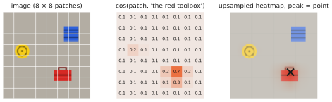
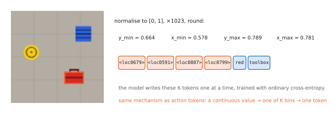

# 4.4 Grounding: From Words to Image Regions

A robot told to *"find the red toolbox"* does not need a score saying the image contains one; it needs to know **where**. Contrastive models give one similarity per image ([4.2](clip-siglip.md)). This section covers the techniques that connect a phrase to a *region* — a box, a mask or a point. They are the perception front-end of modular robot stacks, and their output formats (coordinates as tokens) are the template for how VLAs output actions.

## What is it?

!!! definition "Visual grounding"
    **Visual grounding** maps a natural-language expression $\ell$ and an image $I$ to the image region $R\subseteq I$ the expression refers to. Variants by output:

    - **referring-expression comprehension / phrase grounding:** a bounding box $(x_\text{min},y_\text{min},x_\text{max},y_\text{max})$ for "the red toolbox left of the crate";
    - **open-vocabulary detection:** boxes for every instance of any named category;
    - **referring segmentation:** a pixel mask;
    - **pointing:** one image point $(x,y)$, often all a grasp or a waypoint needs.

This is narrower than the [symbol grounding problem](../01-multimodal-intro/combining.md#the-grounding-problem) of Chapter 1, which asks how words acquire meaning connected to the physical world at all. Visual grounding connects words to *pixels*; connecting them to *actions* is the job of the VLA.

## Why does it exist?

A pooled embedding answers *whether*; manipulation and navigation need *where*. Classical robot pipelines had a closed-set detector trained on the objects of one site. Open-vocabulary grounding lets the instruction name the target at run time — "the yellow barrel next to the fuel tank" — without collecting a dataset for each new object. It is also the most widely deployed use of vision-language models in robotics today, because its output is checkable: a box can be drawn, verified against depth, and passed to a classical planner.

## How does it work? Four families

### 1. Dense similarity maps

Compare the text embedding with *every* patch feature instead of the pooled one:

$$
M_n=\cos\big(\mathbf{z}_nW_I,\ \mathbf{v}\big),\qquad n=1,\dots,N_p,
$$

where $\mathbf{z}_n$ is patch $n$'s output feature, $W_I$ the image projection of [4.1](contrastive.md#what-is-it) and $\mathbf{v}$ the text embedding. Reshaped to the patch grid and upsampled, $M$ is a heatmap of where the phrase applies. For a vanilla CLIP it is noisy: the loss only ever trained the pooled vector, and nothing forced individual patch outputs to live in the joint space (Lab 07, exercise 4). Models trained with dense or region-level objectives (SigLIP 2's localisation losses, DINOv2-based detectors) give much cleaner maps.

<figure markdown="span">
  
  <figcaption markdown="span">Grounding by dense similarity (idealised). Each patch feature is compared with the embedding of "the red toolbox", giving a coarse heatmap on the patch grid. Its peak gives a point, and thresholding gives a region. Its resolution is the patch grid, here $8\times8$.</figcaption>
</figure>

### 2. Open-vocabulary detectors

Make each output patch token a *detection candidate*. **OWL-ViT** (Minderer et al., 2022) removes the ViT's pooling, attaches to every output token a small MLP that predicts a box and a projection that produces a "class embedding", and scores each token against the text embeddings of any query phrases. It starts from a CLIP-style contrastive model and is fine-tuned on detection data. **GLIP** reformulates detection as phrase grounding with deep fusion between the image and text encoders. **Grounding DINO** builds a DETR-style detector whose object queries are selected and refined by the text. Their outputs are boxes with scores for any phrase, which a robot can filter, track and verify.

### 3. Coordinates as tokens

A generative VLM can output a location *as text*. Discretise each normalised coordinate $c\in[0,1]$ into $K$ bins and give each bin its own vocabulary entry:

$$
k=\operatorname{round}\big(c\,(K-1)\big)\in\{0,\dots,K-1\},\qquad |c-\hat c|\le\frac{1}{2(K-1)} .
$$

Pix2Seq introduced this for detection. PaliGemma reserves $K=1024$ tokens `<loc0000>`–`<loc1023>` and answers "detect red toolbox" with four of them ($y_\text{min},x_\text{min},y_\text{max},x_\text{max}$) followed by the label. At 224 px a bin is 0.22 px wide, so the quantisation error is negligible compared with the model's own uncertainty. Molmo instead writes points as decimal coordinates inside markup tags, trained on a large dataset of human pointing annotations.

<figure markdown="span">
  
  <figcaption markdown="span">A bounding box as four tokens. Each corner coordinate is normalised to $[0,1]$, multiplied by $K-1$ and rounded to a bin with its own token. The language model writes the box exactly as it writes words, one token at a time, with a cross-entropy loss. Chapter 8 uses the same trick for actions.</figcaption>
</figure>

This is the most important idea of the section for the rest of the book. **Any continuous quantity can be emitted by a language model through discretisation into dedicated tokens.** RT-2 and OpenVLA do exactly this with robot actions — 256 bins per action dimension ([Chapter 8](../08-vla/index.md)). The trade-offs — quantisation error, one token per dimension, sequential decoding, a categorical distribution that can represent several modes — are the same.

### 4. Promptable segmentation

**SAM** (Kirillov et al., 2023) segments whatever a *prompt* indicates — a point, a box, a rough mask — with a heavy image encoder run once and a light decoder run per prompt. It is not language-conditioned itself. Chained after a grounding detector (detector box → SAM mask) it gives open-vocabulary masks; robotics stacks use this to get object point clouds from depth images.

## Implementation

```python
import torch
import torch.nn.functional as F

def similarity_map(patch_feats, image_proj, text_emb, grid):
    """patch_feats: (N_p, d_v) from the image tower; image_proj: (d_v, d_e); text_emb: (d_e,) normalised."""
    z = F.normalize(patch_feats @ image_proj, dim=-1)        # (N_p, d_e): each patch in the joint space
    m = (z @ text_emb).reshape(grid, grid)                   # (g, g) cosine per patch
    return F.interpolate(m[None, None], scale_factor=16, mode="bilinear")[0, 0]   # upsampled heatmap

def box_to_tokens(box, K=1024):
    """box = (ymin, xmin, ymax, xmax) normalised to [0, 1] -> PaliGemma-style location tokens."""
    return [f"<loc{round(c * (K - 1)):04d}>" for c in box]

def tokens_to_box(tokens, K=1024):
    return [int(t[4:8]) / (K - 1) for t in tokens]

print(box_to_tokens((0.40, 0.25, 0.62, 0.48)))   # ['<loc0409>', '<loc0256>', '<loc0634>', '<loc0491>']
```

!!! robot "A grounding pipeline for the depot drone"
    The drone's camera produces 1920×1080 frames at 30 Hz. Tile each frame into 512-px crops and run an open-vocabulary detector on each tile with the query "red toolbox". Keep boxes above a score threshold calibrated on the drone's own footage, project the box centre to the ground plane with the camera intrinsics, the drone's pose and the altitude, and report a GPS estimate with an uncertainty. Every step can be inspected and every number checked, and none of it needs a VLA. [Chapter 13](../13-uavs/index.md) argues that for UAVs this kind of *grounded perception plus classical planning* is usually the right architecture.

## Limitations

- **Resolution.** Dense maps live on the patch grid. Small or thin objects (a handle, a cable) fall below it.
- **2-D only.** A box is not a grasp. Depth, the camera model and the robot's kinematics are still needed to turn it into a 3-D target.
- **Compositional phrases** inherit the failures of [4.5](failure-modes.md): "the red toolbox left of the crate" may ground to the wrong red object.
- **Calibration.** Detector scores are not probabilities; thresholds must be set on in-domain data.

## Why it matters for VLAs and robots

Grounding is the bridge between a vision-language model that *describes* and a policy that *acts*. It shows two ways to cross it. The modular way outputs a region and hands it to classical planning. The end-to-end way outputs coordinates as tokens, which leads directly to action tokens. VLAs take the second path. Chapter 5 shows how VLMs learn to point and detect. Chapter 8 shows how the same token mechanism carries motor commands.
