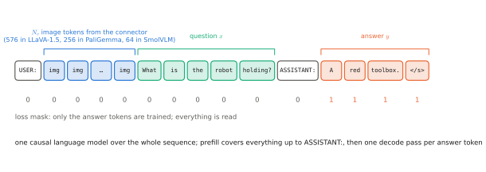

# 5.1 The Vision-Language Model Recipe

[0.8](../00-foundations/first-look.md#multimodal-models) sketched a vision-language model as a diagram. Chapters 2–4 have since built every box in it. This section assembles them into the architecture that most modern VLMs share. It was popularised by LLaVA (Liu et al., 2023): a pretrained vision encoder, a connector, and a pretrained decoder-only language model reading image tokens and text tokens as one sequence. Every token-based VLA starts as this model.

## What is it?

!!! definition "Vision-language model (LLaVA-style)"
    A **VLM** is an autoregressive language model whose context contains image tokens:

    $$
    p_\theta(y_{1:T_y}\mid I,x)=\prod_{t=1}^{T_y}p_\theta\big(y_t\ \big|\ H_v,\ x,\ y_{<t}\big),\qquad H_v=\operatorname{conn}\big(g_\phi(I)\big)\in\mathbb{R}^{N_v\times d},
    $$

    where the LM processes the sequence $[\,\text{template};\ H_v;\ x;\ y\,]$.

| Symbol | Shape | Meaning |
|---|---|---|
| $I$ | $3\times H\times W$ | the image (after the encoder's preprocessing) |
| $g_\phi$ | — | the vision encoder: a pretrained ViT, usually CLIP or SigLIP ([3.2](../03-vision/vit.md), [4.2](../04-alignment/clip-siglip.md)) |
| $\operatorname{conn}$ | — | the connector ([4.3](../04-alignment/connectors.md)) |
| $H_v$ | $N_v\times d$ | **image tokens**, in the LM's embedding space |
| $x$ | $T_x$ ids | the user's text (question or instruction), tokenized |
| $y$ | $T_y$ ids | the response; the only tokens trained on |
| $p_\theta$ | — | the language model, a [decoder-only transformer](../02-transformers/block.md#encoder-decoder-encoderdecoder) |

## Why does it exist?

The LLM is the most knowledgeable component we can download: billions of parameters trained on trillions of tokens. The VLM recipe uses it *unmodified*. The only new parameters are the connector's, and the only interface is the LM's input sequence ([1.3](../01-multimodal-intro/combining.md#tokens-as-a-universal-interface)). Everything the LM knows — that toolboxes have handles, that "bring X to Y" implies picking X up — is available to reason about what the vision encoder sees. Training cost is modest because both large components start pretrained. LLaVA's first version trained in about a day on 8 GPUs.

## How does it work?

### The sequence

A chat-formatted VLM sees a token sequence like this (LLaVA-1.5's template, abridged):

```
A chat between a curious user and an artificial intelligence assistant. ...  USER: <image>
What is the robot holding? ASSISTANT: A red toolbox.</s>
```

The processor replaces the single `<image>` placeholder by $N_v$ positions that receive the image tokens $H_v$ instead of word embeddings. LLaVA-1.5 uses CLIP ViT-L/14 at 336 px, so $N_v=24^2=576$. The language model sees no difference between these positions and word positions, except their content.

<figure markdown="span">
  
  <figcaption markdown="span">What the language model of a VLM actually processes. Template tokens, $N_v$ image tokens from the connector, the question, then the answer. Every position is read under the causal mask, but only the answer tokens carry a loss, the same loss masking as instruction tuning ([2.5](../02-transformers/training.md#loss-masking-what-the-model-is-trained-to-say)).</figcaption>
</figure>

### Tensor shapes, end to end

For LLaVA-1.5-7B (CLIP ViT-L/14-336, MLP projector, Vicuna-7B with $d=4096$):

```
image                     (B, 3, 336, 336)
ViT patch features        (B, 576, 1024)      second-to-last layer, [CLS] dropped
projector (2-layer MLP)   (B, 576, 4096)      = image tokens H_v
text embeddings           (B, T_x + T_y, 4096)
LM input                  (B, T_tpl + 576 + T_x + T_y, 4096)
logits                    (B, T_total, 32000) loss on the T_y answer positions only
```

Two details matter in practice. LLaVA takes patch features from the **penultimate** ViT layer: the last layer is most specialised to the contrastive objective, and the one before keeps more general, spatial information. And the [CLS] token is dropped, because the LM needs one token per region ([3.2](../03-vision/vit.md#the-cls-token-mean-pooling-and-registers)).

### Inference

Answering a question is the [generation loop](../01-multimodal-intro/language.md#how-does-it-work-the-generation-loop) of Chapter 1. The cost structure is that of [2.6](../02-transformers/inference.md): one **prefill** pass over template, image and question, mostly image tokens, then one **decode** pass per answer token with a KV cache. A 576-token image costs as much prefill compute as 576 words. For a short answer the image dominates the latency.

### More images and higher resolution

The same interface handles several images (each `<image>` placeholder expands to its tokens) and video (frames as images). For resolution above the encoder's native size, LLaVA-NeXT and others **tile** the image into native-size crops plus a downscaled global view, each encoded separately: more detail, many more tokens. SmolVLM does the same ([5.3](small-vlms.md)). Lab 08 shows that tiling can cost 17× more image tokens for *no* gain when the image has no fine detail.

## Implementation

The tiny VLM of Lab 08 is the recipe in about twenty lines (`vlacourse.vlm.TinyVLM`):

```python
class TinyVLM(nn.Module):
    def __init__(self, vision, lm, d_vision):
        super().__init__()
        self.vision, self.lm = vision, lm                       # pretrained ViT and TinyGPT
        d = lm.tok_emb.embedding_dim
        self.projector = nn.Sequential(nn.Linear(d_vision, d), nn.GELU(), nn.Linear(d, d))

    def image_tokens(self, images):                            # (B, 3, 64, 64)
        feats = self.vision(images)[:, 1:]                     # (B, 64, d_v): drop [CLS], keep patches
        return self.projector(feats)                           # (B, 64, d): image tokens H_v

    def forward(self, images, ids):                            # ids: (B, T) prompt + answer
        img = self.image_tokens(images)
        logits = self.lm(ids, prefix=img)                      # [H_v ; text] through the causal LM
        return logits[:, img.shape[1]:]                        # (B, T, V): predictions for the text positions
```

`TinyGPT` gained a `prefix` argument for this: the image tokens are concatenated before the word embeddings, positions run over the whole sequence, and the causal mask covers everything. With `prefix_lm=True` the image tokens also attend to each other bidirectionally — PaliGemma's choice ([5.3](small-vlms.md)). A unit test checks that KV-cached generation matches full recomputation in both modes.

!!! lab "Lab 08, parts 1–4"
    Assemble the tiny VLM from the Lab 07 image tower, an MLP projector and a TinyGPT, and trace every tensor from image to logits.

## Limitations

- **The image costs tokens on every forward pass.** Prefill grows with $N_v$; for robots that means latency every control step.
- **One-way reading.** Under a causal mask, image tokens placed first cannot read the question: the image is encoded the same way whatever is asked. (Q-Former-style connectors, FiLM ([1.3](../01-multimodal-intro/combining.md#how-to-fuse-four-mechanisms)) and prefix-LM attention address this partially.)
- **The LM's language prior is strong.** With weak or ambiguous visual evidence, the model answers from what is *usually* true. That is the source of hallucination ([5.4](spatial.md)).

## Why it matters for VLAs and robots

A token-based VLA *is* this architecture with a different vocabulary of answers. OpenVLA is Prismatic (SigLIP + DINOv2 → MLP → Llama 2 7B) fine-tuned to answer "What action should the robot take to {instruction}?" with seven action tokens ([Chapter 10](../10-case-studies/index.md)). π0 starts from PaliGemma and adds an action expert. Everything in this chapter — the sequence layout, the image-token budget, the training stages, the failure modes — carries over directly.
