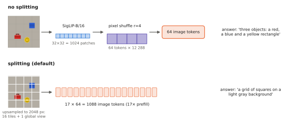

# 5.3 Inside Modern Small VLMs: PaliGemma and SmolVLM

The VLAs of Part III are built on small VLMs, a few hundred million to three billion parameters, because they must run every control step on hardware near the robot. This section dissects the two families that matter most for this course. **PaliGemma** is the backbone of π0. **SmolVLM** is the backbone of SmolVLA, and the model you open in Lab 08. Together they show the design decisions a VLA inherits: attention pattern, resolution strategy and token budget.

## What is it?

| | PaliGemma (Beyer et al., 2024) | SmolVLM-256M (Marafioti et al., 2025) |
|---|---|---|
| vision encoder | SigLIP So400m/14 (400 M) | SigLIP-B/16 at 512 px (86 M) |
| connector | linear projection, one token per patch | pixel shuffle $r=4$ + linear (12 288 → 576) |
| language model | Gemma-2B: $d=2048$, 18 layers, multi-query attention | SmolLM2-135M-style: $d=576$, 30 layers, GQA (9 query / 3 KV heads) |
| image tokens | 256 (224 px), 1024 (448 px), 4096 (896 px) | 64 per 512-px tile; tiles + a global view for large images |
| attention | **prefix-LM**: full attention over image + prompt, causal over the output | causal over everything |
| special outputs | 1024 location tokens, 128 segmentation tokens | — |
| total size | ≈3 B | ≈256 M (Lab 08 counts 86 M vision + 7 M connector + 135 M LM + 28 M LM head) |
| VLA built on it | π0, π0.5 | SmolVLA (on the 500 M sibling) |

Both follow the [recipe of 5.1](recipe.md); they differ in where they spend tokens and in how the image is allowed to interact with the text.

## Why does it exist?

General-purpose VLMs (LLaVA with a 7–13 B LLM) are too slow for control loops and too large to fine-tune on modest hardware. Small VLMs answer two questions. Can a much smaller LM, given good visual tokens, still follow instructions about images? And what is the cheapest way to provide those tokens? PaliGemma was designed as a *transferable base*: pretrained on a broad multitask mixture and meant to be fine-tuned. That is exactly how π0 uses it. SmolVLM was designed for *efficiency*: running on a laptop or a phone, with an aggressive token budget.

## How does it work?

### PaliGemma: a prefix-LM with location tokens

PaliGemma's sequence is `[image tokens][prefix: the task, e.g. "detect red toolbox"][suffix: the output]`. The attention mask is **prefix-LM** ([2.4](../02-transformers/block.md#encoder-decoder-encoderdecoder)):

$$
M_{ij}=\begin{cases}0 & j\in\text{image}\cup\text{prefix}\ \ \text{(every token may read the whole prefix)}\\
0 & i,j\in\text{suffix},\ j\le i\ \ \text{(causal within the output)}\\
-\infty & \text{otherwise.}\end{cases}
$$

Image tokens can therefore attend to the prompt. The image is encoded *with knowledge of the question*, which removes the one-way-reading limitation of [5.1](recipe.md#limitations). π0 extends exactly this mask with a third block for its action tokens ([2.1](../02-transformers/attention.md#masking), figure of four masks).

Its vocabulary adds 1024 `<locNNNN>` tokens, so detection is text generation ([4.4](../04-alignment/grounding.md#3-coordinates-as-tokens)), and 128 `<segNNN>` tokens that encode a mask through a small learned codebook. Pretraining uses a multilingual mixture of captioning, OCR, VQA, detection, segmentation and referring expressions, with **all** parameters trained, including the vision encoder. Resolution is raised in later stages (448, 896 px) for tasks that need detail.

### SmolVLM: spending as few tokens as possible

SmolVLM's choices are all about the token budget of a small LM:

1. **Pixel shuffle with $r=4$.** SigLIP-B/16 at 512 px gives $32\times32=1024$ patch tokens of width 768. Pixel shuffle concatenates each $4\times4$ block into one 12 288-d token, and a linear layer maps it to 576: **64 image tokens** per 512-px image ([3.4](../03-vision/encoders-for-vlas.md#reducing-tokens)). Lab 08 reimplements the rearrangement and matches the library to zero difference.
2. **Image splitting.** A large image is resized (longest edge up to 2048 px by default), split into a grid of 512-px tiles, and accompanied by a downscaled global view. Every tile costs 64 tokens. The tiles are separated by text tokens that name their row and column, so the LM knows where each tile sits.
3. **A small LM with a long context.** SmolLM2-style backbones with an extended context, so many tiles or video frames fit.

<figure markdown="span">
  
  <figcaption markdown="span">SmolVLM's token budget. One 512-px view gives 1024 SigLIP patches, and pixel shuffle turns them into 64 tokens. With splitting, the processor upsamples to a 2048-px longest edge, cuts 16 tiles and adds a global view: 17 × 64 = 1088 image tokens. Lab 08 measures both on the same depot render. The 64-token version describes the scene better.</figcaption>
</figure>

Lab 08's measurements make the trade-off concrete. On a 512-px depot render, without splitting SmolVLM-256M reads 64 image tokens and says *"three objects: a red rectangle, a blue rectangle, and a yellow rectangle"*. The colours are right, the shapes are not named. With splitting it reads 1088 image tokens, 17× the prefill, and describes *"a grid of squares on a light gray background"*: each upsampled tile shows mostly empty floor. More tokens help only when the image contains detail the native resolution cannot resolve.

### Other designs worth knowing

- **Qwen2-VL** processes images at their native resolution with a variable number of tokens. It merges each $2\times2$ group of patch tokens with an MLP, and uses a **2-D (multimodal) RoPE** so that the LM knows each image token's row and column instead of only its raster index. Lab 08 shows why that matters: a tiny VLM learns "where is the toolbox?" last of all its skills, and learns it faster when its image tokens get 2-D positions ([5.4](spatial.md)).
- **Molmo** is trained with a large dataset of human *pointing* annotations, so it can answer "point to the red toolbox" with image coordinates ([4.4](../04-alignment/grounding.md)).

## Implementation

Opening SmolVLM and controlling its token budget (from Lab 08):

```python
from transformers import AutoModelForImageTextToText, AutoProcessor

proc = AutoProcessor.from_pretrained("HuggingFaceTB/SmolVLM-256M-Instruct")
model = AutoModelForImageTextToText.from_pretrained("HuggingFaceTB/SmolVLM-256M-Instruct",
                                                    dtype=torch.bfloat16).to("cuda")
msgs = [{"role": "user", "content": [{"type": "image"}, {"type": "text", "text": "Describe the objects."}]}]
prompt = proc.apply_chat_template(msgs, add_generation_prompt=True)
inputs = proc(text=prompt, images=[img], return_tensors="pt", do_image_splitting=False).to("cuda")
print((inputs.input_ids == model.config.image_token_id).sum())   # 64 image tokens for one 512-px view
out = model.generate(**inputs, max_new_tokens=50, do_sample=False)
```

!!! lab "Lab 08, part 10"
    Count SmolVLM's parameters per component. Rebuild its pixel shuffle and match the library. Measure image tokens, sequence length and latency with and without image splitting, and ask it spatial questions about a depot scene.

## Limitations

- **Small LMs know less.** A 135 M-parameter LM has far less world knowledge than a 7 B one. The point of a VLA backbone is partly that knowledge, so small backbones trade capability for speed.
- **Fixed token budgets lose detail.** 64 tokens per 512-px view are $8\times8$ positions; small objects merge into a single token.
- **Upsample-and-tile is not free resolution**: it multiplies tokens without adding information unless the original image is larger than the encoder's native size.
- **Spatial vocabulary is thin.** In Lab 08, SmolVLM-256M answers "which object is on the left?" with "there is a red object on the left", correct here, but no basis for a grasp.

## Why it matters for VLAs and robots

π0 inherits PaliGemma's prefix-LM attention, its 256-token SigLIP images and its Gemma backbone. SmolVLA inherits SmolVLM's 64-token images and small LM, which is what makes it trainable and runnable on a single consumer GPU. When Chapter 10 compares their speed and capabilities, most of the difference traces back to the decisions in this section: attention pattern, encoder, token budget and LM size.
