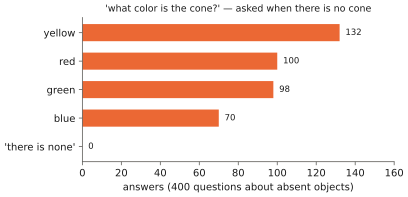

# 5.4 Grounding, Spatial Reasoning and Hallucination

Three questions decide whether a VLM can be trusted near a robot. Can it say **where** something is? Can it reason about **spatial relations**? Does it **refuse** when the answer is not in the image? This section explains how VLMs acquire the first, why the second is hard, and why the third fails by default. Each explanation is grounded in a measurement from Lab 08.

## What is it?

| Capability | Output | How it is learned |
|---|---|---|
| **pointing / detection** | coordinates as text or location tokens | training data with boxes or points written as tokens ([4.4](../04-alignment/grounding.md#3-coordinates-as-tokens)) |
| **spatial reasoning** | answers about left/right, above/below, near/far, counting | instruction data that asks such questions; position information the LM can read |
| **calibrated abstention** | "there is no cone", "I cannot tell" | training data that contains unanswerable questions; verification |

!!! definition "Object hallucination"
    A VLM **hallucinates** when its output asserts visual content that the image does not contain — an absent object, a wrong attribute, a non-existent relation. The POPE benchmark measures it by asking "Is there a ⟨object⟩ in the image?" for present and for frequently co-occurring absent objects.

## Why does it exist?

All three behaviours come from the same source: what the training data asks for, and how easily the LM can read the relevant information from image tokens. VLMs are trained to produce *likely* text given the image ([2.5](../02-transformers/training.md#limitations)). When the image provides strong evidence, likely text is correct text. When the evidence is weak — or when the LM has not learned to read it — likely text is whatever the language prior suggests.

## How does it work?

### Location: present in the features, learned last

Lab 08 asks the tiny VLM "where is the red toolbox?" (nine regions, from "top left" to "bottom right"). This is the last skill it learns. After 400 steps of instruction tuning it is right 19% of the time, while counting is already at 99%; it needs 2000 steps to reach 84% ([5.2](training.md#what-each-stage-does-to-the-tiny-vlm)).

The information is not missing. A linear probe on the *frozen* vision tower predicts the region from the 64 patch tokens with **96%** accuracy, but from the [CLS] token with only **28%**. The patch tokens say *where* by *which* token carries the object; the pooled vector, trained for captions that never state absolute position, discards it ([3.2](../03-vision/vit.md#the-cls-token-mean-pooling-and-registers)).

The bottleneck is how the LM reads token positions. It sees the 64 image tokens in raster order through its own 1-D position embeddings. Row is a smooth function of the token index ($\lfloor n/8\rfloor$); column is periodic ($n\bmod 8$) — exactly the "raster order breaks 2-D geometry" limitation of [2.3](../02-transformers/positions.md#limitations). Giving each image token a learned **row** embedding plus a learned **column** embedding (`TinyVLM(..., pos2d=True)`) changes the curve:

| stage-2 step | 400 | 800 | 1200 | 1600 | 2000 |
|---|---|---|---|---|---|
| location accuracy, 1-D positions | 0.19 | 0.37 | 0.72 | 0.82 | 0.84 |
| location accuracy, 2-D positions | **0.45** | **0.55** | **0.77** | **0.86** | **0.90** |

(One seed; the other question types are essentially unaffected.) Large VLMs solve the same problem with 2-D rotary embeddings (Qwen2-VL), row/column separator tokens between tiles (SmolVLM, [5.3](small-vlms.md#smolvlm-spending-as-few-tokens-as-possible)) and, above all, training data that asks for coordinates.

### Pointing and detection as text

A VLM learns to localise when its training data contains localisation *written as tokens*. PaliGemma's pretraining mixture includes detection ("detect red toolbox ; crate" → four location tokens and a label per object) and referring expressions. Molmo was trained on a large dataset of human pointing annotations and answers "point to the red toolbox" with coordinates. The output is then directly usable: a point in the wrist camera can be deprojected with depth into a 3-D grasp target, a point in a drone image into a ground position ([4.4](../04-alignment/grounding.md)).

### Spatial relations

Relations ("what is left of the blue crate?") are learned before absolute location in Lab 08 (97% at 2000 steps): they need only a *comparison* between two objects' tokens, not an absolute readout. Real VLMs are much weaker. Their encoders were contrastively trained and largely ignore spatial word order ([4.5](../04-alignment/failure-modes.md#spatial-and-numerical-blindness)), and web instruction data rarely asks precise spatial questions. Approaches that generate spatial question–answer data from depth and 3-D reconstructions ("Is the toolbox within 1 m of the crate?") improve this substantially. For robotics this is the most valuable kind of data, and it can be generated in simulation.

In Lab 08, SmolVLM-256M answers "which object is on the left side of the image?" with *"There is a red object on the left side of the image."* That is correct for this scene, but it names a colour rather than an object, and the model's own scene description called every object a "rectangle". Small VLMs have a thin spatial vocabulary.

### Hallucination

Lab 08 asks the tiny VLM about objects that are *not* in the scene: "what color is the cone?" for 400 scenes without a cone. It answers with a colour **every time** (yellow 132, red 100, green 98, blue 70).

<figure markdown="span">
  
  <figcaption markdown="span">Hallucination, measured in Lab 08. Asked the colour of an object that is not in the scene, the tiny VLM always answers with a colour. "There is none" was never a possible answer in its training data, so it does not exist for the model. Large VLMs hallucinate for the same structural reason, at a lower rate.</figcaption>
</figure>

Three mechanisms combine:

1. **The answer was never in the training distribution.** Every training question had an answer in the image. A model trained by maximum likelihood can only produce answers its data contained.
2. **Language priors.** When visual evidence is weak, the LM falls back on what usually follows the prompt. Large VLMs answer "yes" to "is there a fork?" in kitchen scenes without forks, because forks co-occur with kitchens in captions.
3. **Weak visual reading.** Image tokens are a minority of the context the LM has learned to rely on; small or ambiguous objects contribute little to the answer.

Mitigations, in increasing order of reliability: training data with negative and unanswerable questions; decoding-time checks (compare the answer's probability with and without the image); and, for robots, **verification by independent means** — a detector, depth, a second view, or the robot's own sensors — before acting on any VLM assertion.

## Implementation: measuring hallucination

```python
@torch.no_grad()
def absent_object_probe(answer_fn, scenes_list, images, kinds):
    """Ask the colour of an object kind that is absent from each scene; count non-abstaining answers."""
    replies = []
    for s, img in zip(scenes_list, images):
        present = {o.kind for o in s.objects}
        missing = next(k for k in kinds if k not in present)
        replies.append(answer_fn(img, f"what color is the {missing}?"))
    abstained = sum(r in ("there is none", "no", "") for r in replies)
    return 1 - abstained / len(replies)          # hallucination rate: 1.0 for Lab 08's tiny VLM
```

!!! lab "Lab 08, parts 6–9"
    Per-skill learning curves, the location probe, 1-D vs 2-D image positions, attention maps from the answer position to the image tokens, and the absent-object probe.

## Limitations

- **Grounding outputs are 2-D.** A point or box still needs depth and calibration to become a 3-D target.
- **Spatial competence depends on data most VLMs did not see.** Do not assume it; measure it on your images.
- **Abstention trades against recall.** A model trained to say "there is none" will sometimes say it when the object is there; the right operating point depends on the cost of each error for the task.

## Why it matters for VLAs and robots

A VLA acts on what its backbone believes about *where* things are. Lab 08's results transfer directly. Spatial information can sit unused in patch features. How image tokens are positioned decides how fast it becomes usable. And a model that was never shown "nothing there" will invent something. For a manipulator, hallucinating a toolbox means grasping air; for a drone, it means flying to the wrong place. Chapters 12–13 build verification into the architecture because this failure cannot be trained away completely.
