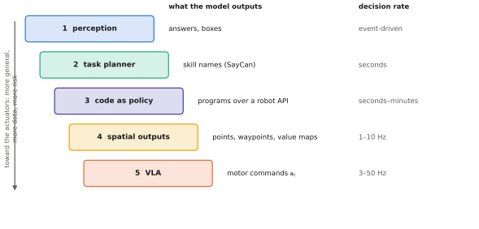

# 5.5 From Describing to Acting

A VLM answers questions about images. A robot must *change* the world. This section closes Part II by laying out the ways a vision-language model can drive a robot, from a pure perception module to a policy whose outputs are motor commands. For each, it states what the model outputs, how often, what must sit between that output and the actuators, and what can go wrong. The last rung of this ladder is the VLA, and Part III builds it.

## What is it?

Write the robot's decision as a hierarchy. A high-level policy chooses what to do next; a low-level controller makes it happen:

$$
\underbrace{\pi_\text{high}\big(z_k\mid \mathbf{o}_t,\ \ell,\ z_{<k}\big)}_{\text{every few seconds}}\qquad\longrightarrow\qquad \underbrace{\pi_{z_k}\big(\mathbf{a}_t\mid\mathbf{o}_t\big)}_{\text{every control step}}\qquad\longrightarrow\qquad\text{actuators}
$$

| Symbol | Meaning |
|---|---|
| $\ell$ | the instruction ("survey the east yard, find the red toolbox, bring it to the inspection station") |
| $z_k$ | the $k$-th high-level decision: a skill name with arguments, a waypoint, a target region, a line of code |
| $\pi_\text{high}$ | the component that chooses $z_k$ — here, the VLM |
| $\pi_{z}$ | the low-level policy or controller that executes $z$: a motion planner, a trained skill, a PX4 position controller |
| $\mathbf{a}_t$ | motor commands at the control rate |

The question "where does the VLM sit?" is the question of what $z$ is. The more continuous and low-level $z$ becomes, the more of the robot's behaviour the model controls. When $z$ *is* $\mathbf{a}_t$, the high-level policy has become a VLA.

<figure markdown="span">
  
  <figcaption markdown="span">Five ways to put a vision-language model in a robot, ordered by how close its output is to the actuators. Moving down the ladder raises the decision rate, the generality of what the model can express, the amount of robot data it needs, and its safety exposure.</figcaption>
</figure>

## Why does it exist?

A VLM brings what classical robot stacks lack: open-vocabulary perception and common-sense knowledge about objects and tasks. Classical stacks bring what VLMs lack: guarantees, precision, speed and decades of engineering. Each rung of the ladder is a different division of labour between the two. Choosing the rung is the most important architectural decision in a learning-enabled robot ([Chapter 12](../12-embodied/index.md)).

## How does it work? The ladder

### Rung 1: perception module

The VLM answers questions about the scene ("is there a red toolbox?", "is the loading bay door open?") or grounds phrases to regions ([4.4](../04-alignment/grounding.md)). A classical planner decides and acts. The output is checkable, the rate is low, and failures are perception failures that downstream logic can catch: a box can be verified against depth. This is today's most widely deployed use.

### Rung 2: task planner over a skill library

The VLM (or an LLM given a scene description) outputs a sequence of skills from a fixed library: `fly_to(east_yard)`, `search(red toolbox)`, `pick(red toolbox)`, `place(inspection_station)`. **SayCan** (Ahn et al., 2022) made this robust by scoring each skill with two factors: the language model's estimate that the skill is a useful next step for the instruction, and a learned **affordance** value — the probability that the skill would succeed from the current state:

$$
z_k=\arg\max_{z\in\mathcal{Z}}\ \underbrace{p_\text{LM}(z\mid\ell,z_{<k})}_{\text{is it useful?}}\cdot\underbrace{V_z(\mathbf{o}_t)}_{\text{can I do it here?}} .
$$

The language model supplies *what makes sense*, the value functions supply *what is feasible*, and neither alone suffices. Feedback variants (Inner Monologue) re-plan after each skill using success detectors and scene descriptions. The limitation is the library itself: the robot can do only what someone pre-built a skill for.

### Rung 3: code as policy

Instead of choosing from a list, the model **writes a program** against a robot API (Code as Policies; Liang et al., 2023):

```python
boxes = detect("red toolbox")                   # perception API
target = closest(boxes, robot.position())
robot.fly_to(target.position + [0, 0, 5.0])    # waypoint 5 m above
if confirm("red toolbox", camera.image()):      # VLM check
    team.request(arm, pick_and_deliver(target, "inspection station"))
```

Code adds loops, conditions, arithmetic and composition of existing functions — far more expressive than a skill list — while every primitive remains a classical, testable function. The program can be inspected (and statically checked) before it runs, which makes this rung attractive for safety-critical platforms.

### Rung 4: spatial outputs

The model outputs geometric targets at a higher rate: points, boxes, waypoints, keypoints, or maps of where an action should happen. Molmo-style pointing, PaliGemma's location tokens, and methods that have a VLM annotate keypoints or compose 3-D value maps for a motion planner all sit here. The output is continuous but still mediated by a planner and controller that enforce kinematics and limits.

### Rung 5: actions — the VLA

The model outputs $\mathbf{a}_t$ itself: end-effector deltas and gripper commands for an arm, or velocity setpoints for a drone, at 3–50 Hz. **RT-2** (Brohan et al., 2023; [Chapter 10](../10-case-studies/index.md)) took a VLM and fine-tuned it to emit action tokens with exactly the coordinates-as-tokens trick of [4.4](../04-alignment/grounding.md#3-coordinates-as-tokens), co-training on web VQA data so that it kept its knowledge. Nothing needs to be pre-built for each behaviour, and contact-rich skills that no library contains become learnable — given demonstrations. The price is the highest rate, the largest data requirement, and direct exposure of the actuators to the model's failure modes.

| Rung | Output $z$ | Rate | Robot data needed | Safety exposure |
|---|---|---|---|---|
| 1 perception | answers, boxes | event-driven | little (calibration) | low |
| 2 task planner | skill names | seconds | skill success detectors | low |
| 3 code | programs | seconds–minutes | API design | low–medium (code can be checked) |
| 4 spatial | points, waypoints | 1–10 Hz | some | medium (planner enforces limits) |
| 5 VLA | motor commands | 3–50 Hz | many demonstrations | high |

!!! robot "One team, several rungs"
    The depot team uses different rungs for different robots. The **drones** use rungs 1–3: a VLM checks frames for "red toolbox" candidates and a planner writes search patterns, while PX4 flies the drone ([Chapter 13](../13-uavs/index.md)). The **arm** uses rung 5 for the grasp, where contact is too subtle for a hand-written skill, wrapped in a safety layer that bounds workspace and forces. The **coordinator** uses rung 2 or 3 to allocate tasks across the team ([Chapter 14](../14-multi-robot/index.md)). Choosing per robot and per decision, not per project, is the main lesson of Part IV.

## Implementation: a SayCan-style selector

```python
import torch

@torch.no_grad()
def select_skill(lm, tok, instruction, history, skills, affordance):
    """Score each candidate skill by LM usefulness x affordance; return the best."""
    prompt = f"Task: {instruction}\nSteps so far: {'; '.join(history) or 'none'}\nNext step:"
    scores = {}
    for s in skills:                                         # e.g. "fly to the east yard", "pick up the red toolbox"
        ids = tok(prompt + " " + s, return_tensors="pt").input_ids
        n = len(tok(" " + s).input_ids)                      # tokens of the skill text
        logp = lm(ids).logits[0, -n - 1:-1].log_softmax(-1)  # predictions for the skill tokens
        lm_score = logp.gather(-1, ids[0, -n:, None]).sum().exp()   # p_LM(skill | prompt)
        scores[s] = lm_score.item() * affordance(s)                  # affordance: P(success | current state)
    return max(scores, key=scores.get), scores
```

With SmolLM2 from Lab 05 as `lm`, and hand-written affordances for the depot (0 for "pick up the toolbox" while it is not yet found), this already sequences the running example sensibly. Lab 08's exercise 5 asks what separates the tiny VLM's region answers from motor commands.

## Limitations

- **Upper rungs are bounded by their interfaces.** A planner can only sequence the skills it is given; code can only call the functions that exist.
- **Lower rungs are bounded by data.** A VLA can only do what demonstrations covered, and generalises in ways that are hard to predict ([Chapter 9](../09-training/index.md)).
- **Every rung inherits the VLM's failure modes** ([4.5](../04-alignment/failure-modes.md), [5.4](spatial.md)): a hallucinated "yes, the toolbox is there" misleads a planner just as it misleads a policy, only with more layers to catch it.
- **Latency grows down the ladder** while the time available per decision shrinks.

## Why it matters for VLAs and robots

This ladder is the map for the rest of the book. Part III builds rung 5. It needs a way to represent action distributions ([Chapter 6](../06-generative/index.md)), a theory of learning policies from demonstrations ([Chapter 7](../07-decision-making/index.md)), and the VLA itself ([Chapter 8](../08-vla/index.md)). Parts IV and V return to the ladder to decide, for arms, drones and teams, which rung each decision belongs on.
