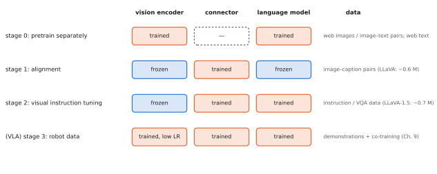
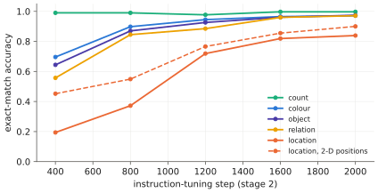

# 5.2 Training VLMs: Alignment and Visual Instruction Tuning

[5.1](recipe.md) fixed the architecture. This section is about training it: what is frozen at each stage, on what data, with which loss mask, and why the stages exist at all. The same stage structure reappears when a VLM becomes a VLA. Robot training is simply one more stage on top of these ([Chapter 9](../09-training/index.md)). Lab 08 runs every stage on the tiny VLM and measures what each one changes.

## What is it?

!!! definition "The two classic VLM training stages (LLaVA)"
    **Stage 1 — feature alignment.** Freeze the vision encoder $g_\phi$ and the language model $p_\theta$; train only the connector on image–caption pairs, with the caption as the response:

    $$
    \min_{\psi}\ -\sum_{(I,c)}\ \sum_{t}\log p_\theta\big(c_t\mid \operatorname{conn}_\psi(g_\phi(I)),\,c_{<t}\big).
    $$

    **Stage 2 — visual instruction tuning.** Keep the encoder frozen; train the connector *and* the language model on (image, instruction, response) triples, with the loss on the response tokens only:

    $$
    \min_{\psi,\theta}\ -\sum_{(I,x,y)}\ \sum_{t}m_t\,\log p_\theta\big(y_t\mid H_v,\,x,\,y_{<t}\big),\qquad m_t=\mathbb{1}[\text{token }t\text{ belongs to the response}].
    $$

| Symbol | Meaning |
|---|---|
| $\psi$, $\theta$, $\phi$ | connector, language-model and vision-encoder parameters |
| $(I,c)$ | an image and its caption |
| $(I,x,y)$ | an image, an instruction or question, and the desired response |
| $m_t$ | the [loss mask](../02-transformers/training.md#loss-masking-what-the-model-is-trained-to-say): 1 on response tokens, 0 on template, image and question tokens |

<figure markdown="span">
  
  <figcaption markdown="span">What each stage trains. Stage 0 is the separate pretraining of the vision encoder and the language model. Stage 1 trains only the connector, which is cheap and leaves both pretrained models intact. Stage 2 also trains the language model, to follow instructions about images. Turning a VLM into a VLA adds a stage on robot data, usually training everything, the encoder at a lower learning rate.</figcaption>
</figure>

## Why does it exist?

**Why freeze, and why stage?** The connector starts random. If the LM were trained at the same time, its first gradients would come from random image tokens: noisy updates that damage the knowledge we want to reuse. Stage 1 lets the connector learn a sensible mapping while everything else is fixed. Stage 2 then adapts the LM to *use* image tokens to follow instructions. Freezing the vision encoder protects its features, which took far more data to learn than any VLM training set contains.

**Why instruction data?** Captioning teaches description, not obedience. Stage 2 data are conversations, detailed descriptions and reasoning questions about images. LLaVA generated its 158 k instruction examples by giving a text-only GPT-4 the *captions and object boxes* of COCO images and asking it to write conversations about them. LLaVA-1.5 mixed in academic VQA datasets (VQAv2, GQA, OCR tasks) with short-answer format prompts ("Answer the question using a single word or phrase."), about 665 k examples in total.

## How does it work?

### What each stage does to the tiny VLM

Lab 08 trains the tiny VLM (1.1 M-parameter ViT from Lab 07, 33 k-parameter MLP projector, 1.1 M-parameter TinyGPT) through both stages and evaluates on 2000 questions about unseen scenes.

**Stage 1** (projector only, 600 steps on captions). Captions of new scenes are an exact match only **8%** of the time ("a blue toolbox left of a blue toolbox" for a yellow barrel below a yellow crate), and questions are not answered at all. That is not a bug in the recipe. Stage 1 relies on the frozen LM being a *general in-context reader*, able to make use of tokens it has never seen. A 7 B LLM trained on trillions of tokens is one; a 1 M-parameter LM trained on a 42-word language is not. (Lab 08 pretrains its LM with an empty 64-position image slot. With learned absolute positions, text that starts after 64 image tokens would otherwise sit at untrained positions. LLMs with RoPE do not have this problem.)

**Stage 2** (projector + LM, 2000 steps on questions). Accuracy rises quickly, and not uniformly:

<figure markdown="span">
  
  <figcaption markdown="span">Which skills a VLM learns first, measured in Lab 08: exact-match accuracy per question type on unseen scenes during stage 2. Counting is learned almost at once, then colour and object identity, then spatial relations. Absolute location ("where is the red toolbox?") comes last. Dashed: the same model with 2-D position embeddings for its image tokens, which learns location much earlier ([5.4](spatial.md)).</figcaption>
</figure>

The ordering is informative. Counting needs only *how many* image tokens look like objects. Colour and identity need *which* tokens, plus the word-to-feature mapping. Relations need two objects compared. Absolute location needs the LM to turn "the object is in image token 37" into "middle right" through its own position embeddings. Section [5.4](spatial.md) shows the information is present in the frozen features from the start; the LM has to learn to read it.

### Modern variants

| Choice | LLaVA-1.0/1.5 | Common in recent VLMs |
|---|---|---|
| vision encoder in stage 2 | frozen | unfrozen at low learning rate, or LoRA |
| stage 1 data | ~0.6 M captions | tens to hundreds of millions of image–text pairs, interleaved documents |
| stage 2 data | 0.16–0.67 M instructions | millions, many synthetic, with OCR, charts, grounding, multi-image |
| resolution | fixed 224/336 px | staged increases; tiling or native resolution |
| text-only data | none | mixed in to preserve language ability |

Two effects matter for robotics. **Catastrophic forgetting**: training the LM on image conversations erodes some of its text-only abilities and knowledge, so recipes mix in text data. **Co-training**: RT-2 applied the same idea one stage later, mixing web VQA data into robot-action training so that the VLA kept its semantic knowledge ([Chapter 9](../09-training/index.md)).

### Evaluating a VLM

Benchmarks fall into families — general VQA (VQAv2, GQA), OCR and documents (TextVQA, DocVQA), multi-discipline reasoning (MMMU), and hallucination (POPE asks "is there a ⟨object⟩ in the image?" for present and absent objects). None of them measures what a robot needs: spatially precise, viewpoint-robust grounding on *its* camera images. Build your own probe set, as Labs 07–08 do.

## Implementation

The two stages differ only in which parameters receive gradients and which data are fed:

```python
def set_trainable(module, flag):
    for p in module.parameters():
        p.requires_grad = flag

# stage 1: projector only, captions (prompt = "<bos> <sep>", response = caption)
set_trainable(vlm.vision, False); set_trainable(vlm.lm, False); set_trainable(vlm.projector, True)
fit(caption_items, vlm.projector.parameters(), steps=600, lr=1e-3)

# stage 2: projector + LM, questions (prompt = "<bos> question <sep>", response = answer)
set_trainable(vlm.lm, True)
fit(qa_items, list(vlm.projector.parameters()) + list(vlm.lm.parameters()), steps=2000, lr=5e-4)

# inside fit(): targets of every non-response position are -100, so only the response is learned
seqs = [prompt + answer for _, prompt, answer in items]
tgts = [[-100] * (len(prompt) - 1) + answer for _, prompt, answer in items]
```

!!! lab "Lab 08, parts 4–7"
    Stage 1 and stage 2 on the tiny VLM, with per-skill learning curves, a linear probe that shows where the location information is, and a second model with 2-D image positions.

## Limitations

- **Stage 1 assumes a strong LM.** With a small or domain-narrow LM, aligning through a frozen model is weak (Lab 08); training more of the model is then necessary.
- **Synthetic instruction data inherits its generator's biases**, and was usually generated from captions and boxes, not from the pixels: whatever captions omit (precise positions, small objects) is underrepresented.
- **Frozen encoders cap spatial precision.** They are trained for captions, not coordinates ([4.5](../04-alignment/failure-modes.md)).
- **Forgetting** is the price of every additional stage.

## Why it matters for VLAs and robots

A VLA's training is this pipeline plus one more stage. The decisions here carry over: which parts to freeze, which data to mix in to avoid forgetting, how to mask the loss, how far to trust a frozen encoder's spatial precision. OpenVLA, for example, trains everything on robot data (its authors found unfreezing the vision encoder crucial). It masks the loss to the action tokens and, unlike RT-2, does not co-train on web data. Lab 08's learning curves also predict where a VLA will struggle first: knowing *where*, not *what*.
