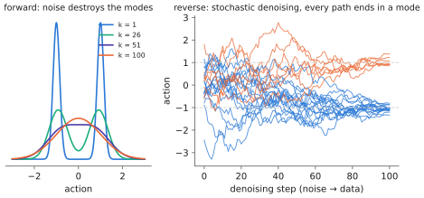

# 6.4 Denoising Diffusion

A diffusion model learns to **undo noise**. Training corrupts a demonstrated action with Gaussian noise of a random strength and teaches a network to predict the noise. Generation starts from pure noise and removes it step by step, each step a small denoising move. The result can represent any distribution, trains with a plain regression loss, and does not collapse. Diffusion Policy brought it to robotics in 2023; Octo and RDT use diffusion heads; and flow matching ([6.5](flow-matching.md)), its close relative, drives π0.

## What is it?

!!! definition "DDPM (Ho, Jain & Abbeel, 2020)"
    **Forward (noising) process.** For a clean sample $\mathbf{x}_0$ (an action or action chunk) and a schedule $0<\beta_1<\dots<\beta_K<1$,

    $$
    q(\mathbf{x}_k\mid\mathbf{x}_{k-1})=\mathcal{N}\big(\sqrt{1-\beta_k}\,\mathbf{x}_{k-1},\ \beta_kI\big)\quad\Longrightarrow\quad
    \mathbf{x}_k=\sqrt{\bar\alpha_k}\,\mathbf{x}_0+\sqrt{1-\bar\alpha_k}\,\boldsymbol\epsilon,\qquad \boldsymbol\epsilon\sim\mathcal{N}(\mathbf{0},I),\ \ \bar\alpha_k=\prod_{s=1}^{k}(1-\beta_s).
    $$

    **Training.** A network $\boldsymbol\epsilon_\theta(\mathbf{x}_k,k,\mathbf{o})$ predicts the noise:

    $$
    \mathcal{L}(\theta)=\mathbb{E}_{\mathbf{x}_0,\mathbf{o},k,\boldsymbol\epsilon}\Big[\big\lVert\boldsymbol\epsilon-\boldsymbol\epsilon_\theta\big(\sqrt{\bar\alpha_k}\mathbf{x}_0+\sqrt{1-\bar\alpha_k}\boldsymbol\epsilon,\ k,\ \mathbf{o}\big)\big\rVert^2\Big],\qquad k\sim\mathcal{U}\{1,\dots,K\}.
    $$

    **Sampling.** Start at $\mathbf{x}_K\sim\mathcal{N}(\mathbf{0},I)$ and for $k=K,\dots,1$:

    $$
    \mathbf{x}_{k-1}=\frac{1}{\sqrt{1-\beta_k}}\Big(\mathbf{x}_k-\frac{\beta_k}{\sqrt{1-\bar\alpha_k}}\,\boldsymbol\epsilon_\theta(\mathbf{x}_k,k,\mathbf{o})\Big)+\sigma_k\mathbf{z},\qquad\mathbf{z}\sim\mathcal{N}(\mathbf{0},I),\ \ \sigma_k^2=\beta_k .
    $$

| Symbol | Meaning |
|---|---|
| $k\in\{1..K\}$ | **diffusion step** (noise level), distinct from robot time $t$; the book's notation appendix writes it $\tau$ when continuous |
| $\beta_k$ | variance added at step $k$; a linear schedule from $10^{-4}$ to $0.02$ with $K=1000$ in DDPM; robot policies use $K\approx100$ |
| $\bar\alpha_k$ | fraction of the clean signal's variance left after $k$ steps; $\bar\alpha_K\approx0$: pure noise |
| $\boldsymbol\epsilon_\theta$ | the **denoiser**: conditioned on noise level and observation; for actions, a small MLP, 1-D U-Net or transformer |
| $\mathbf{o}$ | the conditioning (images, state, instruction features) |

## Why does it exist?

Sampling from a complicated distribution in one shot is hard; removing a *little* noise is easy. When the noise is small, the reverse step $q(\mathbf{x}_{k-1}\mid\mathbf{x}_k)$ is nearly Gaussian, so a network predicting its mean suffices. Chaining many such steps turns pure noise into a sample from an arbitrarily complex, multimodal distribution. Unlike a GAN there is no adversarial game; unlike a VAE there is no encoder to collapse; unlike an MDN the number of modes need not be chosen. The training loss is a regression, as stable as MSE, but it regresses the *noise*, not the action, so it does not average modes.

## How does it work?

### Why predicting noise does not average modes

Take a bimodal action distribution with modes at $\pm1$. At a large noise level, $\mathbf{x}_k$ is mostly noise, and the best prediction of the clean action is close to the mean, 0. At a small noise level, $\mathbf{x}_k$ is already close to one mode, and the denoiser only has to pull it the last bit toward *that* mode. Sampling starts with large noise, where the network nudges every sample toward the data region. Along the way, random noise and small differences push each sample toward one side. Once a sample is closer to one mode, the denoiser commits it there. The averaging that ruins MSE happens only at high noise, where it is harmless.

<figure markdown="span">
  
  <figcaption markdown="span">Diffusion on a one-dimensional bimodal action distribution, computed exactly. Left: the noised marginals as noise increases, from two sharp modes to a single Gaussian. Right: sampling trajectories of the reverse process. Each starts in pure noise and ends in one of the two modes; none ends between them. The paths are curved, which is why many steps are needed.</figcaption>
</figure>

### Where the loss comes from

Diffusion is a latent-variable model with latents $\mathbf{x}_{1:K}$ and a fixed "encoder" $q$. The [ELBO](vae.md#deriving-the-elbo) decomposes into a sum of KL divergences between Gaussian reverse steps:

$$
-\log p_\theta(\mathbf{x}_0)\le\sum_{k>1}D_\text{KL}\big(q(\mathbf{x}_{k-1}\mid\mathbf{x}_k,\mathbf{x}_0)\,\Vert\,p_\theta(\mathbf{x}_{k-1}\mid\mathbf{x}_k)\big)+\text{const}.
$$

The forward posterior is Gaussian in closed form, $q(\mathbf{x}_{k-1}\mid\mathbf{x}_k,\mathbf{x}_0)=\mathcal{N}(\tilde{\boldsymbol\mu}_k,\tilde\beta_kI)$, with

$$
\tilde{\boldsymbol\mu}_k=\frac{1}{\sqrt{1-\beta_k}}\Big(\mathbf{x}_k-\frac{\beta_k}{\sqrt{1-\bar\alpha_k}}\boldsymbol\epsilon\Big)\quad\text{where }\mathbf{x}_k=\sqrt{\bar\alpha_k}\mathbf{x}_0+\sqrt{1-\bar\alpha_k}\boldsymbol\epsilon .
$$

Parameterising the model's mean the same way with $\boldsymbol\epsilon_\theta$ in place of $\boldsymbol\epsilon$ makes each KL a weighted $\lVert\boldsymbol\epsilon-\boldsymbol\epsilon_\theta\rVert^2$. Ho et al. dropped the weights ("$\mathcal{L}_\text{simple}$"), which trained better: that is the loss in the definition, and the mean of the sampling step.

### Noise prediction is score estimation

The noised marginal $p_k(\mathbf{x})=\int q(\mathbf{x}\mid\mathbf{x}_0)p(\mathbf{x}_0)d\mathbf{x}_0$ has **score** $\nabla_\mathbf{x}\log p_k(\mathbf{x})$, the direction toward higher density. For one training pair, $\nabla_{\mathbf{x}_k}\log q(\mathbf{x}_k\mid\mathbf{x}_0)=-\boldsymbol\epsilon/\sqrt{1-\bar\alpha_k}$. Averaged over the data (denoising score matching), the optimal predictor satisfies

$$
\boldsymbol\epsilon_\theta^\ast(\mathbf{x},k)=-\sqrt{1-\bar\alpha_k}\ \nabla_\mathbf{x}\log p_k(\mathbf{x}).
$$

The denoiser estimates the score at every noise level, and sampling is noisy gradient ascent on the log-density (annealed Langevin dynamics). This view explains the multimodality: the score field of a bimodal density points toward the nearest mode, never toward the gap.

### Faster sampling: DDIM

Ancestral DDPM sampling needs all $K$ steps. **DDIM** (Song, Meng & Ermon, 2021) defines a deterministic sampler with the same marginals. It first estimates the clean sample, $\hat{\mathbf{x}}_0=(\mathbf{x}_k-\sqrt{1-\bar\alpha_k}\boldsymbol\epsilon_\theta)/\sqrt{\bar\alpha_k}$, then jumps to any earlier noise level $j<k$:

$$
\mathbf{x}_j=\sqrt{\bar\alpha_j}\,\hat{\mathbf{x}}_0+\sqrt{1-\bar\alpha_j}\,\boldsymbol\epsilon_\theta(\mathbf{x}_k,k).
$$

The same trained network can then sample with 10 steps instead of 100, at some loss of quality. DDIM is a discretisation of an ODE (the *probability-flow ODE*) whose solutions transport noise to data — the bridge to [flow matching](flow-matching.md).

### Conditioning and the denoiser for actions

The denoiser receives three inputs. The noisy action $\mathbf{x}_k$ is a vector or an $H_a\times d_a$ chunk. The noise level $k$ is embedded with sinusoidal features and an MLP ([2.3](../02-transformers/positions.md#sinusoidal-encodings)). The observation $\mathbf{o}$ is injected by FiLM or adaLN ([1.3](../01-multimodal-intro/combining.md#how-to-fuse-four-mechanisms)) or by cross-attention to observation tokens. **Diffusion Policy** (Chi et al., 2023) denoises chunks of 16 future actions conditioned on the last two observations, with a 1-D temporal U-Net modulated by FiLM or with a transformer. It executes the first 8 actions before replanning. It outperformed the previous state of the art across simulated and real manipulation tasks, with the clearest gains on multimodal demonstrations.

## Implementation

```python
import math
import torch
import torch.nn as nn

K = 100
betas = torch.linspace(1e-4, 0.02, K)
alphas_bar = torch.cumprod(1 - betas, 0)                        # (K,)

def time_emb(k, dim=32):                                        # sinusoidal features of the noise level
    f = torch.exp(-math.log(1000) * torch.arange(dim // 2) / (dim // 2))
    a = k[:, None].float() * f
    return torch.cat([a.sin(), a.cos()], -1)

class Denoiser(nn.Module):
    def __init__(self, d_a, d_obs, hidden=256):
        super().__init__()
        self.net = nn.Sequential(nn.Linear(d_a + d_obs + 32, hidden), nn.SiLU(), nn.Linear(hidden, hidden),
                                 nn.SiLU(), nn.Linear(hidden, d_a))

    def forward(self, x, k, o):                                 # x: (B, d_a) noisy action, k: (B,), o: (B, d_obs)
        return self.net(torch.cat([x, o, time_emb(k)], -1))     # predicted noise

def ddpm_loss(model, a, o):
    k = torch.randint(0, K, (len(a),))
    eps = torch.randn_like(a)
    ab = alphas_bar[k][:, None]
    return ((model(ab.sqrt() * a + (1 - ab).sqrt() * eps, k, o) - eps) ** 2).mean()

@torch.no_grad()
def ddpm_sample(model, o, d_a):
    x = torch.randn(len(o), d_a)
    for k in reversed(range(K)):
        kk = torch.full((len(o),), k)
        x = (x - betas[k] / (1 - alphas_bar[k]).sqrt() * model(x, kk, o)) / (1 - betas[k]).sqrt()
        if k > 0:
            x = x + betas[k].sqrt() * torch.randn_like(x)
    return x
```

!!! lab "Lab 09, part 5"
    Train this denoiser on the bimodal toy; sample with 100 DDPM steps and with 10, 5 and 2 DDIM steps; plot sample trajectories and count samples between the modes.

## Limitations

- **Sampling cost.** $K$ network evaluations per action chunk; even with DDIM, around 10 ([6.6](sampling-cost.md)).
- **Likelihoods are not cheap.** Exact log-probabilities need an ODE integration with a trace estimate, which matters for RL fine-tuning ([Chapter 7](../07-decision-making/index.md)).
- **Schedule and parameterisation choices** ($\epsilon$- vs $\mathbf{x}_0$- vs $\mathbf{v}$-prediction, noise schedule) affect quality and must be tuned for low-dimensional action data, which differs from images.
- **Stochasticity at control time.** Two consecutive samples can land in different modes; chunking is needed for consistency.

## Why it matters for VLAs and robots

Diffusion made expressive, stable action generation practical. Diffusion Policy is a standard baseline, and Octo, RDT and several VLAs predict actions with a diffusion head conditioned on transformer features. Its cost structure, a small denoiser called $K$ times per chunk, is the template for VLA *action experts*. The heavy backbone runs once per control step; the light action network runs $K$ times. Flow matching keeps this structure with simpler mathematics and fewer steps.
