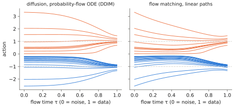

# 6.5 Flow Matching and Rectified Flow

Diffusion transports noise to data along curved, noisy paths. **Flow matching** asks for the simplest possible transport. Draw a straight line from each noise sample to a data sample, and learn the velocity field that moves points along those lines on average. Training is a one-line regression; sampling integrates an ordinary differential equation in about ten Euler steps. π0, GR00T N1 and SmolVLA all generate actions this way, so this is the action model you will meet most in Chapter 10.

## What is it?

!!! definition "Conditional flow matching with linear paths (rectified flow)"
    Let $\mathbf{x}_0\sim\mathcal{N}(\mathbf{0},I)$ be noise and $\mathbf{x}_1$ a data sample (an action chunk) with conditioning $\mathbf{o}$. Define the interpolation and its velocity

    $$
    \mathbf{x}_\tau=(1-\tau)\,\mathbf{x}_0+\tau\,\mathbf{x}_1,\qquad \frac{d\mathbf{x}_\tau}{d\tau}=\mathbf{x}_1-\mathbf{x}_0,\qquad\tau\in[0,1].
    $$

    Train a velocity network $\mathbf{v}_\theta(\mathbf{x},\tau,\mathbf{o})$ by

    $$
    \mathcal{L}(\theta)=\mathbb{E}_{\tau,\,\mathbf{x}_0,\,(\mathbf{x}_1,\mathbf{o})}\Big[\big\lVert\mathbf{v}_\theta(\mathbf{x}_\tau,\tau,\mathbf{o})-(\mathbf{x}_1-\mathbf{x}_0)\big\rVert^2\Big],
    $$

    and sample by integrating $d\mathbf{x}/d\tau=\mathbf{v}_\theta(\mathbf{x},\tau,\mathbf{o})$ from $\tau=0$ (noise) to $\tau=1$, e.g. with $N$ Euler steps $\mathbf{x}\leftarrow\mathbf{x}+\tfrac1N\mathbf{v}_\theta(\mathbf{x},\tau,\mathbf{o})$.

| Symbol | Meaning |
|---|---|
| $\tau$ | **flow time**, 0 = pure noise, 1 = data (conventions differ between papers: some, including π0's, put noise at $\tau=1$) |
| $\mathbf{x}_1-\mathbf{x}_0$ | the target velocity for one (noise, data) pair: constant along its straight line |
| $\mathbf{v}_\theta$ | the network: same inputs as a diffusion denoiser, different target |
| $N$ | number of integration steps at inference; π0 uses 10 |

## Why does it exist?

Diffusion's training target (noise) and its sampler (a reverse stochastic process or a curved ODE) are tied to a particular noising schedule. Flow matching (Lipman et al., 2023; Liu et al., 2023; Albergo & Vanden-Eijnden, 2023) separates the two questions: *choose* a path from noise to data, then regress its velocity. Straight paths give the simplest target and the straightest sampling trajectories, so fewer integration steps are needed. In practice flow matching trains as easily as diffusion, needs no noise schedule, and samples well with 5–10 steps. For a robot those steps are latency.

## How does it work?

### Why regressing straight lines gives the right flow

A single network cannot follow every training line, because lines from different pairs cross. At a point $\mathbf{x}$ and time $\tau$, many pairs pass through, each with its own velocity $\mathbf{x}_1-\mathbf{x}_0$. The MSE loss is minimised by their **conditional mean**, exactly the averaging argument of [6.1](multimodality.md):

$$
\mathbf{v}^\ast(\mathbf{x},\tau)=\mathbb{E}\big[\mathbf{x}_1-\mathbf{x}_0\ \big|\ \mathbf{x}_\tau=\mathbf{x}\big].
$$

Here averaging is exactly what we want. This **marginal velocity field** transports the noise distribution to the data distribution: the density $p_\tau$ of the interpolants satisfies the continuity equation $\partial_\tau p_\tau+\nabla\cdot(p_\tau\mathbf{v}^\ast)=0$. Integrating $\mathbf{v}^\ast$ from a noise sample therefore lands on a data sample, *in one of the modes*. The averaging that failed for actions in 6.1 averages *velocities* here, and the ODE turns the average velocity field into a multimodal distribution of endpoints. Early in the flow ($\tau$ small) the field points toward the data mean. As $\tau$ grows, the posterior over "which data point is my endpoint" sharpens, and trajectories peel off toward their modes.

<figure markdown="span">
  
  <figcaption markdown="span">Deterministic sampling trajectories from noise ($\tau=0$) to a bimodal action distribution ($\tau=1$), computed with the exact velocity fields. Left: the probability-flow ODE of diffusion (DDIM) bends late and sharply. Right: flow matching's straight-line interpolation gives gentler, straighter trajectories that a few large Euler steps can follow. Every trajectory ends in a mode.</figcaption>
</figure>

### Training-time choices

- **Distribution of $\tau$.** Uniform $\tau$ is the default. Stable Diffusion 3 and π0 put more weight on noisier times, where the network must decide which mode to head for and the target is hardest. π0 samples flow time from a shifted Beta distribution for this reason.
- **Parameterisation.** One can predict the velocity, the clean sample $\mathbf{x}_1$, or the noise. With linear paths they are related by $\mathbf{v}=(\mathbf{x}_1-\mathbf{x}_\tau)/(1-\tau)$, but they weight the loss differently at each $\tau$.
- **Conditioning** is identical to diffusion: flow time through sinusoidal features, observations through adaLN or cross-attention.

### Sampling, step counts and straightness

Euler integration with $N$ steps has error that grows with the curvature of the trajectories. Straight trajectories can be integrated exactly in one step; the marginal flow is not exactly straight (trajectories bend where modes separate), but it is far straighter than diffusion's. **Rectified flow**'s *reflow* procedure straightens it further. Generate (noise, sample) pairs with the trained model, then retrain on straight lines between *those* pairs, which no longer cross much. That enables one- or two-step sampling. Lab 09 measures quality against $N$.

### Flow matching vs diffusion

| | Diffusion (DDPM/DDIM) | Flow matching (linear paths) |
|---|---|---|
| path from noise to data | defined by a noise schedule; curved | chosen; straight per pair |
| regression target | noise $\boldsymbol\epsilon$ (or $\mathbf{x}_0$, $\mathbf{v}$) | velocity $\mathbf{x}_1-\mathbf{x}_0$ |
| sampler | ancestral (stochastic) or DDIM (ODE) | ODE (Euler, Heun, …) |
| typical steps for actions | 10–100 | 5–10 |
| relationship | diffusion's probability-flow ODE is a flow with a particular (Gaussian, curved) path | |

With Gaussian paths and matched schedules the two are mathematically equivalent families. The practical difference is the default path and how much tuning it needs.

## Implementation

The whole method:

```python
import torch

def fm_loss(v_net, x1, cond):
    """x1: (B, ...) clean action chunks; cond: conditioning features."""
    x0 = torch.randn_like(x1)                                     # noise
    tau = torch.rand(len(x1), *[1] * (x1.dim() - 1))               # (B, 1, ...) flow time
    x_tau = (1 - tau) * x0 + tau * x1                              # point on the straight line
    return ((v_net(x_tau, tau.flatten(), cond) - (x1 - x0)) ** 2).mean()

@torch.no_grad()
def fm_sample(v_net, cond, shape, steps=10):
    x = torch.randn(shape)                                         # tau = 0: noise
    for i in range(steps):
        tau = torch.full((shape[0],), i / steps)
        x = x + v_net(x, tau, cond) / steps                        # Euler step toward tau = 1
    return x
```

These are `vlacourse.flow.fm_loss` and `fm_sample`, which the toy VLA of Lab 11 uses for its action expert.

!!! lab "Lab 09, part 6"
    Train a flow-matching velocity network on the bimodal toy, sample with 1, 2, 5, 10 and 50 Euler steps, plot trajectories, and compare quality per network evaluation with DDIM.

## Limitations

- **Still iterative.** Ten network evaluations per chunk is far better than a hundred, but more than one ([6.6](sampling-cost.md)).
- **Deterministic sampler, stochastic start.** The noise sample chooses the mode; consecutive control steps with fresh noise can switch modes, as with any sampler.
- **No cheap likelihood**, as for diffusion, which complicates likelihood-based RL fine-tuning.
- **Conventions vary** (direction of time, what is predicted, how $\tau$ is sampled); read each paper's definitions before reusing its numbers.

## Why it matters for VLAs and robots

π0 attaches a 300 M-parameter *action expert* to a 3 B PaliGemma backbone. It predicts 50-step action chunks by flow matching with 10 Euler steps, and the expensive backbone runs once per chunk. GR00T N1 (with a diffusion-transformer action head) and SmolVLA follow the same pattern. You can now read their training objective as the two-line `fm_loss` above, with $\mathbf{x}_1$ an action chunk and the conditioning the backbone's features. [Chapter 8](../08-vla/index.md) builds exactly that.
