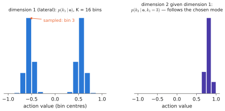

# 6.2 Mixtures and Discretisation: Explicit Multimodal Distributions

The first two fixes for [regression to the mean](multimodality.md) write the distribution down explicitly. A **mixture density network** outputs the parameters of a mixture of Gaussians. **Discretisation** turns each action dimension into a categorical over bins, and **autoregression** chains the dimensions so that they agree with one another. The second is exactly how RT-2 and OpenVLA produce actions: with the same token machinery as words ([4.4](../04-alignment/grounding.md#3-coordinates-as-tokens)).

## What is it?

!!! definition "Mixture density network (Bishop, 1994)"
    A network outputs, for each observation $\mathbf{o}$, the weights, means and (diagonal) standard deviations of a $K$-component Gaussian mixture:

    $$
    p_\theta(\mathbf{a}\mid\mathbf{o})=\sum_{k=1}^{K}\pi_k(\mathbf{o})\,\mathcal{N}\big(\mathbf{a};\ \boldsymbol\mu_k(\mathbf{o}),\ \operatorname{diag}\boldsymbol\sigma_k^2(\mathbf{o})\big),\qquad \boldsymbol\pi(\mathbf{o})=\operatorname{softmax}(\mathbf{z}_\pi),\ \ \boldsymbol\sigma_k=\exp(\mathbf{s}_k),
    $$

    trained by maximising the log-likelihood of the demonstrated actions.

!!! definition "Discretised autoregressive action model"
    Map each action dimension $a_i\in[\ell_i,u_i]$ to one of $K$ bins, $k_i=\operatorname{bin}(a_i)\in\{0,\dots,K-1\}$, and model the bins autoregressively:

    $$
    p_\theta(k_1,\dots,k_{d_a}\mid\mathbf{o})=\prod_{i=1}^{d_a}p_\theta\big(k_i\mid\mathbf{o},k_{<i}\big),
    $$

    each factor a softmax over $K$ classes, trained with [cross-entropy](../00-foundations/probability.md#entropy-cross-entropy-and-kl-divergence). The action is recovered as the bin centres, $\hat a_i=\ell_i+(k_i+\tfrac12)\frac{u_i-\ell_i}{K}$.

| Symbol | Meaning |
|---|---|
| $K$ | number of mixture components (MDN) or bins per dimension (discretisation); RT-2 and OpenVLA use 256 bins |
| $\pi_k(\mathbf{o})$ | mixture weight of component $k$ — the probability of "mode $k$" |
| $\boldsymbol\mu_k,\boldsymbol\sigma_k$ | mean and per-dimension standard deviation of component $k$ |
| $[\ell_i,u_i]$ | range of action dimension $i$; OpenVLA uses the 1st and 99th percentiles of the training data so that outliers do not stretch the bins |
| $k_{<i}$ | bins of the dimensions already generated |

## Why does it exist?

Both methods keep the training loss a plain negative log-likelihood — stable, well understood, the same as for language — while removing the unimodality that made MSE average. The MDN does it with a handful of explicit modes. Discretisation does it by giving up continuity: a categorical over $K$ bins can represent *any* shape of distribution in one dimension, and autoregression extends that to joint distributions in many.

## How does it work?

### MDN: training and sampling

The negative log-likelihood of one example is

$$
-\log p_\theta(\mathbf{a}\mid\mathbf{o})=-\log\sum_k\exp\Big(\log\pi_k-\tfrac12\sum_i\Big[\Big(\frac{a_i-\mu_{k,i}}{\sigma_{k,i}}\Big)^2+2\log\sigma_{k,i}+\log2\pi\Big]\Big),
$$

computed with `logsumexp` for stability. Its gradient assigns each example to components softly, through the posterior responsibility $r_k\propto\pi_k\mathcal{N}(\mathbf{a};\boldsymbol\mu_k,\boldsymbol\sigma_k^2)$ — the E-step of EM inside backpropagation. To sample: pick $k\sim\boldsymbol\pi(\mathbf{o})$, then $\mathbf{a}\sim\mathcal{N}(\boldsymbol\mu_k,\boldsymbol\sigma_k^2)$. Picking the component *first* is what makes the sample coherent: all dimensions come from the same mode.

MDNs work well for a few dimensions and a known small number of modes. They are fragile in practice: components collapse (one $\sigma\to0$ on a single point, likelihood $\to\infty$, so a floor on $\sigma$ is needed), unused components die, and with high-dimensional action chunks the number of modes needed grows quickly. They appear in robotics mostly in older policies.

### Discretisation: the action-token recipe

**Binning.** With uniform bins of width $w=(u-\ell)/K$, the quantisation error is at most $w/2$ per dimension. For a 7-DoF end-effector delta with range ±2 cm and $K=256$, that is 0.08 mm — far below what a robot repeats. The real cost is elsewhere.

**Why autoregress over dimensions?** Independent categoricals per dimension, $\prod_ip(k_i\mid\mathbf{o})$, can represent each dimension's marginal but not their *coupling*. With "go left" $=(-1,+1)$ and "go right" $=(+1,+1)$, independent sampling can choose lateral $-1$ from one mode and something inconsistent from another. Conditioning dimension $i$ on $k_{<i}$ makes the joint sample coherent. This is the same factorisation as [next-token prediction](../00-foundations/sequence-models.md#the-autoregressive-factorisation). That is why a language model can produce actions with no change of architecture: an action of 7 dimensions is a "word" of 7 tokens.

<figure markdown="span">
  
  <figcaption markdown="span">Discretised autoregressive actions. Each dimension of the continuous action is mapped to one of $K$ bins. The model predicts a categorical over bins for the first dimension, then for the second given the first, and so on. A bimodal distribution is represented exactly, and sampling the first dimension's mode makes the later ones follow it.</figcaption>
</figure>

**Costs of the token recipe.**

- **Sequential decoding.** $d_a$ tokens per action, $H_ad_a$ per chunk, each a full decode pass of the backbone ([2.6](../02-transformers/inference.md)). A 7B VLA emitting 7 tokens per step runs at a few hertz.
- **Distance-blind loss.** Cross-entropy treats bin 127 vs 128 as wrong as bin 127 vs 0. The model must learn from data that neighbouring bins are similar.
- **Resolution vs vocabulary.** More bins mean finer actions but sparser data per bin.
- **Chunks are long.** A 50-step chunk of 7 dims is 350 tokens. **FAST** (Pertsch et al., 2025) compresses a chunk first: a discrete cosine transform along time (smooth trajectories have few significant frequency coefficients), quantisation, then BPE over the coefficients ([0.5](../00-foundations/tokens.md#how-does-it-work-byte-pair-encoding)). That yields a few dozen tokens per chunk ([Chapter 8](../08-vla/index.md)).

**Clustering instead of a grid.** Behavior Transformer (BeT) clusters demonstrated actions with $k$-means, predicts the cluster as a token and regresses a continuous offset from its centre. That keeps the categorical head's multimodality while restoring continuous precision.

## Implementation

```python
import torch
import torch.nn as nn
import torch.nn.functional as F

class MDN(nn.Module):
    def __init__(self, d_obs, d_a, K=5, hidden=128):
        super().__init__()
        self.K, self.d_a = K, d_a
        self.net = nn.Sequential(nn.Linear(d_obs, hidden), nn.ReLU(), nn.Linear(hidden, hidden), nn.ReLU(),
                                 nn.Linear(hidden, K * (1 + 2 * d_a)))

    def forward(self, o):                                         # o: (B, d_obs)
        out = self.net(o)
        logit_pi, mu, log_sigma = out.split([self.K, self.K * self.d_a, self.K * self.d_a], -1)
        return (logit_pi, mu.view(-1, self.K, self.d_a),
                log_sigma.view(-1, self.K, self.d_a).clamp(min=-5))   # floor on sigma against collapse

    def nll(self, o, a):                                          # a: (B, d_a)
        logit_pi, mu, log_sigma = self(o)
        z = (a[:, None, :] - mu) / log_sigma.exp()               # (B, K, d_a)
        log_n = -0.5 * (z ** 2).sum(-1) - log_sigma.sum(-1) - 0.5 * self.d_a * torch.log(torch.tensor(2 * torch.pi))
        return -torch.logsumexp(F.log_softmax(logit_pi, -1) + log_n, -1).mean()

    @torch.no_grad()
    def sample(self, o):
        logit_pi, mu, log_sigma = self(o)
        k = torch.distributions.Categorical(logits=logit_pi).sample()          # choose the mode first
        idx = torch.arange(len(o))
        return mu[idx, k] + log_sigma[idx, k].exp() * torch.randn_like(mu[idx, k])


class Binner:
    """Uniform bins on [low, high] per dimension; ids in {0..K-1}."""
    def __init__(self, low, high, K=256):
        self.low, self.high, self.K = torch.as_tensor(low), torch.as_tensor(high), K

    def encode(self, a):
        x = (a.clamp(self.low, self.high) - self.low) / (self.high - self.low)    # in [0, 1]
        return (x * self.K).long().clamp(max=self.K - 1)

    def decode(self, ids):
        return self.low + (ids.float() + 0.5) / self.K * (self.high - self.low)  # bin centres
```

!!! lab "Lab 09, parts 2–3"
    Train an MDN and a two-token autoregressive bin model on the bimodal toy; compare with independent per-dimension bins and watch incoherent samples appear.

## Limitations

- **MDNs**: need the number of modes in advance; numerically fragile; scale poorly to long chunks.
- **Discretisation**: sequential decoding (latency), loss ignorant of distance between bins, many tokens per chunk without compression.
- **Both** model one step (or one chunk) at a time; temporal consistency across control steps is a separate problem.

## Why it matters for VLAs and robots

Discretised autoregression is how a language model becomes a policy with *no* architectural change. RT-2 and OpenVLA use it, which is why the whole of Chapter 2 applies to them unmodified, including the [latency arithmetic](../02-transformers/inference.md#arithmetic-intensity) that limits them to a few hertz. FAST keeps the token interface while shortening the sequence. Diffusion and flow models ([6.4](diffusion.md)–[6.5](flow-matching.md)) abandon the token interface for actions altogether, trading sequential tokens for iterative denoising.
