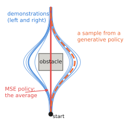

# 6.1 Regression to the Mean and Multimodal Action Distributions

Part III builds the action half of a VLA. Before any architecture, one statistical fact decides most of its design. **Demonstrations of the same situation contain different actions**, and a network trained with squared error predicts their average — which may be an action no demonstrator would ever take. You have seen this twice: the averaged elbow-up/elbow-down arm in [0.2](../00-foundations/neural-networks.md#a-robotics-example-learning-inverse-kinematics) and the grasp on the lid between two handles in [0.4](../00-foundations/probability.md#maximum-likelihood). This section makes the argument precise and general; the rest of the chapter builds the models that fix it.

## What is it?

!!! definition "Multimodal conditional distribution"
    A conditional distribution $p(\mathbf{a}\mid\mathbf{o})$ is **multimodal** at $\mathbf{o}$ if it has several separated regions of high density (**modes**) — several distinct good actions for the same observation. A **policy class** can represent it if, for that $\mathbf{o}$, it can put probability mass on each mode and little between them.

In this chapter $\mathbf{o}$ stands for whatever the policy conditions on (images, state, instruction) and $\mathbf{a}\in\mathbb{R}^{d_a}$ for an action or a flattened action chunk $\mathbf{A}\in\mathbb{R}^{H_ad_a}$ ([notation](../../appendix/notation.md#learning-and-control)).

## Why does it exist? Where modes come from in robotics

1. **Symmetric choices.** Pass an obstacle on the left or the right; grasp the left or the right handle; approach a box from either side.
2. **Ambiguous instructions.** "Go to the red object" when two objects are red. Lab 11's depot environment produces exactly this.
3. **Different demonstrators.** Two teleoperators solve the same task with different strategies and speeds.
4. **Hidden variables.** The demonstrator saw something the policy does not (an occluded obstacle, a remembered plan), so the same observation is followed by different actions.
5. **Timing.** In a chunk of future actions, "start moving now" and "start moving in 0.3 s" are both consistent with a pause in the demonstrations.

None of these is noise to be averaged away. Each is a real decision whose options are all valid and whose average is not.

## How does it work? Why squared error averages

Train a deterministic policy $f_\theta(\mathbf{o})$ with mean squared error on data drawn from $p(\mathbf{o},\mathbf{a})$:

$$
\mathcal{L}(\theta)=\mathbb{E}_{\mathbf{o},\mathbf{a}}\big[\lVert f_\theta(\mathbf{o})-\mathbf{a}\rVert^2\big]
=\mathbb{E}_{\mathbf{o}}\Big[\underbrace{\lVert f_\theta(\mathbf{o})-\boldsymbol\mu(\mathbf{o})\rVert^2}_{\text{reducible}}+\underbrace{\mathbb{E}_{\mathbf{a}\mid\mathbf{o}}\lVert\mathbf{a}-\boldsymbol\mu(\mathbf{o})\rVert^2}_{\text{irreducible}}\Big],\qquad \boldsymbol\mu(\mathbf{o})=\mathbb{E}[\mathbf{a}\mid\mathbf{o}],
$$

because the cross term vanishes in expectation. The only $\theta$-dependent part is minimised by $f_\theta(\mathbf{o})=\boldsymbol\mu(\mathbf{o})$: **the best possible MSE policy outputs the conditional mean.** For a bimodal $p(\mathbf{a}\mid\mathbf{o})$ with modes at $\pm\mathbf{m}$ and equal weights, $\boldsymbol\mu=\mathbf{0}$ — straight into the obstacle. This is not a failure of optimisation or capacity; a perfectly trained network does it.

Equivalently ([0.4](../00-foundations/probability.md#maximum-likelihood)), MSE is maximum likelihood under a Gaussian with fixed variance, and a single Gaussian has one mode. Any unimodal family — a Gaussian with learned variance, a Laplace (L1 loss gives the conditional *median*, also between the modes for symmetric data) — has the same problem.

<figure markdown="span">
  
  <figcaption markdown="span">The averaging failure in two dimensions. Demonstrations pass an obstacle on the left or on the right (blue). The MSE-trained policy predicts their mean, which drives into the obstacle (red). A model of the full distribution can sample either detour (orange). Every method in this chapter is a different way of representing such a distribution.</figcaption>
</figure>

### What a good action model must do

| Requirement | Why |
|---|---|
| represent several modes | the data has them |
| **sample** a single mode coherently | the robot must commit to one option, in all action dimensions and all steps of a chunk at once |
| scale to high dimensions | an action chunk of 50 steps × 7 dims is a 350-dimensional vector |
| be fast to sample | the sampler runs every control step ([6.6](sampling-cost.md)) |
| be trainable by a stable loss | thousands of GPU-hours of VLA training cannot babysit a GAN |

The families of the next sections trade these off differently:

| Family | Section | Multimodal | Sampling cost | Typical use |
|---|---|---|---|---|
| Gaussian / MSE | — | no | one pass | simple, unimodal tasks |
| mixture density network | [6.2](mdn-ar.md) | yes, $K$ modes | one pass | low-dimensional actions |
| discretisation + autoregression | [6.2](mdn-ar.md) | yes, any | one pass per token | RT-2, OpenVLA (action tokens) |
| conditional VAE | [6.3](vae.md) | yes (via latent) | one pass | ACT |
| diffusion | [6.4](diffusion.md) | yes, any | 10–100 passes | Diffusion Policy, Octo, RDT |
| flow matching | [6.5](flow-matching.md) | yes, any | ~10 passes | π0, GR00T N1, SmolVLA |

## Implementation: measuring the failure

```python
import torch
import torch.nn as nn

# observations o ~ U(-1, 1): the obstacle's lateral offset; demonstrations swerve left or right of it
o = torch.rand(4096, 1) * 2 - 1
side = torch.randint(0, 2, (4096, 1)) * 2 - 1                      # -1: left, +1: right, 50/50
a = torch.cat([o + 0.6 * side, torch.ones_like(o)], 1)              # (lateral, forward) action

f = nn.Sequential(nn.Linear(1, 64), nn.ReLU(), nn.Linear(64, 64), nn.ReLU(), nn.Linear(64, 2))
opt = torch.optim.Adam(f.parameters(), 1e-3)
for _ in range(2000):
    loss = ((f(o) - a) ** 2).mean()
    opt.zero_grad(); loss.backward(); opt.step()
print(f(torch.tensor([[0.2]])))        # lateral ≈ 0.2: exactly where the obstacle is, never in the data
```

!!! lab "Lab 09 — Generative action heads"
    The toy above, and then every model of this chapter trained on it: MDN, discretised autoregression, CVAE, DDPM and flow matching. For each, sample, count how many samples fall between the modes, and time the sampler.

## Limitations

- **Modelling multimodality is necessary, not sufficient.** Sampling a mode independently at every control step makes the robot **dither** between options. Committing over time is the job of action chunking ([Chapter 8](../08-vla/index.md)).
- **Not every spread is multimodality.** Noisy demonstrations around one strategy are unimodal; a distributional model then just adds sampling noise to control.
- **More expressive models need more data per mode.** With few demonstrations, a rare mode looks like noise to every method.

## Why it matters for VLAs and robots

Choosing how to represent $\pi_\theta(\mathbf{a}\mid\mathbf{o},\ell)$ is, as [0.4](../00-foundations/probability.md#why-it-matters-for-vlas-and-robots) put it, the single most consequential architectural choice in a VLA. Token-based VLAs (RT-2, OpenVLA) answer it with discretisation; ACT with a CVAE; Diffusion Policy and Octo with diffusion; π0, GR00T N1 and SmolVLA with flow matching. The rest of this chapter gives you the mathematics to understand — and to change — any of these choices.
