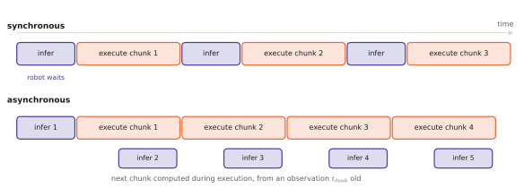

# 6.6 Sampling Cost and Its Consequences for Control Rates

Every model in this chapter must be *sampled* to act, and every sampler costs time. On a robot, time is not a training-budget concern but a control-loop concern. The action must be ready before the robot needs it. This section turns the samplers of [6.2](mdn-ar.md)–[6.5](flow-matching.md) into a latency model, connects it to the control rate through action chunking, and lists the techniques that buy speed.

## What is it?

!!! definition "Inference latency of a generative policy"
    For a policy with a backbone (encoder + transformer over observations) and an action generator, the time to produce one action chunk is approximately

    $$
    t_\text{chunk}\approx t_\text{backbone}+N_\text{eval}\cdot t_\text{gen},
    $$

    where $t_\text{backbone}$ is one prefill pass over the observation tokens ([2.6](../02-transformers/inference.md#prefill-and-decode)), $t_\text{gen}$ the cost of one evaluation of the action generator, and $N_\text{eval}$ the number of sequential evaluations:

    | Generator | $N_\text{eval}$ per chunk | $t_\text{gen}$ |
    |---|---|---|
    | regression, MDN, CVAE decoder | 1 | small head |
    | discretised autoregression | $H_ad_a$ (or the compressed token count with FAST) | one **decode pass of the whole backbone** |
    | diffusion | $K$ (10–100) | small denoiser |
    | flow matching | $N$ (5–10) | small action expert |

Two facts stand out. Token-based VLAs pay $N_\text{eval}$ *backbone* passes, because each action token is generated by the full language model. Diffusion and flow VLAs pay $N_\text{eval}$ passes of a *small* network that reuses the backbone's cached features. That asymmetry is why most recent VLAs put a separate action expert next to the backbone.

## Why does it matter? The control loop

A policy queried every control period $\Delta t$ must satisfy $t_\text{chunk}\le\Delta t$ if it predicts one action at a time. With **action chunking**, the policy predicts $H_a$ actions and the robot executes $H_e\le H_a$ of them before asking for a new chunk. The constraint relaxes to

$$
t_\text{chunk}\le H_e\,\Delta t\qquad\text{(sequential execution)},
$$

and the effective rate at which *new observations influence actions* drops to $1/(H_e\Delta t)$. Chunking buys throughput with **reactivity**: a 50-step chunk executed open loop at 50 Hz does not react to anything for a second.

<figure markdown="span">
  
  <figcaption markdown="span">Executing action chunks. Synchronous (top): the robot executes a chunk, stops, waits for inference, then executes the next, so it pauses whenever inference is slower than the gap. Asynchronous (bottom): inference for the next chunk runs while the current one executes. The robot never pauses, but the new chunk is computed from an observation that is already $t_\text{chunk}$ old, and its first actions must blend with the actions being executed.</figcaption>
</figure>

**Asynchronous execution** removes the pauses. Start computing chunk $j+1$ while chunk $j$ is still executing, and switch when it arrives. Two problems follow. The new chunk was conditioned on a stale observation, by $t_\text{chunk}$. And the switch can be discontinuous when the new sample chose a different mode. Remedies include temporal ensembling of overlapping chunks (ACT; [Chapter 8](../08-vla/index.md)) and **real-time chunking**: condition the flow sampler on the actions already committed, as an inpainting problem, so the new chunk continues them smoothly.

## How does it work? Buying speed

| Technique | What it reduces | Cost |
|---|---|---|
| fewer integration steps (DDIM, Euler with small $N$) | $N_\text{eval}$ | sample quality at very small $N$ |
| straighter flows (rectified flow, reflow) | $N_\text{eval}$ needed for a given quality | an extra distillation stage |
| consistency models / distillation into 1–2 steps | $N_\text{eval}\to1$–$2$ | training complexity; some loss of diversity |
| caching the backbone's keys and values across denoising steps | $t_\text{gen}$ | memory |
| smaller action expert | $t_\text{gen}$ | capacity |
| compressed action tokens (FAST) | $N_\text{eval}$ for token-based policies | a tokenizer to train; decoding errors |
| parallel decoding of all action tokens | $N_\text{eval}$ for token-based policies | the autoregressive coupling between dimensions |
| quantisation, lower precision | $t_\text{backbone}$, $t_\text{gen}$ in bandwidth-bound regimes | accuracy ([Chapter 11](../11-deployment/index.md)) |

A worked comparison with round numbers, on an embedded GPU where one backbone decode pass of a 7 B model takes ≈70 ms in bf16 ([2.6](../02-transformers/inference.md#arithmetic-intensity)):

| Policy | Backbone | Generator | $t_\text{chunk}$ |
|---|---|---|---|
| token-based, 7 dims, 1 action | prefill + 7 decode passes of 7 B | — | $\gtrsim$ 0.5 s for **one** action |
| token-based with FAST, 50-step chunk compressed to ~30 tokens | prefill + 30 decode passes | — | $\gtrsim$ 2 s for 50 actions |
| flow matching, 2 B backbone + 300 M expert, $N=10$ | one prefill of 2 B | 10 passes of 0.3 B | dominated by the prefill; the expert adds ~10 × its own pass |

The flow-matching design wins whenever the chunk is long, because its sequential cost is paid by a small network. Lab 09 measures sampler time against quality on the toy problem. Lab 11 measures the whole loop on the toy VLA.

## Implementation: a latency model you can reuse

```python
def chunk_latency(t_prefill, t_decode=None, n_tokens=0, t_gen=0.0, n_eval=0):
    """Seconds per action chunk: one prefill, then sequential decode passes or generator evaluations."""
    return t_prefill + n_tokens * (t_decode or 0.0) + n_eval * t_gen

def max_control_rate(t_chunk, H_e, synchronous=True):
    """Upper bound on the control rate (Hz) when H_e actions are executed per chunk."""
    return H_e / t_chunk if synchronous else float("inf")   # async: limited by staleness, not by pauses

def staleness(t_chunk):
    """With asynchronous execution, the age of the observation behind the first new action."""
    return t_chunk
```

!!! lab "Lab 09, part 7"
    Time every sampler of the chapter on CPU and GPU, plot quality (mode coverage, off-mode samples) against network evaluations, and pick the cheapest generator that meets a 20 Hz budget with 8-step chunks.

## Limitations

- **The latency model ignores variance.** Real systems have jitter from the OS, Python, memory allocation and other processes; a control loop needs the worst case, not the mean ([Chapter 11](../11-deployment/index.md)).
- **Reactivity is not latency.** A policy can meet its rate and still react to a new obstacle only after a full chunk.
- **Speed-ups interact.** Distillation, quantisation and fewer steps each cost a little quality; together the losses can compound.

## Why it matters for VLAs and robots

The generative model is part of the controller. Its sampling cost sets how often the robot can replan. Its stochasticity sets how consistent consecutive decisions are. Its chunk length sets how long the robot runs open loop. For an arm at 50 Hz, chunks with asynchronous execution make billion-parameter policies usable. For a drone, whose stability loop runs at hundreds of hertz, no generator in this chapter is fast enough to sit in the inner loop. That is a central argument of [Chapter 13](../13-uavs/index.md).
