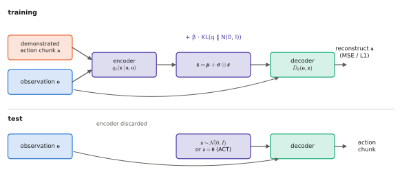

# 6.3 Variational Autoencoders and the CVAE of ACT

The mixture of [6.2](mdn-ar.md) chose its mode with an explicit discrete variable. The **variational autoencoder** generalises the idea: a continuous **latent variable** $\mathbf{z}$ selects "which way" the action goes, and a decoder turns $(\mathbf{o},\mathbf{z})$ into an action. The latent is never observed, so training needs a lower bound on the likelihood, the **ELBO**, whose derivation is the most reused piece of mathematics in generative modelling. The conditional VAE is the action model of ACT, the policy behind the ALOHA bimanual robots and one of the main precursors of VLAs.

## What is it?

!!! definition "Conditional latent-variable model and the ELBO"
    A **conditional VAE (CVAE)** models

    $$
    p_\theta(\mathbf{a}\mid\mathbf{o})=\int p_\theta(\mathbf{a}\mid\mathbf{o},\mathbf{z})\,p(\mathbf{z})\,d\mathbf{z},\qquad p(\mathbf{z})=\mathcal{N}(\mathbf{0},I),
    $$

    with a **decoder** $p_\theta(\mathbf{a}\mid\mathbf{o},\mathbf{z})$ (usually Gaussian with mean $D_\theta(\mathbf{o},\mathbf{z})$) and an **encoder** $q_\phi(\mathbf{z}\mid\mathbf{a},\mathbf{o})=\mathcal{N}(\boldsymbol\mu_\phi,\operatorname{diag}\boldsymbol\sigma_\phi^2)$ that approximates the intractable posterior. Training maximises the **evidence lower bound**

    $$
    \log p_\theta(\mathbf{a}\mid\mathbf{o})\ \ge\ \underbrace{\mathbb{E}_{q_\phi(\mathbf{z}\mid\mathbf{a},\mathbf{o})}\big[\log p_\theta(\mathbf{a}\mid\mathbf{o},\mathbf{z})\big]}_{\text{reconstruction}}-\underbrace{D_\text{KL}\big(q_\phi(\mathbf{z}\mid\mathbf{a},\mathbf{o})\,\Vert\,p(\mathbf{z})\big)}_{\text{regularisation}}=:\operatorname{ELBO}.
    $$

| Symbol | Shape | Meaning |
|---|---|---|
| $\mathbf{z}$ | $d_z$ | latent "style" or "mode" variable (ACT: $d_z=32$) |
| $p(\mathbf{z})$ | — | prior, a standard Gaussian |
| $q_\phi(\mathbf{z}\mid\mathbf{a},\mathbf{o})$ | — | encoder: sees the demonstrated action, infers which $\mathbf{z}$ produced it; used only in training |
| $D_\theta(\mathbf{o},\mathbf{z})$ | $d_a$ (or $H_a\times d_a$) | decoder: the policy |
| $\beta$ | scalar | weight of the KL term (ACT uses $\beta=10$) |

## Why does it exist?

A latent variable turns a hard problem — a multimodal distribution over a 350-dimensional action chunk — into an easier one. Given $\mathbf{z}$, the action is (approximately) deterministic, so a plain regression decoder suffices. The multimodality lives in $\mathbf{z}$, and different regions of $\mathbf{z}$ space decode to different modes. The integral over $\mathbf{z}$ cannot be computed, but the ELBO can be estimated with one sample per example and optimised by backpropagation.

## How does it work?

### Deriving the ELBO

For any distribution $q(\mathbf{z})$ (dropping the conditioning on $\mathbf{o}$ for brevity):

$$
\log p(\mathbf{a})=\mathbb{E}_{q}\Big[\log\frac{p(\mathbf{a},\mathbf{z})}{q(\mathbf{z})}\Big]+\mathbb{E}_{q}\Big[\log\frac{q(\mathbf{z})}{p(\mathbf{z}\mid\mathbf{a})}\Big]=\operatorname{ELBO}(q)+D_\text{KL}\big(q(\mathbf{z})\,\Vert\,p(\mathbf{z}\mid\mathbf{a})\big).
$$

(Check: the sum of the two expectations is $\mathbb{E}_q[\log p(\mathbf{a},\mathbf{z})/p(\mathbf{z}\mid\mathbf{a})]=\log p(\mathbf{a})$.) Since the KL is non-negative, the ELBO is a lower bound, tight exactly when $q$ equals the true posterior. Writing $p(\mathbf{a},\mathbf{z})=p(\mathbf{a}\mid\mathbf{z})p(\mathbf{z})$ splits the ELBO into the reconstruction and KL terms of the definition. Maximising it over $\theta$ improves the model; maximising it over $\phi$ improves the posterior approximation. The same derivation underlies the training objective of diffusion models ([6.4](diffusion.md)).

### The two terms in closed form

With a Gaussian decoder of fixed variance $\sigma^2$, the reconstruction term is $-\frac{1}{2\sigma^2}\lVert\mathbf{a}-D_\theta(\mathbf{o},\mathbf{z})\rVert^2+\text{const}$: an MSE, but conditioned on $\mathbf{z}$. For diagonal Gaussians the KL to the standard normal is

$$
D_\text{KL}\big(\mathcal{N}(\boldsymbol\mu,\operatorname{diag}\boldsymbol\sigma^2)\Vert\mathcal{N}(\mathbf{0},I)\big)=\tfrac12\sum_{j=1}^{d_z}\big(\mu_j^2+\sigma_j^2-1-\log\sigma_j^2\big).
$$

### The reparameterisation trick

The reconstruction expectation needs a gradient with respect to $\phi$ through a *sample* of $\mathbf{z}$. Write the sample as a deterministic function of the parameters and independent noise:

$$
\mathbf{z}=\boldsymbol\mu_\phi+\boldsymbol\sigma_\phi\odot\boldsymbol\epsilon,\qquad\boldsymbol\epsilon\sim\mathcal{N}(\mathbf{0},I),
$$

so that $\partial\mathbf{z}/\partial\boldsymbol\mu_\phi=I$ and $\partial\mathbf{z}/\partial\boldsymbol\sigma_\phi=\operatorname{diag}(\boldsymbol\epsilon)$, and ordinary backpropagation applies. Diffusion and flow models use the same trick: the noisy input is always "clean data + scaled noise".

<figure markdown="span">
  
  <figcaption markdown="span">A conditional VAE for actions. In training (top), the encoder sees the demonstrated action and the observation and proposes a latent $\mathbf{z}$. The decoder must reconstruct the action from $\mathbf{z}$ and the observation, and the KL term keeps $\mathbf{z}$ close to the prior. At test time (bottom), the encoder is discarded and $\mathbf{z}$ comes from the prior: a random draw for diversity, or $\mathbf{z}=\mathbf{0}$ as ACT does.</figcaption>
</figure>

### Posterior collapse

If the decoder can model the data well *without* $\mathbf{z}$, the cheapest way to raise the ELBO is to make $q_\phi(\mathbf{z}\mid\cdot)=p(\mathbf{z})$ (KL = 0) and ignore the latent. The model is then unimodal again — back to averaging. Collapse is most likely with powerful decoders and large $\beta$. Remedies are KL annealing (start with $\beta\approx0$), a "free bits" floor on the KL, and a weaker decoder. Watch the KL term during training: if it goes to zero, the latent carries nothing.

### ACT: a CVAE over action chunks

ACT (*Action Chunking with Transformers*; Zhao et al., 2023) was designed for fine bimanual manipulation from about 50 demonstrations per task:

- **Encoder** (training only): a small transformer over [CLS] + joint positions + the demonstrated chunk of $k$ actions. Its [CLS] output gives $(\boldsymbol\mu,\log\boldsymbol\sigma^2)$ of a 32-d $\mathbf{z}$. It does not see the images, which keeps it cheap.
- **Decoder** (the policy): a transformer encoder over ResNet-18 features of four camera images, the joint positions and $\mathbf{z}$, then a transformer decoder whose $k$ learned queries [cross-attend](../02-transformers/multi-head.md#cross-attention) to it and output the **whole chunk** of $k$ future joint targets (ACT uses $k=100$ at 50 Hz, two seconds).
- **Loss**: L1 reconstruction of the chunk plus $\beta\cdot$KL with $\beta=10$.
- **Inference**: $\mathbf{z}=\mathbf{0}$, the prior mean, so the policy is deterministic. A new chunk is predicted at every step, and overlapping predictions for the same time step are averaged with exponential weights (**temporal ensembling**, [Chapter 8](../08-vla/index.md)).

Setting $\mathbf{z}=\mathbf{0}$ means ACT does not *sample* modes at test time. What it gains from the CVAE is cleaner training: the decoder is not forced to average incompatible demonstrations, because the encoder explains their differences with $\mathbf{z}$. Ablations in the ACT paper show performance dropping sharply without the CVAE objective on human-teleoperated data.

## Implementation

```python
import torch
import torch.nn as nn

class CVAE(nn.Module):
    def __init__(self, d_obs, d_a, d_z=8, hidden=128):
        super().__init__()
        self.d_z = d_z
        self.enc = nn.Sequential(nn.Linear(d_obs + d_a, hidden), nn.ReLU(), nn.Linear(hidden, 2 * d_z))
        self.dec = nn.Sequential(nn.Linear(d_obs + d_z, hidden), nn.ReLU(), nn.Linear(hidden, hidden),
                                 nn.ReLU(), nn.Linear(hidden, d_a))

    def loss(self, o, a, beta=1.0):
        mu, log_var = self.enc(torch.cat([o, a], -1)).chunk(2, -1)            # q(z | a, o)
        z = mu + (0.5 * log_var).exp() * torch.randn_like(mu)                 # reparameterisation
        recon = ((self.dec(torch.cat([o, z], -1)) - a) ** 2).sum(-1).mean()
        kl = 0.5 * (mu ** 2 + log_var.exp() - 1 - log_var).sum(-1).mean()
        return recon + beta * kl, recon, kl                                   # watch kl: -> 0 means collapse

    @torch.no_grad()
    def sample(self, o, zero=False):
        z = torch.zeros(len(o), self.d_z) if zero else torch.randn(len(o), self.d_z)
        return self.dec(torch.cat([o, z], -1))
```

!!! lab "Lab 09, part 4"
    Train the CVAE on the bimodal toy with $\beta=0.01$, $1$ and $10$. Watch the KL term, sample from the prior, try ACT's $\mathbf{z}=\mathbf{0}$, and find posterior collapse.

## Limitations

- **The ELBO is a bound**, and a loose bound gives blurry samples: Gaussian decoders with fixed variance smear modes that the latent did not separate.
- **Posterior collapse** silently turns the model back into a regressor.
- **$\mathbf{z}=\mathbf{0}$ at test time** gives a single "typical" action. It is deterministic and stable, but not a sample of the modes.
- **Prior holes**: regions of $\mathbf{z}$ that the encoder never produced decode to nonsense when sampled.

## Why it matters for VLAs and robots

ACT showed that predicting **chunks** of actions with a transformer and a latent variable works remarkably well from few demonstrations. The chunking idea survived into every modern VLA. The latent-variable route itself was largely overtaken by diffusion and flow matching, which model multimodality without an encoder, without collapse and with sharper samples. The ELBO, however, comes back immediately: it is how diffusion models are derived.
