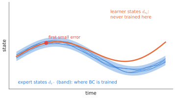

# 7.2 Behavioural Cloning

The simplest way to learn a policy is to copy one. Record an expert — a teleoperator, a scripted controller, a motion planner — and train a network to predict the expert's action from the observation. **Behavioural cloning (BC)** is supervised learning on (observation, action) pairs, and it is how nearly every VLA is trained. This section states exactly what it optimises. [7.3](covariate-shift.md) explains why that is not quite what we want.

## What is it?

!!! definition "Behavioural cloning"
    Given demonstrations $\mathcal{D}=\{(\mathbf{o}_i,\mathbf{a}_i)\}$ collected by running an expert policy $\pi^\ast$, BC maximises the likelihood of the expert's actions:

    $$
    \theta^\star=\arg\max_\theta\ \mathbb{E}_{(\mathbf{o},\mathbf{a})\sim d_{\pi^\ast}}\big[\log\pi_\theta(\mathbf{a}\mid\mathbf{o})\big]\ \approx\ \arg\min_\theta\ -\frac{1}{|\mathcal{D}|}\sum_i\log\pi_\theta(\mathbf{a}_i\mid\mathbf{o}_i),
    $$

    where $d_{\pi^\ast}$ is the distribution of observations visited by the *expert*.

| Symbol | Meaning |
|---|---|
| $\pi^\ast$ | the demonstrator: human teleoperator, scripted controller, planner, another policy |
| $d_{\pi^\ast}(\mathbf{o})$ | state (observation) distribution induced by running $\pi^\ast$: where the expert went |
| $\pi_\theta$ | the learned policy; its form decides the loss: cross-entropy for action tokens, MSE for a Gaussian, the flow-matching loss for a flow head ([Chapter 6](../06-generative/index.md)) |

The **distribution** in the expectation is the crux. BC fits the policy on states the expert visited. The policy is then deployed on the states *it* visits, $d_{\pi_\theta}$, which differ whenever it makes mistakes.

## Why does it exist?

Reinforcement learning needs a reward and many trials. Behavioural cloning needs neither, only demonstrations. For real robots that is decisive. Trials are slow, risky and require resets; rewards for real tasks are hard to write; and a teleoperated demonstration directly shows *how* to do the task, including style and safety margins. BC is also exactly the training loop of [Chapter 2](../02-transformers/training.md) — minibatches, a likelihood loss, AdamW — so everything known about training large networks transfers. ALVINN (Pomerleau, 1989) drove a van this way with a three-layer network. RT-1, OpenVLA and π0 are BC on hundreds of thousands to millions of demonstrations.

## How does it work?

### The data

A demonstration is a trajectory $(\mathbf{o}_0,\mathbf{a}_0,\mathbf{o}_1,\mathbf{a}_1,\dots)$ plus the instruction $\ell$. BC breaks it into independent training pairs $(\mathbf{o}_t,\ell)\mapsto\mathbf{a}_t$, or $\mapsto\mathbf{A}_t$ for chunks. Properties of the data matter as much as the model:

| Property | Effect | Practice |
|---|---|---|
| **coverage** | states never demonstrated are guesses | vary starts, objects, lighting, distractors |
| **consistency** | conflicting demonstrations become multimodality ([6.1](../06-generative/multimodality.md)) or noise | one strategy per operator, or a distributional head |
| **action labels** | what the robot actually received: joint targets, end-effector deltas | record at the control rate, after any safety filter |
| **pauses and hesitations** | the policy learns to hesitate too | trim idle segments; condition on progress |
| **observation–action alignment** | latency between camera and action shifts labels | timestamp everything; correct for delays |

### Choice of action representation

The same demonstrations can be labelled in several ways. Absolute joint positions, joint deltas, absolute or delta end-effector poses, velocities. **Delta** actions (change relative to the current state) generalise across positions but accumulate error. **Absolute** targets do not drift but tie the policy to one workspace. Many VLAs predict end-effector deltas for arms and normalise each dimension to $[-1,1]$ with dataset statistics ([Chapter 8](../08-vla/index.md)). For a drone the natural BC label is a velocity setpoint for the flight controller ([Chapter 13](../13-uavs/index.md)).

### What BC guarantees — and does not

If the learned policy matches the expert with per-step error rate $\epsilon$ **on the expert's state distribution**, BC's training objective is satisfied. That says nothing about the states the learner reaches after its first mistake. [7.3](covariate-shift.md) turns this into a bound: the expected number of mistakes can grow quadratically with the horizon.

<figure markdown="span">
  
  <figcaption markdown="span">Behavioural cloning's blind spot. Training pairs come from the expert's trajectories (blue band). A small error at deployment takes the learner off the band (orange). There the policy was never trained, its errors are larger, and they push it further away.</figcaption>
</figure>

## Implementation

BC with any of Chapter 6's heads is a few lines around the standard training loop:

```python
def bc_step(policy, opt, batch, head="flow"):
    o, instr, a = batch["obs"], batch["instruction"], batch["actions"]      # a: (B, H_a, d_a) chunks
    feats = policy.encode(o, instr)                                          # backbone features
    if head == "mse":
        loss = ((policy.regress(feats) - a) ** 2).mean()                    # Gaussian / MSE: averages modes
    elif head == "tokens":
        ids = binner.encode(a).flatten(1)                                    # (B, H_a * d_a) action tokens
        loss = F.cross_entropy(policy.token_logits(feats, ids).flatten(0, 1), ids.flatten())
    else:
        loss = fm_loss(policy.velocity, a, feats)                            # flow matching (Chapter 6)
    opt.zero_grad(); loss.backward(); opt.step()
    return loss.item()
```

!!! lab "Lab 10, parts 1–2"
    A vectorised patrol task: follow a circular route around the depot. Collect expert demonstrations, train a BC policy, measure its training loss and its closed-loop tracking error, and compare the two.

## Limitations

- **Covariate shift**: trained on $d_{\pi^\ast}$, deployed on $d_{\pi_\theta}$ ([7.3](covariate-shift.md)).
- **No improvement beyond the expert.** BC copies; it cannot outperform its demonstrations except by averaging noise away.
- **Causal confusion.** With rich observations, a policy can latch onto a correlate of the expert's action rather than its cause — the brake light on the dashboard rather than the pedestrian. More information can make BC *worse*.
- **Offline loss is a weak proxy** for closed-loop success ([2.5](../02-transformers/training.md#what-to-monitor)).

## Why it matters for VLAs and robots

A VLA is a behavioural-cloning policy with a pretrained vision-language backbone. Its strengths are BC's: no reward and no on-robot trials, and scalability with demonstration data. Its weaknesses are BC's too: compounding errors, sensitivity to data quality, inability to exceed the demonstrator. [Chapter 9](../09-training/index.md) is in large part about engineering around those weaknesses at scale.
