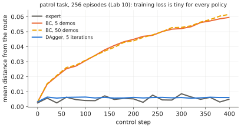

# 7.3 Covariate Shift and Compounding Error

Behavioural cloning trains on the expert's states and runs on the learner's ([7.2](behavior-cloning.md)). After one small mistake the learner is somewhere the expert never was. Its errors there are larger, so it drifts further. The resulting **compounding error** is the central weakness of imitation learning. It makes the *quadratic* dependence on the horizon below more than a theoretical curiosity: it is what a robot does when it slowly wanders off a path it was trained to follow.

## What is it?

!!! definition "Covariate shift in imitation learning"
    Let $d_\pi$ be the distribution of states visited by policy $\pi$ over an episode. BC minimises the expected loss under $d_{\pi^\ast}$ (expert states), but performance depends on the loss under $d_{\pi_\theta}$ (learner states). The mismatch between the two input distributions is **covariate shift**: the inputs change, the labelling function (the expert) does not.

!!! definition "Compounding-error bound (Ross & Bagnell, 2010)"
    Let the learner disagree with the expert with probability at most $\epsilon$ on states drawn from $d_{\pi^\ast}$, and let costs per step lie in $[0,1]$. Then over a horizon of $T$ steps

    $$
    J_\text{cost}(\pi_\theta)\ \le\ J_\text{cost}(\pi^\ast)+T^2\epsilon ,
    $$

    and there are problems where this quadratic growth is attained.

## Why does it exist? The argument

The intuition behind the bound is short. The learner makes its first mistake at step $t$ with probability at most $\epsilon$ per step, so it is still "on the expert's distribution" at step $t$ with probability at least $1-t\epsilon$. Once off, nothing in training constrains it, and in the worst case it pays the maximum cost for every remaining step. Summing the probability of having left by step $t$ over all steps,

$$
\sum_{t=1}^{T}\Pr[\text{off by step }t]\ \le\ \sum_{t=1}^{T}t\,\epsilon\ \approx\ \tfrac12T^2\epsilon .
$$

A supervised learner with error $\epsilon$ per *independent* example would pay $T\epsilon$. The extra factor $T$ is the price of the feedback loop: errors change future inputs. For a control engineer this is the open-loop instability of a learned closed-loop controller. Outside its training set the learned map has no reason to be stabilising.

<figure markdown="span">
  
  <figcaption markdown="span">Compounding error, measured in Lab 10 on a patrol task: mean distance from the route over an episode. The behaviour-cloned policy starts on the route and drifts off as small errors take it to states it never saw. A policy trained with DAgger on states it visited itself stays on. Training losses of the two policies are similar; their closed-loop behaviour is not.</figcaption>
</figure>

## How does it work? Mitigations

| Mitigation | Idea | Cost |
|---|---|---|
| **more diverse demonstrations** | widen $d_{\pi^\ast}$ so it covers more of $d_{\pi_\theta}$ | data collection |
| **noise injection during collection** (DART) | perturb the expert's executed actions while recording the *intended* corrective action, so demonstrations include recoveries | slightly worse demonstrations |
| **recovery demonstrations** | deliberately start from off-nominal states and demonstrate the way back | operator time |
| **interactive imitation** (DAgger, [7.4](dagger.md)) | label the learner's own states with expert actions | an expert available during training |
| **action chunking** | fewer independent decisions per episode: the effective horizon becomes $T/H_e$ | reactivity ([6.6](../06-generative/sampling-cost.md)) |
| **history / state estimation** | reduce partial observability that makes the learner's state ambiguous | tokens, latency |
| **closed-loop low-level control** | the policy outputs setpoints; a stable classical controller tracks them | less expressive actions |

The last row is underrated. If a VLA outputs end-effector targets that an impedance controller tracks stably, small policy errors become small target errors, not unstable motions. Placing learned components *above* stabilising feedback loops is one of the main arguments of [Chapter 12](../12-embodied/index.md).

**Chunking as a horizon reduction.** If a policy commits to chunks of $H_e$ actions, it makes only $T/H_e$ decisions per episode, and the quadratic term becomes $(T/H_e)^2\epsilon_\text{chunk}$. Whether the per-chunk error $\epsilon_\text{chunk}$ grows more slowly than $H_e^2$ is empirical. ACT and Diffusion Policy report large gains from chunking, which suggests it often does ([Chapter 8](../08-vla/index.md)).

## Implementation: measuring it

The useful diagnostic is not the training loss but the **closed-loop error as a function of time**, compared with the expert from the same initial states:

```python
@torch.no_grad()
def tracking_error_curve(env, policy, n=256, T=200, seed=0):
    """Mean distance to the reference path at every step, over n parallel episodes."""
    s = env.reset(n, seed)                    # (n, d_s), a vectorised environment
    errs = []
    for t in range(T):
        s = env.step(s, policy(s))
        errs.append(env.path_error(s).mean().item())
    return errs                               # a flat curve is good; a rising one is compounding error
```

!!! lab "Lab 10, part 3"
    Plot the tracking error over time for the expert, for BC with 5 and 50 demonstrations (ten times more data does not help: 0.060 vs 0.061), and for BC trained on noise-injected demonstrations (0.006). Then look at where BC goes and check that no demonstration went there.

## Limitations of the analysis

- The bound is worst-case. Many tasks are forgiving: a policy that drifts slightly toward a large target still succeeds.
- It assumes the learner's errors are independent of the state. In practice errors concentrate in rare, hard states (contact, occlusion).
- It ignores **partial observability**. When the observation does not determine the expert's action (a hidden variable), even zero training error on $d_{\pi^\ast}$ is impossible.

## Why it matters for VLAs and robots

Large, diverse datasets are the main reason VLAs survive covariate shift: $d_{\pi^\ast}$ becomes broad enough to cover many of the learner's mistakes. They do not eliminate it. Long-horizon tasks, precise insertions and fast dynamics expose compounding error quickly, and drones, with unstable open-loop dynamics, are the extreme case. The remedies — interactive data, recovery demonstrations, chunking, stable low-level control — reappear in [Chapter 9](../09-training/index.md) as data-collection strategy and in [Chapter 13](../13-uavs/index.md) as system architecture.
