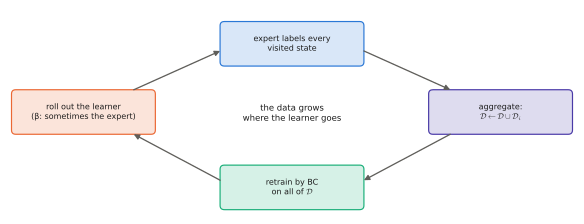

# 7.4 DAgger and Interactive Imitation

If behavioural cloning fails because it never sees its own mistakes, the fix is to show them to it. **DAgger** (Dataset Aggregation; Ross, Gordon & Bagnell, 2011) runs the *learner*, asks the expert what it should have done in each state the learner visited, adds those labels to the dataset, and retrains. Repeating this makes the training distribution converge to the learner's own state distribution, which removes covariate shift. The quadratic compounding error of [7.3](covariate-shift.md) becomes linear.

## What is it?

!!! definition "DAgger"
    Initialise $\mathcal{D}\leftarrow$ expert demonstrations and train $\pi_1$ by BC. For iterations $i=1,\dots,N$:

    1. **Roll out** the mixture policy $\pi_i^\beta=\beta_i\pi^\ast+(1-\beta_i)\pi_i$ (execute the expert's action with probability $\beta_i$, the learner's otherwise), collecting the visited states $\{\mathbf{s}\}$.
    2. **Label** every visited state with the expert's action, $\mathcal{D}_i=\{(\mathbf{s},\pi^\ast(\mathbf{s}))\}$.
    3. **Aggregate**: $\mathcal{D}\leftarrow\mathcal{D}\cup\mathcal{D}_i$.
    4. **Retrain** $\pi_{i+1}$ by BC on all of $\mathcal{D}$.

    Typically $\beta_1=1$ and $\beta_i\to0$ (e.g. $\beta_i=p^{i-1}$).

The key detail is in step 2. The *expert* labels states the *learner* reached, but the learner's actions are what was executed. The dataset grows exactly where the learner goes.

## Why does it exist?

Ross et al. cast imitation as **online learning**. Each iteration presents a new loss — the expert-disagreement loss on the current learner's state distribution — and DAgger's "train on everything so far" is the *follow-the-leader* algorithm, which is **no-regret** for the strongly convex losses they consider. No-regret implies that some policy among the iterates achieves expected cost

$$
J_\text{cost}(\pi)\ \le\ J_\text{cost}(\pi^\ast)+u\,T\,\epsilon_N+O(1/N),
$$

where $\epsilon_N$ is the best achievable training error on the *aggregated* distribution and $u$ bounds how much one deviation can increase the cost-to-go. The dependence on the horizon is **linear**, not quadratic: errors are learned from where they happen.

## How does it work? DAgger with real experts

The algorithm assumes an expert that can label *any* state on demand. For a scripted controller or a planner with access to the simulator state, that is free. Lab 10's patrol expert is one, and so is a motion planner in simulation. For a **human** teleoperator it is not: labelling states after the fact, without controlling the robot, is unnatural and slow. Practical variants:

| Variant | How the expert intervenes | Used for |
|---|---|---|
| **DAgger** (offline labels) | label recorded states afterwards | simulated experts, planners |
| **HG-DAgger** (human-gated) | the human watches the learner and takes over when it errs; only the takeover segments are added | real robots, autonomous driving |
| **intervention-based / shared autonomy** | the operator corrects in real time; corrections and pre-intervention states are logged | fleet data collection |
| **privileged teacher → student** | a policy with access to true state (trained by RL or planning in simulation) labels the student's image-based states | sim-to-real locomotion, manipulation |

The last row is a powerful pattern for robotics. In simulation, train a *teacher* with privileged information (exact object poses, contact forces) by RL or planning. Then DAgger-distil it into a *student* that sees only cameras and proprioception. It sidesteps both the reward-design problem for the student and the expense of human labels.

<figure markdown="span">
  
  <figcaption markdown="span">The DAgger loop. The learner drives; the expert only labels. Each iteration adds states from the learner's own distribution, so after a few iterations the training data covers the states the learner actually reaches.</figcaption>
</figure>

## Implementation

```python
import torch

def dagger(env, expert, policy, train_bc, n_iters=5, n_rollouts=64, T=200, p=0.5):
    S, A = env.expert_dataset()                     # initial demonstrations: states and expert actions
    train_bc(policy, S, A)
    for i in range(n_iters):
        beta = p ** i                               # probability of executing the expert's action
        s = env.reset(n_rollouts, seed=i)
        new_s, new_a = [], []
        for t in range(T):
            a_exp = expert(s)                       # label: what the expert would do HERE
            a_pol = policy(s).detach()
            use_expert = (torch.rand(len(s), 1) < beta).float()
            new_s.append(s); new_a.append(a_exp)
            s = env.step(s, use_expert * a_exp + (1 - use_expert) * a_pol)
        S = torch.cat([S] + new_s); A = torch.cat([A] + new_a)    # aggregate
        train_bc(policy, S, A)                                   # retrain on everything
    return policy
```

!!! lab "Lab 10, part 4"
    Run DAgger on the patrol task with the scripted expert, and plot tracking error against DAgger iteration and against the number of expert labels. Compare it with simply collecting more BC demonstrations for the same label budget.

## Limitations

- **Needs a queryable expert.** Free in simulation, expensive with humans; human labels of states the human did not drive are also noisier.
- **Executing the learner** early in training can be unsafe on hardware; human-gated variants and safety layers are required.
- **The expert must be realisable.** If the student's observations cannot determine the teacher's action (the teacher saw something the student cannot), DAgger converges to the best guess — and the student may still fail where information is missing.
- **Data grows without bound**; in practice old iterations are subsampled.

## Why it matters for VLAs and robots

VLAs are mostly trained by plain BC on fixed datasets. Interactive data is the most direct cure for their compounding errors. That means operator corrections logged from deployed robots, DAgger-style relabelling in simulation, and privileged teachers distilled into vision-based students. For fleets — including multi-robot teams — intervention logging is how the dataset grows exactly where the policy fails ([Chapter 9](../09-training/index.md), [Chapter 14](../14-multi-robot/index.md)).
