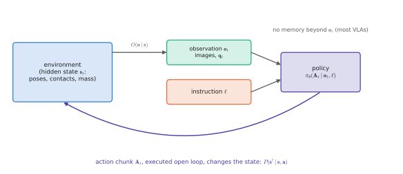

# 7.1 MDPs, POMDPs and Policies

Chapters 1–6 treated a model's output as a prediction. A robot's output is an **action**, and actions change what the robot sees next. This feedback loop is what separates control from classification, and it is why a policy with low training loss can still fail on the robot ([0.3](../00-foundations/training.md#generalisation-overfitting-and-regularisation)). This section fixes the vocabulary of sequential decision making that Chapter 7 and every later chapter use. It is close to the state-space language of control you already know.

## What is it?

!!! definition "Markov decision process (MDP)"
    An **MDP** is a tuple $(\mathcal{S},\mathcal{A},P,r,\rho_0,\gamma)$:

    - $\mathcal{S}$, $\mathcal{A}$: state and action spaces;
    - $P(\mathbf{s}_{t+1}\mid\mathbf{s}_t,\mathbf{a}_t)$: transition dynamics;
    - $r(\mathbf{s}_t,\mathbf{a}_t)$: reward;
    - $\rho_0$: initial-state distribution;
    - $\gamma\in[0,1)$: discount factor.

    A (stochastic) **policy** $\pi(\mathbf{a}\mid\mathbf{s})$ generates trajectories $\tau=(\mathbf{s}_0,\mathbf{a}_0,\mathbf{s}_1,\dots)$ with probability $\rho_0(\mathbf{s}_0)\prod_t\pi(\mathbf{a}_t\mid\mathbf{s}_t)P(\mathbf{s}_{t+1}\mid\mathbf{s}_t,\mathbf{a}_t)$. Its objective is the expected **return**

    $$
    J(\pi)=\mathbb{E}_{\tau\sim\pi}\Big[\sum_{t=0}^{T-1}\gamma^t\,r(\mathbf{s}_t,\mathbf{a}_t)\Big].
    $$

!!! definition "Partially observable MDP (POMDP)"
    A **POMDP** adds an observation space $\mathcal{O}$ and an observation model $O(\mathbf{o}_t\mid\mathbf{s}_t)$. The agent sees $\mathbf{o}_t$, not $\mathbf{s}_t$. An optimal policy in general depends on the whole **history** $h_t=(\mathbf{o}_0,\mathbf{a}_0,\dots,\mathbf{o}_t)$, or equivalently on the **belief** $b_t(\mathbf{s})=p(\mathbf{s}_t=\mathbf{s}\mid h_t)$.

| Symbol | Robot meaning (depot) |
|---|---|
| $\mathbf{s}_t$ | full state: robot pose and joint angles, every object's pose, the gripper's contact state |
| $\mathbf{o}_t$ | what the policy receives: camera images, proprioception $\mathbf{q}_t$, instruction $\ell$ ([notation](../../appendix/notation.md#learning-and-control)) |
| $\mathbf{a}_t$ | an action or an action chunk $\mathbf{A}_t$ |
| $P$ | physics: the arm's dynamics, contacts, the drone's aerodynamics |
| $r$ | task success, distance to goal, penalties for collisions or jerk — often *not available* |
| $T$, $\gamma$ | episode length; discount (control people may read $\gamma^t$ as a stage-cost weighting) |

## Why does it exist?

The MDP is the minimal model in which an agent's choices affect its future inputs. Every policy-learning method in this book is defined relative to it. **Imitation learning** ([7.2](behavior-cloning.md)–[7.4](dagger.md)) assumes no reward, only demonstrations of a good policy $\pi^\ast$. **Reinforcement learning** ([7.5](rl.md)) assumes a reward and no demonstrations. VLA training combines them ([7.6](rl-finetuning.md)). The POMDP is the honest model for robots: cameras do not reveal mass, friction, occluded objects or the plan a teleoperator had in mind.

## How does it work?

### Value functions and the Bellman equation

!!! definition "Value and action-value functions"
    $$
    V^\pi(\mathbf{s})=\mathbb{E}_\pi\Big[\sum_{k\ge0}\gamma^kr_{t+k}\ \Big|\ \mathbf{s}_t=\mathbf{s}\Big],\qquad
    Q^\pi(\mathbf{s},\mathbf{a})=\mathbb{E}_\pi\Big[\sum_{k\ge0}\gamma^kr_{t+k}\ \Big|\ \mathbf{s}_t=\mathbf{s},\mathbf{a}_t=\mathbf{a}\Big],
    $$

    and the **advantage** $A^\pi(\mathbf{s},\mathbf{a})=Q^\pi(\mathbf{s},\mathbf{a})-V^\pi(\mathbf{s})$: how much better action $\mathbf{a}$ is than the policy's average.

They satisfy the **Bellman equation**, a one-step consistency condition that every RL algorithm exploits:

$$
Q^\pi(\mathbf{s},\mathbf{a})=r(\mathbf{s},\mathbf{a})+\gamma\,\mathbb{E}_{\mathbf{s}'\sim P,\ \mathbf{a}'\sim\pi}\big[Q^\pi(\mathbf{s}',\mathbf{a}')\big].
$$

For a control engineer: with deterministic linear dynamics, quadratic cost ($r=-\mathbf{s}^\top Q\mathbf{s}-\mathbf{a}^\top R\mathbf{a}$) and no discount, $V$ is a quadratic form and the Bellman optimality equation becomes the discrete-time Riccati equation of LQR. RL is the same dynamic-programming idea without a model and with function approximation.

### Policies a VLA can represent

A VLA is a policy $\pi_\theta(\mathbf{A}_t\mid\mathbf{o}_t,\ell)$ over **action chunks** conditioned on the current observation and the instruction. Three simplifications are built into that signature:

1. **Markov in the observation.** Most VLAs see only $\mathbf{o}_t$ (one or two frames), not the history. That is a strong assumption in a POMDP, broken whenever something must be remembered: an object that left the field of view, how many boxes have already been moved, which part of the yard has been searched ([0.7](../00-foundations/sequence-models.md#why-it-matters-for-vlas-and-robots)).
2. **Open loop within a chunk.** The $H_a$ actions of a chunk are chosen from one observation. Within the chunk the policy is open loop, which is acceptable only if the dynamics are predictable over that horizon ([6.6](../06-generative/sampling-cost.md)).
3. **Instruction as goal.** The instruction $\ell$ plays the role of a goal or task index in a **goal-conditioned** MDP: one policy, many reward functions, selected by language.

<figure markdown="span">
  
  <figcaption markdown="span">The decision loop of a VLA as a POMDP. The environment's true state is hidden. The policy receives an observation — images, proprioception — and the instruction, and outputs a chunk of actions that are executed open loop before the next observation. Everything that is not in the current observation must be inferred, or remembered by something outside the model.</figcaption>
</figure>

### Horizon and credit assignment

Two quantities make a decision problem hard. The **effective horizon** $\approx1/(1-\gamma)$, or the episode length $T$, sets how far consequences reach. **Credit assignment** is the problem of telling which of many actions caused a late success or failure. For "bring the red toolbox to the inspection station", success arrives after hundreds of control steps. A sparse reward at the end says almost nothing about which grasp adjustment mattered. This is why imitation (which provides a target at *every* step) dominates VLA training, and why RL for VLAs relies on shaped rewards, value functions and short horizons.

## Implementation

A minimal environment interface, the one the labs use (compatible in spirit with Gymnasium):

```python
class Env:
    def reset(self, seed=None):            # -> observation o_0
        ...
    def step(self, action):                # -> (o_{t+1}, reward, done, info)
        ...

def rollout(env, policy, T, seed=0):
    o, ret, traj = env.reset(seed), 0.0, []
    for t in range(T):
        a = policy(o)                      # pi(a | o): may sample
        o_next, r, done, _ = env.step(a)
        traj.append((o, a, r))
        ret += r
        o = o_next
        if done:
            break
    return traj, ret
```

`vlacourse.depot_env.DepotNav` (Lab 11) follows this pattern with a success flag instead of a reward. Lab 10 builds a vectorised patrol task in PyTorch so that hundreds of rollouts run in parallel.

## Limitations

- **Rewards for real tasks are hard to write.** "Tidy the shelf" has no obvious reward. Imitation sidesteps this; RL must hand-engineer, learn or ask a VLM for rewards ([7.6](rl-finetuning.md)).
- **States are not observed.** Every robot policy is a POMDP policy; Markov VLAs ignore it.
- **Discounting is a modelling choice**, not a law: it trades long-term reward against variance and convenience.

## Why it matters for VLAs and robots

The MDP vocabulary lets you state precisely what a VLA is: a goal-conditioned, mostly Markov, chunked stochastic policy in a POMDP, trained mostly by imitation. Each of those adjectives hides a limitation that the rest of the book examines. For multi-robot systems the vocabulary extends to **decentralised POMDPs**. Each robot has its own observation and policy, and the team shares one reward ([Chapter 14](../14-multi-robot/index.md)).
