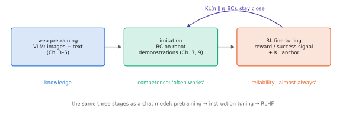

# 7.6 RL Fine-Tuning of Large Pretrained Policies

Language models showed the recipe. Pretrain by imitation of an enormous corpus, fine-tune by imitation of good examples, then improve with reinforcement learning against a reward, while staying close to the imitation policy. VLAs follow the first two steps. This section explains how the third works for robot policies, why it is harder than for chatbots, and which simple versions work reliably.

## What is it?

!!! definition "KL-regularised policy improvement"
    Given a pretrained reference policy $\pi_\text{ref}$ (the behaviour-cloned VLA) and a reward $r$, find

    $$
    \pi^\star=\arg\max_{\pi}\ \mathbb{E}_{\tau\sim\pi}\big[R(\tau)\big]-\beta\,\mathbb{E}_{\mathbf{s}\sim d_\pi}\Big[D_\text{KL}\big(\pi(\cdot\mid\mathbf{s})\,\Vert\,\pi_\text{ref}(\cdot\mid\mathbf{s})\big)\Big].
    $$

    In the single-step (bandit) case the solution has a closed form,

    $$
    \pi^\star(\mathbf{a}\mid\mathbf{s})\ \propto\ \pi_\text{ref}(\mathbf{a}\mid\mathbf{s})\,\exp\!\big(A(\mathbf{s},\mathbf{a})/\beta\big):
    $$

    reweight the pretrained policy toward better actions, more sharply as $\beta$ decreases.

| Symbol | Meaning |
|---|---|
| $\pi_\text{ref}$ | the frozen pretrained/BC policy: the anchor |
| $\beta$ | strength of the anchor: large keeps the fine-tuned policy close to the BC behaviour |
| $A(\mathbf{s},\mathbf{a})$ | advantage under the current policy (from returns, a critic or a success detector) |

## Why does it exist?

Three reasons for RL on top of BC, and three reasons for the KL anchor.

**Why RL:**

1. BC cannot exceed its demonstrators. RL can make a policy faster, more precise, or more reliable than the average demonstration.
2. RL learns from the policy's *own* failures, the states covariate shift creates ([7.3](covariate-shift.md)), without an expert to label them.
3. Success is cheaper to verify than to demonstrate: a camera check that the toolbox is on the station is easier than teleoperating the whole task.

**Why the anchor:**

1. The reward is always imperfect; without an anchor the policy exploits its holes (reward hacking).
2. The pretrained policy embodies knowledge and generality that a narrow reward does not; drifting far from it forgets them.
3. It keeps exploration in a region where the policy is competent and safe.

This is the structure of RLHF for language models (PPO with a KL penalty to the instruction-tuned model). DPO solves the same objective directly from preference pairs, using the closed form above.

## How does it work? Approaches for VLAs

The policy class determines which RL tools apply:

| VLA head | Likelihood $\log\pi_\theta(\mathbf{a}\mid\mathbf{o})$ | RL approach |
|---|---|---|
| action tokens (RT-2, OpenVLA) | exact: sum of token log-probs | PPO / policy gradient exactly as for LLMs |
| flow / diffusion (π0, GR00T, SmolVLA) | intractable in closed form | reward-filtered or advantage-weighted BC; RL in the *noise* or latent space that the sampler maps to actions; a small RL-trained residual on top |
| any | — | train a value function / success detector and use it to *select* among sampled actions (best-of-$N$) |

### The robust baseline: filtered and advantage-weighted BC

Run the current policy, keep the episodes (or segments) with high return, add them to the dataset, and fine-tune with the ordinary BC loss. Iterating this is **reward-filtered BC** — REINFORCE with binary advantages and no negative examples — and it is the RL method most often applied to large robot policies, because:

- it uses the *same* training code as pretraining, whatever the action head (tokens, flow, diffusion);
- it never needs $\log\pi_\theta$ explicitly;
- it naturally stays close to the reference (it only ever imitates the policy's own successes).

**Advantage-weighted regression** generalises it: weight each sample's BC loss by $\exp(\hat A/\beta)$, the closed-form solution above in sample form. Both can only reinforce behaviour the policy already produces sometimes. They improve reliability rather than discovering new strategies.

### Rewards for robot tasks

| Source | Pros | Cons |
|---|---|---|
| scripted success check (simulation state) | exact | only in simulation; sim-to-real gap |
| learned success detector / classifier on images | cheap at run time | needs labels; its errors become reward hacking targets |
| VLM-as-judge ("is the toolbox on the station?") | open-vocabulary, no task-specific training | hallucinates ([5.4](../05-vlms/spatial.md)); latency; must be verified |
| progress / value estimator | dense signal | must itself be trained |
| human labels or interventions | trustworthy | expensive; slow |

### Where to run it

**In simulation**: millions of cheap, safe, resettable episodes and exact rewards, at the cost of the sim-to-real gap ([Chapter 15](../15-research/index.md)). **On real robots**: true physics, but hundreds of episodes at best, so methods must be sample-efficient (filtered BC, off-policy SAC on small heads), with autonomous resets and a safety layer that bounds exploration ([Chapter 12](../12-embodied/index.md)).

<figure markdown="span">
  
  <figcaption markdown="span">The training pipeline of a VLA, mirroring that of a chat model. Web-scale pretraining gives knowledge. Imitation of demonstrations gives competence on the robot. RL against a reward gives reliability. The KL anchor to the imitation policy keeps the RL stage from forgetting or exploiting the reward.</figcaption>
</figure>

## Implementation: advantage-weighted BC

```python
import torch

def awr_step(policy_loss_per_sample, opt, batch, advantages, beta=1.0, w_max=20.0):
    """policy_loss_per_sample: callable returning the per-sample BC loss (B,) for any head
    (token cross-entropy, flow matching, MSE). advantages: (B,) estimates for the batch's actions."""
    w = torch.exp(advantages / beta).clamp(max=w_max)        # closed-form KL-regularised improvement
    loss = (w.detach() * policy_loss_per_sample(batch)).mean()
    opt.zero_grad(); loss.backward(); opt.step()
    return loss.item()

def filtered_bc_dataset(rollouts, threshold):
    """Keep only rollouts whose return exceeds the threshold; fine-tune on them with the plain BC loss."""
    return [r for r in rollouts if r["return"] >= threshold]
```

!!! lab "Lab 10, part 5"
    Residual RL on top of a frozen behaviour-cloned policy, with and without a KL anchor. Exercise 4 adds reward-filtered BC for comparison.

## Limitations

- **Exploration is limited to what the pretrained policy does.** Filtered BC and AWR only reweight existing behaviour.
- **Rewards are the bottleneck.** Every reward source has failure modes that RL will find.
- **Real-world sample cost** remains the main obstacle; most large-scale RL fine-tuning of VLAs happens in simulation or uses human interventions as the signal.
- **Likelihood-free heads** (flow, diffusion) make principled policy-gradient methods awkward; this is an active research area.

## Why it matters for VLAs and robots

Imitation gets a VLA to "often works". Deployment needs "almost always works", and RL fine-tuning is the main tool for closing that gap. For multi-robot systems there is an additional twist. A team's reward depends on *joint* behaviour, and credit must be assigned to individual robots — the multi-agent RL problem of [Chapter 14](../14-multi-robot/index.md).
