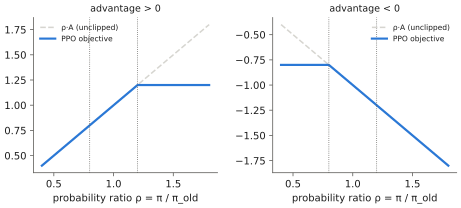

# 7.5 Reinforcement Learning: Policy Gradients, Actor-Critic, Offline RL

Imitation learns *how the expert did it*. **Reinforcement learning (RL)** learns *what works*, from a reward and trial and error. It can exceed its demonstrators and discover recoveries nobody demonstrated. It is also data-hungry and needs a reward. For VLAs, RL is mainly a *fine-tuning* tool on top of a policy pretrained by imitation ([7.6](rl-finetuning.md)). This section derives the pieces that fine-tuning uses: the policy gradient, baselines and advantages, actor-critic methods, PPO, and the offline setting.

## What is it?

!!! definition "Policy-gradient theorem (REINFORCE form)"
    For a differentiable stochastic policy $\pi_\theta(\mathbf{a}\mid\mathbf{s})$ and trajectories $\tau$ with return $R(\tau)=\sum_t\gamma^tr_t$,

    $$
    \nabla_\theta J(\theta)=\mathbb{E}_{\tau\sim\pi_\theta}\Big[\sum_{t=0}^{T-1}\nabla_\theta\log\pi_\theta(\mathbf{a}_t\mid\mathbf{s}_t)\ \hat A_t\Big],
    $$

    where $\hat A_t$ is any unbiased estimate of the advantage $A^{\pi_\theta}(\mathbf{s}_t,\mathbf{a}_t)$ — for example the reward-to-go $\sum_{k\ge t}\gamma^{k-t}r_k$ minus a baseline $b(\mathbf{s}_t)$.

| Symbol | Meaning |
|---|---|
| $\nabla_\theta\log\pi_\theta(\mathbf{a}_t\mid\mathbf{s}_t)$ | the **score function**: how to change $\theta$ to make the taken action more likely |
| $\hat A_t$ | how much better the taken action turned out than expected: the weight of that change |
| $b(\mathbf{s})$ | a **baseline** (usually a learned value $V_\phi(\mathbf{s})$); subtracting it reduces variance without bias |

## Why does it exist?

The return depends on $\theta$ through the *distribution* of trajectories, which also involves unknown dynamics $P$. The **log-derivative trick** removes the dynamics from the gradient:

$$
\nabla_\theta\,\mathbb{E}_{\tau\sim p_\theta}[R(\tau)]=\mathbb{E}_{\tau\sim p_\theta}\big[R(\tau)\,\nabla_\theta\log p_\theta(\tau)\big],\qquad
\log p_\theta(\tau)=\log\rho_0+\sum_t\big[\log\pi_\theta(\mathbf{a}_t\mid\mathbf{s}_t)+\log P(\mathbf{s}_{t+1}\mid\mathbf{s}_t,\mathbf{a}_t)\big].
$$

$P$ and $\rho_0$ do not depend on $\theta$, so their gradients vanish: only the policy's log-probabilities remain. The gradient can therefore be estimated from rollouts **without a model of the physics**. Causality (an action cannot affect earlier rewards) replaces $R(\tau)$ by the reward-to-go. Any baseline that depends only on the state can be subtracted, because $\mathbb{E}_{\mathbf{a}\sim\pi}[\nabla\log\pi(\mathbf{a}\mid\mathbf{s})]=\nabla\sum_\mathbf{a}\pi=0$.

Read the estimator as **weighted behavioural cloning**. It is the gradient of $\sum_t\hat A_t\log\pi_\theta(\mathbf{a}_t\mid\mathbf{s}_t)$: imitate your *own* actions, weighted by how good they turned out, and push away from bad ones. With $\hat A_t\equiv1$ on expert data it is exactly BC.

## How does it work?

### Actor-critic and advantage estimation

The variance of Monte-Carlo returns grows with the horizon. **Actor-critic** methods learn a critic $V_\phi(\mathbf{s})\approx V^\pi(\mathbf{s})$ by regression and use it to estimate advantages from short segments. The temporal-difference error

$$
\delta_t=r_t+\gamma V_\phi(\mathbf{s}_{t+1})-V_\phi(\mathbf{s}_t)
$$

is a one-step advantage estimate: low variance, biased if $V_\phi$ is wrong. **Generalised advantage estimation** (GAE; Schulman et al., 2016) interpolates between one-step and Monte-Carlo estimates with $\lambda\in[0,1]$:

$$
\hat A_t^{\text{GAE}(\gamma,\lambda)}=\sum_{k\ge0}(\gamma\lambda)^k\,\delta_{t+k}.
$$

### PPO: small, safe policy updates

A policy-gradient step is valid only near the policy that collected the data. Large steps can collapse performance, and on-policy data then has to be re-collected. **PPO** (Schulman et al., 2017) reuses each batch for several epochs while clipping the probability ratio $\rho_t(\theta)=\pi_\theta(\mathbf{a}_t\mid\mathbf{s}_t)/\pi_{\theta_\text{old}}(\mathbf{a}_t\mid\mathbf{s}_t)$:

$$
\mathcal{L}^\text{CLIP}(\theta)=\mathbb{E}_t\Big[\min\big(\rho_t\hat A_t,\ \operatorname{clip}(\rho_t,1-\varepsilon,1+\varepsilon)\,\hat A_t\big)\Big],\qquad\varepsilon\approx0.2 .
$$

Once an action's probability has moved more than $\varepsilon$ in the direction its advantage favours, the objective stops rewarding further movement. PPO with GAE and a value critic is the default on-policy algorithm for robot learning in simulation and for RLHF of language models.

<figure markdown="span">
  
  <figcaption markdown="span">The PPO objective for one action, as a function of the probability ratio between new and old policy. With a positive advantage (left), the gain stops growing once the ratio exceeds $1+\varepsilon$. With a negative advantage (right), it stops once the ratio falls below $1-\varepsilon$. Updates that would move the policy far from the data-collecting policy earn nothing.</figcaption>
</figure>

### Off-policy and offline RL

**Off-policy** methods (DQN, DDPG/TD3, SAC) learn a $Q$-function from a replay buffer of past transitions, so data is reused far more than in PPO. SAC adds an entropy bonus — the Boltzmann form of [0.4](../00-foundations/probability.md#softmax) — and is a standard choice for real-robot RL because of its sample efficiency.

**Offline RL** learns from a fixed dataset with rewards and *no* further interaction — the regime of large robot datasets. Its central difficulty is distribution shift again, in a new form. The learned $Q$-function is queried at actions the dataset never contains, its errors there are unconstrained, and policy improvement exploits exactly those errors. Offline methods therefore stay close to the data: they penalise $Q$-values of unseen actions (CQL), avoid querying them at all (IQL), or regularise the policy toward behavioural cloning (TD3+BC; advantage-weighted regression). The last family has the same structure as advantage-weighted BC above. It is the easiest to bolt onto a large pretrained policy.

| Family | Data | Strength | Weakness |
|---|---|---|---|
| on-policy (REINFORCE, PPO) | fresh rollouts each update | stable, simple | sample-hungry: needs simulation |
| off-policy (SAC, TD3) | replay buffer | sample-efficient | unstable with large networks, overestimation |
| offline (CQL, IQL, AWR) | fixed dataset | no interaction | conservative; limited improvement beyond the data |

## Implementation

REINFORCE with a learned baseline for a Gaussian policy, vectorised over $n$ parallel rollouts (Lab 10 uses this):

```python
import torch

def reinforce_update(policy, value, opt, env, n=256, T=100, gamma=0.99):
    s = env.reset(n)
    logps, rewards, states = [], [], []
    for t in range(T):
        mean, log_std = policy(s)
        dist = torch.distributions.Normal(mean, log_std.exp())
        a = dist.sample()
        logps.append(dist.log_prob(a).sum(-1))                  # log pi(a_t | s_t), (n,)
        states.append(s)
        s, r = env.step_with_reward(s, a)
        rewards.append(r)
    R, returns = torch.zeros(n), []
    for r in reversed(rewards):                                  # reward-to-go
        R = r + gamma * R
        returns.insert(0, R)
    returns, states, logps = torch.stack(returns), torch.stack(states), torch.stack(logps)   # (T, n, ...)
    adv = (returns - value(states).squeeze(-1)).detach()         # advantage with a learned baseline
    adv = (adv - adv.mean()) / (adv.std() + 1e-8)
    loss = -(logps * adv).mean() + ((value(states).squeeze(-1) - returns) ** 2).mean()
    opt.zero_grad(); loss.backward(); opt.step()
```

!!! lab "Lab 10, part 5"
    Fine-tune the behaviour-cloned patrol policy with REINFORCE on a residual: a 4-parameter correction gain improves it nearly to expert level, while a 4,000-parameter residual network gets worse at the same sample budget. That is sample complexity, measured.

## Limitations

- **Sample cost.** Thousands to millions of episodes for policies trained from scratch: realistic only in simulation.
- **Rewards.** Sparse rewards make exploration hopeless; dense rewards invite *reward hacking*, where the policy optimises the reward rather than the intent.
- **Safety during exploration.** Random actions on real hardware break things; RL on robots needs constrained action spaces, resets and supervision.
- **Variance and instability** grow with network size; RL on billion-parameter policies is an active research area.

## Why it matters for VLAs and robots

RL enters VLAs at the end of the pipeline. A VLA pretrained by imitation provides a policy that already succeeds sometimes, which solves exploration. RL then improves success rates, speed or robustness from a success signal. The tools of this section — advantage-weighted likelihood, PPO's trust region, staying close to the BC policy — are the ingredients of [7.6](rl-finetuning.md). The value function is also a useful object in itself: a **progress estimator** that can rank actions, detect failure and trigger recovery ([Chapter 15](../15-research/index.md)).
