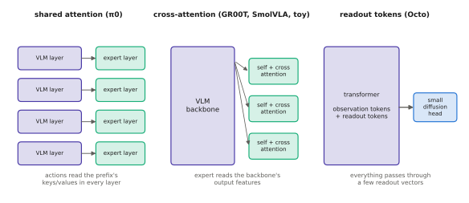

# 8.5 Diffusion and Flow-Matching Action Experts

The alternative to writing actions as tokens is to give the VLM a second network that speaks *continuous* actions natively: an **action expert** that denoises a whole action chunk ([6.4](../06-generative/diffusion.md)–[6.5](../06-generative/flow-matching.md)) while reading the backbone's understanding of the scene. π0, π0.5, GR00T N1 and SmolVLA are built this way. The interesting question is less "diffusion or flow" than **how the expert reads the backbone**. That choice decides the cost per denoising step, how much the action stream can influence perception, and how the pieces are trained.

## What is it?

!!! definition "Action expert"
    An **action expert** is a network $v_\psi$ that takes a noisy action chunk $\mathbf{A}^\tau\in\mathbb{R}^{H_a\times d_a}$, a flow (or diffusion) time $\tau$, and the backbone's representation of the observation, and outputs a velocity (or noise) estimate. It is trained with the flow-matching loss

    $$
    \mathcal{L}(\psi,\phi)=\mathbb{E}\Big[\big\lVert v_\psi\big(\mathbf{A}^\tau,\tau,\ \mathrm{KV}_\phi(\mathbf{o},\ell)\big)-(\mathbf{A}-\boldsymbol\epsilon)\big\rVert^2\Big],\qquad\mathbf{A}^\tau=(1-\tau)\boldsymbol\epsilon+\tau\mathbf{A},
    $$

    where $\mathrm{KV}_\phi$ denotes whatever the expert reads from the backbone: its final features, or its keys and values at every layer. At inference the backbone runs **once** per chunk and the expert $N$ times (π0: $N=10$).

The expert is typically much smaller than the backbone. π0 pairs a 3 B PaliGemma backbone with a ≈300 M action expert, and its action tokens get their own weights (narrower, width 1024 instead of 2048). π0's authors describe this as a mixture-of-experts-like design: one transformer, two sets of weights, routed by token type.

## Why does it exist?

Two costs of token heads motivated it ([8.4](action-tokens.md)): sequential decoding through the whole backbone, and discretisation. An expert with continuous outputs and parallel denoising of the whole chunk removes both. Its $N$ sequential steps run a *small* network over $H_a$ tokens, reusing the backbone's cached computation. The continuous flow models arbitrary multimodal chunk distributions without bins. That combination is what made 50 Hz control of dexterous tasks with a billion-parameter VLM practical ([6.6](../06-generative/sampling-cost.md)).

## How does it work? Three ways to read the backbone

<figure markdown="span">
  
  <figcaption markdown="span">Three ways to attach an action expert. **Shared attention** (π0): one sequence, two sets of weights, a block-wise mask, so action tokens attend to the backbone's keys and values in *every* layer. **Cross-attention** (GR00T N1, SmolVLA, the toy VLA): the expert's layers cross-attend to features produced by the backbone. **Readout** (Octo): learned readout tokens inside the transformer summarise the observation, and a small diffusion head conditions on them.</figcaption>
</figure>

### 1. Shared attention with a block-wise mask (π0)

The image, text, state and action tokens form one sequence and pass through the same number of layers. Image and text tokens use the VLM's weights, and state and action tokens use the expert's weights. In each layer the tokens attend to each other through a **block-causal mask**:

| query block ↓ / key block → | image + text | state | noisy actions |
|---|---|---|---|
| image + text | ✓ (bidirectional) | ✗ | ✗ |
| state | ✓ | ✓ | ✗ |
| noisy actions | ✓ | ✓ | ✓ (bidirectional) |

The prefix never attends to the actions, so its keys and values are independent of the noisy chunk. They are computed once and **cached**, and each of the $N$ denoising steps runs only the action tokens through the expert's weights, attending to the cached prefix ([2.6](../02-transformers/inference.md#the-kv-cache)). Coupling is deep: the expert reads the backbone's representation at every depth, not only its output.

### 2. Cross-attention to backbone features (GR00T N1, SmolVLA, toy VLA)

The backbone runs as usual. The expert is a separate transformer whose blocks alternate self-attention over the action tokens with [cross-attention](../02-transformers/multi-head.md#cross-attention) to the backbone's output tokens (GR00T N1 reads an intermediate layer of its VLM). Flow time enters through adaLN ([1.3](../01-multimodal-intro/combining.md#how-to-fuse-four-mechanisms)) or by adding a time embedding to the action tokens. The coupling is shallower, but the two networks are modular: they can have different widths and depths, run on different schedules, and be trained or frozen independently. SmolVLA additionally truncates its VLM, using only its first half of layers, because middle-layer features were sufficient and halve the backbone cost.

### 3. Readout tokens (Octo)

A transformer processes observation tokens plus a few learned **readout tokens**, which attend to the observation but are not attended to by it — a resampler inside the sequence ([4.3](../04-alignment/connectors.md#learned-query-resamplers)). A small diffusion head conditioned on the readouts produces the chunk. This is cheap and modular, but everything the head knows must pass through a few readout vectors.

### Dual-system timing

GR00T N1 makes the separation temporal. "System 2", the VLM, runs at a low rate; "System 1", the diffusion-transformer action head, runs at a much higher rate on the latest proprioception, reusing the most recent VLM features. The two loops mirror the planner–controller split of classical robotics ([Chapter 12](../12-embodied/index.md)): semantic understanding refreshed slowly, motor generation refreshed fast.

### Training the coupled system

Training the expert with the flow loss sends gradients into the backbone as well. That adapts the VLM's representation to control, but can also erode the language and vision knowledge that motivated using a VLM. Recipes therefore co-train on web data ([Chapter 9](../09-training/index.md)), use a lower learning rate for the backbone, or stop the expert's gradients from reaching the backbone. In the last case the backbone is trained on a separate objective, for example discrete FAST tokens, so that it still learns about actions.

## Implementation

The toy VLA's expert (cross-attention coupling, `vlacourse.vla.FlowExpert`) and its sampler:

```python
class FlowExpert(nn.Module):
    def __init__(self, d, d_action, horizon, n_layers=2, n_heads=4):
        super().__init__()
        self.inp = nn.Linear(d_action, d)
        self.pos = nn.Parameter(torch.randn(1, horizon, d) * 0.02)           # which step of the chunk
        self.time = nn.Sequential(nn.Linear(64, d), nn.SiLU(), nn.Linear(d, d))
        self.blocks = nn.ModuleList(CrossBlock(d, n_heads) for _ in range(n_layers))  # self-attn, cross-attn, FFN
        self.out = nn.Sequential(RMSNorm(d), nn.Linear(d, d_action))

    def forward(self, a_tau, tau, context, context_mask=None):             # a_tau: (B, H_a, d_a)
        x = self.inp(a_tau) + self.pos + self.time(time_features(tau, 64))[:, None, :]
        for blk in self.blocks:
            x = blk(x, context, context_mask)                               # read the backbone features
        return self.out(x)                                                  # velocity (B, H_a, d_a)

# inference: backbone once, expert N times
ctx, key = vla.encode(images, instr, state)                                 # (B, P, d)
A = torch.randn(B, H_a, d_a)
for i in range(N):
    A = A + vla.expert(A, torch.full((B,), i / N), ctx, key[:, None, None, :]) / N
```

!!! lab "Lab 11, §6 and §8"
    Train the flow head; compare its closed-loop success with the token and MSE heads, on ambiguous and specific instructions; measure the cost split between backbone and expert. Exercise 5 sweeps the number of Euler steps.

## Limitations

- **No exact likelihood** for RL fine-tuning or uncertainty estimates ([7.6](../07-decision-making/rl-finetuning.md)).
- **Stochastic samples**: consecutive chunks can come from different modes; execution schemes must handle switching ([8.6](chunking.md)).
- **Two networks to tune**, with an interface (shared attention vs cross-attention, which layer) whose best choice is still empirical.
- **Knowledge erosion** of the backbone if gradients flow freely without co-training.
- **Hedging under weak conditioning**: a head that can represent several modes can fit the data with a mixture over all plausible targets instead of using the instruction. In Lab 11 the flow and token heads trail regression on specific instructions even after three times the training steps; strong language conditioning (more data, classifier-free guidance) is needed to turn flexibility into the right commitment.

## Why it matters for VLAs and robots

The action expert is the current default for high-rate, dexterous control with VLMs. Its cost structure — big model once, small model $N$ times — is what makes a chunked 50 Hz policy possible on one GPU. It is also the structure you will modify when building VLAs for new robots. Change the expert's action space, for example a drone's velocity setpoints. Change its rate, a fast System 1 on the companion computer. Or let it read messages from other robots alongside the backbone ([Chapter 14](../14-multi-robot/index.md)).
