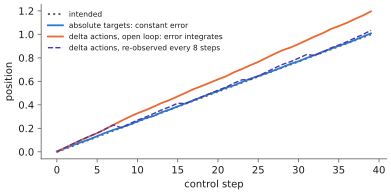

# 8.3 Action Spaces and Representations

"Predict the action" hides a decision that shapes everything downstream: *which* quantity is the action, in which frame, at what rate, normalised how? The same demonstration can be labelled as joint positions, joint velocities, end-effector poses or end-effector deltas, and each choice changes what the policy must learn, how errors propagate, what the low-level controller does, and whether data from different robots can be pooled.

## What is it?

!!! definition "Action space of a VLA"
    The **action space** is the set $\mathcal{A}\subseteq\mathbb{R}^{d_a}$ of commands the policy outputs at each control step, together with their **interpretation**: which controller consumes them, in which reference frame, and at which rate. A chunk $\mathbf{A}_t\in\mathbb{R}^{H_a\times d_a}$ is $H_a$ consecutive commands at the control period $\Delta t$.

| Representation | Example (arm) | Example (drone) | Consumed by |
|---|---|---|---|
| absolute joint positions | 7 joint targets | — | joint position/impedance controller |
| joint deltas / velocities | $\Delta\mathbf{q}$ or $\dot{\mathbf{q}}$ | — | joint controller |
| absolute end-effector pose | $(\mathbf{p},\mathbf{R})$ in the base frame + gripper | position setpoint $(x,y,z,\psi)$ | IK + joint controller / PX4 position controller |
| end-effector **delta** | $(\Delta\mathbf{p},\Delta\mathbf{r})$ + gripper: $d_a=7$ | velocity setpoint $(v_x,v_y,v_z,\dot\psi)$: $d_a=4$ | operational-space controller / PX4 velocity controller |
| waypoints / keyposes | the next gripper pose of interest | the next waypoint | motion planner |

## Why does it matter?

**Absolute** targets carry no drift: the error of each step does not accumulate. But they tie the policy to one workspace, one robot geometry and one calibration. **Delta** actions generalise across positions (the same "move 2 cm toward the handle" applies anywhere) and are the most common choice for cross-robot datasets. They integrate errors, however: a small bias in every delta becomes a large position error after many steps. **Joint** spaces are robot-specific, so a 7-DoF Franka and a 6-DoF UR5 do not share them. **End-effector** spaces are closer to a shared task space but need inverse kinematics and handle redundancy and singularities outside the policy.

The **rate** matters as much as the quantity. Demonstrations recorded at 50 Hz and replayed at 10 Hz are a different dynamical system. A chunk of 50 actions means 1 s at 50 Hz but 5 s at 10 Hz.

<figure markdown="span">
  
  <figcaption markdown="span">Absolute versus delta actions with the same small per-step bias. Absolute targets (blue) keep a constant error. Delta commands (orange) integrate it, so the error grows with every step until feedback from new observations corrects it. Chunked delta actions run open loop for $H_e$ steps, so the drift between corrections grows with the chunk.</figcaption>
</figure>

## How does it work?

### Normalisation

Action dimensions have different units and ranges: centimetres, radians, a binary gripper. Before training, each dimension is normalised with dataset statistics, typically to $[-1,1]$ using the **1st and 99th percentiles** (OpenVLA), so that outliers do not stretch the range. Mean–standard-deviation normalisation is the alternative (π0). The statistics become part of the model: un-normalising with the wrong statistics, for example from a different dataset mixture, produces actions that are wrong by a constant scale. With discretised heads, normalisation also sets the bin grid ([6.2](../06-generative/mdn-ar.md)).

### The gripper

The gripper is usually one dimension, continuous (opening width) or binary (open/close). Binary gripper commands are naturally a two-class categorical; regression heads predict a value and threshold it. A gripper that "hesitates" (chatters between open and close near the decision boundary) is a classic failure of continuous heads. Committing through chunking or hysteresis fixes it.

### Rotations

End-effector rotations need a representation: Euler angle deltas (simple, singular at gimbal lock, fine for small deltas), axis-angle deltas, quaternions (unit-norm constraint) or the 6-D continuous representation (two columns of the rotation matrix, orthonormalised). For small per-step deltas Euler or axis-angle is the common choice; for absolute orientations, 6-D or quaternions avoid discontinuities that a network cannot regress.

### Cross-embodiment action spaces

Training one VLA on many robots requires a common action space. Strategies:

- **Pad to a maximum dimension** and mask unused dimensions in the loss (π0: actions padded to the largest robot's dimension).
- **Shared end-effector convention** (Open X-Embodiment datasets converted to 7-D end-effector deltas + gripper where possible).
- **Per-embodiment heads or tokens**: an embodiment token selects the action decoder (Octo's readouts plus robot-specific heads; GR00T's embodiment-specific projections).

For a multi-robot team — an arm, a rover, drones — this is a first-order design decision ([Chapter 14](../14-multi-robot/index.md)). One shared backbone with embodiment-specific action decoders is the common answer.

### Actions for UAVs

A drone's VLA should almost never output motor thrusts or attitude rates. Its inner loops run at hundreds of hertz, have unstable open-loop dynamics, and are safety-critical. The natural action spaces are **velocity setpoints** (body or local frame) or **position/waypoint setpoints** consumed by PX4's controllers, which enforce limits and failsafes ([Chapter 13](../13-uavs/index.md)). The toy VLA of Lab 11 uses exactly this: a 2-D velocity setpoint in the unit disc, integrated by a kinematic "controller".

## Implementation

```python
import numpy as np

class ActionNormalizer:
    """Per-dimension quantile normalisation to [-1, 1] (OpenVLA-style). Store with the model weights."""

    def __init__(self, actions, q_low=0.01, q_high=0.99):          # actions: (N, d_a) from the dataset
        self.low = np.quantile(actions, q_low, axis=0)
        self.high = np.quantile(actions, q_high, axis=0)

    def normalize(self, a):
        return np.clip(2 * (a - self.low) / (self.high - self.low + 1e-8) - 1, -1, 1)

    def unnormalize(self, a):
        return self.low + (a + 1) / 2 * (self.high - self.low)


def to_delta(ee_positions):
    """Absolute end-effector positions (T, 3) -> per-step deltas (T-1, 3); integrate with cumsum."""
    return np.diff(ee_positions, axis=0)
```

!!! lab "Lab 11, exercise 3"
    Retrain the toy VLA with absolute *goal-position* actions instead of velocities and compare success and behaviour.

## Limitations

- **No action space is neutral.** Each encodes assumptions about the controller underneath and the geometry of the task.
- **Normalisation statistics are part of the model**, yet often stored separately; mismatches are silent.
- **Embodiment differences** are not just dimension counts: dynamics, limits, latencies and rates differ too.

## Why it matters for VLAs and robots

The action space is the contract between the learned policy and the classical control stack under it. Choose it so that the controller underneath is stable and enforces limits. Then the VLA's errors become small target errors, not instabilities ([7.3](../07-decision-making/covariate-shift.md#how-does-it-work-mitigations)). Choose it so that data from different robots can be pooled. And choose it so that a safety layer can check every command before it reaches an actuator ([Chapter 12](../12-embodied/index.md)).
