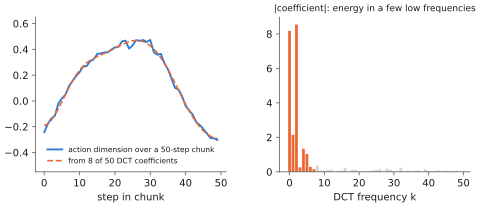

# 8.4 Autoregressive Action Tokens: Binning, FAST and Parallel Decoding

The first VLAs did not add an action head at all. They taught a vision-language model to *write* actions as tokens, with the coordinates-as-tokens trick of [4.4](../04-alignment/grounding.md#3-coordinates-as-tokens) applied to motor commands. This section builds that design precisely, with how the vocabulary is extended, how training and decoding work, and what it costs. Then come the two refinements that keep tokens competitive: compressing chunks with **FAST**, and decoding all action tokens **in parallel**.

## What is it?

!!! definition "Token-based VLA (RT-2 / OpenVLA recipe)"
    1. **Discretise** each normalised action dimension into $K=256$ uniform bins ([6.2](../06-generative/mdn-ar.md)).
    2. **Map bins to vocabulary entries.** Reserve 256 token ids for the bins. RT-2 used tokens that already denote integers (PaLI-X) or overwrote rarely used tokens (PaLM-E); OpenVLA overwrites the 256 *least frequently used* tokens of the Llama 2 tokenizer.
    3. **Train** the VLM by next-token prediction on sequences `[image][prompt][a_1 … a_{d_a}][eos]`, with the [loss mask](../02-transformers/training.md#loss-masking-what-the-model-is-trained-to-say) on the action tokens only.
    4. **Decode** $d_a$ tokens autoregressively (greedy, [1.1](../01-multimodal-intro/language.md#decoding)), map them back to bin centres, un-normalise.

For OpenVLA, $d_a=7$: three position deltas, three rotation deltas, one gripper value. One action is seven tokens, and the policy runs one action per step.

## Why does it exist?

Nothing in the VLM needs to change. The model, the loss, the optimiser, the inference engine, the KV cache, quantisation, LoRA fine-tuning — all the language-model machinery of Chapter 2 and Chapter 9 applies verbatim. Co-training with web data is trivial because robot data is just more text. The categorical output represents multimodal action distributions exactly ([6.2](../06-generative/mdn-ar.md)). RT-2 showed that this simple recipe transfers semantic knowledge to control; OpenVLA showed that an open 7 B model trained this way on 970 k trajectories outperformed the 55 B RT-2-X on its evaluations.

## How does it work?

### Training sequence and loss

```
[image tokens ×256] In: What action should the robot take to pick up the red toolbox? Out: ▁ 137 090 201 128 128 117 255 </s>
                                                                                          └──── 7 action tokens ────┘
```

Each of the seven positions is a 256-way classification; their cross-entropies (plus end-of-sequence) are the loss. Because decoding is autoregressive, the rotation token can depend on the chosen position tokens, which keeps the action coherent within a mode ([6.2](../06-generative/mdn-ar.md#discretisation-the-action-token-recipe)).

### The cost: one backbone pass per token

Every action token is a full [decode pass](../02-transformers/inference.md#prefill-and-decode) of the backbone. For a 7 B model in bf16 on a 1 TB/s GPU, each pass needs at least ~14 ms (reading the weights). Seven tokens plus the prefill give OpenVLA's reported ≈6 Hz on a desktop GPU, for *single* actions. A one-second chunk at 50 Hz of 7-D actions would be 350 tokens, about 5 s of decoding. Token-based VLAs with naive binning therefore predict one action per call and run at a few hertz.

### FAST: compress the chunk before tokenising

Robot trajectories are smooth, and smooth signals have most of their energy in low frequencies. **FAST** (*Frequency-space Action Sequence Tokenization*; Pertsch et al., 2025) exploits that:

1. normalise the chunk $\mathbf{A}\in\mathbb{R}^{H_a\times d_a}$;
2. apply the **discrete cosine transform** along time to each dimension: $C_{k,i}=\sum_{h}A_{h,i}\cos\big(\tfrac{\pi}{H_a}(h+\tfrac12)k\big)$;
3. scale and **round** the coefficients to integers (most high-frequency ones become 0);
4. flatten low frequencies first, interleaving dimensions;
5. compress the integer sequence with **BPE** ([0.5](../00-foundations/tokens.md#how-does-it-work-byte-pair-encoding)), learned on a large corpus of action chunks.

Runs of zeros and common coefficient patterns merge into single tokens, so a one-second chunk becomes a few dozen tokens instead of hundreds, and decoding inverts the steps. π0-FAST, which generates FAST tokens autoregressively with the π0 backbone, matched π0's flow head on many tasks and trained faster, while decoding more slowly than flow matching.

<figure markdown="span">
  
  <figcaption markdown="span">Why FAST works, computed on a smooth 50-step trajectory of one action dimension. Left: the trajectory, and its reconstruction from only the first 8 DCT coefficients. Right: the magnitudes of all 50 coefficients. Nearly all the energy is in a handful of low frequencies, so quantised high-frequency coefficients are zero and BPE compresses the sequence to a few tokens.</figcaption>
</figure>

### Parallel decoding

Autoregression across action dimensions buys coherence within a mode. If the demonstrations are close to unimodal, it costs latency for little benefit. **OpenVLA-OFT** (Kim et al., 2025) replaces it: the backbone receives $H_ad_a$ empty action *slots* and predicts all of them in one bidirectional forward pass, with a continuous L1-regression head instead of token classification. The combination of action chunking, parallel decoding and continuous outputs sped up inference by more than an order of magnitude and improved success on simulation benchmarks. Note the trade-off ([6.1](../06-generative/multimodality.md)). An L1 head predicts a per-dimension median, which is coherent only when the demonstrations are effectively unimodal.

| Variant | Tokens per chunk | Backbone passes per chunk | Multimodal |
|---|---|---|---|
| binning, one action per call (RT-2, OpenVLA) | $d_a$ | $d_a$ (+ prefill) | yes |
| binning, full chunk | $H_ad_a$ | $H_ad_a$ | yes |
| FAST | tens | tens | yes |
| parallel decoding + regression (OFT) | — | 1 | no (median) |

## Implementation

The toy VLA's token head lets the backbone itself decode, under a **prefix-LM mask**: the observation attends to itself bidirectionally, action token $i$ attends to the observation and to action tokens $\le i$, and the observation never attends to actions.

```python
def _token_logits(self, images, instr, state, ids):           # ids: (B, n), start token first
    x, key = self._prefix(images, instr, state)                # (B, P, d) observation tokens
    a = self.action_emb(ids) + self.segment.weight[3]          # (B, n, d) action tokens
    P, n = x.shape[1], ids.shape[1]
    m = torch.zeros(len(x), P + n, P + n, dtype=torch.bool)
    m[:, :, :P] = key[:, None, :]                              # everyone reads the real observation tokens
    m[:, P:, P:] = torch.ones(n, n).tril().bool()              # actions are causal among themselves
    m[:, :P, P:] = False                                       # the observation never reads actions
    h = self._run(torch.cat([x, a], 1), m[:, None])           # ONE backbone pass over everything
    return self.bin_head(h[:, P:])                             # (B, n, n_bins)

@torch.no_grad()
def act_tokens(self, images, instr, state):
    ids = torch.full((B, 1), self.n_bins)                      # start token
    for _ in range(self.horizon * self.d_action):              # one backbone pass per action token
        nxt = self._token_logits(images, instr, state, ids)[:, -1].argmax(-1, keepdim=True)
        ids = torch.cat([ids, nxt], 1)
    return self.binner.decode(ids[:, 1:].view(B, self.horizon, self.d_action))
```

A unit test checks the mask: changing the last action token never changes the logits of earlier ones.

!!! lab "Lab 11, §6 and §8"
    Train the toy VLA with the token head, evaluate it in closed loop, and measure its time per chunk against the flow head: 16 backbone passes against one backbone pass plus 10 expert passes.

## Limitations

- **Latency** scales with tokens per chunk; FAST reduces but does not remove it.
- **Quantisation** of each dimension, and a loss blind to the distance between bins.
- **Vocabulary surgery** (overwriting tokens) slightly damages the language model's original abilities.
- **Parallel regression** gives up multimodality to get speed.

## Why it matters for VLAs and robots

The token-based design is the most direct way to turn a VLM into a policy, and the easiest to fine-tune, quantise, serve and RL-train with language-model tooling. Its cost per action makes it a poor fit for fast or long-chunk control unless the chunk is compressed (FAST) or decoded in parallel (OFT). Those two refinements are worth understanding precisely: they are the main knobs between expressiveness and speed in the token family, and they show up in every latency budget of [Chapter 11](../11-deployment/index.md).
